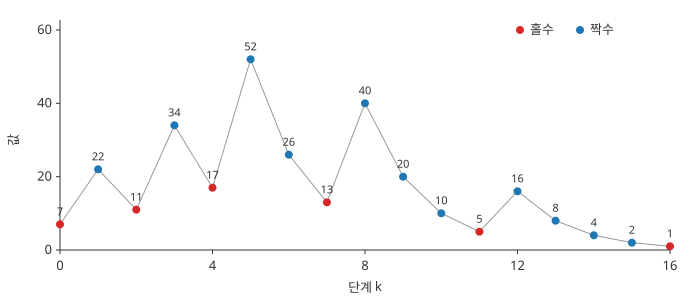

# Collatz 추측

# 개요

**Collatz 추측(Collatz conjecture, 3x+1 문제)** 은 양의 정수에 "짝수면 $2$ 로 나누고, 홀수면 $3$ 배하고 $1$ 을 더한다" 를 되풀이하면 어느 수에서 시작해도 언젠가 $1$ 에 닿는다는 추측이다. $6$ 에서 시작하면 $6, 3, 10, 5, 16, 8, 4, 2, 1$ 로 여덟 번 만에 닿는다. $27$ 에서 시작하면 $111$ 번 만에 닿고, 그사이 값이 $9232$ 까지 오른다.

시작 수마다 끝까지 따라가는 방법으로는 모든 수를 확인할 수 없다. 처음 몇 단계의 짝홀이 시작 수를 $2$ 의 거듭제곱으로 나눈 나머지로 정해진다는 사실을 쓰면, 나머지 하나에 속하는 무한히 많은 수를 한꺼번에 다룰 수 있다.

# 직관

$7$ 에서 시작하면 다음 열여섯 단계를 거쳐 $1$ 에 닿는다. 빨간 점이 홀수, 파란 점이 짝수다.

$$
7,\ 22,\ 11,\ 34,\ 17,\ 52,\ 26,\ 13,\ 40,\ 20,\ 10,\ 5,\ 16,\ 8,\ 4,\ 2,\ 1
$$

그림에서 홀수 다음에는 값이 세 배 가까이 오르고, 짝수 다음에는 절반으로 내려간다. 오르내림이 섞여 있어 몇 단계 뒤의 값을 미리 알 수 없다.

모든 수를 하나씩 따라갈 수는 없으니 [수학적 귀납법](mathematical-induction.md)을 쓴다. $n$ 보다 작은 수가 전부 $1$ 에 닿는다고 가정하면, $n$ 에서 출발한 값이 한 번이라도 $n$ 보다 작아지면 그 뒤로 $1$ 에 닿는다. 그러므로 각 $n\ge 2$ 가 언젠가 $n$ 보다 작아지는지만 보면 된다.

짝수 $n$ 은 한 단계 만에 $n/2$ 로 작아진다. $n=4m+1$ 이면 $12m+4$, $6m+2$, $3m+1$ 로 가서 세 단계 만에 $n$ 보다 작아진다. $n=4m+3$ 이면 $12m+10$, $6m+5$ 를 거쳐 $18m+16$, $9m+8$ 로 가고, $9m+8$ 의 짝홀은 $m$ 에 달려 있다. $m$ 을 다시 짝홀로 나누어 $n$ 을 $16$ 으로 나눈 나머지까지 보면 $n\equiv 3$ 은 $9m+2$ 꼴로 작아지고, 나머지 $7, 11, 15$ 만 남는다.

$16$ 개의 나머지 가운데 $3$ 개가 남았다. 법을 $2^{12}=4096$ 까지 올리면 남는 나머지는 $226$ 개로 전체의 6% 가 안 된다. 법을 키울수록 남는 비율이 $0$ 으로 간다는 것이 성질 절의 Terras 정리다. 남는 비율이 $0$ 으로 가도 남는 수가 없다는 뜻은 아니어서, 이 방법만으로는 추측이 증명되지 않는다.

# 정의

**Collatz 함수(Collatz function)** $C$ 는 양의 정수에서 양의 정수로 가는 다음 함수다.

$$
C(n)=\begin{cases} n/2 & n\equiv 0 \pmod 2 \cr 3n+1 & n\equiv 1 \pmod 2 \end{cases}
$$

$n$ 의 **궤도(orbit)** 는 수열 $n, C(n), C(C(n)), \dots$ 이다. 직관 절의 $7$ 의 궤도는 $7, 22, 11, \dots$ 이다.

**Collatz 추측** 은 모든 양의 정수 $n$ 에 대해 $C^k(n)=1$ 인 $k$ 가 존재한다는 진술이다. 그런 $k$ 가운데 가장 작은 것을 $n$ 의 **전체 정지 시간(total stopping time)** 이라 한다. $7$ 은 $16$, $27$ 은 $111$ 이다.

이 추측은 증명되지 않았다.[^4] 컴퓨터 계산으로 $2^{68}$ 까지의 모든 시작 수가 $1$ 에 닿는 것이 확인되었다.[^5]

홀수 $n$ 에서 $3n+1$ 은 항상 짝수이므로 다음 단계에서 반드시 $2$ 로 나눈다. 두 단계를 묶은 함수가 다음의 $T$ 이고, 이하 성질 절은 $T$ 로 쓴다.

$$
T(n)=\begin{cases} n/2 & n\equiv 0 \pmod 2 \cr (3n+1)/2 & n\equiv 1 \pmod 2 \end{cases}
$$

$7$ 의 $T$ 궤도는 $7, 11, 17, 26, 13, 20, 10, 5, 8, 4, 2, 1$ 이다.

$n\ge 2$ 에 대해 $T^k(n)\lt n$ 인 가장 작은 $k$ 를 $n$ 의 **정지 시간(stopping time)** $\sigma(n)$ 이라 한다. 그런 $k$ 가 없으면 $\sigma(n)=\infty$ 다. 짝수는 $\sigma(n)=1$ 이고, $n=4m+1$ 은 $T$ 로 $6m+2$, $3m+1$ 이 되므로 $\sigma(n)=2$ 다.

$n$ 의 **홀짝 벡터(parity vector)** 는 $T^i(n)$ 이 홀수인지를 $i=0,1,\dots,k-1$ 에 대해 적은 $0$ 과 $1$ 의 열 $(x\_0,\dots,x\_{k-1})$ 이다. $7$ 의 길이 $4$ 홀짝 벡터는 $7, 11, 17, 26$ 에서 $(1,1,1,0)$ 이다.

# 성질

## 정지 시간으로의 환원

Collatz 추측은 모든 $n\ge 2$ 의 정지 시간이 유한하다는 진술과 동치다.

증명의 요지. 추측이 참이면 $n\ge 2$ 의 궤도가 $1$ 에 닿으므로 $n$ 보다 작아진다. 거꾸로 모든 정지 시간이 유한하면 $n$ 에 대한 강한 귀납법(strong induction)으로, $T^{\sigma(n)}(n)\lt n$ 이 $1$ 에 닿으므로 $n$ 도 닿는다.

## 홀짝 벡터와 2 의 거듭제곱 법

$n$ 을 $2^k$ 로 나눈 나머지가 $n$ 의 길이 $k$ 홀짝 벡터를 정하고, 그 대응은 $\mathbb Z/2^k\mathbb Z$ 에서 $\lbrace 0,1\rbrace^k$ 로 가는 전단사다.[^1]

증명의 요지. $k$ 에 대한 귀납법이다. 길이 $k$ 홀짝 벡터에 $1$ 이 $j$ 개 있으면 다음이 성립한다.

$$
T^k(n+2^k m)=T^k(n)+3^j m
$$

$3^j m$ 의 짝홀은 $m$ 의 짝홀과 같으므로, $n$ 과 $n+2^k$ 는 처음 $k$ 개의 짝홀이 같고 $k+1$ 번째 짝홀이 서로 다르다. 그러므로 법 $2^{k+1}$ 의 나머지 두 개가 길이 $k+1$ 벡터 두 개로 나뉘어 간다.

직관 절의 계산이 이 정리의 예다. $n=16m+3$ 의 홀짝 벡터는 $(1,1,0,0)$ 이고 $j=2$ 이므로 $T^4(n)=9m+2$ 다. $9\lt 16$ 이라 $n$ 보다 작다.

## Terras 정리

정지 시간이 유한한 양의 정수의 집합은 자연 밀도(natural density)가 $1$ 이다.[^1] $N$ 이하의 정수 가운데 그런 수의 비율이 $N\to\infty$ 일 때 $1$ 로 간다는 뜻이다.

증명의 요지. 길이 $k$ 홀짝 벡터에 $1$ 이 $j$ 개 있으면 $T^k(n)$ 은 대략 $(3^j/2^k)n$ 이다. $3^j\lt 2^k$, 곧 다음 부등식이 성립하면 그 나머지에 속하는 큰 $n$ 은 $k$ 단계 안에 작아진다.

$$
\frac{j}{k}\lt \frac{1}{\log\_2 3}\approx 0.631
$$

앞 정리에 따라 법 $2^k$ 의 나머지들은 $\lbrace 0,1\rbrace^k$ 의 벡터와 하나씩 대응한다. $1$ 의 비율이 $0.631$ 이상인 벡터의 비율은 [큰 수의 법칙](law-of-large-numbers.md)으로 $k\to\infty$ 일 때 $0$ 으로 간다.

## Tao 정리

$f(N)\to\infty$ 인 어떤 함수 $f$ 를 잡아도, 로그 밀도(logarithmic density)로 거의 모든 $N$ 의 궤도가 $f(N)$ 보다 작은 값을 지난다.[^2] $f(N)=\log\log\log N$ 처럼 아주 느리게 자라는 $f$ 에도 성립한다.

Terras 정리는 궤도가 시작 수 $N$ 보다 작아진다는 것만 주지만, 이 정리는 궤도가 $N$ 과 무관하게 거의 유계인 값까지 내려간다는 것을 준다. 모든 $N$ 에 대한 진술은 아니어서 추측을 함의하지 않는다.

## 순환 방정식

$T^L(n)=n$ 이고 길이 $L$ 홀짝 벡터에 $1$ 이 $j$ 개 있으면, 앞의 계산을 펼쳐 다음을 얻는다. 여기서 $c$ 는 홀짝 벡터만으로 정해지는 양의 정수다.

$$
n=\frac{c}{2^L-3^j}
$$

$n\gt 0$ 이므로 $2^L\gt 3^j$ 다. $1, 2$ 의 순환은 $L=2$, $j=1$, $c=1$ 이다. 다른 순환이 있으려면 $2^L-3^j$ 이 $c$ 를 나누어야 하는데, $3^j/2^L$ 이 $1$ 에 가까울수록 $n$ 이 커진다. 계산으로 확인한 범위 안의 수가 모두 $1$ 에 닿으므로, 다른 순환은 그 범위보다 큰 수로만 이루어져야 한다.

## 음의 정수와 다른 계수

같은 규칙을 음의 정수에 쓰면 $1, 2$ 말고도 순환이 있다. $-5$ 에서 시작하면 $C$ 로 $-14, -7, -20, -10, -5$ 로 돌아온다. 짝홀만 보는 앞의 논증은 음의 정수에도 똑같이 적용되므로, 그 논증만으로는 다른 순환이 없음을 보일 수 없다.

$3n+1$ 대신 $5n+1$ 을 쓰면 $13$ 이 $66, 33, 166, 83, 416, 208, 104, 52, 26, 13$ 으로 돌아온다. 홀수 단계가 절반이라고 놓으면 두 단계마다 값이 평균 $5/4$ 배가 되어, $3n+1$ 의 $3/4$ 배와 달리 커지는 쪽이다.

## 일반화된 Collatz 함수

법 $d$ 의 나머지 $r$ 마다 다른 일차식 $a\_r n+b\_r$ 을 쓰는 함수를 일반화된 Collatz 함수(generalized Collatz function)라 한다. 이런 함수와 시작 수가 주어졌을 때 그 궤도가 $1$ 에 닿는지를 판정하는 알고리즘은 존재하지 않는다.[^3] 증명은 Turing 기계(Turing machine)의 계산을 그런 함수의 궤도로 나타내어 [정지 문제](halting-problem.md)로 환원한다.

# 활용

- $T$ 는 [p 진수](p-adic-numbers.md) $\mathbb Z_2$ 위의 연속함수로 늘어난다. 홀짝 벡터를 무한히 늘인 사상은 $\mathbb Z_2$ 에서 $\lbrace 0,1\rbrace^{\mathbb N}$ 으로 가는 위상동형(homeomorphism)이고, $T$ 를 벡터의 첫 자리를 지우는 이동 사상(shift map)으로 옮긴다.[^6] 그래서 $\mathbb Z_2$ 위의 $T$ 는 [Haar 측도](haar-measure.md)를 보존하고 강하게 섞는다(strongly mixing).
- Conway 는 일반화된 Collatz 함수를 분수의 목록으로 적는 계산 모형 FRACTRAN 을 만들었다.[^7] 분수 목록 하나가 프로그램 하나이고, 정수 하나에 목록의 분수를 차례로 곱해 보는 것이 실행이다.

[^1]: R. Terras, "A stopping time problem on the positive integers", *Acta Arithmetica* 30 (1976), 241–252.
[^2]: T. Tao, "Almost all orbits of the Collatz map attain almost bounded values", *Forum of Mathematics, Pi* 10 (2022), e12.
[^3]: J. H. Conway, "Unpredictable iterations", *Proceedings of the 1972 Number Theory Conference*, University of Colorado, Boulder, 1972, 49–52.
[^4]: J. C. Lagarias (ed.), *The Ultimate Challenge: The 3x+1 Problem*, American Mathematical Society, 2010, 서문.
[^5]: D. Barina, "Convergence verification of the Collatz problem", *The Journal of Supercomputing* 77 (2021), 2681–2688.
[^6]: J. C. Lagarias, "The 3x+1 problem and its generalizations", *American Mathematical Monthly* 92 (1985), 3–23.
[^7]: J. H. Conway, "FRACTRAN: a simple universal programming language for arithmetic", in T. M. Cover, B. Gopinath (eds.), *Open Problems in Communication and Computation*, Springer, 1987, 4–26.

# 연관 문서

## 선수지식

- [정수의 합동](modular-arithmetic.md)
- [수학적 귀납법](mathematical-induction.md)

## 더 알아보기

아직 연결한 문서가 없다.

#number_theory #computation #probability
