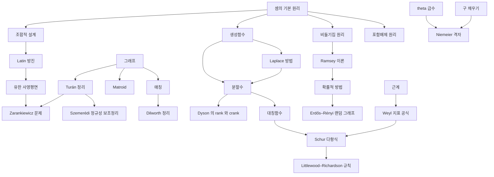

# 조합론 개관

# 개요

조합론(combinatorics)은 유한한 대상을 세고, 배열하고, 극단적인 구성이 존재하는지 묻는 분야다. 기본 물음은 "몇 개인가" 이지만 답하는 방식이 갈래를 만든다. 직접 세는 대신 생성함수의 계수로 세고, 구성을 보이는 대신 확률로 존재를 보이고, 개별 대상 대신 대칭군의 표현으로 센다.

처음 읽는 사람은 [셈의 기본 원리](counting-principles.md)에서 시작한다. 거기서 [생성함수](generating-functions.md)로 가면 [분할수](partitions.md)와 조합적 종이 이어지고, [비둘기집 원리](pigeonhole-principle.md)로 가면 [Ramsey 이론](ramsey-theory.md)과 [확률적 방법](probabilistic-method.md)이 이어진다. [대칭함수](symmetric-functions.md)와 [Schur 다항식](schur-polynomials.md)의 대수적 조합론은 분할수를 읽은 뒤에 온다.

# 지도

# 갈래

처음 읽는 사람은 세기의 기초, 분할과 조합적 종, 매칭과 매트로이드, 극단 조합론의 순서로 읽는다. 설계와 접촉 구조, 확률적 방법과 무작위 구조는 극단 조합론 뒤에 오고, 위상적 조합론은 그 셋과 따로 읽어도 된다. 대수적 조합론은 분할수와 대칭함수를 읽은 뒤에, 격자와 부호는 생성함수와 theta 급수를 읽은 뒤에 온다.

## 세기의 기초

먼저 읽을 것: [집합](sets.md). 시작 문서: [셈의 기본 원리](counting-principles.md).

- [셈의 기본 원리](counting-principles.md): 합 법칙, 곱 법칙, 이중 계산, 전단사 논법
  - [포함배제 원리](inclusion-exclusion.md): 조건을 어기는 경우를 번갈아 더하고 빼서 세는 공식
  - [Burnside 보조정리](burnside-lemma.md): 궤도의 개수를 군 원소별 고정점 개수의 평균으로 세는 식
  - [Pólya 세기 정리](polya-enumeration.md): 대칭을 같은 것으로 보았을 때 색칠의 개수를 주는 순환 지표
  - [Lyndon 단어](lyndon-words.md): 모든 진짜 순환 이동보다 사전순으로 작은 문자열, Möbius 반전으로 얻는 개수와 Chen–Fox–Lyndon 분해, Duval 알고리즘
- [비둘기집 원리](pigeonhole-principle.md): 상자보다 물건이 많으면 두 개가 같은 상자에 들어간다
- [생성함수](generating-functions.md): 수열을 멱급수의 계수로 두어 점화식을 함수의 식으로 바꾼다
  - [Catalan 수](catalan-numbers.md): 괄호 배열, 이진트리, 다각형의 삼각분할을 한꺼번에 세는 수열
  - [Fibonacci 수](fibonacci-numbers.md): 두 앞 항의 합으로 정해지는 수열, Binet 공식과 Cassini 항등식, Zeckendorf 정리와 최대공약수 성질
  - [Lagrange 반전 공식](lagrange-inversion.md): $w=z\varphi(w)$ 의 해의 계수를 $\varphi$ 의 거듭제곱에서 읽는 공식
  - [Ehrhart 다항식](ehrhart-polynomial.md): 격자 다면체를 정수배로 팽창했을 때의 격자점 개수
  - [Laplace 방법](laplace-method.md): 적분의 점근을 최대점 근처의 Gauss 근사로 구하는 방법

## 분할과 조합적 종

먼저 읽을 갈래: 세기의 기초. 먼저 읽을 것: [모듈러 형식](modular-forms.md)(정수론 개관). 시작 문서: [Stirling 수](stirling-numbers.md).

- [Stirling 수](stirling-numbers.md): 집합 분할과 순열의 순환을 세는 두 종류의 수, 거듭제곱과 내림 계승의 기저 변환
- [Bell 수](bell-numbers.md): 집합 분할 전체의 개수, 지수생성함수와 Dobinski 공식
  - [비교차 분할](noncrossing-partitions.md): 원 위의 현이 교차하지 않는 분할, Catalan 수와 자유 누적량
- [분할수](partitions.md): 자연수를 순서 없는 자연수의 합으로 쓰는 방법의 개수, 오각수 정리와 Hardy–Ramanujan 점근
- [조합적 종](combinatorial-species.md): 구조를 배정하는 규칙의 합, 곱, 합성이 지수생성함수의 연산이 된다
- [분자종](molecular-species.md): 합으로 쪼갤 수 없는 종은 $X^n/H$ 뿐이고 모든 종이 그 합으로 유일하게 분해된다
- [가상 종](virtual-species.md): 분자종의 계수를 정수로 넓힌 환, 가역원과 종의 등식 풀이

## 매칭과 매트로이드

먼저 읽을 갈래: 세기의 기초. 먼저 읽을 것: [그래프](graphs.md), [평면 그래프](planar-graphs.md)(그래프 이론 개관). 시작 문서: [매칭](matchings.md).

- [매칭](matchings.md): 끝점을 공유하지 않는 간선의 모임, 이분 그래프가 완전 매칭을 갖는 조건
- [영구식](permanent.md): 부호 없는 행렬식, 이분 그래프의 완전 매칭 수와 Ryser 공식, 계산의 #P-완전성과 van der Waerden 부등식
  - [Kasteleyn 정리](kasteleyn-theorem.md): 평면 그래프의 Kasteleyn 방향과 Pfaffian 으로 완전 매칭 수를 다항시간에 센다. 도미노 덮기의 곱 공식
- [Matroid](matroids.md): 벡터의 일차독립과 그래프의 순환 없음을 한 공리계로 묶고 탐욕 알고리즘이 통하는 범위를 정한다
  - [완벽그래프와 강한 완벽그래프 정리](perfect-graphs.md): 모든 유도 부분그래프에서 채색수와 클릭수가 같은 그래프의 분류

## 극단 조합론

먼저 읽을 갈래: 매칭과 매트로이드. 시작 문서: [Ramsey 이론](ramsey-theory.md).

- [Ramsey 이론](ramsey-theory.md): 충분히 큰 구조를 색칠하면 단색 부분구조가 강제된다
  - [Hindman 정리](hindman-theorem.md): 유한합이 단색인 무한집합의 존재, 멱등 초필터로 넘는 증명
- [van der Waerden 정리](van-der-waerden-theorem.md): 정수를 유한 색으로 칠하면 임의 길이의 단색 등차수열이 생긴다는 정리, 블록 무늬로 하는 길이 3 의 증명과 Gowers 상한, Szemerédi 정리와 Hales–Jewett 정리
  - [Hales–Jewett 정리](hales-jewett-theorem.md): 단어의 자리만으로 정의한 조합적 직선이 충분히 큰 차원의 모든 유한 색칠에서 단색으로 나온다는 정리, van der Waerden 정리와 Gallai 정리를 따름정리로 주고 밀도판은 Furstenberg–Katznelson
- [Turán 정리](turan-theorem.md): $K_{r+1}$ 을 포함하지 않는 그래프의 최대 간선 수와 그 값을 주는 Turán 그래프
- [Szemerédi 정규성 보조정리](szemeredi-regularity-lemma.md): 조각 쌍마다 간선 밀도가 고른 분할의 존재, 삼각형 제거 보조정리와 길이 3 등차수열의 Roth 정리
  - [Erdős–Stone 정리](erdos-stone-theorem.md): 금지 부분그래프의 극단 간선 수가 그 그래프의 채색수로 정해진다
- [Szemerédi 정리](szemeredi-theorem.md): 양의 상밀도를 갖는 정수 집합이 모든 길이의 등차수열을 포함한다는 정리, 조합적·에르고딕·Fourier·초그래프 제거의 네 증명과 길이 3 의 Behrend 하한과 Kelley–Meka 상한
- [등차수열의 Roth 정리](roth-theorem-arithmetic-progressions.md): 밀도 양수인 집합이 길이 3 의 등차수열을 포함한다는 정리, Fourier 계수로 세는 공식과 밀도 증가 논법, F₃ⁿ 판본의 Meshulam 상한, Behrend 구성과 상한의 변천
- [그래폰](graphons.md): 조밀 그래프 열의 극한인 대칭 가측함수, cut 거리와 그래폰 공간의 콤팩트성
- [Sidorenko 추측](sidorenko-conjecture.md): 이분그래프의 준동형 밀도를 무작위 그래프가 최소화한다는 추측, 나무와 짝수 사이클에서의 증명
  - [공통 그래프](common-graphs.md): 단색 사본의 밀도 합을 무작위 색칠이 최소화하는 그래프, Goodman 정리와 $K_4$ 의 반례
- [Dilworth 정리](dilworth-theorem.md): 부분순서의 최소 사슬 덮개 크기가 최대 반사슬 크기와 같다
- [Sperner 정리](sperner-theorem.md): 부분집합 격자의 최대 반사슬과 LYM(Lubell–Yamamoto–Meshalkin) 부등식
  - [Littlewood–Offord 문제](littlewood-offord.md): 부호를 바꿔 더한 값이 한 점에 몰리는 정도의 상한
- [Erdős–Ko–Rado 정리](erdos-ko-rado.md): 서로 만나는 $k$ 집합족의 최대 크기, Katona 의 순환 배열 세기
  - [Frankl–Wilson 정리](frankl-wilson-theorem.md): 교집합 크기가 법 p 로 s 가지 값만 갖는 k 균등족이 C(n, s) 개 이하라는 정리, 다항식의 일차독립성 증명, 단위 거리 그래프의 채색수와 Borsuk 추측의 반례와 명시적 Ramsey 그래프
- [해바라기 보조정리](sunflower-lemma.md): 원소가 k 개 이하인 집합이 k!(p − 1)ᵏ 개보다 많으면 교집합이 모두 같은 집합 p 개가 있다는 Erdős–Rado 상한, 귀납과 비둘기집 원리의 증명과 해바라기 추측
- [캡 집합](cap-sets.md): 한 직선 위의 세 점이 없는 F₃ⁿ 의 부분집합, 조각 계수와 다항식 차수 세기로 얻는 Ellenberg–Gijswijt 의 2.756ⁿ 상한
- [조합적 영점 정리](combinatorial-nullstellensatz.md): 격자 위에서 다항식이 모두 0 이 될 수 없는 최고차 단항식 조건, Cauchy–Davenport 정리와 Chevalley 정리와 Erdős–Ginzburg–Ziv 정리의 증명
- [유한체 Kakeya 집합](finite-field-kakeya-sets.md): 모든 방향의 직선을 포함하는 Fqⁿ 의 부분집합, 다항식 방법으로 얻는 Dvir 의 qⁿ/n! 하한

## 설계와 접촉 구조

먼저 읽을 갈래: 극단 조합론. 시작 문서: [조합적 설계](block-designs.md).

- [조합적 설계](block-designs.md): 원소쌍이 고르게 나타나는 블록족, Fisher 부등식
- [Latin 방진](latin-squares.md): 행과 열마다 기호가 한 번씩 오는 방진, 직교하는 방진의 최대 개수
- [유한 사영평면](finite-projective-planes.md): 차수 $n$ 평면의 존재 문제와 직교 방진 $n-1$ 개의 동치
- [Zarankiewicz 문제](zarankiewicz-problem.md): $K_{s,t}$ 를 포함하지 않는 이분 그래프의 최대 간선 수
- [Szemerédi–Trotter 정리](szemeredi-trotter.md): 점과 직선의 접촉 횟수 상한, 평면 그래프의 교차 횟수를 세어 얻는 증명

## 확률적 방법과 무작위 구조

먼저 읽을 갈래: 극단 조합론. 시작 문서: [확률적 방법](probabilistic-method.md).

- [확률적 방법](probabilistic-method.md): 무작위로 뽑은 대상이 조건을 만족할 확률이 양수임을 보여 존재를 증명한다
  - [Moser–Tardos 알고리즘](moser-tardos-algorithm.md): 일어난 나쁜 사건의 변수만 다시 뽑아 국소 보조정리가 존재를 보인 값을 찾는 알고리즘, 증거 나무와 기대 반복 횟수 상한
- [Erdős–Rényi 랜덤 그래프](erdos-renyi-graphs.md): 간선을 독립으로 넣은 그래프의 문턱 현상, 연결성과 거대 성분
  - [Potts 모형](potts-model.md): 그래프의 정점에 색을 배정하는 분포, 무작위 클러스터 표현과 분배함수의 전개
  - [부울 함수의 Fourier 해석](boolean-fourier.md): 초입방체 위 함수의 Fourier 전개, 영향력과 잡음 민감도
  - [Kahn–Kalai–Linial 정리](kkl-theorem.md): 균형 잡힌 부울 함수에는 영향력이 log n/n 이상인 좌표가 있다. 초축약성을 쓴 증명, Tribes 함수, Friedgut 정리
  - [다항식의 불변 원리](invariance-principle-polynomials.md): 영향력이 작은 저차 다항식의 값 분포가 ±1 입력과 Gauss 입력에서 가깝다는 정리, Lindeberg 치환과 Borell 의 등주정리로 얻는 Majority is Stablest

## 위상적 조합론

먼저 읽을 갈래: 세기의 기초, 극단 조합론. 먼저 읽을 것: [Brouwer 고정점 정리](brouwer-fixed-point.md), [Borsuk–Ulam 정리](borsuk-ulam.md)(위상 개관). 시작 문서: [Sperner 보조정리](sperner-lemma.md).

- [Sperner 보조정리](sperner-lemma.md): 단체분할의 이름표가 강제하는 완전 이름표 단체, Brouwer 고정점 정리의 조합적 증명
  - [Hex 게임](hex-game.md): 가득 찬 판에서 정확히 한 사람이 이겨 있다는 Hex 정리와 Brouwer 고정점 정리의 동치, 전략 훔치기로 얻는 먼저 두는 사람의 승리, 판정의 PSPACE-완전성
  - [KKM 정리](kkm-theorem.md)(Knaster–Kuratowski–Mazurkiewicz): 면 구조를 따르는 닫힌 덮개의 공통점, Brouwer 고정점 정리와의 동치
- [Tucker 보조정리](tucker-lemma.md): 반대칭 이름표가 강제하는 보완 간선, Borsuk–Ulam 정리의 조합적 판본
- [Kneser 그래프](kneser-graphs.md): 서로 만나지 않는 $k$ 집합을 잇는 그래프, 독립수와 Lovász 의 채색수 $n-2k+2$
  - [목걸이 분할 정리](necklace-splitting.md): $t$ 종류의 구슬을 $q$ 명에게 공평히 나누는 절단 $t(q-1)$ 개

## 대수적 조합론

먼저 읽을 갈래: 분할과 조합적 종. 먼저 읽을 것: [Lie 대수](lie-algebras.md), [근계](root-systems.md), [Coxeter 군](coxeter-groups.md)(추상대수 개관). 시작 문서: [대칭함수](symmetric-functions.md).

- [대칭함수](symmetric-functions.md): 변수 치환으로 변하지 않는 다항식, 네 기저와 Newton 항등식
- [Weyl 지표 공식](weyl-character-formula.md): 반단순 Lie 대수의 기약표현의 지표를 근계의 자료로 주는 식
  - [MV 순환](mv-cycles.md)(Mirkovic–Vilonen): 아핀 Grassmann 다양체의 순환이 쌍대군 표현의 무게 기저가 된다
- [Schur 다항식](schur-polynomials.md): 두 행렬식의 비로 쓰이는 대칭다항식, 분할과 Young 표의 대응
  - [Littlewood–Richardson 규칙](littlewood-richardson.md): Schur 다항식의 곱을 전개한 계수를 기울어진 표의 개수로 세는 규칙
  - [Schubert 계산](schubert-calculus.md): 선형 부분공간의 교차 조건을 만족하는 부분공간의 개수를 세는 방법
  - [Casselman–Shalika 공식](casselman-shalika.md): 비분기 자리의 구면 Whittaker 함수 값을 쌍대군의 기약지표로 주는 공식
  - [최장 증가 부분수열](longest-increasing-subsequence.md): 꼬리 배열로 길이를 구하는 알고리즘, RSK 모양의 첫 행이 그 길이라는 Schensted 정리, 무작위 순열에서의 Tracy–Widom 요동
- [Schur–Weyl 쌍대성](schur-weyl-duality.md): 텐서곱에 작용하는 대칭군과 일반선형군이 서로의 중심화대수가 된다
  - [Brauer 대수](brauer-algebras.md): 완전 짝짓기 도형이 기저인 대수, 직교군과 심플렉틱군 쪽의 중심화대수
- [클러스터 대수](cluster-algebras.md): 변이라는 교환 규칙으로 생성한 가환환, 모든 변수가 Laurent 다항식이고 유한형이 Dynkin 도형으로 분류된다
- [Kazhdan–Lusztig 다항식](kazhdan-lusztig.md): Coxeter 군의 Hecke 대수에 정의되는 다항식, 기약표현의 지표 중복도를 준다
  - [범주 O](category-o.md): 무게 분해가 되는 Lie 대수 가군의 범주, Verma 가군의 합성열이 조합 자료가 된다

## 격자와 부호

먼저 읽을 갈래: 세기의 기초. 먼저 읽을 것: [격자](lattices.md), [모듈러 형식](modular-forms.md)(정수론 개관), [Golay 부호](golay-codes.md)(정보이론 개관). 시작 문서: [구 채우기](sphere-packing.md).

- [구 채우기](sphere-packing.md): 같은 크기의 공을 겹치지 않게 쌓아 얻는 밀도의 최댓값
  - [Penrose 쪽매](penrose-tiling.md): 연과 화살촉 두 종으로 평면을 비주기적으로 덮는 쪽매, 합성의 유일성과 결정학적 제한
- [theta 급수](theta-series.md): 격자 벡터를 길이별로 세어 만든 생성함수, 짝수 유니모듈러 격자에서 모듈러 형식이 된다
  - [Siegel–Weil 공식](siegel-weil.md): 같은 류의 정부호 이차형식의 표현 개수를 가중 평균한 값에 닫힌 식을 준다
- [Niemeier 격자](niemeier-lattices.md): 24 차원 짝수 유니모듈러 격자 24 개의 분류, 근계로 구분된다
  - [Leech 격자](leech-lattice.md): 근 벡터가 없는 24 차원 격자, 접촉수 196560 과 Conway 군
  - [Schellekens 목록](schellekens-list.md): 중심 전하 24 의 꼴지점 작용소 대수 71 개의 분류
  - [Mathieu 군](mathieu-groups.md): Golay 부호의 자기동형으로 얻는 다섯 개의 산재 단순군
- [Mock 모듈러 형식](mock-modular-forms.md): 비정칙 보정항을 더하면 모듈러 형식이 되는 정칙 $q$ 급수
  - [Dyson 의 rank 와 crank](dyson-rank-crank.md): 분할수의 합동식을 설명하는 두 통계량

# 연관 문서

## 선수지식

- [집합](sets.md)

## 더 알아보기

- [셈의 기본 원리](counting-principles.md)
- [Matroid](matroids.md)

#combinatorics #overview
