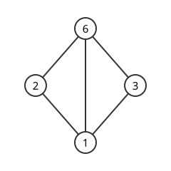

# 비교 가능성 그래프

# 개요

**비교 가능성 그래프(comparability graph)** 는 부분순서 집합의 원소를 정점으로 두고, 순서로 비교되는 두 원소를 간선으로 이은 그래프다. 과목 사이의 선수 관계가 주어진 시간표에서, 선수 관계로 이어진 두 과목은 같은 학기에 들을 수 없다. 이 충돌 관계가 비교 가능성 그래프이고, 필요한 학기 수는 그 그래프의 [그래프 색칠](graph-coloring.md) 수로, 그 값은 선수 관계로 이어진 가장 긴 과목 사슬의 길이로 계산된다.

# 직관

$6$ 의 약수 $1,2,3,6$ 에 나누어떨어짐 순서를 준다. $1$ 은 모두를 나누고, $2$ 와 $3$ 은 $6$ 을 나누며, $2$ 와 $3$ 은 서로 나누지 않는다. 비교되는 쌍을 이으면 아래 그림처럼 $2$–$3$ 만 빠진 그래프가 된다.

서로 모두 이어진 정점들은 순서로 한 줄에 서는 사슬이다. 가장 큰 것은 $1,2,6$ 이나 $1,3,6$ 이고 크기가 $3$ 이다. 정점을 $\lbrace 1\rbrace,\lbrace 2,3\rbrace,\lbrace 6\rbrace$ 의 세 층으로 나누면 같은 층의 원소는 비교되지 않으므로 세 색으로 칠해지고, 사슬 $1,2,6$ 때문에 두 색으로는 안 된다.

# 정의

그래프 $G=(V,E)$ 의 각 간선에 방향을 주어, $u\to v$ 와 $v\to w$ 이면 $u\to w$ 가 성립하게 하는 것을 **추이적 방향 주기(transitive orientation)** 라 한다. 추이적 방향 주기를 가진 그래프를 **비교 가능성 그래프** 라 한다. [부분순서](partial-orders.md) $(P,\le)$ 에서 $x\lt y$ 이면 $x\to y$ 로 방향을 주면 추이적 방향 주기가 되므로, 부분순서의 비교 가능성 그래프는 이 정의의 비교 가능성 그래프이고 그 역도 성립한다. 직관 절의 그래프에서 작은 약수에서 큰 약수로 방향을 준 것이 추이적 방향 주기다.

# 성질

## 클릭과 사슬, 독립집합과 반사슬

비교 가능성 그래프의 클릭은 사슬이고, 독립집합은 반사슬이다. 색칠 하나는 반사슬들로의 분할이다.

## 완벽성

비교 가능성 그래프는 [완벽그래프](perfect-graphs.md)다. 색칠 수가 가장 큰 클릭의 크기와 같다는 것은 Mirsky 정리(Mirsky's theorem), 곧 가장 긴 사슬의 길이가 반사슬 분할의 최소 개수와 같다는 정리다. 원소마다 그 원소에서 끝나는 가장 긴 사슬의 길이를 층으로 주면 같은 층은 반사슬이다. 유도 부분그래프도 비교 가능성 그래프이므로 완벽그래프가 된다.

여그래프에서는 클릭이 반사슬이고 색칠이 사슬 분할이므로, 여그래프의 색칠 수가 가장 큰 클릭의 크기와 같다는 것은 [Dilworth 정리](dilworth-theorem.md)다. 그래서 비교 가능성 그래프의 여그래프도 완벽그래프다.

## 인식

Gallai 는 비교 가능성 그래프를 금지 유도 부분그래프의 목록으로 특징지었다[^1]. 그래프가 추이적 방향 주기를 가지는지는 선형 시간에 판정되고, 가지면 그 방향 주기를 만든다[^2].

## 구간 그래프와의 관계

정리(Gilmore–Hoffman). 그래프가 [구간 그래프](interval-graphs.md)인 것은 현 그래프이면서 여그래프가 비교 가능성 그래프인 것과 동치다[^3]. 구간 표현에서 겹치지 않는 두 구간을 왼쪽 것에서 오른쪽 것으로 방향을 주면 여그래프의 추이적 방향 주기가 된다.

# 활용

- 일정 계획. 선수 관계가 있는 작업들을 같은 시간대에 둘 수 없을 때 필요한 시간대의 수가 가장 긴 사슬의 길이다.
- 그래프 알고리즘. 비교 가능성 그래프에서는 가장 큰 클릭, 가장 큰 독립집합, 색칠 수가 모두 다항 시간에 계산된다. 클릭은 가장 긴 경로 계산으로, 독립집합은 Dilworth 정리의 매칭 계산으로 구한다.
- [순열 그래프](permutation-graphs.md). 순열에서 순서가 뒤바뀐 두 수를 이은 그래프는 비교 가능성 그래프이면서 여그래프도 비교 가능성 그래프이고, 그 역도 성립한다.

[^1]: T. Gallai, "Transitiv orientierbare Graphen", *Acta Mathematica Academiae Scientiarum Hungaricae* **18** (1967), 25–66.
[^2]: R. M. McConnell, J. P. Spinrad, "Modular decomposition and transitive orientation", *Discrete Mathematics* **201** (1999), 189–241.
[^3]: P. C. Gilmore, A. J. Hoffman, "A characterization of comparability graphs and of interval graphs", *Canadian Journal of Mathematics* **16** (1964), 539–548.

# 연관 문서

## 선수지식

- [Dilworth 정리](dilworth-theorem.md)

## 더 알아보기

- [순열 그래프](permutation-graphs.md)

#order_theory #graph_theory #combinatorics
