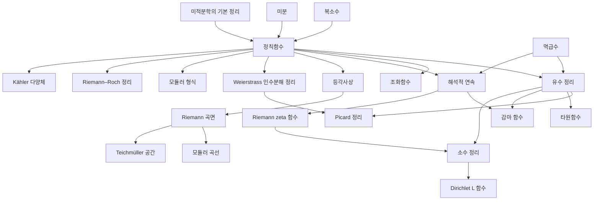

# 복소해석 개관

# 개요

복소해석(complex analysis)은 복소수를 받아 복소수를 내는 함수 가운데 미분가능한 것을 다루는 분야다. [실수](real-numbers.md) 적분 $\int_{-\infty}^{\infty}\frac{dx}{1+x^4}$ 를 원시함수로 구하면 로그와 역탄젠트가 섞인 긴 식을 거쳐야 한다. 적분 경로를 복소평면의 닫힌 곡선으로 바꾸면 적분값이 함숫값이 무한대로 가는 몇 개의 점에서 정해지는 수만으로 계산되어, 이런 적분이 대수 계산으로 풀린다.

처음 읽는 사람은 [복소수](complex-numbers.md)에서 시작한다.

# 지도

# 갈래

처음 읽는 사람은 정칙함수와 조화함수, 급수와 특이점, 영점과 값 분포의 순서로 읽는다. 그 뒤는 두 방향으로 갈린다. 확장과 사상은 정의역을 넓히거나 영역을 바꿔치는 쪽이고 복소역학이 그 뒤에 온다.

해석적 수론은 급수와 특이점만 읽고도 들어갈 수 있다. 나머지 해석적 정수론 문서는 [정수론 개관](number-theory-overview.md)에 있다.

## 정칙함수와 조화함수

먼저 읽을 것: [미분](derivative.md)(해석 개관). 시작 문서: [복소수](complex-numbers.md).

- [복소수](complex-numbers.md): $i^2=-1$ 로 정한 실수 쌍의 체, 극형식과 Euler 공식, 거듭제곱근
  - [대수학의 기본정리](fundamental-theorem-of-algebra.md): 상수 아닌 복소 다항식이 근을 갖는다는 정리, 최솟값, Liouville, 감김수, Galois 이론에 의한 네 증명
    - [Gauss–Lucas 정리](gauss-lucas-theorem.md): 미분한 다항식의 근이 원래 근들의 볼록 껍질 안에 있다는 정리, 로그 미분의 증명과 삼차식의 Marden 정리
    - [Eneström–Kakeya 정리](enestrom-kakeya-theorem.md): 양수 계수 다항식의 근이 이웃한 계수의 비의 최솟값과 최댓값 사이의 원환에 있다는 정리, 1 − z 를 곱하는 증명, 지수함수 부분합의 근
    - [Cauchy 근 한계](cauchy-root-bound.md): 계수의 절댓값 가운데 최댓값에 1 을 더한 값이 모든 근의 절댓값보다 크다는 부등식, 계수의 절댓값만 쓰는 한계 가운데 가장 작은 Cauchy 다항식의 양근, Fujiwara 한계, 역수 다항식으로 얻는 하한
  - [Möbius 변환](mobius-transformations.md): z 를 (az+b)/(cz+d) 로 보내는 변환, 원과 직선의 보존, 행렬 곱으로 쓰는 합성, 세 점 정리와 복비, 대각합에 따른 네 종류, Cayley 변환
    - [Ptolemy 부등식](ptolemy-inequality.md): 마주 보는 변의 곱의 합이 대각선의 곱 이상이라는 부등식, 한 원 위의 네 점에서의 등호, 내적 공간의 반전 증명과 Schoenberg 의 판정
      - [Casey 정리](casey-theorem.md): 한 원에 안쪽에서 접하는 원 네 개의 공통외접선 길이가 Ptolemy 등식을 만족한다는 정리, 단위원 안의 반지름 1/2, 1/4 인 원과 두 점에서 양변 √6, 접선의 길이가 접점 사이 거리의 √((R − rᵢ)(R − rⱼ))/R 배라는 공식, 바깥쪽으로 접하는 원, 역과 Feuerbach 정리
    - [원 반전](circle-inversion.md): 원의 중심에서 거리를 역수로 바꾸는 변환, 원점에서 접하는 두 원이 평행선 x = 1/2, x = 1 이 되어 풀리는 Pappus 사슬, 일반화된 원의 보존과 상의 중심과 반지름, 거리 공식, 방향을 뒤집는 각 보존, 직교하는 원, Steiner 폐형 정리와 Feuerbach 정리의 반전 증명
      - [Steiner 폐형 정리](steiner-porism.md): 두 원 사이에 접하는 원을 잇는 사슬이 닫히는지가 첫 원에 달려 있지 않다는 정리, 반지름 10 인 원과 중심 3, 반지름 3 인 원 사이의 원 여섯 개, 극한점 10/3 과 30 에 대한 반전으로 중심이 같은 반지름 1 과 3 의 원으로 옮기기, sin(π/n) = (R − r)/(R + r) 과 거리 d 의 조건, 중심이 놓이는 타원
      - [Descartes 원 정리](descartes-circle-theorem.md): 서로 접하는 원 네 개의 곡률의 합의 제곱이 제곱의 합의 두 배라는 등식, 곡률 −1, 2, 2, 3 의 틈에 들어가는 곡률 15 의 원, 접점에서 한 반전으로 두 원을 평행선으로 바꾸는 증명, 두 근의 합, 정수 Apollonius 개스킷, 복소 Descartes 정리, 높은 차원
        - [Soddy 육구](soddy-hexlet.md): 서로 접하는 공 세 개에 모두 접하는 공의 사슬이 언제나 여섯 개로 닫힌다는 정리, 반지름 2, 2/3, 1 인 세 공과 반지름 1, 2/3, 2/5, 1/3, 2/5, 2/3 인 육구, 두 공의 접점에서 한 구 반전으로 평행한 두 평면 사이의 같은 크기 공 여섯으로 바꾸는 증명, 마주 보는 곡률의 합 2s 와 3 차원 Descartes 등식의 점화식, 접점의 원과 Dupin 사이클라이드
      - [Apollonius 문제](apollonius-problem.md): 주어진 세 원에 모두 접하는 원을 찾는 문제, 중심 (0, 0), (6, 0), (0, 8) 의 단위원 셋에 접하는 반지름 4, 6, 8√10/5, 3√3 의 원, 부호 있는 반지름, 반지름을 함께 바꿔 한 원을 점으로 줄이고 반전으로 공통접선 문제로 바꾸는 풀이, 해가 많아야 여덟 개라는 것
      - [Peaucellier–Lipkin 연결 장치](peaucellier-lipkin-linkage.md): 막대와 관절만으로 정확한 직선을 그리는 장치, 팔 5 와 마름모 √10 에서 OP · OQ = 15 와 직선 x = 5, 반전기의 곱 b² − a², 원점을 지나는 원의 반전으로 하는 직선 운동, 움직이는 범위, Kempe 보편성 정리
- [정칙함수](holomorphic-functions.md): Cauchy–Riemann 방정식, Goursat 논법, 적분 공식, Liouville 정리, 대수학의 기본정리
  - [Liouville 정리](liouville-theorem.md): 유계인 전해석함수가 상수라는 정리, Cauchy 부등식과 다항식 증가의 판정
  - [Dolbeault–Grothendieck 보조정리](dolbeault-grothendieck-lemma.md): ∂u/∂z̄=f 를 Cauchy 변환으로 푸는 방법, 다원판에서 ∂̄ 닫힌 형식의 국소 완전성, Dolbeault 정리
- [Morera 정리](morera-theorem.md): 삼각형 둘레 적분이 모두 0 인 연속함수가 정칙이라는 정리, 국소 균등수렴 극한과 매개변수 적분의 정칙성, Schwarz 반사 원리
- [Runge 정리](runge-theorem.md): 콤팩트 집합 위의 정칙함수를 극을 지정한 유리함수로 근사하는 정리, 극 옮기기, 여집합이 연결일 때의 다항식 근사, Mergelyan 정리
- [최대 절댓값 원리](maximum-modulus-principle.md): 상수가 아닌 정칙함수의 절댓값은 안쪽에서 최대가 아니라는 정리, 평균값 등식과 Hadamard 세 원 정리
- [Phragmén–Lindelöf 원리](phragmen-lindelof.md): 증가가 제한된 함수에서 유계가 아닌 영역의 경계 상계가 안쪽으로 이어진다는 정리, 세 선 정리
  - [Carlson 정리](carlson-theorem.md): 허수축 위 증가가 $e^{\pi\vert y\vert}$ 보다 느린 지수형 함수는 음이 아닌 정수에서의 값으로 정해진다는 정리
- [조화함수](harmonic-functions.md): Laplace 방정식과 조화 켤레, 평균값 성질, 최대 원리, Poisson 적분 공식, Harnack 부등식
  - [Dirichlet 문제](dirichlet-problem.md): 경계값을 갖는 조화함수의 존재, Perron 구성과 장벽
    - [조화 측도](harmonic-measure.md): 경계의 부분 집합이 안쪽 한 점에서 받는 온도, 상반평면의 각과 원판의 호 길이, Brown 운동의 출구 분포, 두 상수 정리와 Hadamard 세 원 정리
    - [Makarov 정리](makarov-theorem.md): 단순연결 영역의 조화 측도가 차원 1 인 경계 부분에 몰린다는 정리, Bloch 함수의 반복로그 한계, Jones–Wolff 정리와 고차원

## 급수와 특이점

먼저 읽을 갈래: 정칙함수와 조화함수. 시작 문서: [멱급수](power-series.md).

- [멱급수](power-series.md): 수렴반지름, 항별 미분, 해석함수
- [유수 정리](residue-theorem.md): 고립 특이점의 분류, 유수 계산, 실적분으로의 응용
  - [Jordan 보조정리](jordan-lemma.md): 상반평면의 큰 반원에서 eⁱᵃᶻ 가 곱해진 적분의 상한 π/a, 작은 반원 보조정리, sin x/x 의 적분과 Fourier 적분
  - [Riemann–Hilbert 문제](riemann-hilbert-problem.md): 곡선을 건널 때 행렬을 곱한 만큼 값이 바뀌는 정칙함수를 찾는 문제, 직교다항식의 표현과 Deift–Zhou 최급강하법
- [해석적 연속](analytic-continuation.md): 함수 요소와 경로를 따른 연속, 항등정리와 유일성, 단일가치 정리, 자연 경계
  - [타원함수](elliptic-functions.md): 이중주기 유리형함수, Weierstrass 페 함수와 그 미분방정식, 복소 원환면
    - [렘니스케이트 사인](lemniscatic-sine.md): 렘니스케이트의 호의 길이를 뒤집은 함수, 렘니스케이트 상수와 감마 함수, Fagnano 배가 공식, Gauss 정수 격자의 주기, Abel 의 등분 정리
  - [Hartogs 확장 정리](hartogs-extension-theorem.md): 두 변수 이상의 정칙함수가 가운데가 빈 영역에서 빈 곳까지 연장된다는 정리, Hartogs 도형, 고립되지 않는 영점과 특이점, 정칙 영역

## 영점과 값 분포

먼저 읽을 갈래: 급수와 특이점. 먼저 읽을 것: [Arzelà–Ascoli 정리](arzela-ascoli.md)(함수해석 개관), [Laplace 변환](laplace-transform.md)(해석 개관). 시작 문서: [Weierstrass 인수분해 정리](weierstrass-factorization.md).

- [Weierstrass 인수분해 정리](weierstrass-factorization.md): 기본 인수와 무한곱, 지정한 영점을 갖는 전해석함수, 위수와 Hadamard 인수분해
  - [Wiman 최소 절댓값 정리](wiman-minimum-modulus-theorem.md): 위수 ρ 가 1 보다 작은 전해석함수의 원 위 최솟값이 최댓값의 cos πρ 제곱 가까이 되는 원이 끝없이 있다는 정리, 음의 실축 위 영점의 등호 예, 위수 1/2 미만에서 최솟값의 발산
- [Jensen 공식](jensen-formula.md): 원 위 크기 평균과 원 안 영점의 위치를 잇는 등식, 영점 개수의 상계와 Blaschke 조건
- [Blaschke 곱](blaschke-products.md): 원판 안 지정한 점에서만 0 이 되는 유계 정칙함수, Blaschke 조건과 영점의 분리
- [Hardy 공간](hardy-spaces.md): 원 위 평균 크기가 유계인 정칙함수의 공간, 경계값, 내부·외부 인수분해와 Beurling 정리
  - [Carleson 측도](carleson-measures.md): 경계의 호 위 상자에 호의 길이에 비례하는 무게만 주는 원판의 측도, Hardy 공간의 함수를 제곱 적분할 수 있는 측도와의 동치인 Carleson 매립 정리, 유계 평균 진동(bounded mean oscillation, BMO) 판정
    - [Corona 정리](corona-theorem.md): 절댓값의 합이 양의 하한을 갖는 유계 정칙함수들로 1 을 결합하는 정리, 극대 아이디얼 공간에서 원판의 조밀성, Wolff 의 ∂̄ 증명과 Carleson 측도
  - [Bergman 공간](bergman-spaces.md): 원판 전체에서 제곱 넓이 적분이 유한한 정칙함수의 공간, 점 평가의 유계성, 재생핵 1/(1−zw̄)², Bergman 사영, 상자 조건 |I|², Blaschke 조건을 어기는 영점 집합
  - [Nehari 정리](nehari-theorem.md): 원 위의 유계함수와 원판의 유계 정칙함수 사이의 가장 작은 균등 거리가 음의 Fourier 계수로 만든 Hankel 행렬의 노름이라는 정리, 크기가 일정한 최량 근사의 오차, 계수가 유한한 Hankel 행렬과 유리함수의 Kronecker 정리, Adamyan–Arov–Krein 정리. 선형대수 개관의 균형 절단을 먼저 읽는다
- [Picard 정리](picard-theorems.md): Casorati–Weierstrass 정리, 두 값을 피할 수 없다는 작은 Picard 와 큰 Picard
  - [역함수의 특이점](singularities-of-inverse-functions.md): 역함수를 이어 갈 때 막히는 대수적·초월 특이점, 직접·간접·로그 특이점, 점근값과의 대응, 피하는 값이 점근값이라는 Iversen 정리, 위수 유한에서 고립 특이값의 로그 특이점
- [Nevanlinna 이론](nevanlinna-theory.md): 값마다 취한 횟수와 가까이 머문 정도를 재는 계수 함수와 근접 함수, 두 기본정리와 결손 관계
- [Rouché 정리](rouche-theorem.md): 경계에서 작은 항을 더해도 영역 안의 영점 개수가 같다는 정리, 대칭형, 열린 사상 성질과 다항식 근의 개수
  - [Pellet 정리](pellet-theorem.md): 계수 하나가 원 위에서 나머지 항의 합보다 큰 반지름의 범위로 근이 없는 원환과 안쪽 원판의 근의 개수를 정하는 정리, Rouché 정리에 의한 증명과 Cauchy 근 한계와의 관계
- [Hurwitz 정리](hurwitz-theorem.md): 국소 균등수렴에서 영점 개수의 보존, 영점 없음과 단사성의 보존, Rouché 정리와의 관계
- [Nyquist 판정법](nyquist-criterion.md): 열린 고리 주파수 응답 곡선이 점 −1/k 를 감는 횟수로 닫힌 고리의 불안정한 극을 세는 편각 원리의 응용, Z=N+P, 이득 여유와 위상 여유, 시간 지연
  - [Routh–Hurwitz 판정법](routh-hurwitz-criterion.md): 실계수 다항식의 근이 모두 왼쪽 반평면에 있는지를 Routh 표의 첫째 칸 부호와 Hurwitz 행렬식으로 판정, 부호 변화와 불안정한 근의 개수, Liénard–Chipart 판정법
    - [Jury 판정법](jury-criterion.md): 다항식의 근이 모두 단위원 안에 있는지를 뒤집은 다항식으로 차수를 줄여 판정, Rouché 정리를 쓴 Schur–Cohn 줄이기, 2차의 안정 삼각형, 쌍일차 변환
      - [Lehmer–Schur 알고리즘](lehmer-schur-algorithm.md): Schur 변환의 상수항 부호로 원판 안의 근의 유무를 판정하고, 반지름을 반으로 줄이거나 고리를 원판 여덟 개로 덮어 근이 든 원판을 줄이는 근 찾기, 선형 수렴과 전역 수렴
    - [Hermite–Biehler 정리](hermite-biehler-theorem.md): 허수축 위 값의 실수부와 허수부, 곧 짝수 차 항과 홀수 차 항의 근이 번갈아 놓이는 것이 Hurwitz 안정과 동치라는 정리, 편각의 단조 증가와 Mikhailov 판정법, 허수축 위 근의 경계
      - [Kharitonov 정리](kharitonov-theorem.md): 계수마다 범위만 아는 다항식 전체가 안정한지를 끝값을 정해진 무늬로 고른 네 다항식으로 판정, 허수축 위 값 집합이 축에 평행한 직사각형이라는 사실과 영점 배제 원리
        - [모서리 정리](edge-theorem.md): 계수가 매개변수의 일차식인 다항식 다면체의 근이 영역 안에 있는지를 모서리의 선분만으로 판정하는 정리, 두 끝의 값이 반대 방향을 가리키는 주파수로 하는 선분의 판정, 꼭짓점이 모두 안정한데 가운데가 불안정한 삼차와 사차의 선분
  - [근궤적](root-locus.md): 이득을 키울 때 닫힌 고리의 극이 움직이는 자취, 편각 조건과 크기 조건, 극에서 출발해 영점과 점근선으로 가는 가지, 실수축 규칙, 영점이 가지를 원으로 휘는 예
  - [Bode 선도](bode-plot.md): 주파수 응답의 크기를 데시벨로, 위상을 각으로 로그 주파수 위에 그린 그래프, 인수의 합과 꺾인 직선 근사, 이득 여유와 위상 여유, Bode 이득–위상 관계
    - [Bode 감도 적분](bode-sensitivity-integral.md): 되먹임이 외란을 줄이는 비율의 로그를 모든 주파수에서 적분한 값이 열린 고리의 불안정한 극의 실수부 합의 π 배라는 등식, 상대 차수 1 의 보정, 대역 제한과 물침대 효과, 이산시간 판본
- [Montel 정리](montel-theorem.md): 국소 유계인 정칙함수족의 정규성, 두 값을 생략하는 족

## 확장과 사상

먼저 읽을 갈래: 영점과 값 분포. 먼저 읽을 것: [덮개공간](covering-spaces.md)(위상 개관). 시작 문서: [등각사상](conformal-mapping.md).

- [등각사상](conformal-mapping.md): Möbius 변환, Schwarz 보조정리, 원판의 자기동형군
  - [Schwarz–Pick 보조정리](schwarz-pick-lemma.md): 원판의 자기사상이 의사쌍곡 거리와 Poincaré 계량의 길이를 늘리지 않는다는 정리, 등호의 자기동형, Ahlfors–Schwarz 보조정리
    - [Borel–Carathéodory 정리](borel-caratheodory-theorem.md): 실부의 위쪽 상한과 중심값으로 작은 원 위의 크기를 누르는 정리, 도함수의 상한, 실부가 다항식만큼 커지는 전해석함수
    - [Denjoy–Wolff 정리](denjoy-wolff-theorem.md): 타원형 자기동형이 아닌 원판의 자기사상의 반복이 한 점으로 수렴한다는 정리, Wolff 보조정리의 horodisk, 각 도함수와 Julia 보조정리
    - [보간 수열](interpolating-sequences.md): 아무 유계 값이나 갖는 유계 정칙함수가 있는 원판의 점열, 고르게 떨어진 수열과 Carleson 보간 정리, Carleson 측도
    - [Julia–Carathéodory 정리](julia-caratheodory-theorem.md): 경계 팽창 계수의 하극한이 유한하면 경계점에서 비접선 각 도함수가 있다는 정리, Julia 보조정리의 horodisk 포함
    - [Kobayashi 쌍곡성](kobayashi-hyperbolicity.md): 원판의 쌍곡 거리로 만든 의사거리와 정칙사상의 거리 축소, 두 점을 뺀 평면과 작은 Picard 정리, Brody 정리
    - [Bloch 함수](bloch-functions.md): 도함수가 경계까지 거리의 역수 규모로만 커지는 원판의 정칙함수, Möbius 불변인 노름과 유계 함수의 포함, 등각사상의 로그 도함수와 상한 6, 간격 급수, Makarov 의 반복로그 한계. Makarov 정리를 먼저 읽는다
  - [Nevanlinna–Pick 보간](nevanlinna-pick-interpolation.md): 원판의 점에서 값을 정한 유계 정칙함수의 존재, Pick 행렬의 양의 준정부호 판정과 Schur 알고리즘
- [Riemann 사상정리](riemann-mapping-theorem.md): 단순연결 영역과 원판의 등각동치, 극값 문제로 가는 증명과 Carathéodory 경계 확장
  - [Carathéodory–Torhorst 정리](caratheodory-torhorst-theorem.md): Riemann 사상이 경계까지 연속인 조건으로서의 경계의 국소 연결성, Jordan 영역의 위상동형, 길이와 넓이의 보조정리, 빗살 영역과 prime end
  - [Schwarz–Christoffel 공식](schwarz-christoffel-formula.md): 상반평면을 다각형으로 보내는 등각사상의 적분식, 꼭짓점마다 내각으로 정한 지수, 매개변수 문제, 직사각형의 타원적분과 등각 모듈러스
    - [Jacobi 타원함수](jacobi-elliptic-functions.md): 제1종 타원적분의 역함수 sn, cn, dn, 큰 진폭 진자의 주기, 덧셈 정리와 두 주기, 직사각형 사상
      - [산술기하 평균](arithmetic-geometric-mean.md): 산술 평균과 기하 평균의 반복과 이차 수렴, K(k) = π/2M(1, k′) 의 Gauss 적분 표현, Gauss 상수, Gauss–Legendre 원주율 알고리즘
  - [de Branges 정리](de-branges-theorem.md): 정규화한 단엽 함수의 계수가 n 을 넘지 않는다는 정리, Koebe 함수, 넓이 정리와 둘째 계수, Koebe 사분의 일 정리, 왜곡 정리, Milin 부등식과 Löwner 방정식
- [Riemann 곡면](riemann-surfaces.md): 다가함수를 단일가치로 만드는 곡면, 구면과 평면과 원판의 삼분법
  - [Riemann–Hurwitz 공식](riemann-hurwitz-formula.md): 정칙사상의 차수와 분기지수로 두 곡면의 종수를 잇는 등식, 초타원곡선과 Fermat 곡선의 종수, 자기동형군의 84(g−1) 상계
  - [초타원곡선](hyperelliptic-curves.md): y² = f(x) 로 쓰이는 곡선, 초타원 대합과 정칙 미분의 기저, 종수 2 곡선이 전부 초타원이라는 것
  - [Klein 사차곡선](klein-quartic.md): 자기동형군 PSL₂(F₇) 로 Hurwitz 상계 84(g−1) 의 등호를 이루는 종수 3 곡선, 모듈러 곡선 X(7)
- [준등각 사상](quasiconformal-maps.md): 왜곡을 유계로 묶은 동형사상, Beltrami 방정식과 가측 Riemann 사상 정리
  - [Teichmüller 정리](teichmuller-theorem.md): 팽창률이 최소인 준등각 사상의 존재와 유일성, 정칙 이차미분으로 쓴 Beltrami 계수와 Teichmüller 공간의 좌표
  - [Rodin–Sullivan 정리](rodin-sullivan-theorem.md): 육각형 격자 원 채움과 같은 접촉 그래프의 원판 안 최대 원 채움을 잇는 이산 Riemann 사상이 Riemann 사상으로 수렴한다는 정리, 고리 보조정리로 얻는 고른 준등각성, 육각 채움의 강성, 반지름의 비가 |f′| 로 가는 도함수의 수렴. 그래프 이론 개관의 원 채움 정리를 먼저 읽는다
  - [극값 길이](extremal-length.md): 곡선 모임의 길이와 넓이로 정의한 등각 불변량, 사각형의 모듈러스와 고리, 직렬 법칙, 준등각 사상의 기하적 정의와 Grötzsch 부등식
    - [Ahlfors 왜곡 정리](ahlfors-distortion-theorem.md): 통로 모양 영역을 띠로 펴는 사상의 늘임을 단면 폭의 역수 적분으로 잡는 정리, 먼 끝의 조화 측도 추정과 Warschawski 정리
      - [Denjoy–Carleman–Ahlfors 정리](denjoy-carleman-ahlfors-theorem.md): 위수 ρ 인 전해석함수의 서로 다른 유한 점근값이 2ρ 개 이하라는 정리, 사인 적분의 두 점근값, 겹치지 않는 영역의 각 셈과 왜곡 정리로 하는 증명, 등호를 주는 함수. Weierstrass 인수분해 정리의 위수를 먼저 읽는다
  - [Riemann–Roch 정리](riemann-roch.md): 곡면 위 유리형함수 공간의 차원
    - [Weierstrass 점](weierstrass-points.md): 한 점에서만 극을 갖는 함수의 위수에서 빠지는 간극이 보통과 다른 점, 간극이 g 개이고 2g − 1 이하라는 간극 정리, 무게의 합 g³ − g 와 Wronski 행렬식, 초타원곡선의 2g + 2 개와 평면 사차곡선의 변곡점 24 개
    - [Clifford 정리](clifford-theorem.md): 특수 divisor 의 함수 공간 차원이 차수의 절반 더하기 1 이하라는 부등식, 곱셈 사상과 Riemann–Roch 정리로 하는 증명, 등호와 초타원곡선의 판정, 표준사상의 매장
    - [Noether 공식](noether-formula.md): 곡면의 χ(O) 를 K² 와 Euler 표수로 적는 12χ = K² + e, Todd 류로 하는 증명, 사영공간 초곡면의 p_g, 부호수와 합친 χ = (e + τ)/4
    - [Kodaira 차원](kodaira-dimension.md): 다중종수 P_m 이 m 의 몇 제곱으로 자라는지로 정한 −∞ 부터 n 까지의 수, 곡선의 종수 0, 1, 2 이상과의 대응, 쌍유리 불변성, 곱과 덮개, 초곡면의 차수 판정, Enriques–Kodaira 곡면 분류, Iitaka 추측
      - [Castelnuovo 유리성 판정법](castelnuovo-rationality-criterion.md): 곡면이 유리곡면일 필요충분조건 q = P₂ = 0, Enriques 곡면이 보이는 P₂ 의 필요, 단유리 곡면의 유리성
      - [타원 곡면](elliptic-surfaces.md): 올이 타원곡선인 곡면, 삼차곡선 모임을 부풀린 유리 타원 곡면과 마디 올 12 개, Kodaira 의 특이 올 분류와 확장 Dynkin 도형, e = 12χ, 표준다발 공식과 Kodaira 차원
      - [쌍타원 곡면](bielliptic-surfaces.md): 두 타원곡선의 곱을 한쪽에서 평행이동인 유한군으로 나눈 곡면, q = 1 과 p_g = 0, 위수 2, 3, 4, 6 의 표준다발, 두 올 구조, Bagnera–de Franchis 의 일곱 꼴. 대수 개관의 아벨 다양체를 먼저 읽는다
  - [Jacobi 다양체](jacobian-variety.md): 주기 격자로 나눈 복소 토러스, Abel 정리가 주는 주 divisor 판정
    - [Riemann 특이점 정리](riemann-singularity-theorem.md): theta divisor 의 중복도가 차수 g − 1 divisor 의 Riemann–Roch 공간 차원과 같다는 정리, Brill–Noether 자취, Kempf 의 행렬식 접원뿔, 특이점 집합의 차원 g − 4 와 초타원곡선의 g − 3, 종수 4 의 두 특이점과 이차곡면
      - [Brill–Noether 이론](brill-noether-theory.md): 극이 d 개 이하인 함수와 r 차원 사영공간으로 가는 차수 d 사상의 존재, Brill–Noether 수 ρ = g − (r+1)(g − d + r), Kleiman–Laksov 존재 정리와 Porteous 류, 일반 곡선의 Griffiths–Harris 정리와 Gieseker–Petri 정리, gonality ⌊(g+3)/2⌋, Martens 정리
    - [Prym 다양체](prym-varieties.md): 분기 없는 이중 덮개에서 노름 사상의 핵으로 얻는 g − 1 차원 아벨 다양체, theta divisor 의 제한이 주편극의 두 배라는 Mumford 정리, Prym 사상의 차원 비교와 종수 6 의 차수 27, Wirtinger 덮개로 얻는 Jacobi 다양체, 삼차 삼중체의 무리성
    - [중간 Jacobi 다양체](intermediate-jacobian.md): 삼차원 다양체의 셋째 코호몰로지의 아래쪽 Hodge 조각을 정수 격자로 나눈 복소 원환체, Abel–Jacobi 사상, (3,0) 조각이 0 일 때의 주편극, 부풀림 공식과 Clemens–Griffiths 판정법, 삼차 초곡면의 theta 인자
  - [Kähler 다양체](kahler-manifolds.md): 조화형식으로 읽는 코호몰로지
    - [Lefschetz (1,1) 정리](lefschetz-1-1-theorem.md): 정수 2 차 코호몰로지류가 선다발의 첫째 Chern 류일 조건이 (1,1) 성분에만 놓이는 것이라는 정리, 지수 완전열로 하는 증명, Néron–Severi 군과 Picard 수, 원환면과 타원곡선 곱의 예. 위상 개관의 Picard 군을 먼저 읽는다
    - [Kodaira 소멸 정리](kodaira-vanishing-theorem.md): 양의 선다발 L 에 대해 K ⊗ L 의 높은 코호몰로지가 0 이라는 정리, Bochner–Kodaira–Nakano 항등식으로 하는 증명, 양성 조건이 없을 때의 반례, Kawamata–Viehweg 와 Akizuki–Nakano 판본. 대수 개관의 Serre 쌍대성을 먼저 읽는다
    - [Kodaira 매장 정리](kodaira-embedding-theorem.md): 양의 선다발의 큰 거듭제곱이 사영공간으로의 매장을 준다는 정리, 원환면에서 ℘ 와 ℘′ 으로 하는 삼차곡선 모형, 부풀림과 소멸로 하는 증명, 정수 Kähler 류에 의한 사영성 판정, 곡선의 차수 2g + 1, 원환면의 Riemann 조건
    - [Albanese 다양체](albanese-variety.md): 정칙 1 형식의 적분이 주는 복소 원환면과 사상, 쌍타원 곡면의 첫째 올 구조, 원환면으로 가는 사상의 보편 성질, Pic⁰ 와의 쌍대, 곡선·선직곡면·K3 곡면의 예
    - [Hopf 곡면](hopf-surfaces.md): 원점을 뺀 ℂ² 를 z ↦ 2z 로 나눈 콤팩트 복소곡면, S¹ × S³ 과의 미분동형과 b₁ = 1, Kähler 도 사영 다양체도 아닌 예, 깨진 Hodge 대칭, 타원 올 구조
  - [곡선의 모듈라이 공간](moduli-of-curves.md): 종수 $g$ 곡선의 동형류가 이루는 차원 $3g-3$ 의 공간, 안정곡선을 더한 Deligne–Mumford 콤팩트화와 Torelli 사상
- [Riemann–Hilbert 대응](riemann-hilbert-correspondence.md): 특이점을 뺀 평면 위의 정칙 특이 선형 미분방정식과 기본군 표현의 일대일 대응, Hilbert 21번 문제와 초기하 방정식의 강성
  - [Schlesinger 방정식](schlesinger-equations.md): 특이점을 움직여도 모노드로미가 바뀌지 않게 하는 Fuchs 형 계 계수의 편미분방정식, tau 함수와 Painlevé VI

## 복소역학

먼저 읽을 갈래: 확장과 사상. 시작 문서: [Julia 집합](julia-set.md).

- [Julia 집합](julia-set.md): 반복합성이 초기값에 민감한 점의 집합, Fatou 집합과의 분할, 반복 전사성
- [Fatou 성분의 분류](fatou-components.md): 성분이 모두 최종 주기적이라는 Sullivan 정리와 주기 성분의 네 유형
  - [Siegel 선형화 정리](siegel-linearization.md): 무리 회전수 중립 고정점이 회전과 공액이 되는 Diophantine 조건, Siegel 원판의 존재
  - [Eremenko–Lyubich 류](eremenko-lyubich-class.md): 임계값과 유한 점근값의 집합이 유계인 초월 전해석함수, z+1+e⁻ᶻ 의 달아나는 반평면과 eᶻ/4 의 달아나는 실수 3, 탈출 집합이 Julia 집합에 든다는 정리와 로그 변수 변환, Speiser 류에 방황 영역이 없다는 정리, 동적 반직선
- [Mandelbrot 집합](mandelbrot-set.md): 임계점 궤도가 유계인 매개변수, 연결성 이분법과 쌍곡 성분

## 해석적 수론

먼저 읽을 갈래: 급수와 특이점. 먼저 읽을 것: [소수](primes.md)(정수론 개관). 시작 문서: [Riemann zeta 함수](riemann-zeta.md).

- [Riemann zeta 함수](riemann-zeta.md): Euler 곱, 함수방정식, 임계띠의 영점
  - [감마 함수](gamma-function.md): 함수방정식을 거꾸로 읽어 얻는 유리형 확장과 점근전개
- [소수 정리](prime-number-theorem.md): 직선 $\mathrm{Re}\thinspace s=1$ 위의 비영점성이 주는 소수 계수 함수의 점근
- [Dirichlet L 함수](dirichlet-l-functions.md): 등차수열의 소수 정리
  - [모듈러 형식](modular-forms.md): 상반평면 위의 변환 규칙을 가진 정칙함수
    - [Schottky 문제](schottky-problem.md): 주편극 아벨 다양체 가운데 곡선의 Jacobi 다양체를 가르는 문제, 종수 3 이하에서 닫힘이 전체인 것, 종수 4 의 Schottky–Igusa 형식과 두 16 차원 격자의 [theta 급수](theta-series.md), Andreotti–Mayer 궤적, KP 방정식으로 하는 Shiota 정리와 Krichever 의 삼중할선 정리. Siegel 모듈라이 다양체와 확장과 사상 갈래의 곡선의 모듈라이 공간을 먼저 읽는다

# 연관 문서

## 선수지식

- [집합](sets.md)

## 더 알아보기

- [복소수](complex-numbers.md)

#complex_analysis #analysis #number_theory #overview
