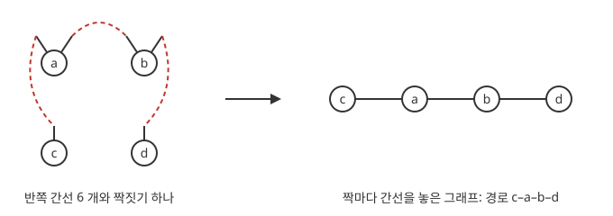

# 구성 모형

# 개요

**구성 모형(configuration model)** 은 정점마다 이웃 수를 미리 정해 두고, 그 수를 지키는 그래프를 무작위로 뽑는 방법이다. 친구 관계망을 조사하니 친구가 한 명인 사람이 많고 수백 명인 사람도 몇 있다. 이웃 수가 이렇게 정해진 그래프 가운데 아무것이나 하나 골랐을 때 모두가 이어진 큰 무리가 생기는지가 이 모형의 물음이다.

구성 모형은 정점마다 이웃 수만큼 반쪽 간선을 붙인 뒤 반쪽 간선을 무작위로 짝지어 그래프를 만들고, 그 짝짓기를 분지과정으로 근사해 이 물음에 답한다.

# 직관

정점 $a,b,c,d$ 의 이웃 수를 $2,2,1,1$ 로 정한다. $a$ 와 $b$ 에 반쪽 간선을 둘씩, $c$ 와 $d$ 에 하나씩 붙이면 반쪽 간선이 $6$ 개다. 이것을 둘씩 짝짓는 방법은 $5\cdot 3\cdot 1=15$ 가지이고, 짝지은 두 반쪽 간선을 이어 간선 하나로 만든다.

아래 그림의 왼쪽은 반쪽 간선 여섯 개와 그 짝짓기 하나를 점선으로 그린 것이고, 오른쪽은 그 짝마다 간선을 놓아 얻은 경로다.

$15$ 가지 가운데 경로 $c$–$a$–$b$–$d$ 가 $4$ 가지, 경로 $c$–$b$–$a$–$d$ 가 $4$ 가지다. 나머지 $7$ 가지는 자기 자신으로 가는 고리나 $a$ 와 $b$ 사이의 겹간선이 생긴다. 고리와 겹간선이 없는 그래프는 $8/15$ 의 확률로 나오고, 그렇게 나온 두 경로는 같은 확률이다.

# 정의

## 구성 모형

정점 $1,\dots,n$ 과 합이 짝수인 차수열 $d_1,\dots,d_n$ 이 주어졌다고 하자. 정점 $v$ 에 반쪽 간선(half-edge) $d_v$ 개를 붙이고, 반쪽 간선 $\sum_vd_v$ 개 전체의 완전 짝짓기를 고르게 하나 뽑아 짝마다 간선을 놓는다. 이렇게 얻은 다중그래프를 **구성 모형** 이라 한다[^1].

직관 절의 예는 $n=4$, 차수열 $(2,2,1,1)$ 이다. 반쪽 간선이 $2m$ 개이면 완전 짝짓기의 수는 $(2m-1)(2m-3)\cdots 1$ 이고, 이 예에서 $m=3$ 이므로 $15$ 다.

## 차수 분포

$n\to\infty$ 에서 차수가 $k$ 인 정점의 비율이 $p_k$ 로 수렴하고 $D$ 가 그 분포를 따르는 확률변수일 때, $(p_k)$ 를 **차수 분포(degree distribution)** 라 한다. 반쪽 간선 하나를 고르게 골라 그 짝이 붙은 정점에서 나머지 반쪽 간선의 수를 세면, 그 수는 다음 분포를 따른다. 이것을 **초과 차수 분포(excess degree distribution)** 라 한다.

$$
q_k=\frac{(k+1)p_{k+1}}{\mathbb E\lbrack D\rbrack}
$$

이웃은 차수에 비례하는 확률로 뽑히므로 차수가 큰 정점이 이웃으로 더 자주 나타난다.

# 성질

## 단순 그래프에서의 고른 분포

정리. 구성 모형이 단순 그래프를 내놓았다는 조건 아래에서, 그 그래프는 차수열이 $(d_v)$ 인 단순 그래프 전체 가운데 고르게 분포한다[^1].

증명의 요지. 정점 $v$ 의 반쪽 간선의 순서를 바꾸는 $\prod_vd_v!$ 가지가 같은 단순 그래프를 준다. 단순 그래프에서는 이 순서 바꾸기가 서로 다른 짝짓기를 주므로, 단순 그래프마다 짝짓기가 정확히 $\prod_vd_v!$ 개다. 직관 절에서 $2!\cdot 2!\cdot 1!\cdot 1!=4$ 가 두 경로의 짝짓기 수다.

## 단순할 확률

정리. 차수 분포의 둘째 모멘트가 유한하고 $\nu=\mathbb E\lbrack D(D-1)\rbrack/\mathbb E\lbrack D\rbrack$ 이면, 고리의 수와 겹간선의 수는 평균이 $\nu/2$, $\nu^2/4$ 인 [Poisson 분포](poisson-distribution.md)로 수렴하고 그래프가 단순할 확률은 다음으로 수렴한다[^1].

$$
\exp\Big(-\frac{\nu}2-\frac{\nu^2}4\Big)
$$

이 확률이 $0$ 이 아니므로, 단순 그래프가 나올 때까지 다시 뽑으면 차수열이 정해진 고른 무작위 단순 그래프가 나온다. 구성 모형에서 확률이 $1$ 로 가는 성질은 차수열이 같은 고른 무작위 단순 그래프에서도 확률이 $1$ 로 간다.

## 거대 성분

정리(Molloy–Reed). 차수 분포가 적당한 모멘트 조건을 만족할 때, 다음이 양수이면 크기가 $n$ 에 비례하는 연결 성분이 하나 생기고, 음수이면 모든 성분의 크기가 $o(n)$ 이다[^2].

$$
\mathbb E\lbrack D(D-2)\rbrack=\sum_kk(k-2)p_k
$$

증명의 요지. 한 정점에서 이웃을 훑어 나가면 새로 만나는 정점마다 초과 차수만큼 가지가 뻗고, 그 수는 거의 독립인 $q_k$ 분포를 따른다. 그래서 훑기가 자손 수 분포 $(q_k)$ 인 [분지과정](branching-processes.md)에 가깝고, 그 평균 $\nu=\sum_kkq_k$ 가 $1$ 보다 클 조건이 $\mathbb E\lbrack D(D-1)\rbrack\gt\mathbb E\lbrack D\rbrack$, 곧 위 식이 양수인 것이다.

차수 분포가 평균 $c$ 의 Poisson 분포이면 $\mathbb E\lbrack D(D-2)\rbrack=c^2-c$ 이고, [Erdős–Rényi 랜덤 그래프](erdos-renyi-graphs.md)의 문턱 $c=1$ 이 다시 나온다. 모든 차수가 $2$ 이면 식이 $0$ 이고 그래프는 순환들의 합이다.

## 두꺼운 꼬리의 차수 분포

$p_k$ 가 $k^{-\gamma}$ 에 비례하고 $2\lt\gamma\le 3$ 이면 $\mathbb E\lbrack D\rbrack$ 는 유한하고 $\mathbb E\lbrack D^2\rbrack$ 는 무한하다. 그러면 $\nu=\infty$ 이므로 정점을 무작위로 지워 평균 차수를 아무리 낮춰도 거대 성분이 남는다[^3].

# 활용

- 실제 네트워크의 기준 모형. 관측한 그래프와 차수열이 같은 구성 모형을 뽑아, 삼각형 수나 군집 구조가 차수만으로 설명되는지 비교한다.
- 감염의 문턱. [네트워크 위의 감염 모형](network-epidemics.md)에서는 접촉 그래프 위에서 병이 이웃으로 옮을 확률이 $T$ 이면 유행의 문턱이 $T\nu=1$ 이고, 차수의 분산이 클수록 문턱이 낮아진다.
- 고정 차수 그래프. 모든 $d_v=d$ 인 구성 모형으로 무작위 $d$-정칙 그래프의 성질(연결성, 확장성, 둘레)을 계산한다.

[^1]: Remco van der Hofstad, *Random Graphs and Complex Networks*, Vol. 1, Cambridge University Press, 2017, Ch. 7.
[^2]: Michael Molloy, Bruce Reed, "A critical point for random graphs with a given degree sequence", *Random Structures & Algorithms* 6 (1995), 161–179.
[^3]: Reuven Cohen, Keren Erez, Daniel ben-Avraham, Shlomo Havlin, "Resilience of the Internet to random breakdowns", *Physical Review Letters* 85 (2000), 4626–4628.

# 연관 문서

## 선수지식

- [Erdős–Rényi 랜덤 그래프](erdos-renyi-graphs.md)
- [분지과정](branching-processes.md)

## 더 알아보기

- [네트워크 위의 감염 모형](network-epidemics.md)

#combinatorics #probability #graph_theory
