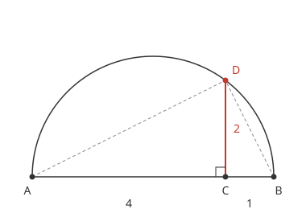

# 작도 가능한 수

# 개요

**작도 가능한 수(constructible number)** 는 길이 $1$ 인 선분에서 시작해 눈금 없는 자와 컴퍼스만으로 그릴 수 있는 길이다. 정삼각형을 그리면 $60^\circ$ 각이 생기지만, 그 각을 세 등분한 $20^\circ$ 각을 같은 도구로 그릴 수 있는지는 그림을 여러 번 그려 보아도 정해지지 않는다. 작도로 얻는 길이가 유리수에서 사칙연산과 제곱근을 되풀이해 얻는 수뿐임을 보이면, 이 물음은 $\cos 20^\circ$ 를 담는 [체의 확대](field-extensions.md)의 차수를 세는 문제가 된다.

# 직관

눈금 없는 자와 컴퍼스로 할 수 있는 일은 세 가지다. 이미 찍은 두 점을 지나는 직선을 긋는다. 이미 찍은 점을 중심으로 원을 그린다. 그린 직선과 원이 만나는 점을 새로 찍는다.

점 $(0,0)$ 과 $(1,0)$ 에서 시작해, 각 점을 중심으로 다른 점을 지나는 원 둘을 그린다. 두 원은 $(1/2,\sqrt3/2)$ 에서 만나고, 세 점이 정삼각형을 이루어 $60^\circ$ 각이 그려진다. 각을 반으로 나누는 것도 이 세 조작으로 된다. 그런데 $60^\circ$ 를 세 등분한 $20^\circ$ 를 그리는 순서는 찾아지지 않는다.

찍히는 점의 좌표를 따라간다. 두 직선의 교점은 일차방정식 두 개의 해이므로, 그 좌표는 직선을 정한 점들의 좌표에 사칙연산을 해서 나온다. 직선과 원의 교점은 직선의 식을 원의 식에 넣으면 이차방정식의 근이 되므로, 근의 공식에서 제곱근이 하나 더해진다.

두 원의 교점은 두 원의 식을 빼면 $x^2+y^2$ 이 지워져 직선의 식이 되므로, 직선과 원의 경우와 같다. 위의 두 원 $x^2+y^2=1$ 과 $(x-1)^2+y^2=1$ 을 빼면 $2x-1=0$ 이고, $x=1/2$ 을 첫 식에 넣으면 $y=\pm\sqrt3/2$ 가 나온다. 그래서 작도로 찍는 점의 좌표는 $0$ 과 $1$ 에서 사칙연산과 제곱근을 되풀이해 얻는 수뿐이다.

거꾸로 길이 $a$ 인 선분이 있으면 길이 $\sqrt a$ 인 선분도 그려진다. 아래 그림은 길이 $4$ 와 $1$ 을 이어 지름 $5$ 인 반원을 그리고, 이음점 $C$ 에서 세운 수선이 반원과 만나는 점을 $D$ 로 찍은 것이다. 삼각형 $ACD$ 와 $DCB$ 가 닮아서 $CD^2=4\cdot 1$ 이고, $CD=2=\sqrt4$ 다.

$20^\circ$ 가 그려지면 $c=\cos 20^\circ$ 가 좌표로 나온다. 삼배각 공식 $\cos 3\theta=4\cos^3\theta-3\cos\theta$ 에 $\theta=20^\circ$ 를 넣으면 $1/2=4c^3-3c$ 이고, $c$ 는 다음 삼차방정식의 근이다.

$$
8x^3-6x-1=0
$$

$20^\circ$ 를 그릴 수 있는가는 이 근을 사칙연산과 제곱근만으로 적을 수 있는가와 같다. 제곱근을 하나 넣을 때마다 체의 차수가 $2$ 배가 되므로, 차수를 세면 답이 나온다.

# 정의

## 작도 가능한 점과 수

평면을 [복소수](complex-numbers.md) 평면 $\mathbb C$ 로 본다. **작도 가능한 점(constructible point)** 은 $0$ 과 $1$ 에서 시작해 다음 조작을 유한 번 되풀이해 얻는 점이다.

- 이미 얻은 두 점을 지나는 직선을 긋는다.
- 이미 얻은 점을 중심으로, 이미 얻은 두 점 사이의 거리를 반지름으로 하는 원을 그린다.
- 그린 직선과 원 가운데 두 개의 교점을 얻은 점에 더한다.

**작도 가능한 수(constructible number)** 는 작도 가능한 점인 복소수다. 실수 $a$ 가 작도 가능한 것은 길이 $\vert a\vert$ 인 선분이 그려지는 것과 같다. 직관 절의 두 원이 만나는 점 $e^{i\pi/3}$ 은 작도 가능하고, 이 점에서 실축에 내린 수선의 발 $1/2$ 과 수선의 길이 $\sqrt3/2$ 도 작도 가능하다.

## 제곱근 탑

유리수체 $\mathbb Q$ 에서 시작하는 체의 사슬 $\mathbb Q=K_0\subset K_1\subset\cdots\subset K_n$ 에서 모든 $j$ 에 대해 $[K_j:K_{j-1}]=2$ 이면 이 사슬을 **제곱근 탑(quadratic tower)** 이라 한다. 표수 $0$ 의 이차 확대는 근의 공식으로 $K_j=K_{j-1}(\sqrt{d_j})$ 꼴이 되고, $d_j$ 는 $K_{j-1}$ 의 원소다.

$\mathbb Q\subset\mathbb Q(\sqrt{-3})$ 은 길이 $1$ 인 제곱근 탑이고, $e^{i\pi/3}=(1+\sqrt{-3})/2$ 를 포함한다. $\cos^2 22.5^\circ=(2+\sqrt2)/4$ 이므로 $2\cos 22.5^\circ$ 는 다음 탑의 맨 위 체에 들어 있다.

$$
\mathbb Q\subset\mathbb Q(\sqrt2)\subset\mathbb Q\left(\sqrt{2+\sqrt2}\right)
$$

# 성질

## 작도 가능한 수의 체

작도 가능한 수 전체는 $\mathbb C$ 의 부분체이고, $z$ 가 작도 가능하면 $z$ 의 두 제곱근도 작도 가능하다[^1].

증명의 요지. 덧셈은 평행사변형의 넷째 꼭짓점으로 그린다. 양의 실수 $a,b$ 의 곱은 길이 $1$ 과 $a$ 를 한 직선에, $b$ 를 다른 직선에 놓고 평행선을 그어 닮은 삼각형의 비 $1:a=b:ab$ 로 얻고, 나눗셈도 같은 비로 얻는다. 복소수의 곱은 길이를 곱하고 각을 더해 얻는다. 제곱근은 길이에 직관 절의 반원 작도를 쓰고 각은 반으로 나눈다.

## Wantzel 의 판정

**Wantzel 정리(Wantzel's theorem)** 는 복소수 $z$ 가 작도 가능한 것과 $z$ 를 포함하는 제곱근 탑이 존재하는 것이 동치라는 정리다[^1].

증명의 요지. 탑이 있으면 앞 절의 정리로 각 단계의 원소가 작도 가능하다. 거꾸로 작도의 각 단계에서 새 점의 좌표는 직관 절의 계산대로 이전 좌표들이 생성하는 실수체 위에서 차수 $1$ 이나 $2$ 인 원소다. 이 실수체들의 사슬에 마지막으로 $i=\sqrt{-1}$ 을 더하면 $z$ 를 포함하는 제곱근 탑이 된다.

## 차수 판정

$z$ 가 작도 가능하면 $[\mathbb Q(z):\mathbb Q]$ 는 $2$ 의 거듭제곱이다.

증명의 요지. $z$ 를 포함하는 탑의 맨 위 체를 $K_n$ 이라 하면 탑 법칙(tower law)으로 $[K_n:\mathbb Q]=2^n$ 이다. $\mathbb Q(z)$ 는 $\mathbb Q$ 와 $K_n$ 사이의 체이므로 탑 법칙으로 $[\mathbb Q(z):\mathbb Q]$ 가 $2^n$ 을 나눈다.

직관 절의 $8x^3-6x-1$ 에 [유리근 정리](rational-root-theorem.md)를 쓰면 유리근의 후보는 $\pm1,\pm1/2,\pm1/4,\pm1/8$ 이고, 대입하면 어느 것도 근이 아니다. 삼차다항식이 일차 인수를 갖지 않으므로 기약이고, $[\mathbb Q(\cos 20^\circ):\mathbb Q]=3$ 이다. $3$ 은 $2$ 의 거듭제곱이 아니므로 $20^\circ$ 는 작도되지 않는다.

## Galois 폐포에 의한 판정

차수 판정의 역은 성립하지 않는다. $x^4-x-1$ 은 $\mathbb F_2$ 로 내리면 기약인 $x^4+x+1$ 이 되므로 $\mathbb Q$ 위에서 기약이고, 그 실근 $r$ 은 $[\mathbb Q(r):\mathbb Q]=4$ 를 만족한다. 그러나 이 다항식의 [판별식](discriminant.md) $-283$ 은 유리수의 제곱이 아니고 분해 삼차식(resolvent cubic) $x^3+4x+1$ 이 기약이므로 Galois 군은 [대칭군](symmetric-groups.md) $S_4$ 다[^2].

정확한 판정은 다음이다. 대수적 수 $z$ 의 최소다항식의 분해체를 $L$ 이라 하면, $z$ 가 작도 가능한 것과 $[L:\mathbb Q]$ 가 $2$ 의 거듭제곱인 것이 동치다[^3].

증명의 요지. $[L:\mathbb Q]=2^m$ 이면 Galois 군 $G$ 는 $2$ 군이다. [Sylow 정리](sylow-theorems.md)의 p 군에서처럼 $G$ 에는 지수 $2$ 인 부분군의 사슬 $G=G_0\supset G_1\supset\cdots\supset G_m=1$ 이 있다. [Galois 이론](galois-theory.md)의 대응으로 고정체의 사슬이 제곱근 탑이 되고 $z\in L$ 이다. 거꾸로 $z$ 를 담는 탑의 켤레들을 모두 합성하면 $L$ 을 포함하는 차수 $2^k$ 의 Galois 확대가 되므로 $[L:\mathbb Q]$ 가 $2^k$ 를 나눈다.

$x^4-x-1$ 의 분해체는 차수 $24$ 이므로 그 실근 $r$ 은 차수가 $4$ 인데도 작도되지 않는다.

## Gauss–Wantzel 정리

**Gauss–Wantzel 정리(Gauss–Wantzel theorem)** 는 정 $n$ 각형이 작도 가능한 것과 $n$ 이 $2$ 의 거듭제곱과 서로 다른 Fermat 소수(Fermat prime)들의 곱인 것이 동치라는 정리다[^4]. Fermat 소수는 $2^{2^k}+1$ 꼴의 소수다.

증명의 요지. 정 $n$ 각형이 작도 가능한 것은 $\zeta_n=e^{2\pi i/n}$ 이 작도 가능한 것과 같다. [원분체](cyclotomic-fields.md) $\mathbb Q(\zeta_n)$ 은 Galois 확대이고 차수가 Euler 함수(Euler's totient function) $\varphi(n)$ 이므로, 앞 절의 판정으로 $\varphi(n)$ 이 $2$ 의 거듭제곱인지가 답을 정한다. 홀수 소수 $p$ 에 대해 $\varphi(p^a)=p^{a-1}(p-1)$ 이 $2$ 의 거듭제곱이려면 $a=1$ 이고 $p-1$ 이 $2$ 의 거듭제곱이어야 하며, $2^s+1$ 이 소수이면 $s$ 는 $2$ 의 거듭제곱이다.

- $n=17$ 이면 $\varphi(17)=16$ 이므로 정 $17$ 각형은 작도된다.
- $n=7$ 과 $n=9$ 는 $\varphi(n)=6$ 이므로 작도되지 않는다. 정 $9$ 각형이 작도되지 않으므로 $40^\circ$ 가 작도되지 않고, $120^\circ$ 는 세 등분되지 않는다.

알려진 Fermat 소수는 $3, 5, 17, 257, 65537$ 다섯이다[^5].

# 활용

## 세 고전 작도 문제

- 정육면체 배적(doubling the cube). 부피가 $2$ 인 정육면체의 한 변은 $\sqrt[3]{2}$ 이고, 그 최소다항식 $x^3-2$ 는 [Eisenstein 판정법](eisenstein-criterion.md)으로 기약이라 차수가 $3$ 이다. 차수 판정으로 작도되지 않는다.
- 각의 삼등분(angle trisection). 차수 판정 절의 계산으로 $60^\circ$ 는 세 등분되지 않는다. $90^\circ$ 는 정삼각형에서 $30^\circ$ 가 나오므로 세 등분된다. 각 $\theta$ 가 세 등분되는지는 $4x^3-3x-\cos\theta$ 가 $\mathbb Q(\cos\theta)$ 위에서 기약인지로 정해진다.
- 원적 문제(squaring the circle). 반지름 $1$ 인 원과 넓이가 같은 정사각형의 한 변은 $\sqrt\pi$ 다. $\pi$ 는 [초월수](transcendental-numbers.md)이므로 $\sqrt\pi$ 는 어느 유한 확대에도 들어 있지 않고 작도되지 않는다.

## 종이접기 작도

[종이접기 작도](origami-constructions.md)에서 Huzita–Hatori 공리(Huzita–Hatori axioms)로 찍는 점의 좌표는 유리수에서 사칙연산, 제곱근, 세제곱근을 되풀이해 얻는 수다[^6]. 차수 $2$ 와 $3$ 의 확대로 된 탑에 들어 있는 수이므로, 종이접기로는 $\cos 20^\circ$ 와 $\sqrt[3]{2}$ 가 그려진다. 정다각형의 판정에서 Fermat 소수의 자리는 $2^a3^b+1$ 꼴의 소수가 차지하고, 정 $7$ 각형이 종이접기로 그려진다[^7].

[^1]: P. L. Wantzel, "Recherches sur les moyens de reconnaître si un problème de géométrie peut se résoudre avec la règle et le compas", Journal de Mathématiques Pures et Appliquées 2 (1837) 366–372 — 작도 가능한 수가 제곱근 탑으로 특징지어짐과 배적, 삼등분의 불가능성.
[^2]: D. S. Dummit, R. M. Foote, Abstract Algebra, 3rd ed., Wiley 2004, §14.6 — 4차 다항식의 Galois 군을 판별식과 분해 삼차식으로 판정하는 방법.
[^3]: I. Stewart, Galois Theory, 4th ed., CRC Press 2015, Chapter 7 — 작도 가능성과 분해체 차수가 2 의 거듭제곱인 것의 동치.
[^4]: C. F. Gauss, Disquisitiones Arithmeticae (1801) §365–366, 그리고 [^1] 의 Wantzel 논문 — 정 n 각형 작도의 충분조건과 필요조건.
[^5]: The On-Line Encyclopedia of Integer Sequences(OEIS), A019434, "Fermat primes". https://oeis.org/A019434
[^6]: R. C. Alperin, "A mathematical theory of origami constructions and numbers", New York Journal of Mathematics 6 (2000) 119–133 — 종이접기 작도 가능한 수가 제곱근과 세제곱근의 탑으로 특징지어짐.
[^7]: A. M. Gleason, "Angle trisection, the heptagon, and the triskaidecagon", American Mathematical Monthly 95 (1988) 185–194 — 각의 삼등분을 허용할 때 작도되는 정다각형의 판정.

# 연관 문서

## 선수지식

- [체의 확대](field-extensions.md)
- [Galois 이론](galois-theory.md)

## 더 알아보기

- [종이접기 작도](origami-constructions.md)

#field_theory #group_theory #number_theory
