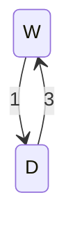

# 연속시간 Markov 연쇄

# 개요

**연속시간 Markov 연쇄(continuous-time Markov chain)** 는 아무 순간에나 상태를 바꿀 수 있고, 다음 변화가 지금 상태만으로 정해지는 무작위 과정이다. 작동 중인 기계가 하루에 평균 $1$ 번 고장 나고, 고장 난 기계는 평균 $1/3$ 일 만에 고쳐진다. 지금 작동하는 기계가 하루 뒤에도 작동하고 있을 확률이 이런 물음이다.

연속시간 Markov 연쇄는 상태마다 다른 상태로 넘어가는 빈도를 행렬 $Q$ 하나로 적고, 시간 $t$ 뒤의 전이확률을 [행렬 지수](matrix-exponential.md) $e^{tQ}$ 로 계산해 이 물음에 답한다.

# 직관

기계의 상태는 작동(W)과 고장(D) 둘이다. [Markov 연쇄](markov-chains.md)는 걸음 단위로 움직이므로, 하루를 길이 $h$ 의 짧은 걸음으로 자른다. 걸음 하나 동안 작동하던 기계가 고장 날 확률을 $h$, 고장 난 기계가 고쳐질 확률을 $3h$ 로 놓는다. $h=0.1$ 이면 한 걸음의 전이행렬은 다음이다.

$$
P_{0.1}=\begin{pmatrix}0.9&0.1\cr 0.3&0.7\end{pmatrix}
$$

이 행렬의 고윳값은 $1$ 과 $1-4h$ 이고, 작동에서 출발해 $n$ 걸음 뒤에 작동하고 있을 확률은 $3/4+(1-4h)^n/4$ 이다. 하루는 $n=1/h$ 걸음이다. $h=0.1$ 이면 $0.7515$, $h=0.01$ 이면 $0.7542$ 가 나온다.

걸음을 잘게 자를수록 $(1-4h)^{1/h}$ 는 $e^{-4}$ 에 다가가고, 확률은 $3/4+e^{-4}/4\approx 0.7546$ 에 다가간다. 걸음 길이가 남지 않는 극한이 연속시간 연쇄다. 한 걸음의 전이행렬을 $I+hQ$ 로 쓰면 하루 뒤의 전이행렬은 $(I+hQ)^{1/h}$ 이고, 그 극한이 $e^{Q}$ 다. 여기서 $Q$ 는 다음 행렬이다.

$$
Q=\begin{pmatrix}-1&1\cr 3&-3\end{pmatrix}
$$

같은 극한으로 작동 상태에 머무는 시간도 나온다. 시간 $t$ 까지 한 번도 고장 나지 않을 확률은 $(1-h)^{t/h}$ 이고 그 극한은 $e^{-t}$ 다. 작동 상태에 머무는 시간은 평균 $1$ 일의 [지수분포](exponential-distribution.md)를 따른다.

# 정의

## 연속시간 Markov 연쇄

가산 집합 $S$ 에 값을 갖는 확률변수의 모임 $(X_t)\_{t\ge 0}$ 가 모든 $s,t\ge 0$ 와 $s$ 이전의 모든 이력에 대해 다음을 만족하면 **연속시간 Markov 연쇄** 라 한다.

$$
\Pr\lbrack X_{s+t}=j\mid X_s=i,\ (X_u)\_{u\le s}\rbrack=p_{ij}(t)
$$

오른쪽이 $s$ 에 의존하지 않는다는 것까지 포함한 정의다. 행렬 $P(t)=(p_{ij}(t))$ 를 **전이확률 행렬(transition matrix)** 이라 한다. 직관 절의 기계에서 $p_{WW}(1)=3/4+e^{-4}/4$ 다.

## 전이율 행렬

$P(t)$ 의 $t=0$ 에서의 미분을 **전이율 행렬(rate matrix, generator)** $Q$ 라 한다.

$$
Q=P'(0)=\lim_{h\to 0}\frac{P(h)-I}{h}
$$

$i\ne j$ 이면 $q_{ij}\ge 0$ 이고 이것을 $i$ 에서 $j$ 로의 **전이율(transition rate)** 이라 한다. 각 행의 합은 $0$ 이므로 대각 성분은 $q_{ii}=-q_i$, $q_i=\sum_{j\ne i}q_{ij}$ 다. 기계의 $Q$ 에서 $q_{WD}=1$, $q_{DW}=3$, $q_W=1$, $q_D=3$ 이다.

## 체류 시간과 점프 연쇄

상태 $i$ 에 들어온 연쇄가 그 상태에 머무는 시간을 **체류 시간(holding time)** 이라 한다. 체류 시간은 $\mathrm{Exp}(q_i)$ 를 따르고, 떠날 때 $j$ 로 갈 확률은 $q_{ij}/q_i$ 다. 상태가 바뀌는 순서만 모은 이산 연쇄를 **점프 연쇄(jump chain)** 라 한다. 기계는 작동 상태에 평균 $1$ 일, 고장 상태에 평균 $1/3$ 일 머물고, 점프 연쇄는 W 와 D 를 번갈아 간다.

## 정상분포

확률분포 $\pi$ 가 다음을 만족하면 **정상분포(stationary distribution)** 라 한다.

$$
\pi Q=0
$$

기계에서는 $-\pi_W+3\pi_D=0$ 과 $\pi_W+\pi_D=1$ 에서 $\pi=(3/4,\thinspace 1/4)$ 이다. 직관 절의 확률이 다가가는 값 $3/4$ 가 $\pi_W$ 다.

# 성질

## Kolmogorov 방정식

정리. $S$ 가 유한하면 $P(t)$ 는 **Kolmogorov 뒤 방정식(backward equation)** 과 **앞 방정식(forward equation)** 을 만족하고, 그 유일한 해는 $e^{tQ}$ 다[^1].

$$
P'(t)=QP(t),\qquad P'(t)=P(t)Q,\qquad P(0)=I
$$

증명의 요지. Chapman–Kolmogorov 식(Chapman–Kolmogorov equation) $P(t+h)=P(t)P(h)=P(h)P(t)$ 에서 $P(t)$ 를 빼고 $h$ 로 나누어 $h\to 0$ 으로 보낸다. 상수계수 선형 미분방정식의 해는 행렬 지수로 유일하게 적힌다.

## 두 상태 연쇄의 닫힌 꼴

$a,b\gt 0$ 에 대해 두 상태 연쇄의 전이율 행렬은 다음이다.

$$
Q=\begin{pmatrix}-a&a\cr b&-b\end{pmatrix},\qquad Q^2=-(a+b)Q
$$

$Q^n=(-(a+b))^{n-1}Q$ 를 지수급수에 넣으면 다음이 나온다.

$$
P(t)=e^{tQ}=I+\frac{1-e^{-(a+b)t}}{a+b}\thinspace Q
$$

기계는 $a=1$, $b=3$ 이므로 $p_{WW}(t)=3/4+e^{-4t}/4$ 다. $t=1$ 에서 직관 절의 극한 $0.7546$ 이 나온다.

## 정상분포로의 수렴

정리. $S$ 가 유한하고 연쇄가 기약이면 정상분포 $\pi$ 가 유일하게 존재하고, 모든 $i,j$ 에 대해 $p_{ij}(t)\to\pi_j$ 다[^1].

이산 Markov 연쇄와 달리 주기 조건이 없다. 기약이면 모든 $t\gt 0$ 에서 $p_{ij}(t)\gt 0$ 이므로 홀짝 진동이 생기지 않는다. $\pi$ 가 정상분포라는 것은 모든 $t$ 에서 $\pi P(t)=\pi$ 인 것과 동치이고, 이것은 $\pi P(t)$ 를 미분한 값 $\pi QP(t)$ 가 $0$ 인 것에서 나온다.

## 균일화

$\lambda\ge\max_i q_i$ 인 수 $\lambda$ 를 잡고 $R=I+Q/\lambda$ 로 두면 $R$ 은 확률행렬이고 다음이 성립한다. 이 표현을 **균일화(uniformization)** 라 한다[^2].

$$
P(t)=\sum_{n=0}^{\infty}e^{-\lambda t}\frac{(\lambda t)^n}{n!}R^n
$$

$e^{tQ}=e^{-\lambda t}e^{\lambda tR}$ 를 전개한 식이다. 연쇄는 세기 $\lambda$ 의 시계가 울릴 때마다 $R$ 로 한 걸음 가고, 울린 횟수는 [Poisson 분포](poisson-distribution.md)를 따른다. 기계에서 $\lambda=3$ 이면 $R$ 의 첫 행은 $(2/3,\thinspace 1/3)$, 둘째 행은 $(1,\thinspace 0)$ 이다. 모든 항이 음이 아니어서 수치 계산에서 상쇄 오차가 생기지 않는다.

## 폭발

$S$ 가 무한하면 유한 시간 안에 점프가 무한히 일어날 수 있다. 이것을 **폭발(explosion)** 이라 한다. 상태 $n$ 에서 $n+1$ 로만 전이율 $2^n$ 으로 뛰는 연쇄는 체류 시간의 평균 합이 $\sum_n 2^{-n}=2$ 로 유한하므로 확률 $1$ 로 유한 시간에 폭발한다. 이 연쇄에서는 Kolmogorov 뒤 방정식의 해가 유일하지 않다[^1].

# 활용

- [출생사망 과정](birth-death-process.md)은 개수가 하나씩만 바뀌는 연속시간 Markov 연쇄이고, $\pi Q=0$ 이 상세균형으로 풀린다.
- [Poisson 과정](poisson-process.md)은 $i$ 에서 $i+1$ 로만 같은 전이율로 뛰는 연쇄다.
- [대기행렬](queues.md)의 M/M/1 모형은 손님 수를 상태로 둔 연속시간 Markov 연쇄다.
- [Kingman 합류](kingman-coalescent.md)는 표본 계보의 분할을 상태로 둔 연속시간 Markov 연쇄다.
- [행렬 로그](matrix-logarithm.md)의 끼워 넣기 문제는 관측한 전이확률 행렬 $P$ 가 어떤 전이율 행렬의 $e^Q$ 인지 묻는다.
- 분자 계통학의 [Jukes–Cantor 모형](jukes-cantor-model.md)은 염기 네 개 사이를 같은 전이율로 바꾸는 연쇄이고, $e^{tQ}$ 로 두 서열 사이의 진화 거리를 추정한다.

[^1]: J. R. Norris, *Markov Chains*, Cambridge University Press (1997), Chapter 2(전이율 행렬, Kolmogorov 방정식, 체류 시간과 점프 연쇄, 폭발)와 Chapter 3(정상분포와 수렴정리).
[^2]: A. Jensen, "Markoff chains as an aid in the study of Markoff processes", *Skandinavisk Aktuarietidskrift* 36 (1953), 87–91.

# 연관 문서

## 선수지식

- [Markov 연쇄](markov-chains.md)
- [행렬 지수](matrix-exponential.md)
- [지수분포](exponential-distribution.md)

## 더 알아보기

- [출생사망 과정](birth-death-process.md)
- [Gillespie 알고리즘](gillespie-algorithm.md)
- [Jukes–Cantor 모형](jukes-cantor-model.md)

#probability #linear_algebra #analysis
