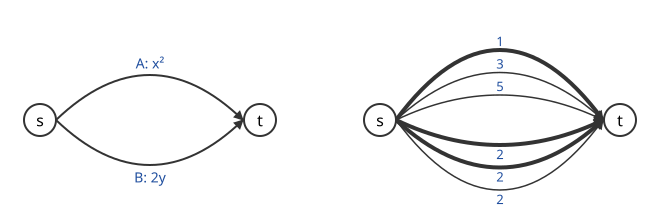

# 볼록 비용 흐름

# 개요

**볼록 비용 흐름(convex-cost flow)** 은 간선마다 비용이 흐르는 양의 볼록함수인 네트워크에서, 정한 양을 보내는 흐름 가운데 비용의 합이 가장 작은 것을 찾는 문제다. 두 도시를 잇는 길이 둘이고, 한 길은 차가 몰릴수록 막혀 $x$ 대를 보내는 비용이 $x^2$, 다른 길은 한 대에 $2$ 씩 들 때, 차 세 대를 두 길에 어떻게 나눌지가 이 꼴이다. 비용을 한 대가 늘 때마다 더해지는 양으로 쪼개면 [최소 비용 흐름](min-cost-flow.md) 문제가 되고, 그 해가 가장 싼 배분이다.

# 직관

도시 $s$ 에서 $t$ 로 차 세 대를 보낸다. 길 $A$ 로 $x$ 대를 보내는 비용은 $x^2$, 길 $B$ 로 $y$ 대를 보내는 비용은 $2y$ 다. 나누는 방법은 넷이고 비용은 다음과 같다.

| A 로 보낸 수 | B 로 보낸 수 | 비용 |
| ------------ | ------------ | ---- |
| 3            | 0            | 9    |
| 2            | 1            | 6    |
| 1            | 2            | 5    |
| 0            | 3            | 6    |

$A$ 에 한 대, $B$ 에 두 대가 가장 싸다. 최소 비용 흐름 문서에서는 한 단위의 비용이 간선마다 정해져 있었는데, 여기서는 $A$ 의 한 대당 비용이 이미 보낸 수에 따라 커진다.

길 $A$ 로 $k$ 번째 차를 더 보낼 때 늘어나는 비용은 $k^2-(k-1)^2=2k-1$, 곧 $1$, $3$, $5$ 다. 그래서 길 $A$ 를 용량이 $1$ 이고 비용이 $1$, $3$, $5$ 인 길 세 개로, 길 $B$ 를 용량이 $1$ 이고 비용이 $2$ 인 길 세 개로 바꾼다. 아래 그림의 왼쪽이 원래의 두 길이고, 오른쪽이 바꾼 여섯 길이다. 오른쪽의 굵은 선이 최소 비용 흐름이 쓰는 길이다.

이 네트워크에서 $3$ 을 보내는 최소 비용 흐름은 비용 $1$, $2$, $2$ 인 길을 쓰고 합이 $5$ 다. 비용이 $1,3,5$ 로 커지므로 $A$ 의 사본은 싼 것부터 채워지고, 사본에 흐르는 양의 합이 그대로 $A$ 에 흐르는 양이다.

$A$ 에 한 대, $B$ 에 두 대인 배분에서 차 한 대를 $B$ 에서 $A$ 로 옮기면 비용이 $3-2=1$ 늘고, $A$ 에서 $B$ 로 옮기면 $-1+2=1$ 는다. 어느 쪽으로 옮겨도 비용이 줄지 않으므로 이 배분이 가장 싸다.

# 정의

유향 그래프 $G=(V,E)$ 의 정점마다 공급량 $\beta(v)$ 가 있고 $\sum_v\beta(v)=0$ 이다. 간선 $e$ 마다 용량 $u_e$ 와 [볼록성](convexity.md) 문서의 볼록함수 $c_e:\lbrack 0,u_e\rbrack\to\mathbb R$ 가 있다. **볼록 비용 흐름 문제** 는 다음이다.

$$
\begin{aligned}
\text{최소화}\quad&\sum_{e\in E}c_e(f_e)\cr
\text{제약}\quad&\sum_{e\text{ 가 }v\text{ 에서 나감}}f_e-\sum_{e\text{ 가 }v\text{ 로 들어옴}}f_e=\beta(v),\qquad 0\le f_e\le u_e
\end{aligned}
$$

$c_e$ 가 정수점에서만 꺾이는 꺾은선 함수이고 용량과 공급량이 정수이면 **정수 볼록 비용 흐름** 이라 한다. 직관 절에서 $\beta(s)=3$, $\beta(t)=-3$ 이고 $c_A(x)=x^2$ 을 정수점 사이에서 직선으로 이은 함수와 $c_B(y)=2y$ 다.

정수 흐름 $f$ 의 **잔여 그래프(residual graph)** 는 $f_e\lt u_e$ 인 간선 $e=(v,w)$ 에 비용 $c_e(f_e+1)-c_e(f_e)$ 인 간선 $v\to w$ 를, $f_e\gt 0$ 인 간선에 비용 $c_e(f_e-1)-c_e(f_e)$ 인 거꾸로 간선 $w\to v$ 를 둔 그래프다. 직관 절의 최적 배분에서 $A$ 의 앞 간선 비용은 $3$, 거꾸로 간선 비용은 $-1$ 이고, $B$ 의 앞 간선 비용은 $2$, 거꾸로 간선 비용은 $-2$ 다.

# 성질

## 평행 간선으로의 변환

정수 볼록 비용 흐름 문제에서 간선 $e$ 를 용량 $1$ 인 평행 간선 $u_e$ 개로 바꾸고, $k$ 번째 간선의 비용을 $c_e(k)-c_e(k-1)$ 로 둔다. 두 문제의 최소 비용은 같다[^1].

볼록성 때문에 $c_e(k)-c_e(k-1)$ 은 $k$ 에 대해 줄지 않는다. 사본 흐름의 합이 $x$ 일 때 사본 비용의 합은 싼 사본 $x$ 개를 채울 때 가장 작고, 그 값이 $c_e(x)-c_e(0)$ 이다. 이 변환은 간선 수를 용량만큼 늘리므로 계산 시간이 용량의 크기에 비례한다.

## 최적성 조건

정수 흐름 $f$ 가 최적인 것은 다음 세 조건과 동치다[^1].

1. 잔여 그래프에 비용의 합이 음수인 순환이 없다.
2. 모든 간선 $e=(v,w)$ 에서 다음을 만족하는 퍼텐셜 $\pi:V\to\mathbb Z$ 가 존재한다.

$$
c_e(f_e)-c_e(f_e-1)\le\pi(w)-\pi(v)\le c_e(f_e+1)-c_e(f_e)
$$

3. 비용을 $c_e(x)-(\pi(w)-\pi(v))x$ 로 바꾸면 각 $f_e$ 가 그 함수를 정수점에서 최소로 한다.

직관 절에서 $\pi(s)=0$, $\pi(t)=2$ 로 두면 $A$ 에서 $1\le 2\le 3$, $B$ 에서 $2\le 2\le 2$ 가 성립한다. 미분가능한 볼록 비용에서 내부의 $f_e$ 에 대한 조건은 $c_e'(f_e)=\pi(w)-\pi(v)$ 다. 쓰이는 간선마다 한계 비용이 퍼텐셜의 차와 같다.

## 용량 스케일링

흐름을 $\Delta$ 단위로만 보내며 $\Delta$ 를 반씩 줄이는 용량 스케일링 알고리즘(capacity scaling algorithm)은 단계마다 퍼텐셜 조건을 $\Delta$ 단위로 유지한다. 단계 수가 $\log_2 U$ 규모이므로 용량의 최댓값 $U$ 에 대해 다항 시간이다[^1]. 비용이 이차함수인 경우처럼 특정 부류에서는 강다항 시간 알고리즘도 알려져 있다[^2].

# 활용

- 교통 배분. [가격 무정부](price-of-anarchy.md)의 Wardrop 균형은 지연 함수 $\ell_e$ 의 적분 $c_e(x)=\int_0^x\ell_e$ 를 비용으로 한 볼록 비용 흐름의 해다. 사회적 최적 흐름은 $c_e(x)=x\ell_e(x)$ 가 볼록일 때 그 비용의 볼록 비용 흐름이다. 두 해를 견준 비가 가격 무정부다.
- 전기 회로. 저항 $r_e$ 인 도선마다 양방향 간선을 두고 비용 $r_ex^2/2$ 를 두면, 공급량이 정해진 볼록 비용 흐름의 해가 회로에 흐르는 전류이고 퍼텐셜에 $-1$ 을 곱한 것이 전위다. 최적성 조건 $r_ef_e=\pi(w)-\pi(v)$ 가 Ohm 법칙(Ohm's law)이다.
- 생산과 재고 계획. 기간마다 생산량을 늘릴수록 단가가 오르는 비용, 재고를 쌓을수록 늘어나는 보관 비용을 볼록함수로 두면 기간 사이의 물량 이동이 볼록 비용 흐름이다.
- 행렬 맞추기와 회귀. 정해진 행합과 열합을 갖는 행렬 가운데 주어진 행렬과의 제곱 거리가 가장 작은 것을 찾는 문제는 이분 그래프의 이차 비용 흐름이다.

[^1]: R. K. Ahuja, T. L. Magnanti, J. B. Orlin, *Network Flows: Theory, Algorithms, and Applications*, Prentice Hall, 1993, Chapter 14.
[^2]: L. A. Végh, "A strongly polynomial algorithm for a class of minimum-cost flow problems with separable convex objectives", *SIAM J. Comput.* 45 (2016), 1729–1761.

# 연관 문서

## 선수지식

- [최소 비용 흐름](min-cost-flow.md)
- [볼록성](convexity.md)

## 더 알아보기

- [바람 부는 우편배달부 문제](windy-postman-problem.md)

#graph_theory #optimization #algorithms
