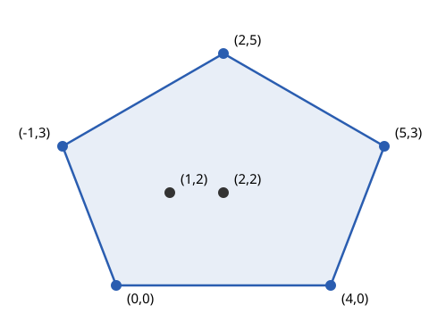

# 볼록 껍질 알고리즘

# 개요

**볼록 껍질 알고리즘(convex hull algorithm)** 은 평면의 점들이 주어졌을 때 그 점들을 모두 감싸는 가장 작은 볼록 다각형의 꼭짓점을 차례로 찾는 방법이다. 판에 못 일곱 개를 박고 바깥에 고무줄을 걸면 고무줄이 몇 개의 못에 걸린 다각형이 되는데, 못의 좌표만 보고 어느 못에 걸리는지 계산하는 문제가 이 꼴이다. 점들을 $x$ 좌표 순으로 정렬한 뒤 왼쪽에서 오른쪽으로 훑으며 안쪽으로 꺾이는 점을 버리면 $O(n\log n)$ 시간에 꼭짓점이 나온다.

# 직관

점 일곱 개 $(0,0)$, $(4,0)$, $(5,3)$, $(2,5)$, $(-1,3)$, $(2,2)$, $(1,2)$ 가 있다. 아래 그림의 파란 다각형이 고무줄이고, 고무줄에 걸린 점은 다섯 개, 안에 남은 점은 $(1,2)$ 와 $(2,2)$ 다.



고무줄의 아래쪽 반을 먼저 찾는다. 점을 $x$ 좌표 순으로 놓으면 $(-1,3)$, $(0,0)$, $(1,2)$, $(2,2)$, $(2,5)$, $(4,0)$, $(5,3)$ 이다. 이 순서로 점을 하나씩 이어 가다가, 마지막 두 점과 새 점이 시계 방향으로 꺾이면 가운데 점은 아래쪽 고무줄에 걸릴 수 없으므로 버린다.

$(-1,3)$, $(0,0)$, $(1,2)$ 까지는 반시계 방향으로 꺾여 셋을 모두 둔다. $(2,2)$ 가 오면 $(0,0)\to(1,2)\to(2,2)$ 가 시계 방향이라 $(1,2)$ 를 버린다.

$(2,5)$ 까지 이은 뒤 $(4,0)$ 이 오면 $(2,5)$ 와 $(2,2)$ 가 차례로 버려진다. 마지막에 $(5,3)$ 을 이으면 아래쪽 고무줄 $(-1,3)$, $(0,0)$, $(4,0)$, $(5,3)$ 이 남는다. 같은 일을 오른쪽에서 왼쪽으로 하면 위쪽 고무줄 $(5,3)$, $(2,5)$, $(-1,3)$ 이 나온다.

# 정의

## 볼록 껍질

평면의 유한 점 집합 $S$ 의 **볼록 껍질(convex hull)** $\mathrm{conv}(S)$ 는 $S$ 를 포함하는 [볼록](convexity.md) 집합 전체의 교집합이다. 점이 셋 이상이고 한 직선 위에 있지 않으면 $\mathrm{conv}(S)$ 는 꼭짓점이 $S$ 에 속하는 볼록 다각형이다. 볼록 껍질 문제는 이 꼭짓점을 반시계 방향 순서로 내놓는 문제다.

직관 절의 일곱 점에서 볼록 껍질은 꼭짓점이 $(0,0)$, $(4,0)$, $(5,3)$, $(2,5)$, $(-1,3)$ 인 오각형이다.

## 방향 판정

세 점 $o,a,b$ 에 대해 다음 값을 방향 판정식(orientation test)이라 한다.

$$
\mathrm{cross}(o,a,b)=(a\_x-o\_x)(b\_y-o\_y)-(a\_y-o\_y)(b\_x-o\_x)
$$

이 값이 양수이면 $o\to a\to b$ 가 반시계 방향으로 꺾이고, 음수이면 시계 방향, $0$ 이면 세 점이 한 직선 위에 있다. 직관 절에서 $o=(0,0)$, $a=(1,2)$, $b=(2,2)$ 의 값은 $1\cdot 2-2\cdot 2=-2$ 이므로 시계 방향이고 $(1,2)$ 가 버려졌다.

## 단조 사슬 알고리즘

**단조 사슬 알고리즘(monotone chain algorithm)** 은 Andrew 가 1979 년에 제안한 다음 절차다[^1]. 점을 $x$ 좌표, 같으면 $y$ 좌표 순으로 정렬하고, 아래쪽 사슬과 위쪽 사슬을 각각 스택으로 만든다.

```typescript
type Pt = [number, number];

const cross = (o: Pt, a: Pt, b: Pt): number =>
  (a[0] - o[0]) * (b[1] - o[1]) - (a[1] - o[1]) * (b[0] - o[0]);

function convexHull(points: Pt[]): Pt[] {
  const p = [...points].sort((u, v) => u[0] - v[0] || u[1] - v[1]);
  if (p.length < 3) return p;
  const chain = (pts: Pt[]): Pt[] => {
    const h: Pt[] = [];
    for (const q of pts) {
      while (h.length >= 2 && cross(h[h.length - 2], h[h.length - 1], q) <= 0) h.pop();
      h.push(q);
    }
    h.pop(); // 마지막 점은 다른 사슬의 첫 점이다
    return h;
  };
  return [...chain(p), ...chain([...p].reverse())];
}
```

직관 절의 계산이 아래쪽 사슬을 만드는 첫 `chain` 호출이다. 두 사슬을 이으면 $(-1,3)$, $(0,0)$, $(4,0)$, $(5,3)$, $(2,5)$ 가 반시계 방향으로 나온다.

# 성질

## 정당성

정리. 단조 사슬 알고리즘은 볼록 껍질의 꼭짓점을 반시계 방향으로 내놓는다[^1].

증명의 요지. 아래쪽 사슬에 대해, 앞에서 $k$ 개의 점을 처리한 뒤의 스택이 그 $k$ 개 점의 아래쪽 껍질이라는 것을 귀납법으로 보인다. 새 점 $q$ 는 지금까지의 점보다 오른쪽에 있으므로 새 아래쪽 껍질의 끝점이다. 스택 끝의 점 $b$ 와 그 앞의 $a$ 에 대해 $a\to b\to q$ 가 시계 방향이면 $b$ 는 선분 $aq$ 의 위에 있어 껍질에 들지 않는다. 반시계 방향이 되면 그 앞의 점들은 이미 볼록하게 꺾여 있으므로 멈춰도 된다.

## 시간

정렬에 $O(n\log n)$ 시간이 든다. 스캔에서는 각 점이 스택에 한 번 들어가고 많아야 한 번 나오므로 방향 판정이 $O(n)$ 번이다. 전체는 $O(n\log n)$ 이다. Graham 이 1972 년에 제안한 Graham 스캔(Graham scan)은 가장 아래의 점을 기준으로 각도 순으로 정렬하고 같은 스캔을 하는 판본이다[^2].

## 하한

[비교 정렬](comparison-sorting.md)의 수 $x\_1,\dots,x\_n$ 을 포물선 위의 점 $(x\_i,x\_i^2)$ 로 보내면 모든 점이 볼록 껍질의 꼭짓점이고, 껍질을 가장 왼쪽 점부터 반시계 방향으로 읽은 순서가 $x\_i$ 의 크기순이다. 그래서 볼록 껍질 알고리즘에 선형 시간을 더하면 정렬이 된다. Ben-Or 는 대수적 계산 나무(algebraic computation tree) 모형에서 정렬의 $\Omega(n\log n)$ 하한을 증명했고, 같은 모형에서 볼록 껍질에도 이 하한이 성립한다[^3].

## 출력에 따라 정해지는 시간

꼭짓점의 수를 $h$ 라 한다. 가장 왼쪽 점에서 시작해 다른 모든 점이 왼쪽에 놓이는 다음 점을 찾기를 되풀이하는 Jarvis 행진(Jarvis march)은 $O(nh)$ 시간이다. Kirkpatrick 와 Seidel 은 $O(n\log h)$ 알고리즘을 만들고 이 시간이 최적임을 보였다[^4]. Chan 은 점을 크기 $m$ 의 묶음으로 나눠 묶음마다 단조 사슬을 돌리고 묶음 껍질 위에서 Jarvis 행진을 하는 방법으로 같은 $O(n\log h)$ 를 더 간단히 얻었다[^5].

## 높은 차원

3 차원에서도 $O(n\log n)$ 시간 알고리즘이 있다. $d$ 차원에서는 [볼록 다면체](convex-polytopes.md)의 면의 수가 꼭짓점 $n$ 개에 대해 $n^{\lfloor d/2\rfloor}$ 의 차수까지 커질 수 있고, Chazelle 은 $d\ge 4$ 에서 $O(n^{\lfloor d/2\rfloor})$ 시간의 알고리즘으로 이 크기에 맞는 시간을 얻었다[^6].

# 활용

- 가장 먼 두 점. 점 집합에서 거리가 가장 먼 두 점은 볼록 껍질의 꼭짓점이므로, 껍질을 구한 뒤 [회전하는 캘리퍼스](rotating-calipers.md)로 맞은편 꼭짓점 쌍을 선형 시간에 훑는다.
- 선형 분리. 두 점 집합을 직선 하나로 가를 수 있는 것은 두 볼록 껍질이 서로 겹치지 않는 것과 동치다.
- 충돌 판정. 물체를 볼록 껍질로 감싸 두 껍질이 겹치는지 먼저 확인하고, 겹칠 때만 정밀하게 계산한다.
- 하한 문제의 환원. 정렬과의 환원은 다른 기하 문제의 $\Omega(n\log n)$ 하한을 보이는 데도 쓰인다.

[^1]: A. M. Andrew, "Another efficient algorithm for convex hulls in two dimensions", Information Processing Letters 9 (1979), 216–219.
[^2]: R. L. Graham, "An efficient algorithm for determining the convex hull of a finite planar set", Information Processing Letters 1 (1972), 132–133.
[^3]: M. Ben-Or, "Lower bounds for algebraic computation trees", ACM Symposium on Theory of Computing (STOC) 1983, 80–86.
[^4]: D. G. Kirkpatrick, R. Seidel, "The ultimate planar convex hull algorithm?", SIAM Journal on Computing 15 (1986), 287–299.
[^5]: T. M. Chan, "Optimal output-sensitive convex hull algorithms in two and three dimensions", Discrete & Computational Geometry 16 (1996), 361–368.
[^6]: B. Chazelle, "An optimal convex hull algorithm in any fixed dimension", Discrete & Computational Geometry 10 (1993), 377–409.

# 연관 문서

## 선수지식

- [비교 정렬](comparison-sorting.md)
- [볼록성](convexity.md)

## 더 알아보기

- [회전하는 캘리퍼스](rotating-calipers.md)
- [Delaunay 삼각분할](delaunay-triangulation.md)
- [Bentley–Ottmann 알고리즘](bentley-ottmann.md)

#algorithms #computation #optimization
