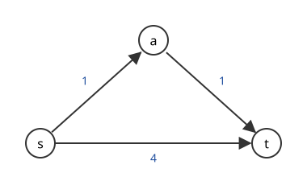

# 비용 척도 조정 알고리즘

# 개요

**비용 척도 조정 알고리즘(cost scaling algorithm)** 은 최소 비용 흐름을 찾을 때 비용 조건을 처음에는 크게 느슨하게 두고, 그 느슨한 폭을 반씩 줄여 가며 흐름을 고치는 알고리즘이다. 정점 $s$ 에서 $t$ 로 한 단위를 보내는데 곧바로 가는 길의 비용이 $4$ 이고 $a$ 를 거쳐 가는 길의 비용이 $1+1=2$ 라면, 비싼 길로 보낸 흐름을 싼 길로 옮겨야 한다.

폭이 정해진 단계마다 정점에 남는 양을 축소 비용이 음수인 간선으로 보내고, 보낼 곳이 없으면 그 정점의 퍼텐셜을 내린다. 폭이 정점 수의 역수보다 작아지면 흐름이 최적이다.

# 직관

아래 그림의 네트워크에서 간선 옆의 수는 한 단위를 보내는 비용이고, 용량은 모두 $1$ 이다. $s$ 에서 $t$ 로 $1$ 을 보내는 흐름으로 $s\to t$ 에 $1$ 을 흘린 것에서 시작한다. 비용은 $4$ 다.



[최소 비용 흐름](min-cost-flow.md)의 잔여 그래프에는 거꾸로 간선 $t\to s$ 가 비용 $-4$ 로 있다. 퍼텐셜을 모두 $0$ 으로 두면 축소 비용이 $-4$ 인 간선이 하나 있으므로, 이 흐름은 축소 비용이 모두 $-4$ 이상이라는 느슨한 조건만 만족한다. 폭을 $4$ 에서 $2$ 로 줄여 축소 비용이 모두 $-2$ 이상이 되게 고친다.

먼저 축소 비용이 음수인 $t\to s$ 를 채운다. $s\to t$ 의 흐름이 취소되어 $s$ 에 $1$ 이 남고 $t$ 에 $1$ 이 모자란다. $s$ 에서 나가는 잔여 간선 $s\to a$, $s\to t$ 의 축소 비용은 $1$, $4$ 이고 음수인 것이 없으므로 $s$ 의 퍼텐셜을 $2$ 만큼 내려 $\pi(s)=-2$ 로 둔다. 그러면 $s\to a$ 의 축소 비용이 $1-2-0=-1$ 이 되어 $s$ 의 $1$ 을 $a$ 로 보낸다.

$a$ 에서 나가는 잔여 간선 $a\to t$, $a\to s$ 의 축소 비용은 $1$, $-1+0+2=1$ 이다. $a$ 의 퍼텐셜을 $2$ 만큼 내리면 $a\to t$ 의 축소 비용이 $-1$ 이 되어 $1$ 을 $t$ 로 보낸다. 남거나 모자란 정점이 없으므로 이 단계가 끝난다.

흐름은 $s\to a\to t$ 이고 비용은 $2$ 다. 퍼텐셜 $\pi(s)=-2$, $\pi(a)=-2$, $\pi(t)=0$ 에서 잔여 간선 $s\to t$, $a\to s$, $t\to a$ 의 축소 비용은 $2$, $-1$, $1$ 로 모두 $-2$ 이상이다. 잔여 그래프의 순환 $s\to t\to a\to s$ 의 비용이 $4-1-1=2$ 로 음수가 아니므로 이 흐름은 최적이다.

# 정의

## ε 최적 흐름

[최소 평균 순환 제거법](minimum-mean-cycle-canceling.md)에서처럼, 흐름 $f$ 와 퍼텐셜 $\pi$ 가 잔여 그래프 $G\_f$ 의 모든 간선에서

$$
w^\pi(u,v)=w(u,v)+\pi(u)-\pi(v)\ge-\varepsilon
$$

를 만족하면 $f$ 를 $\pi$ 에 대해 **ε 최적(ε-optimal)** 이라 한다. 직관 절의 처음 흐름은 $\pi=0$ 에 대해 $4$ 최적이고, 끝난 흐름은 위 퍼텐셜에 대해 $2$ 최적이다.

## 선흐름과 허용 간선

공급 조건을 만족하지 않아도 되고 용량 조건만 만족하는 $f$ 를 **선흐름(preflow, pseudoflow)** 이라 한다. 정점 $v$ 에서 들어온 양과 공급량의 합에서 나간 양을 뺀 값을 $v$ 의 **초과량(excess)** $e(v)$ 라 하고, $e(v)\gt 0$ 인 정점을 **활성(active)** 정점이라 한다. 축소 비용이 음수인 잔여 간선을 **허용 간선(admissible edge)** 이라 한다.

직관 절에서 $t\to s$ 를 채운 직후 $e(s)=1$, $e(t)=-1$ 이고, $s$ 가 활성 정점이다. $\pi(s)=-2$ 로 내린 뒤의 $s\to a$ 가 허용 간선이다.

## 다듬기 단계

폭 $\varepsilon$ 에 대한 **다듬기(refine)** 는 $2\varepsilon$ 최적 흐름을 받아 $\varepsilon$ 최적 흐름을 내놓는 다음 절차다.

1. 축소 비용이 음수인 잔여 간선을 모두 채운다. 결과는 $0$ 최적인 선흐름이다.
2. 활성 정점 $v$ 가 있는 동안 다음을 한다. $v$ 에서 나가는 허용 간선 $(v,x)$ 가 있으면 $e(v)$ 와 잔여 용량 가운데 작은 양을 보낸다(push). 없으면 $\pi(v)$ 를 $\varepsilon$ 만큼 내린다(relabel).

**비용 척도 조정 알고리즘** 은 공급 조건을 만족하는 흐름 하나와 $\pi=0$, $\varepsilon=C$ 에서 시작해 $\varepsilon$ 을 반으로 줄이고 다듬기를 하는 일을 $\varepsilon\lt 1/n$ 이 될 때까지 되풀이한다. $C$ 는 간선 비용의 절댓값의 최댓값이고 $n$ 은 정점 수다. 직관 절은 $C=4$ 에서 시작한 첫 다듬기 단계다.

```typescript
function costScaling(G: Network, f: Flow): Flow {
  const pi = new Map<Vertex, number>(G.vertices.map((v) => [v, 0]));
  let eps = G.maxAbsCost;
  while (eps >= 1 / G.vertices.length) {
    eps = eps / 2;
    for (const e of G.residualEdges(f))
      if (reducedCost(e, pi) < 0) f.saturate(e);
    let v = f.activeVertex();
    while (v !== null) {
      const e = G.residualEdgesFrom(f, v).find((e) => reducedCost(e, pi) < 0);
      if (e) f.push(e, Math.min(f.excess(v), f.residualCapacity(e)));
      else pi.set(v, pi.get(v)! - eps);
      v = f.activeVertex();
    }
  }
  return f;
}
```

# 성질

## 다듬기가 지키는 것

다듬기 중의 선흐름은 언제나 $\varepsilon$ 최적이다. push 로 생기는 잔여 간선은 허용 간선의 거꾸로 간선이므로 축소 비용이 양수다. relabel 하기 전 $v$ 에서 나가는 잔여 간선은 축소 비용이 모두 $0$ 이상이므로, $\pi(v)$ 를 $\varepsilon$ 만큼 내린 뒤에도 $-\varepsilon$ 이상이다. $v$ 로 들어오는 간선의 축소 비용은 커지기만 한다.

## 시작과 끝

간선 비용의 절댓값이 $C$ 이하이면 공급 조건을 만족하는 모든 흐름은 $\pi=0$ 에 대해 $C$ 최적이다.

비용이 정수이고 $\varepsilon\lt 1/n$ 이면 $\varepsilon$ 최적 흐름은 최적이다. 순환을 따라 축소 비용을 더하면 퍼텐셜 항이 지워져 비용 합과 같으므로, 간선이 $n$ 개 이하인 순환의 비용은 $-n\varepsilon\gt-1$ 보다 크다. 비용 합은 정수이므로 $0$ 이상이고, 최소 비용 흐름의 음수 순환 조건에 따라 흐름이 최적이다.

그러므로 다듬기 단계는 $\lceil\log\_2(nC)\rceil+1$ 번 이하다.

## 다듬기 한 번의 연산 횟수

다듬기 한 번에서 정점마다 relabel 은 $3n$ 번 이하다[^1]. 활성 정점 $v$ 에서 초과량이 음수인 정점으로 가는 잔여 경로가 있고, 그 경로에 지금의 $\varepsilon$ 최적성을, 단계를 시작할 때의 선흐름에 $0$ 최적성을 적용하면 $\pi(v)$ 가 내려간 양이 $3n\varepsilon$ 이하로 묶인다.

relabel 의 횟수로 push 를 세는 방법은 [push–relabel 알고리즘](push-relabel-algorithm.md)과 같다. 간선을 채우는 push 는 $O(nm)$ 번, 채우지 않는 push 는 $O(n^2m)$ 번이다. $m$ 은 간선 수다. 다듬기 한 번이 $O(n^2m)$ 시간이고, 전체는

$$
O\bigl(n^2m\log(nC)\bigr)
$$

시간이다. Goldberg 와 Tarjan 은 활성 정점을 고르는 순서와 동적 나무(dynamic tree)를 써서 이것을 $O(nm\log(n^2/m)\log(nC))$ 로 줄였다[^1].

# 활용

- 최소 비용 흐름의 실용 풀이기. Goldberg 의 CS2(cost scaling 2) 구현은 활성 정점을 FIFO(first in, first out) 순서로 고르고 퍼텐셜을 한꺼번에 고치는 휴리스틱을 더한 비용 척도 조정 알고리즘이다[^2].
- [할당 문제](assignment-problem.md). 이분그래프의 할당 문제에 비용 척도 조정을 적용한 Goldberg–Kennedy 알고리즘과 Bertsekas 의 경매 알고리즘(auction algorithm)은 같은 ε 최적 조건을 쓴다[^3].
- [최소 평균 순환 제거법](minimum-mean-cycle-canceling.md)과의 비교. 두 알고리즘은 같은 ε 최적 개념으로 분석되고, 최소 평균 순환 제거법은 순환을 통째로 흘려 ε 을 줄이며 비용 척도 조정은 정점 단위의 push 와 relabel 로 줄인다.

[^1]: A. V. Goldberg, R. E. Tarjan, "Finding minimum-cost circulations by successive approximation", *Mathematics of Operations Research* 15 (1990), 430–466.
[^2]: A. V. Goldberg, "An efficient implementation of a scaling minimum-cost flow algorithm", *Journal of Algorithms* 22 (1997), 1–29.
[^3]: A. V. Goldberg, R. Kennedy, "An efficient cost scaling algorithm for the assignment problem", *Mathematical Programming* 71 (1995), 153–177.

# 연관 문서

## 선수지식

- [push–relabel 알고리즘](push-relabel-algorithm.md)
- [최소 평균 순환 제거법](minimum-mean-cycle-canceling.md)

## 더 알아보기

- [Tardos 알고리즘](tardos-algorithm.md)

#graph_theory #optimization #algorithms
