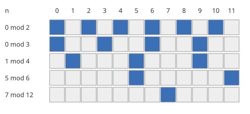

# 덮개 합동계

# 개요

**덮개 합동계(covering system)** 는 모든 정수가 적어도 하나를 만족하도록 고른 합동식 유한 개의 모임이다. 주기가 $2,3,4,6,12$ 일인 당번 다섯 명에게 첫 근무일을 정해 주어 어느 날이든 당번이 한 명 이상 나오게 하는 문제가 이 꼴이다. 주기가 모두 $12$ 의 약수이므로 근무표는 $12$ 일마다 되풀이되고, 첫 $12$ 일이 덮이는지만 확인하면 답이 나온다.

# 직관

날짜에 $0,1,2,\dots$ 의 번호를 붙인다. 주기가 $d$ 일인 당번이 $a$ 번 날에 처음 나오면, 그 당번이 나오는 날은 번호를 $d$ 로 나눈 나머지가 $a$ 인 날 전부다. 주기 $2$ 인 당번을 $0$ 번 날에 두면 짝수 날이 전부 덮이고 홀수 날이 남는다.

주기 $3$ 인 당번을 $0$ 번 날에 두면 $3,9,15,\dots$ 의 홀수 날이 덮인다. 남은 날의 번호를 $12$ 로 나누면 나머지가 $1,5,7,11$ 가운데 하나다.

주기 $4$ 인 당번을 $1$ 번 날에 두면 나머지 $1,5$ 가 덮이고, 주기 $6$ 인 당번을 $5$ 번 날에 두면 나머지 $11$ 이 덮인다. 마지막으로 남은 나머지 $7$ 은 주기 $12$ 인 당번을 $7$ 번 날에 두어 덮는다.

아래 그림은 $0$ 번부터 $11$ 번까지의 날마다 다섯 당번 가운데 누가 나오는지를 칠한 것이다. 줄마다 왼쪽에 그 당번의 첫 근무일과 주기를 적었고, 어느 열에도 칠한 칸이 하나 이상 있다.

$n$ 번 날과 $n+12$ 번 날은 번호를 $2,3,4,6,12$ 로 나눈 나머지가 모두 같으므로 같은 당번이 나온다. 그래서 첫 $12$ 일이 덮이면 모든 날이 덮인다.

# 정의

## 덮개 합동계

정수 $a_i$ 와 $d_i\ge 2$ 의 쌍 유한 개에 대해 다음 합동식의 모임을 생각한다.

$$
n\equiv a_i\pmod{d_i}\qquad (i=1,\dots,k)
$$

모든 정수 $n$ 이 이 가운데 적어도 하나를 만족하면 이 모임을 **덮개 합동계** 라 하고, $d_i$ 를 그 계의 법이라 한다. 법이 $1$ 인 합동식은 혼자서 모든 정수를 덮으므로 빼 둔다. 직관 절의 당번표는 다음 덮개 합동계다.

$$
n\equiv 0\pmod 2,\quad n\equiv 0\pmod 3,\quad n\equiv 1\pmod 4,\quad n\equiv 5\pmod 6,\quad n\equiv 7\pmod{12}
$$

법이 모두 다른 덮개 합동계를 **서로 다른 법의 덮개 합동계(distinct covering system)** 라 하고, 계의 법 가운데 가장 작은 것을 **최소 법(minimum modulus)** 이라 한다. 직관 절의 계는 법이 모두 다르고 최소 법이 $2$ 다.

## 정확 덮개 합동계

모든 정수가 계의 합동식 가운데 정확히 하나를 만족하면 그 계를 **정확 덮개 합동계(exact covering system)** 라 한다. 직관 절의 계는 정확하지 않다. $0$ 번 날에 주기 $2$ 인 당번과 주기 $3$ 인 당번이 함께 나온다. 다음 계는 정확 덮개 합동계다.

$$
n\equiv 0\pmod 2,\quad n\equiv 1\pmod 4,\quad n\equiv 3\pmod 4
$$

두 합동식 $n\equiv a\pmod d$ 와 $n\equiv b\pmod e$ 가 공통해를 갖는 것은 $a\equiv b\pmod{\gcd(d,e)}$ 와 동치다. 이것은 [중국인의 나머지 정리](chinese-remainder-theorem.md)를 서로소가 아닌 법으로 넓힌 진술이다. 위 계의 $n\equiv 0\pmod 2$ 와 $n\equiv 1\pmod 4$ 는 $\gcd(2,4)=2$ 를 법으로 $0\not\equiv 1$ 이므로 공통해가 없다.

# 성질

## 유한 번의 확인

법의 최소공배수를 $L$ 로 둔다. 정수 $n$ 과 $n+L$ 은 각 $d_i$ 로 나눈 나머지가 같으므로 같은 합동식들을 만족한다. 따라서 $0,1,\dots,L-1$ 이 모두 덮이면 계는 덮개 합동계다. 직관 절의 계에서는 $L=12$ 이다.

## 밀도 부등식

덮개 합동계이면 다음이 성립하고, 정확 덮개 합동계이면 등호가 성립한다.

$$
\sum_{i=1}^{k}\frac{1}{d_i}\ge 1
$$

증명의 요지. $0,1,\dots,L-1$ 가운데 $i$ 번째 합동식을 만족하는 수는 $L/d_i$ 개다. 이 $L$ 개의 수가 모두 덮이므로 $L/d_i$ 를 모두 더한 값이 $L$ 이상이고, 정확하면 각 수가 한 번씩만 세어져 합이 $L$ 이다. 직관 절의 계에서 좌변은 $16/12$ 이다.

역은 성립하지 않는다. $n\equiv 0\pmod 2$, $n\equiv 0\pmod 3$, $n\equiv 0\pmod 6$ 은 좌변이 $1$ 이지만 $n=1$ 을 덮지 못한다.

## Mirsky–Newman 정리

**Mirsky–Newman 정리(Mirsky–Newman theorem)** 는 정확 덮개 합동계에서 가장 큰 법이 두 번 이상 나온다는 정리다. 앞 절의 정확 덮개 합동계에서 가장 큰 법 $4$ 가 두 번 나온다. 따라서 법이 모두 다른 정확 덮개 합동계는 없다.

증명의 요지. $0\le a_i\lt d_i$ 로 두면 음이 아닌 정수 $n$ 마다 정확히 하나의 $i$ 에서 $n\equiv a_i\pmod{d_i}$ 이므로, $\vert z\vert\lt 1$ 에서 다음이 성립한다.

$$
\frac{1}{1-z}=\sum_{n\ge 0}z^n=\sum_{i=1}^{k}\frac{z^{a_i}}{1-z^{d_i}}
$$

가장 큰 법 $d$ 가 한 번만 나온다고 하고 $\omega=e^{2\pi i/d}$ 로 둔다. $z$ 가 반지름을 따라 $\omega$ 로 가면 $d_i\lt d$ 인 항은 $\omega^{d_i}\ne 1$ 이므로 유한한 값으로 가고, 법이 $d$ 인 항 하나만 발산한다. 좌변은 $\omega\ne 1$ 이므로 유한한 값으로 가서 모순이다.

## 최소 법 정리

Erdős 는 서로 다른 법의 덮개 합동계에서 최소 법을 얼마든지 크게 할 수 있는지 물었다. **최소 법 정리(minimum modulus theorem)** 는 서로 다른 법의 덮개 합동계의 최소 법이 $10^{16}$ 이하라는 정리이고, Hough 가 증명했다.[^2] 따라서 Erdős 의 물음의 답은 "할 수 없다" 다.

Hough 와 Nielsen 은 서로 다른 법의 덮개 합동계에는 $2$ 나 $3$ 으로 나누어지는 법이 반드시 있다는 것을 증명했다.[^3]

## 알려진 열린 문제

법이 모두 홀수인 서로 다른 법의 덮개 합동계가 있는지는 Erdős 와 Selfridge 가 물은 홀수 법 문제(odd covering problem)이고, 열려 있다.[^4] 앞 절의 Hough–Nielsen 정리에 따라 그런 계가 있다면 법 가운데 $3$ 의 배수가 있다.

# 활용

- [Sierpiński 수](sierpinski-numbers.md). 소수 $p$ 가 $k\cdot 2^n+1$ 을 나누는 $n$ 은 법 $p$ 에서 $2$ 의 위수를 법으로 하는 나머지 하나다. 소수마다 얻은 합동식이 덮개 합동계를 이루면 $k\cdot 2^n+1$ 은 모든 $n$ 에서 합성수다. $78557$ 은 법이 $2,3,4,9,12,18,36$ 인 덮개 합동계를 쓴다.
- Erdős 의 $2^k+p$ 문제. Erdős 는 소수와 $2$ 의 거듭제곱의 합으로 쓸 수 없는 홀수가 등차수열 하나를 통째로 채운다는 것을 증명했다.[^1] 증명은 다음 덮개 합동계를 쓴다.

$$
k\equiv 0\pmod 2,\quad k\equiv 0\pmod 3,\quad k\equiv 1\pmod 4,\quad k\equiv 3\pmod 8,\quad k\equiv 7\pmod{12},\quad k\equiv 23\pmod{24}
$$

각 합동식 $k\equiv a\pmod d$ 에는 법 $p$ 에서 $2$ 의 위수가 $d$ 인 소수 $p$ 를 하나씩 맡긴다. 순서대로 $3,7,5,17,13,241$ 이다. 중국인의 나머지 정리로 $m\equiv 2^{a}\pmod p$ 를 모두 만족하는 홀수 $m$ 을 고르면, 어느 $k$ 에서도 $m-2^k$ 가 여섯 소수 가운데 하나로 나누어진다.

[^1]: P. Erdős, "On integers of the form 2ᵏ + p and some related problems", *Summa Brasiliensis Mathematicae* 2 (1950), 113–123.
[^2]: B. Hough, "Solution of the minimum modulus problem for covering systems", *Annals of Mathematics* 181 (2015), 361–382.
[^3]: B. Hough, P. Nielsen, "Covering systems with restricted divisibility", *Duke Mathematical Journal* 168 (2019).
[^4]: R. K. Guy, *Unsolved Problems in Number Theory*, 3rd ed., Springer, 2004, Section F13.

# 연관 문서

## 선수지식

- [중국인의 나머지 정리](chinese-remainder-theorem.md)

## 더 알아보기

- [Sierpiński 수](sierpinski-numbers.md)

#number_theory #combinatorics
