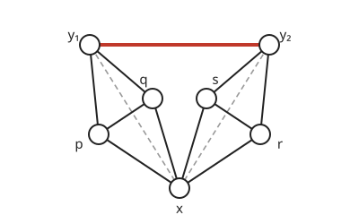

# 임계 그래프

# 개요

**임계 그래프(critical graph)** 는 간선이나 정점을 하나라도 지우면 칠하는 데 드는 색이 줄어드는 그래프다. 어떤 그래프가 네 색이 든다는 것을 확인하려면, 그 그래프에서 네 색이 들게 만드는 부분만 남기고 나머지를 지운 그래프를 보면 된다.

색이 $k$ 개 드는 그래프는 언제나 $k$ 색이 드는 임계 그래프를 부분그래프로 가지므로, 채색수의 하한 문제는 임계 그래프의 구조 문제로 바뀐다.

# 직관

다음 그림의 그래프는 삼각형 두 개를 붙인 마름모 두 개가 꼭짓점 $x$ 를 함께 쓰고, 반대쪽 꼭짓점 $y\_1,y\_2$ 를 빨간 간선으로 이은 것이다. 점선은 이 그래프에 없는 간선이다.

이 그래프를 세 색으로 칠하려고 한다. 삼각형 $x,p,q$ 에서 세 색이 모두 쓰이고, $y\_1$ 은 $p,q$ 와 이웃하므로 $x$ 와 같은 색을 받아야 한다. 같은 이유로 $y\_2$ 도 $x$ 와 같은 색이다. 그러면 이웃한 $y\_1,y\_2$ 가 같은 색이 되므로 세 색으로는 칠할 수 없고, $y\_1$ 을 넷째 색으로 칠하면 네 색으로 칠해진다.

빨간 간선 $y\_1y\_2$ 를 지우면 위의 칠하기가 그대로 세 색 칠하기다. 마름모 안의 간선 $pq$ 를 지우면 $p,q$ 가 같은 색을 받을 수 있어 $y\_1$ 이 $x$ 와 다른 색을 받고, 다시 세 색으로 칠해진다. 다른 간선을 지워도 같다. 이 그래프는 어느 간선이 빠져도 네 색이 들지 않는다.

# 정의

## 임계 그래프

$\chi$ 를 [그래프 색칠](graph-coloring.md)의 채색수라 하자. $\chi(G)=k$ 이고 $G$ 의 모든 진부분그래프 $H$ 에서 $\chi(H)\lt k$ 이면 $G$ 를 **$k$ 임계(k-critical)** 라 한다[^1]. 고립 정점이 없는 그래프에서는 모든 간선 $e$ 에 대해 $\chi(G-e)\lt k$ 인 것과 같다.

직관 절의 그래프는 $4$ 임계다. 완전그래프 $K\_k$ 는 $k$ 임계이고, 간선 하나 $K\_2$ 는 $2$ 임계다.

## Hajós 합

두 그래프 $G\_1,G\_2$ 와 간선 $x\_1y\_1\in E(G\_1)$, $x\_2y\_2\in E(G\_2)$ 가 주어졌을 때, $x\_1$ 과 $x\_2$ 를 한 정점으로 합치고, 간선 $x\_1y\_1$ 과 $x\_2y\_2$ 를 지우고, 간선 $y\_1y\_2$ 를 더한 그래프를 **Hajós 합(Hajós sum)** 이라 한다.

직관 절의 그래프는 완전그래프 $K\_4$ 두 개의 Hajós 합이다. 그림의 점선 두 개가 지운 간선이고 빨간 간선이 더한 간선이다. 이 그래프는 [평면의 채색수](chromatic-number-of-the-plane.md)에 나오는 Moser 방추와 같은 그래프다.

# 성질

## 임계 부분그래프의 존재

$\chi(G)=k$ 이면 $G$ 는 $k$ 임계인 부분그래프를 가진다. $\chi$ 가 $k$ 로 유지되는 한 간선이나 정점을 하나씩 지우면, 유한 번 뒤에 더 지울 수 없는 부분그래프에 닿고 그것이 $k$ 임계다.

## 최소 차수

$k$ 임계 그래프의 모든 정점의 차수는 $k-1$ 이상이다[^1]. 차수가 $k-2$ 이하인 정점 $v$ 가 있으면 $G-v$ 를 $k-1$ 색으로 칠한 뒤, $v$ 의 이웃이 쓰지 않은 색이 남으므로 $v$ 에 그 색을 주어 $G$ 가 $k-1$ 색으로 칠해진다.

이 성질과 앞의 존재를 합치면 $\chi(G)$ 는 $G$ 의 부분그래프들의 최소 차수의 최댓값에 $1$ 을 더한 값 이하다. 이 값이 [그래프 퇴화도](graph-degeneracy.md)에 $1$ 을 더한 것이다.

## 연결성

$k\ge 2$ 이면 $k$ 임계 그래프는 연결이고, $k\ge 3$ 이면 절단점이 없다. 절단점 $v$ 에서 갈라지는 두 조각을 각각 $k-1$ 색으로 칠하고 색 이름을 바꾸어 $v$ 의 색을 맞추면 전체가 $k-1$ 색으로 칠해지기 때문이다.

## 3 임계 그래프

$3$ 임계 그래프는 홀수 고리뿐이다. 채색수가 $3$ 이면 이분그래프가 아니므로 홀수 고리를 부분그래프로 가지고, 홀수 고리의 채색수가 $3$ 이므로 임계성에 따라 그래프 전체가 그 고리다.

## Hajós 정리

$G\_1,G\_2$ 가 $k$ 임계이면 Hajós 합도 $k$ 임계다[^2]. 직관 절의 논법과 같이, 합이 $k-1$ 색으로 칠해지면 $G\_1$ 쪽에서 $x$ 와 $y\_1$ 이, $G\_2$ 쪽에서 $x$ 와 $y\_2$ 가 같은 색을 받아야 하고 $y\_1y\_2$ 가 그것을 막는다.

$K\_k$ 에서 시작해 Hajós 합과 이웃하지 않은 두 정점을 합치는 조작으로 얻는 그래프를 $k$ 구성 가능(k-constructible)이라 한다. Hajós 는 $\chi(G)\ge k$ 인 것과 $G$ 가 $k$ 구성 가능한 부분그래프를 가지는 것이 동치임을 증명했다[^2].

## Gallai 정리

$k$ 임계 그래프에서 차수가 정확히 $k-1$ 인 정점들이 유도하는 부분그래프의 각 블록은 완전그래프이거나 홀수 고리다[^3]. 그래프 전체가 $(k-1)$ 정칙이면 그래프 자신이 하나의 블록이므로 $K\_k$ 이거나 홀수 고리다. 이것이 그래프 색칠의 Brooks 정리(Brooks' theorem)를 임계 그래프로 쓴 것이다.

# 활용

- 채색수의 하한 증명. 그래프가 $k$ 색으로 칠해지지 않음을 보일 때 최소 반례를 $k+1$ 임계 그래프로 놓고 최소 차수 $k$ 를 쓴다. [Hadwiger 추측](hadwiger-conjecture.md)의 $t=4$ 경우와 [4색 정리](four-color-theorem.md)의 증명이 이 꼴로 시작한다.
- [Mycielski 구성](mycielskian.md)은 $k$ 임계 그래프에서 $k+1$ 임계 그래프를 만든다. Grötzsch 그래프는 $4$ 임계다.
- 단위 거리 그래프의 채색. Moser 방추처럼 Hajós 합으로 만든 그래프는 평면의 채색수의 하한을 주는 데 쓰인다.

[^1]: G. A. Dirac, "A property of 4-chromatic graphs and some remarks on critical graphs", *Journal of the London Mathematical Society* 27 (1952), 85–92.
[^2]: G. Hajós, "Über eine Konstruktion nicht n-färbbarer Graphen", *Wissenschaftliche Zeitschrift der Martin-Luther-Universität Halle-Wittenberg, Mathematisch-Naturwissenschaftliche Reihe* 10 (1961), 116–117.
[^3]: T. Gallai, "Kritische Graphen I", *Publications of the Mathematical Institute of the Hungarian Academy of Sciences* 8 (1963), 165–192.

# 연관 문서

## 선수지식

- [그래프 색칠](graph-coloring.md)

## 더 알아보기

아직 연결한 문서가 없다.

#graph_theory #combinatorics
