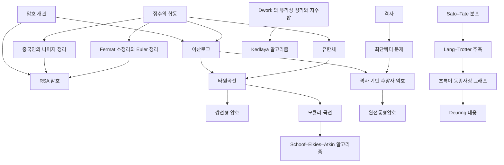

# 암호 개관

# 개요

암호(cryptography)는 한 방향으로는 계산이 쉽고 거꾸로는 어려운 계산을 써서 통신을 보호하는 방법이다. 두 소수 $61$ 과 $53$ 을 곱해 $3233$ 을 얻는 것은 손으로도 금방 되지만, 수백 자리의 합성수가 어떤 두 소수의 곱인지 찾는 데는 알려진 가장 좋은 방법으로도 현실적인 시간 안에 끝나지 않는다. 누구나 아는 수로 메시지를 잠그고, 그 수를 만든 소수를 아는 사람만 풀게 하는 식으로 이런 비대칭을 쓴다.

처음 읽는 사람은 [정수의 합동](modular-arithmetic.md)에서 시작한다. 유한체의 이산로그를 지수시간보다 빨리 푸는 방법은 [지표 계산법](index-calculus.md)에, 소인수분해와 이산로그를 양자 컴퓨터로 푸는 방법은 [Shor 알고리즘](shor-algorithm.md)에 있다.

# 지도

# 갈래

처음 읽는 사람은 산술 기반, 공개키의 두 가정의 순서로 읽는다. 그 뒤는 가정마다 갈린다. 타원곡선 암호와 동종사상 암호는 이산로그 쪽이고, 격자 기반 암호는 양자 알고리즘이 이산로그와 소인수분해를 깨는 경우에 쓰는 가정이다.

## 산술 기반

먼저 읽을 것: [동치관계](equivalence-relations.md)와 [함수](functions.md)(수학기초론 개관). 시작 문서: [정수의 합동](modular-arithmetic.md).

- [정수의 합동](modular-arithmetic.md) — 공개키 방식이 실제로 계산하는 자리. 반복 제곱으로 거듭제곱을 구한다
  - [확장 유클리드 알고리즘](euclidean-algorithm.md) — 최대공약수와 함께 역원을 주는 계수를 구한다
- [군](groups.md) — 이산로그를 정의하는 데 필요한 것은 연산 하나와 위수뿐이다
- [중국인의 나머지 정리](chinese-remainder-theorem.md) — 서로소인 법의 연립 합동식을 한 법의 합동식으로 합친다
- [유한체](finite-fields.md) — 위수 $q=p^k$ 의 체. 곱셈군이 순환군이므로 이산로그를 여기에 건다
- [비밀 분산](secret-sharing.md) — 비밀을 다항식의 값으로 나눠 문턱 수 이상의 조각으로만 복원한다. Shamir 방식과 검증 가능한 분산

## 공개키의 두 가정

먼저 읽을 갈래: 산술 기반. 먼저 읽을 것: [Fermat 소정리와 Euler 정리](fermat-euler-theorem.md)(정수론 개관). 시작 문서: [이산로그](discrete-logarithm.md).

- [이산로그](discrete-logarithm.md) — 유한군에서 $g^x$ 로부터 $x$ 를 되찾는 문제. Pohlig–Hellman 환산과 지표 계산법이 안전한 군의 조건을 정한다
- [RSA 암호](rsa-cryptosystem.md) — 소인수분해의 어려움. Euler 정리가 지수의 주기를 주고 중국인의 나머지 정리가 복호를 가속한다
- [일방향 함수](one-way-functions.md) — 계산은 쉽고 무작위 입력의 역산은 무시할 만한 확률로만 성공하는 함수. 약속과 서명이 이것만으로 구성된다
- [유사난수 생성기](pseudorandom-generators.md) — 짧은 씨를 균등 난수열과 구별되지 않는 긴 비트열로 늘린다. 일방향 함수의 존재와 동치다
  - [약속 방식](commitment-schemes.md) — 값을 감춘 채 맡겼다가 바꿀 수 없게 연다. Pedersen 약속과 Naor 약속
- [유사난수 순열](pseudorandom-permutations.md) — 무작위 순열과 구별되지 않는 블록 암호의 정의. Feistel 구조, Luby–Rackoff 정리, 전환 보조정리
- [암호 해시 함수](cryptographic-hash-functions.md) — 같은 값을 내는 두 입력을 찾기 어려운 압축 함수. 생일 공격, Merkle–Damgård 구성
  - [Merkle 나무](merkle-trees.md) — 블록 해시값을 이진 나무로 쌓아 뿌리 하나로 전체를 대표한다. 포함 증명과 Merkle 서명
- [전자서명](digital-signatures.md) — 비밀키로만 만들고 공개키로 확인하는 값. Lamport 서명, 해시 후 RSA 서명, Schnorr 서명
  - [블라인드 서명](blind-signatures.md) — 서명자가 메시지를 보지 않고 서명한다. 은닉성과 일회 추가 위조 불가능성, RSA 와 Schnorr 의 블라인드 서명
- [메시지 인증 코드](message-authentication-codes.md) — 공유한 비밀키로 붙이고 같은 키로 확인하는 꼬리표. CBC-MAC 의 길이 위조, HMAC, 일회용 MAC
- [의미론적 안전성](semantic-security.md) — 암호문으로 평문에 대해 알아낼 것이 없다는 정의. IND-CPA 와의 동치, ElGamal 암호
  - [블록 암호 운용 모드](block-cipher-modes.md) — ECB, CBC, CTR 모드. ECB 의 실패, 무작위 시작값을 쓴 CBC 와 CTR 의 선택 평문 안전성, 생일 한계
  - [인증 암호화](authenticated-encryption.md) — 평문을 감추고 바뀐 암호문을 거절하는 비밀키 암호화. 암호화 후 인증, 선택 암호문 공격에 대한 안전성, 넌스 재사용
- [망각 전송](oblivious-transfer.md) — 받는 사람이 두 메시지 가운데 하나만 받고 보내는 사람은 어느 것인지 모른다. 다자간 계산의 기본 단계
- [영지식 증명](zero-knowledge-proofs.md) — 비밀을 보이지 않고 그 비밀을 안다는 것을 확인시키는 대화형 증명. Schnorr 프로토콜과 Fiat–Shamir 변환이 서명을 준다
- [다자간 계산](secure-multiparty-computation.md) — 입력을 감춘 채 여러 참가자가 함수값을 함께 계산한다. Beaver 삼중쌍, BGW 정리와 GMW 정리
  - [뒤섞인 회로](garbled-circuits.md) — 게이트를 키의 암호화 표로 바꿔 두 사람 계산을 상수 번의 메시지로 끝낸다
  - [Fiat–Shamir 변환](fiat-shamir.md) — 공개 동전 질문을 해시값으로 바꿔 비대화형 증명과 서명을 만든다. 무작위 오라클 모형의 안전성과 그 한계

## 타원곡선 암호

먼저 읽을 갈래: 공개키의 두 가정. 시작 문서: [타원곡선](elliptic-curves.md).

- [타원곡선](elliptic-curves.md) — 곡선 위의 점에 현과 접선으로 군 구조를 준다. 준지수 시간 알고리즘이 없어 키 길이가 짧다
  - [쌍선형 암호](pairing-based-cryptography.md) — 비틀림점 위의 쌍선형 사상. MOV(Menezes–Okamoto–Vanstone) 환산의 공격 도구이자 신원 기반 암호의 구성 도구
  - [Schoof–Elkies–Atkin 알고리즘](sea-algorithm.md) — 곡선의 점 개수를 $\log p$ 의 다항시간에 센다. 곡선을 고른 뒤 위수가 큰 소인수를 가지는지 확인하는 단계
  - [Kedlaya 알고리즘](kedlaya-algorithm.md) — 초타원곡선의 zeta 함수를 $p$ 진 코호몰로지로 계산한다

## 격자 기반 암호

먼저 읽을 갈래: 공개키의 두 가정. 먼저 읽을 것: [내적 공간](inner-product-spaces.md)(선형대수 개관). 시작 문서: [격자](lattices.md).

- [격자](lattices.md) — 같은 점집합을 짧고 거의 직교하는 기저와 길고 거의 평행한 기저가 함께 나타낸다. 기저 축소와 Minkowski 정리
- [최단벡터 문제](shortest-vector-problem.md) — 근사율 $\gamma$ 에 따라 난해성이 갈리고, 암호는 $\gamma$ 가 다항식인 구간을 쓴다
- [격자 기반 후양자 암호](post-quantum-cryptography.md) — 무작위로 뽑은 사례가 최악의 사례만큼 어렵다는 환산이 파라미터 선택의 근거가 된다
- [완전동형암호](homomorphic-encryption.md) — 암호문을 복호하지 않고 덧셈과 곱셈을 수행한다. 연산마다 커지는 잡음을 재부팅으로 초기화한다

## 동종사상 암호

먼저 읽을 갈래: 타원곡선 암호. 먼저 읽을 것: [Sato–Tate 분포](sato-tate.md)(정수론 개관). 시작 문서: [Lang–Trotter 추측](lang-trotter.md).

- [Lang–Trotter 추측](lang-trotter.md) — 고정된 곡선을 여러 소수로 환원할 때 초특이가 되는 빈도
- [초특이 동종사상 그래프](supersingular-isogeny-graphs.md) — 초특이 $j$ 불변량을 정점으로 하는 정규 그래프. 그 위의 무작위 걸음이 SIDH(supersingular isogeny Diffie–Hellman)의 가정이다
- [Deuring 대응](deuring-correspondence.md) — 초특이 곡선의 자기준동형환이 사원수 대수의 극대차수와 대응한다. 이 대응의 계산이 동종사상 문제의 난이도를 결정한다

# 연관 문서

## 선수지식

- [집합](sets.md)

## 더 알아보기

- [이산로그](discrete-logarithm.md)
- [RSA 암호](rsa-cryptosystem.md)

#cryptography #number_theory #computation #overview
