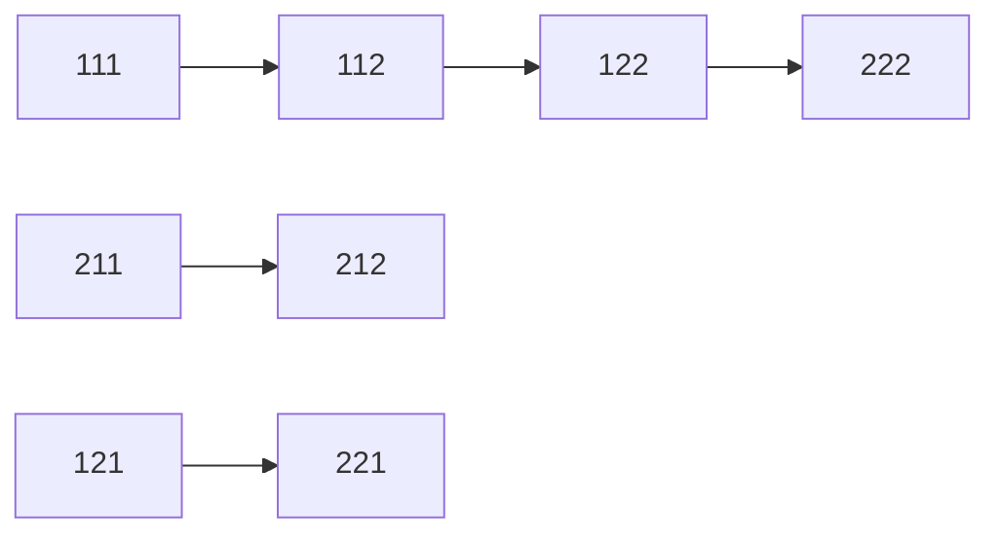

# 결정 기저

# 개요

**결정 기저(crystal basis)** 는 표현의 기저 원소를 정점으로 두고 [Lie 대수](lie-algebras.md)의 생성원이 기저 원소를 다른 기저 원소 하나로 보내는 것을 화살표로 그린 그래프, 곧 결정 그래프를 주는 기저다. $1$ 과 $2$ 로 된 길이 $3$ 인 낱말 여덟 개를 늘어놓고 $\mathfrak{gl}\_2$ 의 표준표현을 세 번 텐서곱한 표현이 어떤 기약표현들로 갈라지는지 묻는다. 결정 그래프에서는 낱말마다 $1$ 하나를 $2$ 로 바꾸는 화살표를 괄호 맞추기 규칙으로 긋고, 연결 성분을 세면 분해가 나온다.

# 직관

$\mathfrak{gl}\_2$ 의 표준표현은 기저 $v_1,v_2$ 를 갖고, 생성원 $f$ 는 $v_1$ 을 $v_2$ 로, $v_2$ 를 $0$ 으로 보낸다. 세 번 텐서곱한 표현의 기저 $v_{a}\otimes v_{b}\otimes v_{c}$ 를 낱말 $abc$ 로 적으면 낱말 $111,112,\dots,222$ 여덟 개가 기저다. 텐서곱에서 $f$ 는 각 자리에 차례로 작용한 것의 합이라, $f(111)=211+121+112$ 처럼 한 기저 원소가 여러 기저 원소의 합으로 간다. 이 상태로는 어느 낱말들이 한 기약표현을 이루는지 보이지 않는다.

[양자군](quantum-groups.md)의 변형 매개변수 $q$ 를 $0$ 으로 보내면 합의 항 가운데 하나만 남는다. 남는 항은 다음 규칙으로 정해진다. 낱말의 $2$ 를 여는 괄호 "(", $1$ 을 닫는 괄호 ")" 로 바꾸고 맞는 괄호 쌍을 지운다. 남은 닫는 괄호 가운데 가장 오른쪽 것의 $1$ 을 $2$ 로 바꾼다.

낱말 $211$ 은 "())" 이고 앞의 두 글자가 쌍으로 지워져 셋째 글자 $1$ 이 남으므로 $f(211)=212$ 다. $212$ 는 "()(" 이고 남은 닫는 괄호가 없으므로 $f(212)=0$ 이다. 여덟 낱말에 모두 화살표를 그으면 다음 그래프가 된다.

연결 성분이 셋이고 크기가 $4,2,2$ 이다. 크기 $4$ 인 성분은 대칭곱 $\mathrm{Sym}^3$ 이고 크기 $2$ 인 두 성분은 같은 기약표현의 두 사본이다. 그래서 세 번 텐서곱한 표현은 차원 $4$ 인 기약표현 하나와 차원 $2$ 인 기약표현 둘로 갈라진다.

# 정의

## 결정 연산자

$B=\lbrace 1,\dots,n\rbrace$ 위의 길이 $k$ 인 낱말 전체를 $B^{\otimes k}$ 로 적는다. $1\le i\lt n$ 에 대해 낱말 $w$ 의 글자 가운데 $i$ 와 $i+1$ 만 남기고, $i+1$ 을 "(", $i$ 를 ")" 로 바꿔 맞는 쌍을 되풀이해 지운다. 남은 글자는 $i$ 가 $\varphi$ 개, 그 뒤에 $i+1$ 이 $\varepsilon$ 개 놓인 꼴이다.

- **결정 연산자(crystal operator)** $f_i$ 는 남은 $i$ 가운데 가장 오른쪽 것을 $i+1$ 로 바꾼다. 남은 $i$ 가 없으면 $f_i w=0$ 이다.
- $e_i$ 는 남은 $i+1$ 가운데 가장 왼쪽 것을 $i$ 로 바꾼다. 남은 $i+1$ 이 없으면 $e_i w=0$ 이다.
- $\varphi_i(w)=\varphi$, $\varepsilon_i(w)=\varepsilon$ 이라 둔다. $f_i$ 를 거듭 걸 수 있는 횟수가 $\varphi_i(w)$, $e_i$ 를 거듭 걸 수 있는 횟수가 $\varepsilon_i(w)$ 다.

직관 절의 $211$ 은 $\varphi_1=1$, $\varepsilon_1=0$ 이고, $e_1(212)=211$ 이다. $e_i$ 와 $f_i$ 는 서로 역이다. $f_iw=w'$ 인 것과 $e_iw'=w$ 인 것이 동치다.

## 결정 그래프와 가중치

$B^{\otimes k}$ 의 낱말을 정점으로 두고 $f_iw=w'$ 일 때 $w$ 에서 $w'$ 로 색 $i$ 의 화살표를 그은 그래프를 **결정 그래프(crystal graph)** 라 한다. 낱말 $w$ 에서 글자 $j$ 가 나온 횟수를 $j$ 번째 성분으로 둔 벡터를 $w$ 의 **가중치(weight)** $\mathrm{wt}(w)$ 라 한다. 모든 $e_i$ 가 $0$ 으로 보내는 낱말을 **최고 가중치 원소(highest weight element)** 라 한다.

직관 절의 그래프에서 최고 가중치 원소는 $111$, $211$, $121$ 셋이고 가중치는 $(3,0)$, $(2,1)$, $(2,1)$ 이다. 각 연결 성분에 하나씩 있다.

## 결정 기저

$q=0$ 에서 극이 없는 유리함수의 환을 $A_0$ 라 한다. $U_q(\mathfrak{gl}\_n)$ 의 유한차원 표현 $V$ 안의 $A_0$ 격자 $L$ 과 $L/qL$ 의 기저 $\mathcal B$ 의 쌍이 다음을 만족하면 이 쌍을 $V$ 의 결정 기저라 한다[^1]. 생성원 $E_i,F_i$ 를 고친 Kashiwara 연산자(Kashiwara operator) $\tilde e_i,\tilde f_i$ 가 $L$ 을 $L$ 로 보내고, $L/qL$ 위에서 $\mathcal B$ 의 원소를 $\mathcal B$ 의 원소 하나나 $0$ 으로 보내며, $\tilde f_ib=b'$ 와 $\tilde e_ib'=b$ 가 동치다. 표준표현의 텐서곱 $V^{\otimes k}$ 에서 기저 $v_{w_1}\otimes\cdots\otimes v_{w_k}$ 가 결정 기저이고, 그 위의 $\tilde e_i,\tilde f_i$ 가 위의 괄호 규칙 $e_i,f_i$ 다.

# 성질

## 텐서곱 규칙

낱말 $w=uv$ 를 앞 조각 $u$ 와 뒤 조각 $v$ 로 나누면 다음이 성립한다.

$$
f_i(uv)=\begin{cases}u\thinspace f_i(v)&\varphi_i(v)\gt\varepsilon_i(u)\cr f_i(u)\thinspace v&\varphi_i(v)\le\varepsilon_i(u)\end{cases}
$$

증명의 요지. $u$ 에서 남은 글자는 $i^{\varphi_i(u)}(i+1)^{\varepsilon_i(u)}$, $v$ 에서 남은 글자는 $i^{\varphi_i(v)}(i+1)^{\varepsilon_i(v)}$ 꼴이다. 이어 붙이면 $u$ 쪽의 $i+1$ 과 $v$ 쪽의 $i$ 가 $\min(\varepsilon_i(u),\varphi_i(v))$ 쌍 지워진다. $v$ 쪽의 $i$ 가 하나라도 남는 것은 $\varphi_i(v)\gt\varepsilon_i(u)$ 일 때이고, 그때 가장 오른쪽에 남은 $i$ 는 $v$ 에 있다. 이 규칙은 두 결정의 텐서곱을 정의하는 식으로 쓰인다. 문헌에 따라 텐서곱 인수의 순서가 반대인 관례도 쓰인다[^2].

## 연결 성분의 분류

$B^{\otimes k}$ 의 각 연결 성분에는 최고 가중치 원소가 꼭 하나 있다. 그 가중치는 성분이 $n$ 개 이하인 분할 $\lambda$ 이고, 성분은 모양 $\lambda$ 의 반표준 대각표 전체가 이루는 결정 $B(\lambda)$ 와 동형이다[^2]. 대각표는 아래 행부터, 각 행은 왼쪽에서 오른쪽으로 읽은 낱말로 $B^{\otimes k}$ 에 넣는다.

직관 절의 크기 $2$ 인 성분 $\lbrace 211,212\rbrace$ 는 첫 행 $1,1$, 둘째 행 $2$ 인 대각표와 첫 행 $1,2$, 둘째 행 $2$ 인 대각표의 읽기 낱말이다. 성분의 가중치를 모두 더한 생성함수는 [Schur 다항식](schur-polynomials.md)이다.

$$
\sum_{b\in B(\lambda)}x^{\mathrm{wt}(b)}=s_\lambda(x_1,\dots,x_n)
$$

직관 절의 세 성분에서는 다음이 나온다.

$$
\begin{aligned}
s_{(3)}&=x_1^3+x_1^2x_2+x_1x_2^2+x_2^3,\qquad s_{(2,1)}=x_1^2x_2+x_1x_2^2,\cr
(x_1+x_2)^3&=s_{(3)}+2s_{(2,1)}
\end{aligned}
$$

## Knuth 동치와의 관계

두 낱말이 [Knuth 동치](knuth-equivalence.md)인 것은 두 낱말이 서로 동형인 연결 성분의 같은 자리에 놓이는 것과 동치다[^2]. 결정 연산자는 낱말의 삽입 대각표 $P(w)$ 에 결정 연산자를 건 것과 맞고, 기록 대각표 $Q(w)$ 는 바꾸지 않는다. 그래서 $Q(w)$ 가 $w$ 가 속한 성분을 정하고, $P(w)$ 가 그 성분 안의 자리를 정한다.

직관 절의 $211$ 과 $121$ 은 둘째 Knuth 변환 $xzy\leftrightarrow zxy$ 로 이어지고, 두 성분의 최고 가중치 원소다. $212$ 와 $221$ 도 Knuth 동치이고 두 성분의 둘째 자리다.

# 활용

- [Littlewood–Richardson 규칙](littlewood-richardson.md). 텐서곱 규칙에서 $B(\mu)\otimes B(\nu)$ 의 최고 가중치 원소 $b\otimes b'$ 은 $b'$ 이 $B(\nu)$ 의 최고 가중치 원소이고 모든 $i$ 에서 $\varepsilon_i(b)\le\varphi_i(b')$ 인 것이다. 이런 원소 가운데 가중치가 $\lambda$ 인 것의 수가 Littlewood–Richardson 계수 $c^\lambda_{\mu\nu}$ 다[^2].
- 다른 Lie 형의 표현. 같은 공리를 만족하는 결정이 [근계](root-systems.md)마다 정의되고, 반단순 Lie 대수의 기약표현마다 결정 $B(\lambda)$ 가 하나 있다. 텐서곱 분해와 가중치 중복도를 같은 괄호 규칙으로 센다[^1].
- 대칭군의 표현과의 대응. $B^{\otimes k}$ 의 연결 성분이 기록 대각표 $Q(w)$ 로 나뉘므로, 모양 $\lambda$ 인 성분의 수는 모양 $\lambda$ 인 표준 Young 대각표의 수다. [Schur–Weyl 쌍대성](schur-weyl-duality.md)의 중복도와 같은 수다.

[^1]: M. Kashiwara, On crystal bases of the $q$-analogue of universal enveloping algebras, *Duke Mathematical Journal* 63 (1991), 465–516.
[^2]: D. Bump, A. Schilling, *Crystal Bases: Representations and Combinatorics*, World Scientific (2017), 2 장, 3 장, 8 장, 9 장.

# 연관 문서

## 선수지식

- [Knuth 동치](knuth-equivalence.md)

## 더 알아보기

아직 연결한 문서가 없다.

#combinatorics #algebra #group_theory
