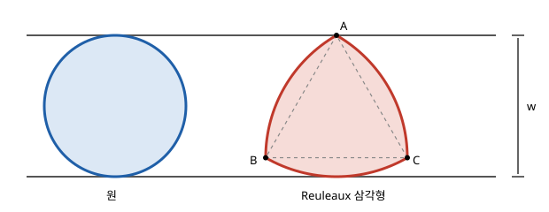

# 너비가 일정한 곡선

# 개요

**너비가 일정한 곡선(curve of constant width)** 은 어느 방향에서 재어도 폭이 같은 볼록 닫힌곡선이다. 둥근 맨홀 뚜껑은 어느 방향으로 재어도 폭이 구멍보다 커서, 어떻게 기울여도 구멍으로 빠지지 않는다. 원이 아닌 곡선 가운데에도 이런 모양이 있고, 정삼각형의 꼭짓점마다 원호를 그려 만든 Reuleaux 삼각형이 그 예다.

# 직관

한 변의 길이가 $w$ 인 정삼각형 $ABC$ 를 그린다. 꼭짓점 $A$ 를 중심으로 반지름 $w$ 인 원호를 $B$ 에서 $C$ 까지 긋고, $B$ 와 $C$ 를 중심으로도 같은 원호를 긋는다. 세 원호로 둘러싸인 도형이 Reuleaux 삼각형(Reuleaux triangle)이다.

이 도형을 가로선 두 개 사이에 끼우면 한쪽 선에는 꼭짓점 하나가, 다른 쪽 선에는 그 맞은편 원호가 닿는다. 원호의 점은 맞은편 꼭짓점에서 거리가 정확히 $w$ 이므로 두 선 사이 거리가 $w$ 다. 도형을 돌려도 닿는 것이 다른 꼭짓점과 원호로 바뀔 뿐이어서 거리는 그대로 $w$ 다. 아래 그림에서 지름 $w$ 인 원과 Reuleaux 삼각형이 같은 두 선에 동시에 닿는다.

# 정의

## 지지함수와 너비

$K$ 를 평면의 콤팩트 [볼록집합](convexity.md)이라 하자. 단위벡터 $u$ 에 대해 다음 값을 $K$ 의 **지지함수(support function)** 라 한다. $\langle x,u\rangle$ 은 표준 내적이다.

$$
h_K(u)=\max_{x\in K}\langle x,u\rangle
$$

$u$ 에 수직인 직선 가운데 $K$ 에 닿고 $K$ 를 한쪽에 두는 것은 둘이고, 그 사이 거리 $h_K(u)+h_K(-u)$ 를 방향 $u$ 의 **너비(width)** $w_K(u)$ 라 한다. 반지름 $r$ 인 원판은 중심이 원점이면 $h_K(u)=r$ 이므로 모든 방향의 너비가 $2r$ 다.

## 너비가 일정한 곡선

모든 단위벡터 $u$ 에서 $w_K(u)=w$ 인 볼록집합을 너비 $w$ 의 **일정 너비 집합(body of constant width)** 이라 하고, 그 경계를 **너비가 일정한 곡선** 이라 한다. 직관 절의 Reuleaux 삼각형은 너비 $w$ 의 일정 너비 집합이다.

변의 수가 홀수 $n$ 인 정다각형에서도 같은 작도가 된다. 각 꼭짓점을 중심으로 가장 먼 두 꼭짓점을 잇는 원호를 그으면 너비가 가장 긴 대각선의 길이와 같은 곡선이 나오고, 이것을 Reuleaux 다각형(Reuleaux polygon)이라 한다.

# 성질

## Barbier 정리

정리(Barbier's theorem). 너비가 $w$ 로 일정한 곡선의 둘레는 $\pi w$ 다.[^1]

증명의 요지. 간격 $w$ 의 평행선 위에 이 곡선을 무작위로 던지면 곡선은 언제나 선과 두 번 만난다. [Buffon 의 바늘 문제](buffons-needle.md)의 교차 횟수 기댓값 공식에서 둘레 $L$ 의 곡선은 평균 $2L/(\pi w)$ 번 만나므로 $2L/(\pi w)=2$ 다. $\square$

Reuleaux 삼각형은 반지름 $w$, 중심각 $\pi/3$ 인 원호 셋이므로 둘레가 $3\cdot w\pi/3=\pi w$ 이고, 지름 $w$ 인 원의 둘레와 같다.

## 넓이의 범위

정리(Blaschke–Lebesgue theorem). 너비 $w$ 의 일정 너비 집합 가운데 넓이가 가장 작은 것은 Reuleaux 삼각형이고, 가장 큰 것은 원판이다.[^2] 넓이를 $A$ 라 하면 다음이 성립한다.

$$
\frac{\pi-\sqrt3}{2}w^2\le A\le\frac\pi4w^2
$$

Reuleaux 삼각형의 넓이는 정삼각형의 넓이 $\frac{\sqrt3}{4}w^2$ 에 원호와 변 사이의 활꼴 셋을 더한 값이다. 활꼴 하나는 부채꼴 $\frac\pi6w^2$ 에서 정삼각형을 뺀 것이므로 합이 왼쪽 값이다. 오른쪽 부등식은 둘레가 $\pi w$ 로 같으므로 [등주부등식](isoperimetric-inequality.md)에서 나오고, 왼쪽 부등식은 W. Blaschke 와 H. Lebesgue 가 1915 년 무렵 따로 증명했다. 수치로는 $0.705w^2$ 과 $0.785w^2$ 다.

## 지름과 맞은편 점

너비 $w$ 의 일정 너비 집합에서 두 점 사이 거리는 $w$ 이하이고, 경계의 점마다 거리가 정확히 $w$ 인 경계의 점이 있다. 방향 $u$ 의 두 지지직선에 닿는 두 점이 그런 쌍이고, 그 두 점을 잇는 선분은 두 지지직선에 수직이다. Reuleaux 삼각형에서는 꼭짓점 $A$ 와 원호 $BC$ 위의 모든 점이 서로 맞은편 점이다.

## 3차원의 일정 너비 입체

공간에서도 모든 방향의 너비가 $w$ 인 볼록 입체를 같은 방법으로 정의한다. 그런 입체의 부피 $V$ 와 겉넓이 $S$ 는 다음 관계를 만족한다.[^1]

$$
V=\frac{w}{2}S-\frac\pi3w^3
$$

반지름 $w/2$ 인 공을 넣으면 $S=\pi w^2$ 이고 양변이 $\frac\pi6w^3$ 로 같다. 평면과 달리 겉넓이는 $w$ 만으로 정해지지 않는다. Reuleaux 사면체(Reuleaux tetrahedron)는 너비가 일정하지 않고, 그 모서리 셋을 고친 Meissner 입체(Meissner body)가 너비가 일정하다.

# 활용

- 맨홀 뚜껑과 동전. 너비가 일정한 뚜껑은 어느 방향으로 세워도 폭이 $w$ 이므로 그보다 조금 좁은 구멍으로 빠지지 않는다. 영국의 20 펜스와 50 펜스 동전은 Reuleaux 칠각형이고, 어느 방향으로 재어도 폭이 같아 자판기의 폭 측정기를 통과한다.
- 굴림대. 판자 밑에 너비가 일정한 굴림대를 넣고 밀면 판자의 높이가 변하지 않는다. 다만 Reuleaux 삼각형의 무게중심은 굴러가며 위아래로 움직이므로 바퀴의 축으로는 쓸 수 없다.
- 정사각형 구멍 뚫기. 너비 $w$ 의 Reuleaux 삼각형은 한 변이 $w$ 인 정사각형 안에서 네 변에 모두 닿은 채 돌 수 있다. 이 회전을 쓰는 드릴은 모서리가 약간 둥근 정사각형 구멍을 뚫는다.
- [내재부피](intrinsic-volumes.md). 평면 볼록집합의 둘레는 모든 방향의 너비를 평균 내어 $\pi$ 를 곱한 값이라는 Cauchy 공식(Cauchy's formula)이 있고, Barbier 정리는 너비가 상수인 경우다.

[^1]: G. D. Chakerian, H. Groemer, "Convex bodies of constant width", in P. M. Gruber, J. M. Wills (eds.), *Convexity and Its Applications*, Birkhäuser (1983), 49–96. Barbier 의 원 논문은 J.-É. Barbier, *Journal de Mathématiques Pures et Appliquées* 2e série **5** (1860), 273–286.
[^2]: H. Martini, L. Montejano, D. Oliveros, *Bodies of Constant Width: An Introduction to Convex Geometry with Applications*, Birkhäuser (2019), 8 장.

# 연관 문서

## 선수지식

- [볼록성](convexity.md)
- [Buffon 의 바늘 문제](buffons-needle.md)

## 더 알아보기

아직 연결한 문서가 없다.

#analysis #combinatorics #probability
