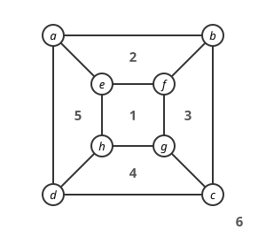

# 순환 이중 덮개 추측

# 개요

**순환 이중 덮개 추측(cycle double cover conjecture)** 은 다리가 없는 그래프마다 순환 몇 개를 골라 모든 간선이 정확히 두 순환에 들게 할 수 있다는 추측이다. 정육면체의 모서리 열두 개는 면 여섯 개의 테두리에 정확히 두 번씩 들어간다. 평면에 그린 그래프에서는 면의 테두리가 이런 순환을 주지만, 평면에 그릴 수 없는 그래프에는 면이 없다. 이 추측은 면이 없어도 같은 순환들이 있는지를 묻고, 간선 색칠과 nowhere-zero 흐름이 있는 그래프에서는 그런 순환들이 실제로 만들어진다.

# 직관

아래 그림은 정육면체의 꼭짓점과 모서리를 평면에 그린 것이다. 바깥 사각형 $abcd$ 와 안쪽 사각형 $efgh$ 를 네 간선이 잇고, 면은 안쪽 사각형 $1$, 사다리꼴 $2,3,4,5$, 바깥 면 $6$ 의 여섯 개다.

간선 $ab$ 는 면 $2$ 와 바깥 면 $6$ 사이에, 간선 $ae$ 는 면 $2$ 와 면 $5$ 사이에 있다. 어느 간선이든 양쪽에 서로 다른 면이 하나씩 있으므로, 여섯 면의 테두리를 순환으로 보면 모든 간선이 정확히 두 순환에 들어간다. 테두리 여섯 개의 길이를 더하면 $6\cdot 4=24$ 이고 간선 수 $12$ 의 두 배다.

이 구성은 그래프를 평면에 그려 면을 얻는 데 기댄다. [Petersen 그래프](petersen-graph.md)처럼 평면에 그릴 수 없는 그래프에는 면이 없으므로, 모든 간선을 두 번씩 덮는 순환들은 다른 방법으로 찾아야 한다.

# 정의

## 짝수 부분그래프

모든 정점의 차수가 짝수인 부분그래프를 **짝수 부분그래프(even subgraph)** 라 한다. 짝수 부분그래프의 간선은 겹치지 않는 순환들로 나뉜다. 직관 절의 면 $1$ 의 테두리 $efgh$ 는 짝수 부분그래프이고, 면 $1$ 과 면 $6$ 의 테두리를 합친 것도 짝수 부분그래프다.

## 순환 이중 덮개

그래프 $G$ 의 순환들의 모임 $\mathcal C$ 에서 $G$ 의 모든 간선이 정확히 두 순환에 들면 $\mathcal C$ 를 $G$ 의 **순환 이중 덮개(cycle double cover)** 라 한다. 같은 순환을 두 번 써도 된다. 직관 절의 면 테두리 여섯 개가 정육면체 그래프의 순환 이중 덮개다.

짝수 부분그래프를 순환들로 나누면 되므로, 순환 대신 짝수 부분그래프로 덮어도 존재 여부는 같다.

## 추측

다리가 없는 모든 그래프에는 순환 이중 덮개가 있다. 이것이 Szekeres 와 Seymour 의 순환 이중 덮개 추측이다[^1][^2]. 다리는 어느 순환에도 들지 않으므로 다리가 없다는 조건은 빠질 수 없다.

# 성질

## 평면 그래프

2 연결 [평면 그래프](planar-graphs.md)를 평면에 그리면 면의 테두리가 모두 순환이고, 간선마다 양쪽 면이 다르므로 면 테두리들이 순환 이중 덮개다. 다리가 없는 그래프의 블록은 모두 2 연결이고 순환은 한 블록 안에 있으므로, 블록마다 덮개를 만들면 그래프 전체의 덮개가 된다. 그래서 다리가 없는 평면 그래프에는 순환 이중 덮개가 있다.

## 간선 3 색칠이 있는 3 정칙 그래프

3 정칙 그래프의 간선을 세 색으로 칠할 수 있으면 순환 이중 덮개가 있다. 색 둘씩 고른 세 쌍 $\lbrace 1,2\rbrace$, $\lbrace 2,3\rbrace$, $\lbrace 1,3\rbrace$ 마다 그 두 색의 간선을 모으면 정점마다 간선이 둘씩 남아 짝수 부분그래프가 된다. 색 $1$ 의 간선은 첫째와 셋째 쌍에 들고, 다른 색도 정확히 두 쌍에 든다.

## nowhere-zero 4 흐름

[nowhere-zero 흐름](nowhere-zero-flows.md)으로 앞 절을 넓힌다. $G$ 가 nowhere-zero $\mathbb Z\_2^2$ 흐름 $f$ 를 가지면, $\mathbb Z\_2^2$ 에서 $\mathbb Z\_2$ 로 가는 $0$ 이 아닌 선형사상 $\varphi$ 셋마다 $\varphi\circ f$ 는 $\mathbb Z\_2$ 흐름이므로 $\varphi(f(e))=1$ 인 간선 $e$ 를 모으면 각 정점에서 그 수가 짝수인 짝수 부분그래프가 된다. $0$ 이 아닌 벡터 $f(e)$ 는 세 $\varphi$ 가운데 정확히 둘에서 $1$ 이므로, 이 세 짝수 부분그래프가 순환 이중 덮개다[^3].

## 네 번 덮기

다리가 없는 그래프는 Jaeger 의 정리로 nowhere-zero $\mathbb Z\_2^3$ 흐름을 가진다. 앞 절과 같은 방법으로 $\mathbb Z\_2^3$ 에서 $\mathbb Z\_2$ 로 가는 $0$ 이 아닌 선형사상 일곱 개를 쓰면, $0$ 이 아닌 벡터는 일곱 가운데 정확히 넷에서 $1$ 이다. 그래서 다리가 없는 그래프에는 모든 간선을 정확히 네 번 덮는 짝수 부분그래프 일곱 개가 있다[^3].

## 최소 반례

순환 이중 덮개가 없는 다리 없는 그래프 가운데 간선이 가장 적은 것은 [snark](snarks.md)다[^3]. 차수가 $2$ 인 정점은 두 간선을 하나로 합쳐 지우고, 차수가 $4$ 이상인 정점은 다리가 생기지 않게 이웃을 나누어 차수를 낮추는 환원으로 3 정칙 그래프까지 줄인다. 3 정칙 그래프에 간선 3 색칠이 있으면 앞 절에 따라 덮개가 있으므로, 남는 것은 간선 3 색칠이 없는 3 정칙 그래프다.

# 활용

- 곡면 위의 그리기. 2 연결 그래프를 어떤 곡면에 그려 모든 면의 테두리가 순환이 되게 할 수 있다는 원형 그리기 추측(circular embedding conjecture)은 순환 이중 덮개 추측을 함의한다. 그런 그리기에서는 평면 그래프의 절처럼 면 테두리들이 덮개가 된다.
- snark 의 연구. 최소 반례가 snark 이므로, snark 의 구성과 분류가 이 추측의 반례 탐색에 쓰인다.
- 최단 순환 덮개. 모든 간선을 적어도 한 번 덮는 순환들의 길이 합을 최소화하는 문제에서, 다리가 없고 간선이 $m$ 개인 그래프는 길이 합 $5m/3$ 이하로 덮인다[^4].

[^1]: G. Szekeres, "Polyhedral decompositions of cubic graphs", *Bulletin of the Australian Mathematical Society* 8 (1973), 367–387.
[^2]: P. D. Seymour, "Sums of circuits", in *Graph Theory and Related Topics*, Academic Press (1979), 341–355.
[^3]: F. Jaeger, "A survey of the cycle double cover conjecture", *Annals of Discrete Mathematics* 27 (1985), 1–12.
[^4]: J.-C. Bermond, B. Jackson, F. Jaeger, "Shortest coverings of graphs with cycles", *Journal of Combinatorial Theory, Series B* 35 (1983), 297–308.

# 연관 문서

## 선수지식

- [Snark](snarks.md)
- [Nowhere-zero 흐름](nowhere-zero-flows.md)

## 더 알아보기

- [강한 순환 이중 덮개 추측](strong-cycle-double-cover-conjecture.md)

#graph_theory #combinatorics
