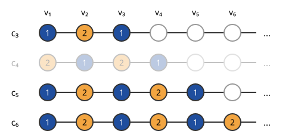

# de Bruijn–Erdős 정리

# 개요

**de Bruijn–Erdős 정리(de Bruijn–Erdős theorem)** 는 무한히 큰 그래프를 몇 가지 색으로 칠할 수 있는지를 유한한 조각만 보고 정하게 해 주는 정리다. 정점이 끝없이 이어지는 그래프는 정점을 하나씩 칠해 나가도 칠하기가 끝나지 않아, 이웃한 정점끼리 색이 다른 칠하기가 전체에 있는지 직접 확인할 수 없다. 이 정리는 모든 유한 부분그래프를 $k$ 색으로 칠할 수 있으면 그래프 전체도 $k$ 색으로 칠할 수 있다고 답한다.

# 직관

정점이 $v_1,v_2,v_3,\dots$ 로 줄 세워지는 그래프에서, 처음 $n$ 개 정점이 만드는 부분그래프의 올바른 $k$ 색칠 $c_n$ 이 $n$ 마다 하나씩 있다. 이 색칠들을 이어 붙여 전체 색칠을 만든다.

$c_1,c_2,\dots$ 는 무한히 많고 $v_1$ 의 색은 $k$ 가지뿐이므로, $v_1$ 에 같은 색 $a_1$ 을 주는 $c_n$ 이 무한히 많다. 그 가운데 $v_2$ 에 같은 색 $a_2$ 를 주는 것이 또 무한히 많다. 이렇게 $a_1,a_2,\dots$ 를 정하고 $v_i$ 에 $a_i$ 를 준다. 간선 $v_iv_j$ ($i\lt j$) 에 대해, $j$ 단계에서 남은 색칠 가운데 $n\ge j$ 인 $c_n$ 은 $v_i$ 에 $a_i$, $v_j$ 에 $a_j$ 를 주는 올바른 색칠이므로 $a_i\ne a_j$ 다.

그림은 정점이 한 줄로 이어진 그래프에서 $k=2$ 인 경우다. $v_1$ 에 색 $1$ 을 주는 $c_3,c_5,c_6$ 이 남고 흐리게 그린 $c_4$ 는 버린다. 남은 색칠은 $v_2$ 에 모두 색 $2$ 를 주므로 $a_1=1$, $a_2=2$ 다.

정점을 줄 세울 수 없으면 이 단계별 선택이 끝나지 않는다. 그때는 모든 색 배정의 공간이 콤팩트하다는 것을 써서 한 번에 고른다.

# 정의

그래프 $G=(V,E)$ 의 **$k$ 색칠** 은 함수 $c:V\to\lbrace 1,\dots,k\rbrace$ 로서 $uv\in E$ 이면 $c(u)\ne c(v)$ 인 것이다. $k$ 색칠이 존재하는 가장 작은 $k$ 가 [그래프 색칠](graph-coloring.md)의 채색수 $\chi(G)$ 다.

**de Bruijn–Erdős 정리.** $k$ 가 자연수이고 $G$ 의 모든 유한 부분그래프 $H$ 에서 $\chi(H)\le k$ 이면 $\chi(G)\le k$ 다. 따라서 채색수가 유한이면 $\chi(G)=\max\lbrace\chi(H) : H\ \text{는}\ G\ \text{의 유한 부분그래프}\rbrace$ 다. N. G. de Bruijn 과 P. Erdős 가 1951 년에 증명했다[^1].

# 성질

## Tychonoff 정리에 의한 증명

$X=\lbrace 1,\dots,k\rbrace^V$ 에 이산위상의 곱위상을 준다. 유한 이산공간의 곱이므로 [Tychonoff 정리](tychonoff-theorem.md)로 $X$ 는 콤팩트다.

유한 간선 집합 $F\subseteq E$ 마다 $C_F=\lbrace c\in X : uv\in F\ \text{이면}\ c(u)\ne c(v)\rbrace$ 로 둔다. $C_F$ 는 유한 개 좌표의 조건이므로 닫힌집합이고, $F$ 의 끝점들이 만드는 유한 부분그래프가 $k$ 색칠되므로 비어 있지 않다. $C_{F_1}\cap\dots\cap C_{F_m}=C_{F_1\cup\dots\cup F_m}$ 이므로 유한 교집합이 비지 않는다. 콤팩트성에서 모든 $C_F$ 의 교집합이 비지 않고, 그 원소가 $G$ 의 $k$ 색칠이다.

같은 증명을 명제논리의 콤팩트성 정리(compactness theorem)로도 쓴다. 정점 $v$ 와 색 $i$ 마다 "$v$ 의 색이 $i$" 인 명제변수를 두면, 유한 부분그래프의 $k$ 색칠이 유한 개 논리식의 충족 배정이 된다.

## 유한 개 색의 조건

$k$ 가 유한이어야 한다. 셀 수 없는 집합 위의 완전그래프는 모든 유한 부분그래프가 유한 개 색으로 칠해지지만 채색수는 정점 집합의 크기와 같다.

## 선택 공리의 역할

위 증명은 유한 이산공간의 곱에만 Tychonoff 정리를 쓴다. 이 경우는 초필터 보조정리(ultrafilter lemma)에서 나오므로, de Bruijn–Erdős 정리에 [선택 공리](axiom-of-choice.md) 전체는 필요하지 않다.

선택 원리 없이는 결론이 달라질 수 있다. S. Shelah 와 A. Soifer 는 실수 위의 그래프 가운데, 선택 공리를 쓰면 채색수가 $2$ 이고 모든 집합이 Lebesgue 가측인 집합론의 모형에서는 채색수가 셀 수 없이 큰 것을 구성했다[^2].

# 활용

- [평면의 채색수](chromatic-number-of-the-plane.md). 이 정리로 평면 전체의 단위 거리 그래프의 채색수가 평면에 그린 유한 단위 거리 그래프의 채색수의 최댓값과 같아진다. 그래서 하한은 유한 그래프 하나를 찾아 증명한다.
- 무한 평면 그래프. 유한 평면 그래프에 대한 4색 정리에서 무한 평면 그래프도 4 색으로 칠해진다는 것이 나온다.

[^1]: N. G. de Bruijn, P. Erdős, "A colour problem for infinite graphs and a problem in the theory of relations", Indagationes Mathematicae 13 (1951), 369–373.
[^2]: S. Shelah, A. Soifer, "Axiom of choice and chromatic number of the plane", Journal of Combinatorial Theory, Series A 103 (2003), 387–391.

# 연관 문서

## 선수지식

- [그래프 색칠](graph-coloring.md)
- [Tychonoff 정리](tychonoff-theorem.md)

## 더 알아보기

- [평면의 채색수](chromatic-number-of-the-plane.md)

#graph_theory #topology #set_theory #combinatorics
