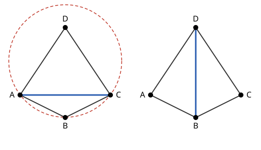

# Delaunay 삼각분할

# 개요

**Delaunay 삼각분할(Delaunay triangulation)** 은 평면의 점들을 꼭짓점으로 하는 삼각형들로 점들의 볼록 껍질을 나누되, 어느 삼각형의 외접원 안에도 다른 점이 들어오지 않게 나눈 것이다. 측량한 지점 몇 곳의 높이로 지형을 그릴 때 지점들을 삼각형으로 이어 삼각형마다 평면으로 메우는데, 가늘고 긴 삼각형이 생기면 멀리 떨어진 두 지점의 높이로 그 사이를 메우게 된다. Delaunay 삼각분할은 가장 작은 각을 가장 크게 하는 삼각분할이어서 이런 가는 삼각형을 피한다.

# 직관

네 지점 $A=(0,0)$, $B=(2,-1)$, $C=(4,0)$, $D=(2,3)$ 을 삼각형 둘로 나누는 방법은 대각선 $AC$ 를 긋거나 $BD$ 를 긋는 두 가지다. 아래 그림의 왼쪽이 $AC$, 오른쪽이 $BD$ 를 그은 것이다.

$AC$ 를 그으면 삼각형 $ABC$ 가 납작해져 $A$ 와 $C$ 의 각이 약 $26.6^\circ$ 다. $BD$ 를 그으면 두 삼각형의 가장 작은 각이 $D$ 의 약 $33.7^\circ$ 여서 더 크다. 그래서 $BD$ 쪽이 덜 가늘다.

왼쪽 그림의 점선은 $A,B,C$ 를 지나는 원이고, 중심이 $(2,1.5)$, 반지름이 $2.5$ 다. $D$ 는 중심에서 $1.5$ 떨어져 원 안에 있다. 납작한 삼각형의 외접원은 커서 다른 점이 그 안에 들어가기 쉽다. "외접원 안에 다른 점이 없다" 를 조건으로 삼으면 $AC$ 는 걸러지고 $BD$ 가 남는다.

# 정의

## 삼각분할

평면의 유한 점 집합 $S$ 의 점이 모두 한 직선 위에 있지는 않다고 한다. $S$ 의 **삼각분할(triangulation)** 은 꼭짓점이 $S$ 의 점인 삼각형들의 모임으로, 삼각형들의 합집합이 $S$ 의 [볼록 껍질](convex-hull-algorithms.md)이고 두 삼각형은 공통 변이나 공통 꼭짓점에서만 만나며 $S$ 의 모든 점이 어느 삼각형의 꼭짓점인 것이다.

직관 절의 네 점에서 두 대각선이 각각 삼각분할 하나를 준다.

## Delaunay 삼각분할

$S$ 의 삼각분할에서 모든 삼각형의 외접원 내부에 $S$ 의 점이 없으면 **Delaunay 삼각분할** 이라 한다. Delaunay 가 1934 년에 정의했다[^1].

직관 절에서 $AC$ 로 나눈 삼각분할은 $D$ 가 삼각형 $ABC$ 의 외접원 안에 있어 Delaunay 삼각분할이 아니다. $BD$ 로 나눈 삼각분할은 Delaunay 삼각분할이다.

## 원 안 판정

$a,b,c$ 가 반시계 방향인 세 점일 때 다음 행렬식이 양수인 것과 $d$ 가 $a,b,c$ 의 외접원 내부에 있는 것은 동치다.

$$
\det\begin{pmatrix}a\_x-d\_x & a\_y-d\_y & (a\_x-d\_x)^2+(a\_y-d\_y)^2\cr b\_x-d\_x & b\_y-d\_y & (b\_x-d\_x)^2+(b\_y-d\_y)^2\cr c\_x-d\_x & c\_y-d\_y & (c\_x-d\_x)^2+(c\_y-d\_y)^2\end{pmatrix}
$$

직관 절의 $A,B,C,D$ 를 넣으면 행들이 $(-2,-3,13)$, $(0,-4,16)$, $(2,-3,13)$ 이고 행렬식은 $16$ 이다. 양수이므로 $D$ 는 외접원 안에 있다.

# 성질

## 포물면으로 올리기

점 $p=(x,y)$ 를 포물면 위의 점 $\hat p=(x,y,x^2+y^2)$ 로 올린다.

정리. $d$ 가 $a,b,c$ 의 외접원 내부에 있는 것과 $\hat d$ 가 $\hat a,\hat b,\hat c$ 를 지나는 평면의 아래에 있는 것은 동치다. 그래서 올린 점들의 3 차원 볼록 껍질에서 아래를 향한 면을 평면에 내리면 Delaunay 삼각분할이 나온다.

증명의 요지. 원 $(x-u)^2+(y-v)^2=r^2$ 을 전개하면 다음과 같다.

$$
x^2+y^2=2ux+2vy+(r^2-u^2-v^2)
$$

이것은 평면 $z=2ux+2vy+\mathrm{const}$ 와 포물면이 만나는 곡선을 내린 것이다. 원 내부의 점은 포물면 위에서 그 평면보다 아래에 있다. 원 안 판정의 행렬식이 이 위아래 판정을 적은 것이다.

이 정리로 3 차원 볼록 껍질 알고리즘이 $O(n\log n)$ 시간의 Delaunay 삼각분할 알고리즘이 된다.

## 존재와 유일성

정리. $S$ 의 점이 모두 한 직선 위에 있지 않으면 Delaunay 삼각분할이 존재한다. 어느 네 점도 한 원 위에 있지 않으면 유일하다.

증명의 요지. 올린 점들의 아래쪽 껍질은 언제나 있고, 네 점이 한 원 위에 없으면 아래쪽 면이 모두 삼각형이다. 네 점이 한 원 위에 있으면 그 사각형의 두 대각선이 모두 조건을 만족한다.

## 각의 최대최소

정리. 삼각분할의 각을 작은 것부터 늘어놓은 열을 사전식으로 비교하면 Delaunay 삼각분할이 가장 크다. 특히 가장 작은 각이 모든 삼각분할 가운데 가장 크다[^2].

증명의 요지. 볼록 사각형의 대각선 하나가 원 조건을 어기면, 다른 대각선으로 바꿀 때 원주각의 비교로 가장 작은 각이 커진다. 직관 절의 $26.6^\circ$ 에서 $33.7^\circ$ 로의 변화가 그 예다.

## 뒤집기 알고리즘

원 조건을 어기는 변 $e$ 가 볼록 사각형의 대각선이면 다른 대각선으로 바꾸는 것을 **뒤집기(edge flip)** 라 한다. 아무 삼각분할에서 시작해 어기는 변이 없을 때까지 뒤집으면 Delaunay 삼각분할에 이른다[^3]. 뒤집기마다 올린 곡면이 아래로 내려가고 한 번 사라진 변은 다시 나오지 않으므로, 뒤집기는 많아야 $\binom n2$ 번이다.

## Voronoi 도형과의 쌍대

점 $p\in S$ 의 **Voronoi 영역(Voronoi cell)** 은 $S$ 의 다른 어느 점보다 $p$ 에 가까운 평면의 점 전체이고, 영역들의 모임이 **Voronoi 도형(Voronoi diagram)** 이다. 네 점이 한 원 위에 있지 않을 때, 두 점의 Voronoi 영역이 변을 공유하는 것과 두 점을 잇는 변이 Delaunay 삼각분할에 있는 것은 동치다. 삼각형의 외접원의 중심이 Voronoi 도형의 꼭짓점이다.

## 크기와 부분그래프

Delaunay 삼각분할은 [평면 그래프](planar-graphs.md)이므로 점이 $n\ge 3$ 개이면 변이 많아야 $3n-6$ 개다. 각 점과 가장 가까운 점을 잇는 변과 유클리드 [최소 신장트리](minimum-spanning-tree.md)의 변은 모두 Delaunay 삼각분할의 변이다. 그래서 평면 점들의 최소 신장트리는 $O(n)$ 개의 변 위에서 구해 $O(n\log n)$ 시간이 든다.

# 활용

- 지형 모형. 측량점의 Delaunay 삼각분할 위에 삼각형마다 평면을 두어 높이를 보간한다.
- 메시 생성. [유한요소법](finite-element-method.md)의 오차는 가는 삼각형에서 커지므로 메시를 Delaunay 삼각분할로 만들고 필요한 곳에 점을 더한다.
- 가장 가까운 점 질의. Voronoi 도형에서 질의점이 든 영역을 찾으면 가장 가까운 점이 나온다.
- 거리의 근사. Delaunay 삼각분할에서 두 점 사이 최단 경로의 길이는 직선 거리의 $2$ 배 이내여서, 변이 $O(n)$ 개인 그래프로 모든 점 쌍의 거리를 근사하는 데 쓰인다.

[^1]: B. Delaunay, "Sur la sphère vide", Bulletin de l'Académie des Sciences de l'URSS, Classe des sciences mathématiques et naturelles 6 (1934), 793–800.
[^2]: R. Sibson, "Locally equiangular triangulations", The Computer Journal 21 (1978), 243–245.
[^3]: C. L. Lawson, "Software for C¹ surface interpolation", in J. R. Rice (ed.), Mathematical Software III, Academic Press, 1977, 161–194.

# 연관 문서

## 선수지식

- [볼록 껍질 알고리즘](convex-hull-algorithms.md)

## 더 알아보기

아직 연결한 문서가 없다.

#algorithms #computation #optimization
