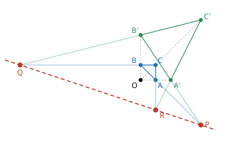

# Desargues 정리

# 개요

**Desargues 정리(Desargues's theorem)** 는 대응하는 꼭짓점을 이은 세 직선이 한 점에서 만나는 두 삼각형에서, 대응하는 변을 연장해 얻는 세 교점이 한 직선 위에 있다는 정리다. 바닥에 놓인 삼각형 판에 전등을 비추면 벽에 그림자 삼각형이 생기는데, 판의 변과 그림자의 대응하는 변을 연장하면 세 교점이 판의 평면과 벽의 평면이 만나는 직선 위에 놓인다. 평면의 그림도 공간의 이 그림을 납작하게 누른 것으로 보면 같은 결론이 나오고, 그래서 이 정리는 점과 직선만으로 정의된 평면이 공간 안에 놓일 수 있는지, 곧 나눗셈환으로 좌표를 붙일 수 있는지를 판정한다.

# 직관

원점 $O$ 에서 나가는 세 직선 위에 삼각형 $ABC$ 와 $A'B'C'$ 을 놓는다.

$$
A=(1,0),\quad B=(0,1),\quad C=(1,1),\qquad A'=(2,0),\quad B'=(0,3),\quad C'=(4,4)
$$

$A'$ 은 직선 $OA$ 위에, $B'$ 은 직선 $OB$ 위에, $C'$ 은 직선 $OC$ 위에 있다. 대응하는 변의 쌍과 교점은 다음과 같다.

| 변의 쌍       | 두 직선                     | 교점         |
| ------------- | --------------------------- | ------------ |
| $AB$, $A'B'$  | $x+y=1$, $3x+2y=6$          | $P=(4,-3)$   |
| $BC$, $B'C'$  | $y=1$, $4y=x+12$            | $Q=(-8,1)$   |
| $CA$, $C'A'$  | $x=1$, $y=2x-4$             | $R=(1,-2)$   |

세 교점은 모두 직선 $x+3y=-5$ 위에 있다. 아래 그림에서 파란 삼각형이 $ABC$, 초록 삼각형이 $A'B'C'$ 이고, 회색 점선은 $O$ 에서 나가는 세 직선, 빨간 점선이 $P,Q,R$ 을 지나는 직선이다.

두 삼각형이 공간에서 서로 다른 평면 $\pi$, $\pi'$ 위에 있으면 이 결론은 계산 없이 나온다. $A'$ 은 직선 $OA$ 위에, $B'$ 은 직선 $OB$ 위에 있으므로 네 점 $A,B,A',B'$ 은 $O,A,B$ 가 정하는 평면 위에 있고, 그 평면 안의 두 직선 $AB$ 와 $A'B'$ 은 한 점 $P$ 에서 만난다. $P$ 는 $AB$ 위에 있으므로 $\pi$ 위에, $A'B'$ 위에 있으므로 $\pi'$ 위에 있다. $Q$ 와 $R$ 도 같으므로 세 점은 두 평면이 만나는 직선 위에 있다.

# 정의

## 점에 대한 원근과 직선에 대한 원근

삼각형 $ABC$ 와 $A'B'C'$ 에서 직선 $AA'$, $BB'$, $CC'$ 이 한 점 $O$ 를 지나면 두 삼각형이 **점 $O$ 에 대해 원근(perspective from a point)** 이라 한다. 직관 절의 두 삼각형은 원점에 대해 원근이다.

대응하는 변의 교점 $AB\cap A'B'$, $BC\cap B'C'$, $CA\cap C'A'$ 이 한 직선 위에 있으면 두 삼각형이 **직선에 대해 원근(perspective from a line)** 이라 한다. 직관 절의 두 삼각형은 직선 $x+3y=-5$ 에 대해 원근이다.

Desargues 정리는 점에 대해 원근인 두 삼각형이 직선에 대해서도 원근이라는 진술이다.

## Desargues 배치

직관 절의 그림에는 점 열 개 $O,A,B,C,A',B',C',P,Q,R$ 과 직선 열 개가 있다. 직선은 $O$ 를 지나는 셋, 두 삼각형의 변 여섯, 그리고 $P,Q,R$ 을 지나는 하나다. 직선마다 열 점 가운데 세 개가 있고, 점마다 열 직선 가운데 세 개가 지난다.

이 결합 구조를 **Desargues 배치(Desargues configuration)** 라 한다. $AB$ 위에는 $A,B,P$ 가 있고, $P$ 를 지나는 직선은 $AB$, $A'B'$, 그리고 $P,Q,R$ 을 지나는 직선이다.

## Desargues 평면

[유한 사영평면](finite-projective-planes.md)의 공리를 만족하는 사영평면에서, 점에 대해 원근인 두 삼각형이 언제나 직선에 대해서도 원근이면 그 평면을 **Desargues 평면(Desarguesian plane)** 이라 한다.

# 성질

## 공간 안의 평면

정리. 3 차원 이상의 사영공간에 들어 있는 평면은 Desargues 평면이다[^1].

증명의 요지. 두 삼각형이 서로 다른 평면에 있으면 직관 절의 논법으로 끝난다. 한 평면에 있으면 그 평면 밖의 점 $S$ 와 직선 $SC$ 위의 점 $C\_1$ 을 잡고, $O,C,S$ 가 정하는 평면 안에서 $C\_1'=OC\_1\cap SC'$ 로 둔다. 삼각형 $ABC\_1$ 과 $A'B'C\_1'$ 은 $O$ 에 대해 원근이고 서로 다른 평면에 있으므로 대응하는 변의 교점이 한 직선 위에 있다. 이 그림을 $S$ 에서 원래 평면으로 사영하면 $C\_1$ 은 $C$ 로, $C\_1'$ 은 $C'$ 으로 가고 나머지 점은 그대로이므로 결론이 나온다.

## 좌표화

정리. 사영평면이 Desargues 평면인 것과 어떤 나눗셈환 $D$ 에 대해 $\mathrm{PG}(2,D)$ 와 동형인 것은 동치다[^1].

$\mathrm{PG}(2,D)$ 는 $D^4$ 로 만든 3 차원 사영공간 안의 평면이므로 위 정리에 따라 Desargues 평면이다. 반대 방향은 Desargues 정리로 평면의 한 직선 위에 덧셈과 곱셈을 작도하고, 이 연산이 나눗셈환의 공리를 만족함을 보인다. 덧셈과 곱셈의 결합법칙이 Desargues 정리의 특수한 경우에서 나온다.

같은 논법으로 사영평면이 Desargues 평면인 것과 3 차원 사영공간의 평면으로 들어갈 수 있는 것도 동치다[^1].

## 역과 쌍대

점과 직선을 맞바꾸면 "직선에 대해 원근인 두 삼각형은 점에 대해 원근이다" 가 나온다. 이것은 Desargues 정리의 역이고, Desargues 평면의 쌍대 평면도 Desargues 평면이므로 Desargues 평면에서 역도 성립한다[^2].

## Desargues 평면이 아닌 평면

평면의 점은 그대로 두고, 음의 기울기 $m$ 을 갖는 직선만 $y$ 축에서 꺾어 $x\le 0$ 에서는 기울기 $m$, $x\ge 0$ 에서는 기울기 $2m$ 인 꺾은선으로 바꾼다. 나머지 직선은 그대로 둔다. 이 결합 구조를 **Moulton 평면(Moulton plane)** 이라 한다.

Moulton 평면에서도 두 점을 지나는 직선은 하나이고, 평행류마다 무한원점을 더하면 사영평면이 된다. 원근 중심과 두 삼각형을 $y$ 축 양쪽에 알맞게 걸쳐 놓으면 대응하는 변의 교점 세 개가 한 직선 위에 있지 않은 배치가 생기므로 Desargues 평면이 아니다[^3].

유한 평면에서는 Desargues 평면이 아닌 것의 최소 차수가 $9$ 다. 그런 평면은 위 동치에 따라 3 차원 사영공간에 들어가지 않는다.

# 활용

- [Pappus 정리](pappus-theorem.md). Pappus 평면은 Desargues 평면이다(Hessenberg 정리). 좌표화 정리와 합치면 Pappus 정리는 좌표 나눗셈환의 곱셈 교환법칙과 동치다.
- 유한 사영평면의 분류. 유한 나눗셈환은 체이므로 유한 Desargues 평면은 $\mathrm{PG}(2,q)$ 다.
- 사영공간의 공리화. 3 차원 이상의 사영공간에서는 Desargues 정리가 결합 공리로부터 증명되므로, 그런 공간은 모두 나눗셈환 위의 사영공간이다[^1].

[^1]: R. Hartshorne, *Foundations of Projective Geometry*, W. A. Benjamin, 1967.
[^2]: H. S. M. Coxeter, *Projective Geometry*, 2판, Springer, 1987.
[^3]: F. R. Moulton, "A simple non-Desarguesian plane geometry", *Transactions of the American Mathematical Society* 3 (1902), 192–195.

# 연관 문서

## 선수지식

- [유한 사영평면](finite-projective-planes.md)

## 더 알아보기

- [Pappus 정리](pappus-theorem.md)

#algebra #combinatorics #field_theory
