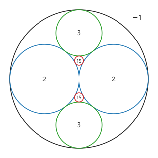

# Descartes 원 정리

# 개요

**Descartes 원 정리(Descartes' circle theorem)** 는 서로 접하는 원 네 개의 반지름 사이에 성립하는 등식이다. 동전 세 개를 서로 닿게 놓으면 가운데에 틈이 생기고, 그 틈에 세 동전 모두에 닿는 동전이 하나 들어간다. 그 동전의 반지름을 중심의 위치를 구하지 않고 세 반지름만으로 이차방정식 하나를 풀어 얻는다.

# 직관

반지름 $1$ 인 원 안에 반지름 $1/2$ 인 원 두 개를 중심 $(\pm 1/2,0)$ 에 놓으면 세 원이 서로 접한다. 그 위쪽 틈에 반지름 $1/3$ 인 원을 중심 $(0,2/3)$ 에 놓으면 이 원도 셋 모두에 접한다. 큰 원의 중심 $(0,0)$ 까지의 거리는 $2/3=1-1/3$ 이고, $(1/2,0)$ 까지의 거리는 다음과 같다.

$$
\sqrt{\frac14+\frac49}=\frac56=\frac12+\frac13
$$

이제 반지름 $1/2$, $1/2$, $1/3$ 인 세 원 사이의 작은 틈에 셋 모두에 접하는 원을 넣는다. 중심을 $(0,y)$, 반지름을 $\rho$ 로 두고 두 접선 조건을 세우면 근호가 든 연립방정식이 나온다.

반지름 대신 역수를 쓴다. 반지름 $1/2$, $1/2$, $1/3$ 의 역수는 $2$, $2$, $3$ 이고, 큰 원은 나머지를 감싸므로 부호를 바꿔 $-1$ 로 둔다. 이 네 수에서 합의 제곱과 제곱의 합의 두 배가 같다.

$$
(-1+2+2+3)^2=36=2(1+4+4+9)
$$

작은 틈의 원의 역수 $k$ 도 $2$, $2$, $3$ 과 함께 같은 등식을 만족한다고 두면 다음 이차방정식이 나온다.

$$
(7+k)^2=2(17+k^2)
$$

근은 $k=15$ 와 $k=-1$ 이다. $-1$ 은 바깥의 큰 원이고, $15$ 가 틈의 원이다. 반지름 $1/15$ 인 원을 중심 $(0,4/15)$ 에 놓으면 $(1/2,0)$ 까지의 거리가 $17/30=1/2+1/15$ 이고 $(0,2/3)$ 까지의 거리가 $2/5=1/3+1/15$ 다.

그림의 숫자는 각 원의 반지름의 역수다. 아래쪽의 $3$ 과 $15$ 는 위쪽을 실수축에 대해 뒤집은 것이다.

# 정의

## 부호 있는 곡률

원 $C$ 의 반지름이 $r$ 일 때 $1/r$ 을 $C$ 의 **곡률(curvature)** 이라 한다. 서로 접하는 원들 가운데 한 원이 나머지를 감싸면 그 원의 곡률은 $-1/r$ 로 두고, 직선의 곡률은 $0$ 으로 둔다. 이 값을 **부호 있는 곡률(signed curvature)** 이라 한다. 직관 절의 큰 원의 부호 있는 곡률은 $-1$ 이다.

## 서로 접하는 원 네 개

원과 직선 네 개가 있어 어느 두 개도 한 점에서 접하고 접점이 여섯 개 모두 다르면, 이 넷을 **서로 접하는 원 네 개(four mutually tangent circles)** 라 한다. 직관 절의 원 넷 가운데 역수가 $-1$, $2$, $2$, $3$ 인 넷과 $2$, $2$, $3$, $15$ 인 넷이 그렇다.

# 성질

## Descartes 원 정리

서로 접하는 원 네 개의 부호 있는 곡률 $k\_1,k\_2,k\_3,k\_4$ 는 다음을 만족한다.

$$
(k_1+k_2+k_3+k_4)^2=2\left(k_1^2+k_2^2+k_3^2+k_4^2\right)
$$

$k\_4$ 에 대해 풀면 다음이 나온다.

$$
k_4=k_1+k_2+k_3\pm 2\sqrt{k_1k_2+k_2k_3+k_3k_1}
$$

증명의 요지. 첫째 원과 둘째 원의 접점을 원점에 두고 반지름 $1$ 인 [원 반전](circle-inversion.md)을 한다. 두 원은 평행한 두 직선 $y=t$, $y=t+1$ 이 되고, 셋째와 넷째 원은 그 사이에 끼어 서로 접하는 지름 $1$ 인 두 원이 된다. 두 원의 중심을 $(a,t+1/2)$, $(a+1,t+1/2)$ 라 하면, 원 반전 문서의 상의 반지름 공식으로 원래 곡률은 다음과 같다.

$$
\begin{aligned}
k_1&=-2t,\qquad k_2=2t+2\cr
k_3&=2\left(a^2+t^2+t\right),\qquad k_4=2\left((a+1)^2+t^2+t\right)
\end{aligned}
$$

이것을 넣으면 양변이 모두 다음 값이 된다.

$$
16\left(a^2+a+t^2+t+1\right)^2
$$

## 두 근의 관계

$k\_1,k\_2,k\_3$ 을 고정하면 $k\_4$ 의 두 근 $k\_4$, $k\_4'$ 은 다음을 만족한다.

$$
k_4+k_4'=2(k_1+k_2+k_3)
$$

두 근은 세 원에 모두 접하는 두 원이다. 직관 절에서 $2$, $2$, $3$ 의 두 근은 $15$ 와 $-1$ 이고 합이 $14$ 다.

## Apollonius 개스킷

서로 접하는 원 네 개에서 시작해, 세 원을 골라 넷째 원을 다른 근의 원으로 바꾸는 일을 되풀이하면 틈이 모두 원으로 채워진다. 이 원들의 모임을 **Apollonius 개스킷(Apollonian gasket)** 이라 한다. 처음 네 곡률이 정수이면 두 근의 관계로 모든 원의 곡률이 정수다. 직관 절의 $-1,2,2,3$ 에서 시작하면 $15$, $3$ 이 나오고, $2,3,15$ 에서는 $38$ 이 나온다.

## 중심의 관계

원의 중심을 복소수 $z\_j$ 로 두면 $k\_jz\_j$ 도 같은 꼴의 등식을 만족한다. 이를 **복소 Descartes 정리(complex Descartes theorem)** 라 한다.

$$
\Bigl(\sum_{j=1}^4 k_jz_j\Bigr)^2=2\sum_{j=1}^4 (k_jz_j)^2
$$

직관 절의 $-1,2,2,3$ 에서 $k\_jz\_j$ 는 $0$, $1$, $-1$, $2i$ 다. 넷째를 $w$ 로 바꾸면 $(2i+w)^2=2(-2+w^2)$ 이고, 근 $w=4i$ 를 곡률 $15$ 로 나누면 틈의 원의 중심 $4i/15$ 가 나온다.

# 활용

- 정수 Apollonius 개스킷의 곡률. 곡률이 모두 정수인 개스킷에서 어떤 정수가 곡률로 나타나는지는 정수론의 문제가 되고, 두 근의 관계로 개스킷의 원들이 정수 행렬로 된 군의 궤도로 적힌다.
- 원 채움의 반지름 계산. 서로 닿는 원 세 개 사이에 넣을 원의 크기를 [원 반전](circle-inversion.md)의 작도 없이 곡률만으로 구한다.
- 높은 차원. $n$ 차원에서 서로 접하는 구 $n+2$ 개의 곡률은 합의 제곱이 제곱의 합의 $n$ 배라는 등식을 만족한다. 3 차원에서는 Soddy 의 등식이다.

# 연관 문서

## 선수지식

- [원 반전](circle-inversion.md)

## 더 알아보기

- [Soddy 육구](soddy-hexlet.md)

#complex_analysis #algebra #number_theory
