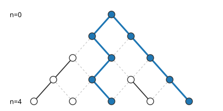

# 방향 있는 침투

# 개요

**방향 있는 침투(directed percolation)** 는 [침투](percolation.md)에서 변을 한 방향으로만 지나도록 정한 모형이다. 바위 표면의 한 점에 물을 부으면 물은 바위 속의 작은 통로를 따라 아래로만 스며들고, 통로는 저마다 확률 $p$ 로 뚫려 있다. 물이 한없이 깊이 내려갈 확률이 양수가 되는 $p$ 의 문턱이 있는지, 그 문턱이 얼마인지가 이 모형의 물음이다. 방향 있는 침투는 깊이마다 젖은 점의 집합을 세대처럼 다루어 문턱의 위아래 경계를 계산하고, 젖은 영역이 퍼지는 빠르기를 구한다.

# 직관

아래 그림의 맨 위 점에 물을 붓는다. 점마다 왼쪽 아래와 오른쪽 아래로 통로가 하나씩 있고, 진한 선이 뚫린 통로, 흐린 점선이 막힌 통로다. 파란 점과 파란 선이 물이 닿은 곳이다.

깊이 $n$ 까지 내려가는 통로의 길은 $2^n$ 가지이고, 길 하나가 모두 뚫려 있을 확률은 $p^n$ 이다. 그러므로 깊이 $n$ 에 물이 닿을 확률은 $(2p)^n$ 이하이고, $p\lt 1/2$ 이면 깊어질수록 $0$ 으로 간다.

$p=1/2$ 에서 바로 물이 끝없이 내려가지는 않는다. 그림에서 깊이 $2$ 의 가운데 점에서 갈라지는 길들은 그 아래 통로를 함께 쓰므로, 한 통로가 막히면 여러 길이 한꺼번에 막힌다. 길의 수로 센 어림보다 실제 확률이 작아서, 문턱은 $1/2$ 보다 크다.

# 정의

## 격자와 젖은 집합

격자를 다음으로 둔다.

$$
\mathcal L=\lbrace(x,n)\in\mathbb Z^2: n\ge 0,\thinspace x+n\text{ 이 짝수}\rbrace
$$

$\mathcal L$ 의 각 점 $(x,n)$ 에서 $(x-1,n+1)$ 과 $(x+1,n+1)$ 로 가는 변을 둔다. 변마다 독립으로 확률 $p$ 로 **열림(open)**, $1-p$ 로 닫힘을 정한다. 원점에서 열린 변만 따라 아래로 내려가 닿는 점의 집합을 원점의 **젖은 집합(wet set)** $C$ 라 한다. 그림에서 깊이 $4$ 의 젖은 점은 $(0,4)$ 와 $(4,4)$ 다.

## 문턱

$\theta(p)=\Pr(C\text{ 가 무한})$ 은 모든 깊이에 젖은 점이 있을 확률이다. 다음을 **임계 확률(critical probability)** 이라 한다.

$$
p\_c=\inf\lbrace p:\theta(p)\gt 0\rbrace
$$

변마다 $\lbrack 0,1\rbrack$ 의 고른 난수 $U\_e$ 를 하나 뽑고 $U\_e\le p$ 일 때 연다고 정하면, $p$ 를 키울 때 열린 변이 늘기만 하므로 $\theta(p)$ 는 증가함수다.

# 성질

## 문턱의 범위

$1/2\le p\_c\lt 1$ 이다.

아래 경계는 직관 절의 셈이다. 깊이 $n$ 까지 열린 길의 수의 기댓값이 $(2p)^n$ 이므로 $p\lt 1/2$ 이면 $\theta(p)=0$ 이다.

위 경계는 Peierls 논법(Peierls argument)으로 얻는다. 젖은 집합이 유한하면 그 둘레를 따라 닫힌 변들이 이어진 사슬이 생긴다. 길이 $m$ 인 사슬의 수는 $m$ 에 대해 지수적으로만 늘어나므로, $p$ 가 $1$ 에 가까우면 그런 사슬이 생길 확률의 합이 $1$ 보다 작고 $\theta(p)\gt 0$ 이다[^1]. Jensen 이 작은 $p$ 에서의 급수 전개로 얻은 추정값은 $p\_c\approx 0.6447$ 이다[^3].

## 퍼지는 빠르기

$p\gt p\_c$ 이고 젖은 집합이 무한하다는 조건 아래에서, 깊이 $n$ 의 가장 오른쪽 젖은 점을 $r\_n$ 이라 하면 $r\_n/n$ 이 양의 상수 $\alpha(p)$ 로 수렴한다[^1]. 젖은 영역은 깊이에 비례하는 폭의 쐐기 꼴로 퍼진다.

## 임계점에서의 소멸

$\theta(p\_c)=0$ 이다. C. Bezuidenhout 와 G. Grimmett 가 [접촉 과정](contact-process.md)과 방향 있는 침투에 대해 모든 차원에서 증명했다[^2]. 임계점에서는 물이 끝없이 내려가지 않는다.

## 접촉 과정과의 관계

깊이를 시간으로 읽고 깊이 간격을 $\delta$ 로 줄이면서 변이 열릴 확률을 $\delta$ 에 맞게 바꾸면, 깊이마다 젖은 점의 집합이 접촉 과정의 감염된 점의 집합으로 수렴한다. 접촉 과정의 그림 표현에서 감염이 전달되는 경로는 시간 방향으로만 이어지는 방향 있는 침투의 열린 길이다.

# 활용

- 흡수 상태가 있는 상전이. 젖은 점이 모두 사라진 상태에서는 다시 젖지 않으므로, 감염병의 소멸, 촉매 반응의 멈춤, 난류가 층류로 돌아가는 현상처럼 한번 들어가면 나오지 않는 상태가 있는 계의 모형이다. 이런 계들이 임계점 근처에서 같은 지수를 갖는다는 Janssen–Grassberger 추측(Janssen–Grassberger conjecture)의 기준 모형이다.
- 시간에 따른 연결. 시간 순서로만 이어지는 통신망이나 전염 경로에서, 한 지점의 정보가 끝없이 전해질 확률을 이 모형의 $\theta(p)$ 로 계산한다.
- 1 차원 세포 자동자의 확률판. 각 칸이 이웃 두 칸의 이전 상태로 다음 상태를 정하는 확률적 세포 자동자의 생존 문제가 방향 있는 침투다.

[^1]: R. Durrett, "Oriented percolation in two dimensions", *The Annals of Probability* 12 (1984), 999–1040.
[^2]: C. Bezuidenhout, G. Grimmett, "The critical contact process dies out", *The Annals of Probability* 18 (1990), 1462–1482.
[^3]: I. Jensen, "Low-density series expansions for directed percolation: I. A new efficient algorithm with applications to the square lattice", *Journal of Physics A: Mathematical and General* 32 (1999), 5233–5249.

# 연관 문서

## 선수지식

- [침투](percolation.md)

## 더 알아보기

아직 연결한 문서가 없다.

#probability #graph_theory #combinatorics
