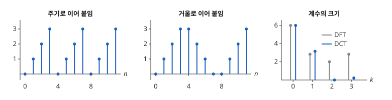

# 이산 코사인 변환

# 개요

**이산 코사인 변환(discrete cosine transform, DCT)** 은 길이 $N$ 인 수열을 반 칸씩 어긋난 코사인 $N$ 개의 조합으로 나타내는 계수를 구하는 변환이다. 사진의 밝기가 한 줄에서 $0,1,2,3$ 처럼 고르게 밝아지면, [이산 Fourier 변환](fourier.md)은 이 줄을 주기로 이어 붙인 것으로 보아 끝에서 $3$ 이 $0$ 으로 떨어지는 계단을 만들고, 그 계단 때문에 높은 주파수의 계수가 커진다. DCT 는 줄을 거울로 이어 붙인 것으로 보아 계단을 없애고, 작은 계수 몇 개를 버려도 줄이 거의 그대로 돌아오게 한다.

# 직관

$x=(0,1,2,3)$ 의 길이 4 이산 Fourier 변환은 $X=(6,\thinspace -2+2i,\thinspace -2,\thinspace -2-2i)$ 이고, 크기는 $(6,\thinspace 2.83,\thinspace 2,\thinspace 2.83)$ 이다. 이산 Fourier 변환의 역변환은 길이 4 마다 되풀이되는 수열이라서, $x$ 를 $0,1,2,3,0,1,2,3,\dots$ 로 이어 붙인 수열을 나타낸다. 이 수열은 $3$ 다음에 $0$ 으로 떨어지고, 이 떨어짐을 나타내려고 높은 주파수 $k=2$ 의 계수가 $2$ 만큼 필요하다.

$x$ 를 $0,1,2,3,3,2,1,0$ 처럼 거울로 이어 붙이면 떨어지는 자리가 없다. 이 길이 8 수열은 좌우 대칭이어서 $e^{\pm i\theta}$ 의 짝이 늘 같은 계수를 갖고, 이산 Fourier 변환이 코사인만으로 적힌다. 그 코사인의 계수를 원래 길이 4 에서 계산하면 $(6,\thinspace -3.15,\thinspace 0,\thinspace -0.22)$ 이고, $k=2,3$ 의 계수가 거의 $0$ 이다.

아래 그림의 왼쪽은 주기로 이어 붙인 수열, 가운데는 거울로 이어 붙인 수열, 오른쪽은 두 변환의 계수 크기다.

# 정의

## 변환

실수 수열 $x\lbrack 0\rbrack,\dots,x\lbrack N-1\rbrack$ 의 **DCT** 는 다음 $N$ 개의 수다[^1].

$$
X\lbrack k\rbrack=\sum_{n=0}^{N-1}x\lbrack n\rbrack\cos\Bigl(\frac{\pi}{N}\Bigl(n+\frac12\Bigr)k\Bigr),\qquad k=0,\dots,N-1
$$

문헌에서 DCT 의 변종 여덟 가운데 이것을 DCT-II 라 부르고, 이 문서의 DCT 는 이것만 가리킨다. 직관 절의 $(6,-3.15,0,-0.22)$ 가 $x=(0,1,2,3)$ 의 DCT 다.

## 역변환

$$
x\lbrack n\rbrack=\frac1N\Bigl(X\lbrack 0\rbrack+2\sum_{k=1}^{N-1}X\lbrack k\rbrack\cos\Bigl(\frac{\pi}{N}\Bigl(n+\frac12\Bigr)k\Bigr)\Bigr)
$$

이 식은 변종 가운데 DCT-III 에 상수를 곱한 것이다.

# 성질

## 코사인의 직교성

$c\_k\lbrack n\rbrack=\cos\bigl(\frac{\pi}{N}(n+\frac12)k\bigr)$ $(0\le k\le N-1)$ 는 $\mathbb R^N$ 에서 서로 직교하고, $\lVert c\_0\rVert^2=N$, $k\ge 1$ 이면 $\lVert c\_k\rVert^2=N/2$ 다. $X\lbrack k\rbrack=\langle x,c\_k\rangle$ 이므로 역변환은 이 직교기저로 $x$ 를 전개한 식이다. 각 벡터를 노름으로 나누면 DCT 는 직교행렬이 된다.

## 거울 확장의 이산 Fourier 변환

$x$ 를 뒤집어 이어 붙인 길이 $2N$ 의 수열을 $y$ 라 한다.

$$
y=\bigl(x\lbrack 0\rbrack,\dots,x\lbrack N-1\rbrack,x\lbrack N-1\rbrack,\dots,x\lbrack 0\rbrack\bigr)
$$

$y$ 의 이산 Fourier 변환 $Y$ 는 다음을 만족한다.

$$
Y\lbrack k\rbrack=2e^{i\pi k/(2N)}X\lbrack k\rbrack,\qquad 0\le k\le N-1
$$

증명의 요지. $y\lbrack 2N-1-n\rbrack=x\lbrack n\rbrack$ 이므로 다음이 나온다.

$$
Y\lbrack k\rbrack=\sum_{n=0}^{N-1}x\lbrack n\rbrack\bigl(e^{-i\pi kn/N}+e^{i\pi k(n+1)/N}\bigr)
$$

괄호에서 $e^{i\pi k/(2N)}$ 을 묶어 내면 $e^{-i\theta}+e^{i\theta}=2\cos\theta$, $\theta=\frac{\pi}{N}(n+\frac12)k$ 가 남는다. 그래서 [고속 Fourier 변환](fft.md)으로 DCT 를 $O(N\log N)$ 번의 연산에 계산한다.

## 계수의 감소

$x$ 가 매끄러운 함수를 잰 값이면, 주기 확장은 끝에서 값이 끊기지만 거울 확장은 값이 이어지고 기울기만 꺾인다. [Fourier 급수](fourier-series.md)에서 값이 끊기는 함수의 계수는 대략 $1/k$ 로, 값은 이어지고 기울기만 꺾이는 함수의 계수는 대략 $1/k^2$ 으로 줄어든다. 그래서 같은 개수의 계수를 남길 때 DCT 쪽의 오차가 작다. 직관 절에서 이산 Fourier 변환의 $k=2$ 하나를 버리고 되살리면 오차의 제곱합이 $2^2/4=1$ 이고, DCT 의 $k=2,3$ 둘을 버리고 되살리면 $2(0^2+0.22^2)/4\approx 0.025$ 다.

## 자기상관이 큰 수열

이웃 값의 상관계수가 $\rho$ 인 정상 과정에서 [주성분 분석](principal-component-analysis.md)(principal component analysis)이 주는 기저는 $\rho\to 1$ 일 때 DCT 의 기저에 가까워진다[^2]. 그래서 이웃한 화소가 비슷한 사진에서 DCT 계수끼리는 상관이 작다.

# 활용

- JPEG(Joint Photographic Experts Group) 압축. 사진을 $8\times 8$ 화소의 칸으로 나누고 가로와 세로에 각각 DCT 를 적용해 계수 64 개를 얻는다. 높은 주파수의 계수를 거칠게 양자화해 대부분을 $0$ 으로 만든다.
- [수정 이산 코사인 변환](modified-discrete-cosine-transform.md). 반씩 겹친 조각에 쓰는 변종이다. 오디오 부호화는 조각 경계의 불연속을 피하려고 DCT 대신 이것을 쓴다.
- [Chebyshev 다항식](chebyshev-polynomials.md) 보간. $\cos(\pi(n+\frac12)/N)$ 의 점에서 잰 함숫값의 DCT 가 Chebyshev 계수다. $T\_k(\cos\theta)=\cos k\theta$ 이므로 보간 계수 계산이 DCT 와 같은 식이 된다.

[^1]: N. Ahmed, T. Natarajan, K. R. Rao, "Discrete cosine transform", *IEEE Transactions on Computers* C-23(1) (1974), 90–93.

[^2]: K. R. Rao, P. Yip, *Discrete Cosine Transform: Algorithms, Advantages, Applications*, Academic Press (1990), 3장.

# 연관 문서

## 선수지식

- [이산 Fourier 변환](fourier.md)

## 더 알아보기

아직 연결한 문서가 없다.

#signal_processing #analysis #algorithms
