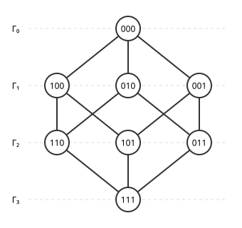

# 거리 정칙 그래프

# 개요

**거리 정칙 그래프(distance-regular graph)** 는 어느 정점에서 출발해도 거리별로 정점을 층으로 나눈 모양이 같은 그래프다. 정육면체의 꼭짓점과 모서리로 된 그래프에서는 어느 꼭짓점에서 보아도 거리 $0,1,2,3$ 인 꼭짓점이 $1,3,3,1$ 개이고, 각 꼭짓점이 앞 층, 같은 층, 다음 층에 갖는 이웃 수도 같다. 이 이웃 수들만으로 $4\times 4$ 행렬 하나를 만들면 $8\times 8$ 인접행렬의 고윳값과 중복도가 나온다.

# 직관

아래 그림은 세 비트 문자열을 정점으로 두고 한 비트만 다른 둘을 이은 정육면체 [그래프](graphs.md)를 $000$ 에서의 거리로 층을 나누어 그린 것이다. $\Gamma_i$ 는 $000$ 에서 거리 $i$ 인 정점들이다.

$\Gamma_1$ 의 정점은 앞 층에 이웃이 $1$ 개, 다음 층에 $2$ 개다. $\Gamma_2$ 의 정점은 앞 층에 $2$ 개, 다음 층에 $1$ 개이고, $\Gamma_3$ 의 $111$ 은 앞 층에 $3$ 개다. 같은 층 안의 이웃은 없다. 출발점을 다른 정점으로 바꾸어도 비트를 뒤집는 대칭으로 옮겨지므로 이 수들은 같다.

인접행렬 $A$ 의 [고윳값](eigenvalues.md)을 구하려 한다. 고유벡터 $x$ 가 거리에만 의존하는 값, 곧 $\Gamma_i$ 위에서 $u_i$ 라 하자. $(Ax)$ 의 $\Gamma_i$ 성분은 이웃의 값의 합이므로 $\Gamma_1$ 에서 $u_0+2u_2$ 이고, 층마다 적으면 $Ax=\theta x$ 는

$$
\begin{pmatrix}0&3&0&0\cr 1&0&2&0\cr 0&2&0&1\cr 0&0&3&0\end{pmatrix}\begin{pmatrix}u_0\cr u_1\cr u_2\cr u_3\end{pmatrix}=\theta\begin{pmatrix}u_0\cr u_1\cr u_2\cr u_3\end{pmatrix}
$$

이다. 이 $4\times 4$ [행렬](matrices.md)의 고윳값은 $3,1,-1,-3$ 이고 정육면체 그래프의 고윳값도 이 넷이다. $\theta=1$ 의 해는 $u=(1,\frac13,-\frac13,-1)$ 이다.

# 정의

연결 그래프 $G$ 의 지름이 $d$ 이고, 거리 $i$ 인 두 정점 $u,v$ 에 대해

$$
c_i=\char35{}\lbrace w\sim v : \mathrm{dist}(u,w)=i-1\rbrace,\quad
a_i=\char35{}\lbrace w\sim v : \mathrm{dist}(u,w)=i\rbrace,\quad
b_i=\char35{}\lbrace w\sim v : \mathrm{dist}(u,w)=i+1\rbrace
$$

가 $u,v$ 에 관계없이 $i$ 로만 정해지면 $G$ 를 **거리 정칙 그래프** 라 한다[^1]. $w\sim v$ 는 $w$ 가 $v$ 의 이웃이라는 뜻이다. 모든 정점의 이웃 수는 $k=b_0$ 이고 $a_i=k-b_i-c_i$ 다. 수열 $\lbrace b_0,b_1,\dots,b\_{d-1};c_1,c_2,\dots,c_d\rbrace$ 를 **교차 배열(intersection array)** 이라 한다.

- 직관 절의 정육면체 그래프는 $\lbrace 3,2,1;1,2,3\rbrace$ 이다.
- [강정칙 그래프](strongly-regular-graphs.md) 문서의 Petersen 그래프는 $\lbrace 3,2;1,1\rbrace$ 이다.
- 길이 $n$ 인 순환은 지름이 $\lfloor n/2\rfloor$ 이고 $b_i=1$, $c_i=1$ 인데, $n$ 이 짝수이면 $c_d=2$ 다.
- 길이 $d$ 인 $q$ 진 문자열을 정점으로 두고 한 자리만 다른 둘을 이은 Hamming 그래프(Hamming graph) $H(d,q)$ 는 $b_i=(d-i)(q-1)$, $c_i=i$ 다. 정육면체 그래프는 $H(3,2)$ 다.

지름이 $2$ 인 거리 정칙 그래프는 연결된 강정칙 그래프와 같고, $k=b_0$, $\lambda=a_1$, $\mu=c_2$ 다.

# 성질

## 층의 크기

한 정점에서 거리 $i$ 인 정점 수 $k_i$ 는

$$
k_0=1,\qquad k\_{i+1}=\frac{k_ib_i}{c\_{i+1}}
$$

이다. $\Gamma_i$ 와 $\Gamma\_{i+1}$ 사이의 간선 수를 양쪽에서 세면 $k_ib_i=k\_{i+1}c\_{i+1}$ 이다. 정육면체는 $1,3,3,1$, Petersen 그래프는 $1,3,6$ 이다.

## 거리 행렬의 점화식

$\mathrm{dist}(u,v)=i$ 이면 $1$, 아니면 $0$ 인 행렬을 $A_i$ 라 하면 $A_0=I$, $A_1=A$ 이고

$$
AA_i=b\_{i-1}A\_{i-1}+a_iA_i+c\_{i+1}A\_{i+1}
$$

이다[^1]. 좌변의 $(u,v)$ 성분은 $v$ 의 이웃 가운데 $u$ 에서 거리 $i$ 인 것의 수이고, $\mathrm{dist}(u,v)$ 가 $i-1,i,i+1$ 일 때 각각 $b\_{i-1},a_i,c\_{i+1}$ 이다. 따라서 $A_i$ 는 $A$ 의 $i$ 차 다항식이다.

## 고윳값

거리 정칙 그래프의 인접행렬은 서로 다른 고윳값을 정확히 $d+1$ 개 가지며, 그것은 교차 배열로 만든 삼중대각 행렬

$$
L=\begin{pmatrix}a_0&b_0&&\cr c_1&a_1&b_1&\cr &\ddots&\ddots&\ddots\cr &&c_d&a_d\end{pmatrix}
$$

의 고윳값과 같다[^1]. 지름이 $d$ 인 그래프에서는 $I,A,\dots,A^d$ 가 일차독립이어서 서로 다른 고윳값이 $d+1$ 개 이상이다. 거리 정칙 그래프에서는 점화식의 $i=d$ 경우에 $A\_{d+1}$ 항이 없으므로 $A$ 가 $d+1$ 차 다항식을 만족한다.

## 중복도

$L$ 의 고윳값 $\theta$ 에 대해 $u_0=1$, $u_1=\theta/k$, $c_iu\_{i-1}+a_iu_i+b_iu\_{i+1}=\theta u_i$ 로 $u_i$ 를 정하면, 정점이 $n$ 개일 때 $\theta$ 의 중복도는

$$
m(\theta)=\frac{n}{\sum\_{i=0}^{d}k_iu_i^2}
$$

이다[^1]. 이를 Biggs 공식(Biggs' formula)이라 한다. 직관 절의 $\theta=1$ 에서 $\sum k_iu_i^2=1+3\cdot\frac19+3\cdot\frac19+1=\frac83$ 이므로 $m(1)=8/\frac83=3$ 이다. 중복도가 정수가 아닌 교차 배열은 어떤 그래프의 것도 아니다.

## Moore 상한

이웃이 $k$ 개이고 지름이 $d$ 인 그래프의 정점 수는

$$
n\le 1+k+k(k-1)+\cdots+k(k-1)^{d-1}
$$

이하다. 등호가 성립하는 그래프를 Moore 그래프(Moore graph)라 하고, 그런 그래프는 $c_1=\cdots=c\_{d-1}=1$, $a_0=\cdots=a\_{d-1}=0$ 인 거리 정칙 그래프다. $k\ge 3$, $d\ge 3$ 이면 Moore 그래프는 없다[^2]. $d=2$ 의 경우는 강정칙 그래프 문서의 Hoffman–Singleton 정리다.

# 활용

- 부호 이론. Hamming 그래프 $H(n,q)$ 에서 [오류정정부호](error-correcting-codes.md)는 정점 집합이고, 부호어 사이의 거리 분포는 거리 행렬 $A_i$ 로 적힌다. 거리 정칙성 덕분에 이 분포가 만족해야 하는 일차 부등식들이 나오고, 이것이 부호 크기의 선형계획 상한(Delsarte linear programming bound)의 출발 식이다.
- 그래프의 대칭. 어느 두 정점 쌍이든 거리가 같으면 자기동형사상으로 옮길 수 있는 거리 추이 그래프(distance-transitive graph)는 거리 정칙이다. 정육면체, Petersen 그래프, Hamming 그래프가 그 예다. 거리 추이가 아닌 거리 정칙 그래프도 있다[^1].

[^1]: A. E. Brouwer, A. M. Cohen, A. Neumaier, *Distance-Regular Graphs*, Springer, 1989. 4 장.
[^2]: E. Bannai, T. Ito, "On finite Moore graphs", *Journal of the Faculty of Science, University of Tokyo, Section IA* 20 (1973), 191–208. R. M. Damerell, "On Moore graphs", *Mathematical Proceedings of the Cambridge Philosophical Society* 74 (1973), 227–236.

# 연관 문서

## 선수지식

- [강정칙 그래프](strongly-regular-graphs.md)

## 더 알아보기

아직 연결한 문서가 없다.

#graph_theory #combinatorics #linear_algebra
