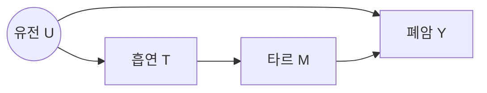

# do 계산법

# 개요

**do 계산법(do-calculus)** 은 개입했을 때의 확률을 관찰한 자료의 확률로 바꾸어 쓰는 세 규칙이다. 흡연이 폐암에 주는 효과를 구하려는데, 흡연 습관과 폐암에 함께 영향을 주는 유전 요인을 측정하지 못했다고 하자. 그러면 [뒷문 기준](backdoor-criterion.md)을 만족하는 변수 집합이 없어 유전 요인으로 나누어 평균 내는 방법을 쓸 수 없다.

흡연이 폐에 쌓이는 타르를 거쳐서만 폐암에 영향을 준다면, 세 규칙을 차례로 적용해 흡연과 타르와 폐암의 관찰 자료만으로 효과를 계산하는 식이 나온다.

# 직관

흡연 $T$ 는 타르 침착 $M$ 을 늘리고, 타르는 폐암 $Y$ 를 일으킨다. 측정하지 못한 유전 요인 $U$ 가 흡연과 폐암에 함께 영향을 준다.

관찰 자료가 다음과 같다고 하자. 흡연자는 절반이고, 흡연자의 95% 와 비흡연자의 5% 에게 타르가 쌓여 있다. 폐암 비율은 타르와 흡연 여부에 따라 다음 표와 같다.

| 타르 M | 흡연 T | 폐암 비율 |
| ------ | ------ | --------- |
| 1      | 1      | 0.15      |
| 1      | 0      | 0.10      |
| 0      | 1      | 0.05      |
| 0      | 0      | 0.02      |

흡연자의 폐암 비율은 $0.95\cdot 0.15+0.05\cdot 0.05=0.145$ 이고 비흡연자는 $0.05\cdot 0.10+0.95\cdot 0.02=0.024$ 다. 이 차이에는 흡연의 효과와 유전 요인의 길 $T\leftarrow U\to Y$ 가 섞여 있다. $U$ 를 측정하지 않았으니 $U$ 로 나눌 수 없다.

그 대신 효과를 두 토막으로 나눈다. 흡연이 타르를 바꾸는 토막에는 $T$ 로 들어오는 길이 $M$ 까지 닿지 않으므로, $P(m\mid t)$ 가 그대로 효과다. 타르가 폐암을 바꾸는 토막에서는 $M$ 으로 들어오는 길 $M\leftarrow T\leftarrow U\to Y$ 를 $T$ 가 막으므로, 흡연 여부로 나누어 평균 내면 된다.

타르가 쌓인 사람의 폐암 비율을 흡연 여부로 나누어 전체의 흡연 비율로 평균 내면 $0.5\cdot 0.15+0.5\cdot 0.10=0.125$ 이고, 타르가 없으면 $0.5\cdot 0.05+0.5\cdot 0.02=0.035$ 다. 모두 흡연하게 하면 95% 에게 타르가 쌓이므로 폐암 비율은 다음과 같다.

$$
0.95\cdot 0.125+0.05\cdot 0.035=0.1205
$$

모두 흡연하지 않게 하면 $0.05\cdot 0.125+0.95\cdot 0.035=0.0395$ 다. 흡연의 효과는 $0.081$ 이고, 관찰한 차이 $0.121$ 의 나머지는 유전 요인의 몫이다. 위 계산의 각 단계는 개입과 조건을 서로 바꾸는 등식이고, do 계산법의 세 규칙이 그 등식이 성립하는 조건을 그래프로 준다.

# 정의

인과 그래프 $G$, 개입 $\mathrm{do}(X=x)$, 경로의 막힘과 d 분리는 [뒷문 기준](backdoor-criterion.md) 문서의 정의를 쓴다. 측정하지 않은 변수도 그래프에 정점으로 둔다. 직관 절의 $U$ 가 그런 정점이다.

$X$, $Y$, $Z$, $W$ 는 서로 겹치지 않는 변수 집합이다. $P(y\mid\mathrm{do}(x),w)$ 는 $X$ 를 $x$ 로 정한 분포에서 $W=w$ 일 때 $Y=y$ 일 조건부확률이다.

$G$ 에서 $X$ 로 들어오는 화살표를 모두 지운 그래프를 $G\_{\overline X}$, $Z$ 에서 나가는 화살표를 모두 지운 그래프를 $G\_{\underline Z}$ 라 쓴다. 둘을 함께 하면 $G\_{\overline X\underline Z}$ 다. 직관 절의 그래프에서 $G\_{\overline T}$ 는 $U\to T$ 를 지운 그래프이고, $G\_{\underline M}$ 은 $M\to Y$ 를 지운 그래프다.

$G$ 에서 $Y$ 와 $Z$ 가 $X\cup W$ 로 d 분리되는 것을 $(Y\perp Z\mid X,W)\_G$ 로 쓴다. **do 계산법** 은 다음 세 규칙이다.[^1]

1. 관찰의 추가와 삭제. $(Y\perp Z\mid X,W)\_{G\_{\overline X}}$ 이면 다음이 성립한다.

$$
P(y\mid\mathrm{do}(x),z,w)=P(y\mid\mathrm{do}(x),w)
$$

2. 개입과 관찰의 교환. $(Y\perp Z\mid X,W)\_{G\_{\overline X\underline Z}}$ 이면 다음이 성립한다.

$$
P(y\mid\mathrm{do}(x),\mathrm{do}(z),w)=P(y\mid\mathrm{do}(x),z,w)
$$

3. 개입의 추가와 삭제. $(Y\perp Z\mid X,W)\_{G\_{\overline X\thinspace\overline{Z(W)}}}$ 이면 다음이 성립한다.

$$
P(y\mid\mathrm{do}(x),\mathrm{do}(z),w)=P(y\mid\mathrm{do}(x),w)
$$

$Z(W)$ 는 $Z$ 의 원소 가운데 $G\_{\overline X}$ 에서 $W$ 의 어느 원소의 조상도 아닌 것들의 집합이다. $W$ 가 비어 있으면 $Z(W)=Z$ 다.

개입 분포 $P(y\mid\mathrm{do}(x))$ 가 측정한 변수의 관찰 분포만으로 정해지면, 곧 관찰 분포가 같은 두 모형이 언제나 같은 개입 분포를 주면 그 개입 분포를 **식별 가능(identifiable)** 하다고 한다. 직관 절의 $P(y\mid\mathrm{do}(t))$ 는 식별 가능하다.

# 성질

## 규칙의 타당성

세 규칙은 모든 인과 그래프에서 성립한다.[^1]

증명의 요지. $\mathrm{do}(x)$ 아래의 분포는 [뒷문 기준](backdoor-criterion.md)의 절단 인수분해로 주어지고, 이것은 그래프 $G\_{\overline X}$ 에 대한 유향 인수분해다. 규칙 1 은 이 분포에 d 분리가 조건부 독립을 함의한다는 사실을 쓴 것이다. 규칙 2 와 3 은 $Z$ 를 정하는 식을 바꾸는 개입을 따로 변수로 그린 그래프에서 같은 사실을 쓴 것이다.

## 뒷문 조정 공식의 유도

$Z$ 가 $(T,Y)$ 에 대해 뒷문 기준을 만족하면 다음이 나온다.

$$
\begin{aligned}
P(y\mid\mathrm{do}(t)) &= \sum\_z P(y\mid\mathrm{do}(t),z)\thinspace P(z\mid\mathrm{do}(t)) \cr
&= \sum\_z P(y\mid t,z)\thinspace P(z)
\end{aligned}
$$

첫 인수는 규칙 2 로 바꾼다. $G\_{\underline T}$ 에서 $T$ 와 $Y$ 를 잇는 경로는 뒷문 경로뿐이고 $Z$ 가 그것을 모두 막는다. 둘째 인수는 규칙 3 으로 바꾼다. $Z$ 가 $T$ 의 후손이 아니므로 $G\_{\overline T}$ 에서 $T$ 와 $Z$ 를 잇는 경로는 $T$ 에서 나가 충돌자를 지나야 하고, 그 경로는 빈 집합으로 막힌다.

## 앞문 공식의 유도

직관 절의 그래프에서 다음 다섯 단계로 앞문 공식이 나온다.

1. 전확률 공식으로 다음이 성립한다.

$$
P(y\mid\mathrm{do}(t))=\sum\_m P(y\mid\mathrm{do}(t),m)\thinspace P(m\mid\mathrm{do}(t))
$$

2. $P(m\mid\mathrm{do}(t))=P(m\mid t)$ 는 규칙 2 다. $G\_{\underline T}$ 에서 $T$ 와 $M$ 을 잇는 경로 $T\leftarrow U\to Y\leftarrow M$ 은 충돌자 $Y$ 에서 막힌다.
3. $P(y\mid\mathrm{do}(t),m)=P(y\mid\mathrm{do}(m))$ 는 규칙 2 로 $m$ 을 $\mathrm{do}(m)$ 으로 바꾸고 규칙 3 으로 $\mathrm{do}(t)$ 를 지운 것이다. $G\_{\overline T\underline M}$ 에서 $M$ 은 $T$ 하고만 이어지고, $G\_{\overline T\thinspace\overline M}$ 에서 $T$ 는 어느 화살표에도 닿지 않는다.
4. $P(y\mid\mathrm{do}(m))=\sum\_{t'}P(y\mid m,t')\thinspace P(t')$ 는 $\lbrace T\rbrace$ 가 $(M,Y)$ 에 대해 뒷문 기준을 만족하므로 앞 절의 공식이다.
5. 넷을 합치면 다음 **앞문 공식(front-door formula)** 이 나온다.

$$
P(y\mid\mathrm{do}(t))=\sum\_m P(m\mid t)\sum\_{t'}P(y\mid m,t')\thinspace P(t')
$$

직관 절의 $0.1205$ 와 $0.0395$ 는 이 식에 표의 값을 넣은 것이다.

## 완전성

개입 분포 $P(y\mid\mathrm{do}(x))$ 가 식별 가능하면, 그 분포를 관찰 분포로 쓰는 식이 세 규칙과 확률의 기본 연산만으로 유도된다.[^2] 식별 가능한지를 그래프에서 다항 시간에 판정하고 식별 가능하면 식을 내놓는 알고리즘도 존재한다.[^2]

## 식별 불가능한 예

$U\to T$, $U\to Y$, $T\to Y$ 만 있고 $U$ 를 측정하지 않은 그래프에서는 $P(y\mid\mathrm{do}(t))$ 가 식별 가능하지 않다. 두 값을 갖는 $U$ 가 반반의 확률로 정해진다고 하자.

- 모형 1. $T=U$ 이고 $Y=U$ 다. 흡연은 폐암에 영향을 주지 않는다.
- 모형 2. $T=U$ 이고 $Y=T$ 다. 흡연이 폐암을 정한다.

두 모형 모두 관찰 분포는 $T=Y$ 가 반반으로 $0$ 이나 $1$ 인 것이다. 개입하면 모형 1 은 $P(Y=1\mid\mathrm{do}(T=1))=1/2$, 모형 2 는 $1$ 이다. 관찰 분포가 같은데 개입 분포가 다르므로 어떤 식으로도 관찰 분포에서 효과를 구할 수 없다.

# 활용

- 식별 알고리즘. 관찰 연구를 설계할 때 그린 인과 그래프에 완전성 절의 알고리즘을 적용하면, 측정할 변수 집합으로 효과가 식별되는지와 계산할 식이 함께 나온다.[^2]
- 전이 가능성(transportability). 한 모집단의 실험 결과를 다른 모집단으로 옮길 때, 두 모집단의 차이를 그래프의 선택 변수로 그리고 세 규칙으로 옮겨 쓸 식을 유도한다.[^3]
- 매개 분석. 앞문 공식은 효과가 측정한 중간 변수를 거쳐서만 전달될 때 그 중간 변수로 효과를 계산하는 방법이고, 직관 절의 타르가 그 중간 변수다.

[^1]: J. Pearl, "Causal diagrams for empirical research", *Biometrika* 82 (1995), 669–688.
[^2]: I. Shpitser, J. Pearl, "Identification of joint interventional distributions in recursive semi-Markovian causal models", *Proceedings of AAAI* (2006); Y. Huang, M. Valtorta, "Pearl's calculus of intervention is complete", *Proceedings of UAI* (2006).
[^3]: E. Bareinboim, J. Pearl, "Transportability of causal effects: completeness results", *Proceedings of AAAI* (2012).

# 연관 문서

## 선수지식

- [뒷문 기준](backdoor-criterion.md)

## 더 알아보기

아직 연결한 문서가 없다.

#statistics #probability #machine_learning
