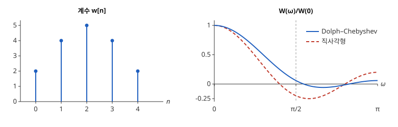

# Dolph–Chebyshev 창

# 개요

**Dolph–Chebyshev 창(Dolph–Chebyshev window)** 은 정해 둔 먼 주파수 범위에서 가장 큰 누설을 가장 작게 하는 [창함수](window-functions.md)다. 계수 5 개짜리 창으로 신호를 재면서, 주파수가 $\pi/2$ 이상 떨어진 성분이 봉우리에 섞이는 비율을 가능한 한 줄이고 싶다. 직사각형 창은 이 비율이 $1/4$ 이고, 계수를 $(2,4,5,4,2)$ 로 두면 $1/17$ 이 되며 이보다 작게 할 수 없다. 이 계수는 [Chebyshev 다항식](chebyshev-polynomials.md)에서 나온다.

# 직관

길이 $5$ 인 좌우 대칭 창함수 $(w_2,w_1,w_0,w_1,w_2)$ 의 스펙트럼은 가운데를 기준으로 쓰면

$$
W(\omega)=w_0+2w_1\cos\omega+2w_2\cos 2\omega
$$

이다. 직사각형 창 $(1,1,1,1,1)$ 은 $W(\omega)=1+2\cos\omega+2\cos2\omega$ 이고 $W(0)=5$ 다. $\omega$ 가 $\pi/2$ 에서 $\pi$ 까지 가는 동안 $W$ 는 $-1$ 에서 시작해 $\cos\omega=-\frac14$ 에서 $-1.25$ 까지 내려갔다가 $\pi$ 에서 $1$ 로 올라온다. 먼 주파수에서 가장 큰 값이 봉우리의 $1.25/5=1/4$ 이다.

$\cos\omega=2c^2-1$, $c=\cos(\omega/2)$ 로 바꾸면 $W$ 는 $c$ 의 4 차 다항식이 된다. $\omega=0$ 은 $c=1$ 이고, 범위 $\pi/2\le\omega\le\pi$ 는 $0\le c\le 1/\sqrt2$ 다. 다항식이 $c$ 의 짝수 거듭제곱만 가지므로 $\lvert c\rvert\le 1/\sqrt2$ 전체로 보아도 같다. $y=\sqrt2\thinspace c$ 로 늘이면 물음은 다음이 된다. 구간 $\lbrack -1,1\rbrack$ 에서 절댓값이 $1$ 이하인 4 차 다항식은 $y=\sqrt2$ 에서 얼마나 클 수 있는가.

Chebyshev 다항식 문서의 구간 밖의 성장이 답한다. $T_4(y)=8y^4-8y^2+1$ 이 가장 크고, $T_4(\sqrt2)=32-16+1=17$ 이다. $W(\omega)=T_4(\sqrt2\cos(\omega/2))$ 를 $\cos\omega$ 와 $\cos2\omega$ 로 전개하면

$$
W(\omega)=5+8\cos\omega+4\cos2\omega
$$

이므로 계수는 $(2,4,5,4,2)$ 다. $W(0)=17$ 이고 $\omega\ge\pi/2$ 에서 $\lvert W\rvert\le 1$ 이다. $\omega=2\pi/3$ 에서 $5-4-2=-1$, $\omega=\pi$ 에서 $5-8+4=1$ 로 먼 주파수의 두 봉우리가 같은 높이다.

아래 그림의 왼쪽은 계수, 오른쪽은 $W(\omega)/W(0)$ 이다. 점선 세로줄 $\omega=\pi/2$ 오른쪽에서 붉은 점선(직사각형 창)은 $-0.25$ 까지 내려가고, 푸른 실선은 $\pm 1/17$ 사이에 머문다.

# 정의

$N=M+1$ 을 홀수, $R\gt 1$ 을 봉우리와 곁엽의 높이 비라 하고

$$
x_0=\cosh\Bigl(\frac1M\mathrm{arccosh}\thinspace R\Bigr)
$$

로 둔다. 가운데를 기준으로 쓴 스펙트럼이

$$
W(\omega)=T_M\bigl(x_0\cos(\omega/2)\bigr)
$$

인 길이 $N$ 의 대칭 창을 **Dolph–Chebyshev 창** 이라 한다. $W(0)=T_M(x_0)=R$ 이 되도록 $x_0$ 를 고른 것이다. 계수는 $W$ 를 $\omega_k=2\pi k/N$ 에서 읽은 값의 역 [이산 Fourier 변환](fourier.md)

$$
w\lbrack n\rbrack=\frac1N\sum_{k=0}^{N-1}W(\omega_k)\cos\bigl(\omega_k(n-M/2)\bigr),\qquad n=0,\dots,M
$$

으로 계산한다. $W$ 가 차수 $M/2$ 의 코사인 다항식이므로 $N$ 개의 값으로 정해진다. 직관 절은 $N=5$, $R=17$ 이고 $x_0=\sqrt2$ 다. 다섯 값 $W(\omega_k)$ 는 $17,\ 4.24,\ -0.24,\ -0.24,\ 4.24$ 이고 위 식은 $(2,4,5,4,2)$ 를 준다.

$\lvert x_0\cos(\omega/2)\rvert\le 1$ 인 범위 $\omega_s\le\omega\le\pi$, $\omega_s=2\arccos(1/x_0)$ 를 곁엽 영역이라 한다. 직관 절에서 $\omega_s=2\arccos(1/\sqrt2)=\pi/2$ 다.

# 성질

## 등진동

곁엽 영역에서 $x_0\cos(\omega/2)$ 는 $\lbrack -1,1\rbrack$ 을 지나므로 $W$ 는 $T_M$ 의 값을 그대로 지나며 $+1$ 과 $-1$ 에 번갈아 닿는다. 모든 곁엽의 높이가 $1/R$ 로 같고 $\omega$ 가 커져도 줄지 않는다. 창함수 문서의 끝점 매끄러움과 곁엽의 관계에서 곁엽이 줄지 않는 창은 끝값이 끊기므로, 끝 계수가 $0$ 쪽으로 가지 않는다. 직관 절의 끝 계수는 가운데의 $2/5$ 다.

## 최적성

다음은 Dolph 가 보인 최적성이다. 길이 $N$ 의 대칭 창 가운데 $\omega_s\le\omega\le\pi$ 에서 $\lvert W(\omega)\rvert\le 1$ 인 것들 사이에서 $W(0)$ 이 가장 큰 것은 Dolph–Chebyshev 창 하나다[^1]. 같은 말로, 곁엽 높이 비 $R$ 을 고정하면 곁엽 영역의 시작 $\omega_s$ 가 가장 작다.

증명의 요지. $c_s=\cos(\omega_s/2)$ 로 두면 $Q(y)=W$ 를 $y=\cos(\omega/2)/c_s$ 의 함수로 본 것은 차수 $M$ 이하의 다항식이고 $\lbrack -1,1\rbrack$ 에서 $\lvert Q\rvert\le 1$ 이다.

$y_1=1/c_s$ 에서 $Q(y_1)\gt T_M(y_1)$ 이라 하자. $\lambda=T_M(y_1)/Q(y_1)\lt 1$ 로 두고 $D=T_M-\lambda Q$ 를 본다. $T_M$ 의 극값점 $\cos(k\pi/M)$, $k=0,\dots,M$ 에서 $T_M=(-1)^k$ 이고 $\lvert\lambda Q\rvert\lt 1$ 이므로 $D$ 의 부호가 $M+1$ 번 번갈아 바뀌어 $\lbrack -1,1\rbrack$ 안에 근이 $M$ 개 있다.

$D(y_1)=0$ 이 근 하나를 더하므로 차수 $M$ 이하의 $D$ 는 $0$ 이고, $\lambda Q=T_M$ 은 $y=1$ 에서 $\lvert\lambda Q\rvert\lt 1$ 과 모순이다. 등호가 성립하는 경우도 같은 논법으로 $Q=T_M$ 이 된다.

## 주엽의 폭

$a=\mathrm{arccosh}\thinspace R$ 로 두면 $1/x_0=1/\cosh(a/M)$ 이므로 $M$ 이 클 때

$$
\omega_s=2\arccos\frac1{\cosh(a/M)}\approx\frac{2a}{M}
$$

이다. 곁엽 높이를 고정하고 계수를 늘리면 곁엽 영역의 시작이 $1/M$ 에 비례해 $0$ 으로 다가간다. $R$ 을 $10$ 배로 키우면 $a$ 가 약 $\ln 10\approx 2.3$ 만큼 늘어난다.

## 잡음 대역폭

직관 절의 창은 $\sum w=17$, $\sum w^2=65$ 이므로 창함수 문서의 등가 잡음 대역폭(equivalent noise bandwidth, ENBW)이 $5\cdot 65/17^2\approx 1.12$ 다. $N$ 을 늘리면 곁엽 영역 전체에 높이 $1/R$ 의 곁엽이 깔리므로 잡음 대역폭이 커진다.

# 활용

- 배열 안테나(antenna array). 일직선으로 같은 간격에 놓인 안테나의 배열 인자(array factor)는 각 안테나의 전류를 계수로 하는 코사인 다항식이다. Dolph 의 원래 문제가 주어진 곁엽 높이에서 주 빔을 가장 좁게 하는 전류 배분이었다[^1].
- [스펙트럼 추정](spectral-estimation.md)에서 강한 성분 옆의 약한 성분을 찾을 때. 두 성분이 $\omega_s$ 이상 떨어져 있고 세기의 비가 $R$ 보다 작으면 약한 성분이 곁엽 위로 드러난다.
- [FIR 필터](fir-filters.md)(finite impulse response filter)의 계수 설계. 저지대역에서 오차가 등진동하도록 계수를 정하는 [Parks–McClellan 알고리즘](parks-mcclellan-algorithm.md)과 같은 근거를 쓴다.

[^1]: C. L. Dolph, "A current distribution for broadside arrays which optimizes the relationship between beam width and side-lobe level", *Proceedings of the IRE* 34 (1946), 335–348.

# 연관 문서

## 선수지식

- [창함수](window-functions.md)
- [Chebyshev 다항식](chebyshev-polynomials.md)

## 더 알아보기

아직 연결한 문서가 없다.

#signal_processing #analysis
