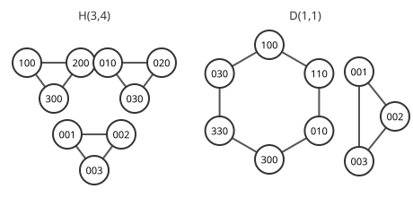

# Doob 그래프

# 개요

**Doob 그래프(Doob graph)** 는 [Shrikhande 그래프](shrikhande-graph.md) 여러 개와 정점 넷의 완전그래프 여러 개를 데카르트 곱으로 이은 그래프다. Shrikhande 그래프 하나와 정점 넷의 완전그래프 하나를 곱하면 정점이 $64$ 개이고 각 정점의 이웃이 $9$ 개다. 네 글자로 쓴 세 자리 낱말을 한 자리 바꾸기로 이은 [Hamming 그래프](hamming-graphs.md) $H(3,4)$ 도 정점 $64$ 개, 이웃 $9$ 개다.

두 그래프는 거리별 이웃 수와 고윳값이 모두 같지만 같은 그래프가 아니다. Doob 그래프는 거리별 이웃 수로 Hamming 그래프를 알아볼 수 있는지 물을 때 나오는 예외 전부다.

# 직관

$H(3,4)$ 의 정점은 $\mathbb Z\_4$ 의 글자로 쓴 낱말 $abc$ 이고, $000$ 의 이웃은 한 자리만 다른 $9$ 개다. 같은 자리를 바꾼 이웃끼리는 한 자리만 달라 이어져 있고, 다른 자리를 바꾼 이웃끼리는 두 자리가 달라 이어져 있지 않다. 그래서 아래 그림의 왼쪽처럼 $000$ 의 이웃은 삼각형 셋으로 나뉜다.

이번에는 앞 두 자리 $ab$ 를 Shrikhande 그래프의 칸으로 읽는다. 앞 두 자리는 차가 $\pm(1,0)$, $\pm(0,1)$, $\pm(1,1)$ 일 때 한 걸음이고, 셋째 자리는 아무 글자로나 바꾸는 것이 한 걸음이다. 한 걸음에 앞 두 자리와 셋째 자리 가운데 한쪽만 바꾼다.

$000$ 의 이웃은 앞 두 자리를 바꾼 $100,110,010,300,330,030$ 과 셋째 자리를 바꾼 $001,002,003$ 이다. 앞의 여섯은 Shrikhande 그래프에서처럼 6 각형을 이루고, 뒤의 셋은 삼각형을 이룬다.

두 그림 모두 정점 $9$ 개와 간선 $9$ 개다. 왼쪽은 정점 셋짜리 조각 셋이고 오른쪽은 정점 여섯짜리 조각 하나와 셋짜리 조각 하나다. 동형사상은 한 정점의 이웃을 다른 정점의 이웃으로 보내고 이웃 사이의 간선도 보존하므로, 두 그래프는 동형이 아니다.

# 정의

두 그래프 $G,H$ 의 **데카르트 곱(Cartesian product)** $G\mathbin{\square}H$ 는 정점이 순서쌍 $(g,h)$ 이고, 한 성분은 같고 다른 성분이 이웃한 두 쌍을 이은 그래프다. 직관 절의 그래프는 Shrikhande 그래프와 $K\_4$ 의 데카르트 곱이고, $H(3,4)$ 는 $K\_4\mathbin{\square}K\_4\mathbin{\square}K\_4$ 다.

$S$ 를 Shrikhande 그래프라 한다. 음이 아닌 정수 $m,n$ 에 대해 다음 그래프를 Doob 그래프 $D(m,n)$ 이라 한다[^1][^2].

$$
D(m,n)=\underbrace{S\mathbin{\square}\cdots\mathbin{\square}S}\_{m}\mathbin{\square}\underbrace{K\_4\mathbin{\square}\cdots\mathbin{\square}K\_4}\_{n}
$$

직관 절의 그래프는 $D(1,1)$ 이다. $D(0,n)$ 은 $H(n,4)$ 이고, $D(1,0)$ 은 Shrikhande 그래프다. 흔히 $m\ge 1$ 인 것만 Doob 그래프라 부른다.

군의 원소를 정점으로 두고 차가 정해진 집합에 드는 두 원소를 이은 그래프를 Cayley 그래프(Cayley graph)라 한다. $S$ 는 $\mathbb Z\_4\times\mathbb Z\_4$ 위의 Cayley 그래프이고 $K\_4$ 는 차가 $1,2,3$ 인 원소를 이은 $\mathbb Z\_4$ 위의 Cayley 그래프다. 그래서 $D(m,n)$ 은 차가 한 성분에만 있고 그 성분에서 이웃의 차인 원소를 이은 $\mathbb Z\_4^{2m+n}$ 위의 Cayley 그래프이고, 정점이 $4^{2m+n}$ 개이며 어느 정점에서 보아도 모양이 같다.

# 성질

## 거리와 교차 배열

$d=2m+n$ 이라 한다. $D(m,n)$ 의 두 정점 사이의 거리는 성분마다의 거리를 더한 값이다. 한 걸음에 성분 하나만 움직이기 때문이다.

$D(m,n)$ 은 $H(d,4)$ 와 교차 배열이 같은 [거리 정칙 그래프](distance-regular-graphs.md)다[^1].

$$
b\_i=3(d-i),\qquad c\_i=i\qquad(0\le i\le d)
$$

증명의 요지. $x$ 에서 거리 $i$ 인 $y$ 의 이웃 가운데 $x$ 에 한 걸음 가까운 것의 수는 성분마다 그 성분에서 한 걸음 가까운 것의 수를 더한 값이다. Shrikhande 그래프의 교차 배열 $\lbrace 6,3;1,2\rbrace$ 에서 거리 $e$ 인 두 정점의 그 수는 $e$ 이고, $K\_4$ 에서도 거리 $e\in\lbrace 0,1\rbrace$ 일 때 $e$ 다. 더하면 $c\_i=i$ 다. 한 걸음 먼 것의 수는 Shrikhande 그래프에서 $6-3e$, $K\_4$ 에서 $3-3e$ 이고, 더하면 $6m+3n-3i=3(d-i)$ 다.

$D(1,1)$ 은 $d=3$ 이고 교차 배열이 $\lbrace 9,6,3;1,2,3\rbrace$ 다. $000$ 에서 거리 $1,2,3$ 인 정점은 $9$, $27$, $27$ 개다.

## 고윳값

$D(m,n)$ 인접행렬의 고윳값은 $j=0,1,\dots,d$ 에 대해 $3d-4j$ 이고, 중복도는 $\binom dj 3^j$ 다. $H(d,4)$ 와 같다.

데카르트 곱의 인접행렬은 $A\_G\otimes I+I\otimes A\_H$ 이므로 고윳값은 두 그래프의 고윳값을 하나씩 골라 더한 값이다. Shrikhande 그래프와 $H(2,4)=K\_4\mathbin{\square}K\_4$ 는 고윳값 $6,2,-2$ 와 중복도 $1,6,9$ 가 같으므로, $S$ 를 $K\_4\mathbin{\square}K\_4$ 로 바꿔도 곱의 고윳값은 바뀌지 않는다.

$D(1,1)$ 에서는 $S$ 의 $6,2,-2$ 와 $K\_4$ 의 $3,-1$ 을 더해 다음 표가 나온다.

| 고윳값 | 만드는 쌍 | 중복도 |
| --- | --- | --- |
| $9$ | $6+3$ | $1$ |
| $5$ | $6-1$, $2+3$ | $3+6=9$ |
| $1$ | $2-1$, $-2+3$ | $18+9=27$ |
| $-3$ | $-2-1$ | $27$ |

## 이웃의 모양

$D(m,n)$ 에서 한 정점의 이웃끼리 이은 그래프는 6 각형 $m$ 개와 삼각형 $n$ 개를 겹치지 않게 늘어놓은 것이다. 다른 성분을 움직인 두 이웃은 두 성분에서 달라 이어지지 않고, 같은 성분을 움직인 이웃끼리는 그 성분의 그래프에서처럼 이어진다. Shrikhande 그래프의 이웃은 6 각형이고 $K\_4$ 의 이웃은 삼각형이다.

이웃의 모양에서 $m$ 과 $n$ 을 읽을 수 있으므로, $2m+n=d$ 인 $D(m,n)$ 은 $m=0,1,\dots,\lfloor d/2\rfloor$ 마다 서로 동형이 아니다. $d=3$ 이면 $H(3,4)$ 와 $D(1,1)$ 의 둘이다.

## Egawa 의 특징 정리

$H(d,q)$ 와 교차 배열이 같은 거리 정칙 그래프는 $H(d,q)$ 이거나, $q=4$ 이고 어떤 $m\ge 1$ 에 대해 $D(m,d-2m)$ 이다. 이것을 Egawa 정리(Egawa's theorem)라 한다[^3]. 위 절과 합치면 $H(d,4)$ 의 교차 배열을 갖는 거리 정칙 그래프는 동형을 빼고 정확히 $\lfloor d/2\rfloor+1$ 개다.

$d=2$ 이면 이 정리는 Shrikhande 그래프 문서의 유일성 정리에서 $n=4$ 인 경우와 같다. 지름 $2$ 의 거리 정칙 그래프는 [강정칙 그래프](strongly-regular-graphs.md)이고, $\mathrm{srg}(16,6,2,2)$ 는 $H(2,4)$ 와 Shrikhande 그래프 둘뿐이다.

# 활용

- 공스펙트럼 그래프의 예. $H(d,4)$ 와 $D(m,d-2m)$ 은 고윳값과 교차 배열이 모두 같으므로, 거리 정칙 그래프가 교차 배열로 정해지지 않는 예가 된다.
- [완전 부호](perfect-codes.md). Doob 그래프의 정점 집합에서 반지름 $1$ 인 공들이 정점을 빠짐없이 겹치지 않게 덮으려면 공의 크기 $1+3d$ 가 정점 수 $4^d$ 를 나누어야 하고, 이 조건은 $1+3d$ 가 $4$ 의 거듭제곱이라는 것과 동치다. $H(d,4)$ 와 같은 조건이고, Doob 그래프에서 그런 부호가 언제 있는지는 Koolen 과 Munemasa 가 연구했다[^4].
- [Delsarte 선형계획 상한](delsarte-lp-bound.md). 교차 배열이 같으므로 $D(m,n)$ 의 거리별 관계는 $H(d,4)$ 와 같은 고윳값 표의 [연관 체계](association-schemes.md)를 이루고, 부호의 크기 상한이 Hamming 그래프에서와 같은 식으로 나온다.

[^1]: A. E. Brouwer, A. M. Cohen, A. Neumaier, *Distance-Regular Graphs*, Springer, 1989, §9.2.
[^2]: M. Doob, "On graph products and association schemes", *Utilitas Mathematica* 1 (1972), 291–302.
[^3]: Y. Egawa, "Characterization of H(n,q) by the parameters", *Journal of Combinatorial Theory, Series A* 31 (1981), 108–125.
[^4]: J. H. Koolen, A. Munemasa, "Tight 2-designs and perfect 1-codes in Doob graphs", *Journal of Statistical Planning and Inference* 86 (2000), 505–513.

# 연관 문서

## 선수지식

- [Shrikhande 그래프](shrikhande-graph.md)

## 더 알아보기

아직 연결한 문서가 없다.

#graph_theory #combinatorics #linear_algebra
