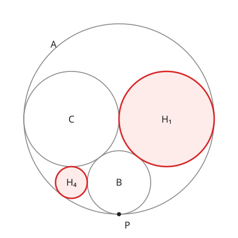

# Dupin 사이클라이드

# 개요

**Dupin 사이클라이드(Dupin cyclide)** 는 도넛 모양의 원환면(torus)을 구 반전으로 옮긴 곡면이다. [Soddy 육구](soddy-hexlet.md)의 여섯 공은 서로 닿은 채 둘레를 따라 함께 미끄러질 수 있고, 그동안 공들이 쓸고 지나간 자리는 굵기가 곳에 따라 다른 도넛이다. 이 도넛은 원환면을 반전한 것이므로 원환면처럼 두 가족의 원으로 덮이고, 휘어짐도 그 원들을 따라 계산된다.

# 직관

Soddy 육구 문서의 세 공을 그대로 쓴다. 공 $A$ 는 중심 $(1,0,1)$, 반지름 $2$ 이고, 공 $B$ 는 중심 $(1,0,-1/3)$, 반지름 $2/3$ 이고, 공 $C$ 는 중심 $(0,0,1)$, 반지름 $1$ 이다. 세 공에 모두 접하는 공의 사슬은 어느 공에서 시작해도 여섯째 공에서 닫히므로, 사슬의 공들을 조금씩 옮겨 가며 계속 굴릴 수 있다. 굴리는 동안 공들이 지나간 자리의 겉면이 어떤 곡면인지 묻는다.

$A$ 와 $B$ 의 접점 $P=(1,0,-1)$ 을 중심으로 반지름의 제곱이 $4$ 인 구에 대해 반전하면 $A$ 와 $B$ 는 평면 $z=0$ 과 $z=2$ 가 되고 $C$ 는 그대로 있다. 사슬의 공들은 반지름 $1$ 이고 중심이 평면 $z=1$ 위의 원, 곧 $(0,0,1)$ 을 중심으로 하는 반지름 $2$ 인 원 위에 있다. 이 공들을 원을 따라 굴리면 겉면은 중심원의 반지름이 $2$ 이고 관의 반지름이 $1$ 인 원환면이다. 그래서 원래 그림의 곡면은 이 원환면을 반전한 것이다.

이 곡면을 평면 $y=0$ 으로 자른다. 이 평면은 $P$ 를 지나므로 반전이 평면을 자기 자신으로 보내고, 원환면의 단면인 두 원의 상이 곡면의 단면이다. 원환면의 단면은 중심 $(2,0,1)$ 과 $(-2,0,1)$, 반지름 $1$ 인 두 원이다.

Soddy 육구 문서의 구 반전 공식을 쓴다. 중심 $(2,0,1)$ 인 원은 $\vert c-P\vert^2-r^2=5-1=4$ 가 반지름의 제곱과 같아서 그대로 있다. 중심 $(-2,0,1)$ 인 원은 $c-P=(-3,0,2)$ 이고 $\vert c-P\vert^2-r^2=13-1=12$ 이므로 중심이 $(0,0,-1/3)$, 반지름이 $4/12=1/3$ 인 원으로 옮겨진다.

그림은 단면이다. 빨간 두 원이 곡면의 단면이고, 곡면은 한쪽에서 관의 반지름이 $1$, 반대쪽에서 $1/3$ 이다. 두 빨간 원은 육구의 공 $H_1$ 과 $H_4$ 를 이 평면으로 자른 원과 같다.

원환면은 관을 가로로 자른 원(자오원)과 축을 도는 수평한 원(위도원) 두 가족으로 덮인다. 반전은 원을 원으로 보내므로 원래 그림의 곡면도 두 가족의 원으로 덮인다. 그림의 빨간 두 원은 자오원의 상이고, 평면 $z=0$, $z=2$ 와 공 $C$ 는 원환면에 위도원을 따라 닿으므로 $A$, $B$, $C$ 는 곡면에 원을 따라 닿는다.

# 정의

## 원환면

$a\gt \mu\gt 0$ 일 때 다음 식으로 매개화한 곡면을 중심원 반지름 $a$, 관의 반지름 $\mu$ 인 **원환면(torus of revolution)** 이라 한다.

$$
r(\theta,\varphi)=\bigl((a+\mu\cos\varphi)\cos\theta,\ (a+\mu\cos\varphi)\sin\theta,\ \mu\sin\varphi\bigr)
$$

$\theta$ 를 고정한 곡선은 반지름 $\mu$ 인 원이고 **자오원(meridian)** 이라 한다. $\varphi$ 를 고정한 곡선은 $z$ 축을 도는 수평한 원이고 **위도원(parallel)** 이라 한다. 직관 절의 원환면은 $a=2$, $\mu=1$ 인 원환면을 위로 $1$ 만큼 옮긴 것이다.

## 곡률선

곡면의 한 점에서 모양 연산자의 고유벡터 방향을 **주방향(principal direction)** 이라 한다. 그 고윳값이 [곡률](curvature.md) 문서의 주곡률이다. 접선이 언제나 주방향인 곡면 위의 곡선을 **곡률선(line of curvature)** 이라 한다.

원환면에서는 자오원과 위도원이 곡률선이다. 법선을 관의 중심 쪽으로 잡으면 자오원 방향의 주곡률은 $1/\mu$ 이고, 위도원 방향의 주곡률은 다음과 같다.

$$
\frac{\cos\varphi}{a+\mu\cos\varphi}
$$

직관 절의 원환면에서 바깥 적도 $\varphi=0$ 의 주곡률은 $1$ 과 $1/3$ 이고, 안쪽 적도 $\varphi=\pi$ 의 주곡률은 $1$ 과 $-1$ 이다.

## Dupin 사이클라이드

원환면을 [원 반전](circle-inversion.md)을 공간으로 옮긴 구 반전으로 옮긴 곡면을 Dupin 사이클라이드라 한다[^1]. 반전의 중심이 원환면 위에 없으면 상은 유계이고 매끄러운 닫힌 곡면이다. 넓게는 원기둥과 원뿔을 반전한 곡면도 Dupin 사이클라이드에 넣는다.

직관 절의 곡면은 중심원 반지름 $2$, 관의 반지름 $1$ 인 원환면을 $P=(1,0,-1)$ 에 대해 반전한 Dupin 사이클라이드다. $P$ 는 원환면 위에 있지 않다.

# 성질

## 두 가족의 원으로 된 곡률선

Dupin 사이클라이드의 곡률선은 두 가족이고, 두 가족이 모두 원이다. 한 가족은 자오원의 상이고 다른 가족은 위도원의 상이다.

증명의 요지. 원환면 둘레의 점을 다음과 같이 세 좌표 $(\rho,\theta,\varphi)$ 로 적는다.

$$
\bigl((a+\rho\cos\varphi)\cos\theta,\ (a+\rho\cos\varphi)\sin\theta,\ \rho\sin\varphi\bigr)
$$

$\rho$ 가 일정한 원환면들, $\theta$ 가 일정한 반평면들, $\varphi$ 가 일정한 원뿔면들은 세 좌표 방향의 벡터가 서로 직교하므로 서로 직각으로 만나는 곡면의 세 가족이다. 이런 세 가족을 **삼중 직교계(triply orthogonal system)** 라 하고, 삼중 직교계의 두 곡면은 서로의 곡률선을 따라 만난다는 것이 Dupin 정리(Dupin's theorem)다. 반전은 각을 보존하므로 삼중 직교계를 삼중 직교계로 보내고, Dupin 정리에 따라 자오원과 위도원의 상이 곡률선이다.

## 곡률구

곡면의 한 점에서 주곡률 $k\ne 0$ 에 대해, 법선 위 거리 $1/k$ 인 점을 중심으로 하고 그 점을 지나는 구를 **곡률구(curvature sphere)** 라 한다. $k=0$ 이면 곡률구는 접평면이다. Dupin 사이클라이드에서는 각 곡률선을 따라 그 곡률선 방향의 곡률구가 바뀌지 않는다.

원환면에서 자오원을 따라 자오원 방향의 곡률구는 그 자오원을 대원으로 갖는 반지름 $\mu$ 인 구이고, 위도원을 따라 위도원 방향의 곡률구는 중심이 $z$ 축 위에 있는 구다. 곡면에 한 곡선을 따라 접하는 구는 그 곡선 위의 법선들이 모두 구의 중심을 지나므로 그 곡선 방향의 곡률구다. 반전은 원환면에 자오원을 따라 접하는 구를 사이클라이드에 자오원의 상을 따라 접하는 구로 보내므로, 사이클라이드에서도 곡률구가 곡률선을 따라 일정하다. 위도원의 상도 같다.

곡률구의 반지름이 일정하다는 것과 주곡률이 일정하다는 것은 같으므로, 각 주곡률은 자기 곡률선을 따라 일정하다.

직관 절의 그림에서 육구의 공 $H_1,\dots,H_6$ 은 자오원 쪽 가족의 곡률구다. 원환면에서 $z=0$ 과 $z=2$ 는 주곡률이 $0$ 인 위도원 $\varphi=\pm\pi/2$ 의 접평면이고, $C$ 는 안쪽 적도의 곡률구다. 그래서 $A$, $B$, $C$ 는 위도원 쪽 가족의 곡률구다.

역으로, 배꼽점(umbilic point)이 없는 곡면에서 두 가족의 곡률선이 모두 원이나 직선이면 그 곡면은 Dupin 사이클라이드의 조각이다. 배꼽점은 두 주곡률이 같은 점이다.

## 두 가족의 구의 포락면

한 매개변수로 움직이는 구 가족의 모든 구에 접하는 곡면을 그 가족의 **포락면(envelope)** 이라 한다. 포락면은 가족의 각 구에 원을 따라 접한다. Dupin 사이클라이드는 두 가족의 곡률구 각각의 포락면이다.

직관 절의 사이클라이드는 $A$, $B$, $C$ 에 모두 접하는 구 가족, 곧 육구가 지나가는 구들의 포락면이다. Dupin 은 사이클라이드를 이렇게 세 구에 접하는 구들의 포락면으로 정의했다[^1].

## 표준형과 초점 곡선

좌표를 알맞게 잡으면 Dupin 사이클라이드는 다음 식으로 적힌다. 여기서 $a\gt b\gt 0$ 이고 $c^2=a^2-b^2$ 이다.

$$
\bigl(x^2+y^2+z^2-\mu^2+b^2\bigr)^2=4(ax-c\mu)^2+4b^2y^2
$$

$c=0$ 이면 $a=b$ 이고 식은 중심원 반지름 $a$, 관의 반지름 $\mu$ 인 원환면의 식이 된다.

$$
\bigl(x^2+y^2+z^2+a^2-\mu^2\bigr)^2=4a^2(x^2+y^2)
$$

$y=0$ 으로 자르면 식은 양변의 제곱근을 취해 두 원으로 갈린다. 중심 $(a,0,0)$, 반지름 $\vert c-\mu\vert$ 인 원과 중심 $(-a,0,0)$, 반지름 $c+\mu$ 인 원이다. 직관 절의 단면에서 두 원의 반지름이 $1$ 과 $1/3$ 으로 달랐던 것이 이 꼴이다.

곡률구의 중심은 서로 직교하는 두 평면 위의 두 [원뿔곡선](conic-sections.md)을 따라 움직인다. 한 가족의 중심은 평면 $z=0$ 위의 타원 $x^2/a^2+y^2/b^2=1$ 을, 다른 가족의 중심은 평면 $y=0$ 위의 쌍곡선 $x^2/c^2-z^2/b^2=1$ 을 따라간다. 원환면에서는 타원이 중심원이 되고 쌍곡선이 $z$ 축으로 줄어든다.

# 활용

- Soddy 육구. 육구의 공들은 사이클라이드의 한 가족의 곡률구이고, 각 공은 사이클라이드에 원을 따라 접한다. 공들이 접하는 원은 원환면의 자오원을 반전한 원이다.
- 기하 모델링. 원기둥과 원뿔을 매끄럽게 잇는 이음면(blending surface)에 사이클라이드의 조각을 쓴다. 곡률선이 원이어서 이음면의 경계와 단면을 원호로 적을 수 있다.
- 이산 미분기하. 곡률선 그물을 이산화한 원 그물(circular net)에서 네 꼭짓점이 한 원 위에 있는 사각형마다 사이클라이드 조각을 붙여 곡면을 만든다.

[^1]: C. Dupin, Applications de géométrie et de méchanique, Bachelier, 1822.

# 연관 문서

## 선수지식

- [Soddy 육구](soddy-hexlet.md)
- [곡률](curvature.md)

## 더 알아보기

아직 연결한 문서가 없다.

#differential_geometry #complex_analysis #algebra
