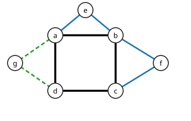

# 귀 분해

# 개요

**귀 분해(ear decomposition)** 는 그래프를 순환 하나에서 시작해, 양 끝점만 이미 만든 부분에 있는 경로를 하나씩 붙여 만드는 분해다. 붙이는 경로를 귀(ear)라 한다. 도시의 모든 길을 일방통행으로 바꾸면서도 어디서 어디로든 갈 수 있게 하려면, 도시가 어떤 순서로 이어져 있는지 알아야 한다. 도시를 순환 하나에 길을 하나씩 붙여 만들 수 있으면 붙이는 순서대로 방향을 정해 그런 일방통행 배치를 얻는다.

# 직관

도시의 모든 길을 일방통행으로 바꾸면서 어느 교차로에서 어느 교차로로도 갈 수 있게 하려고 한다. 길이 한 바퀴 도는 순환이면 그 순환을 한 방향으로 정하면 된다. 이 순환 위의 두 교차로 $x,y$ 를 잇는 새 길을 붙이면, 새 길을 $x$ 에서 $y$ 로 정한다. 새 길 위의 교차로에서는 $y$ 로 가서 순환을 타고 어디로든 가고, 어디서든 순환을 타고 $x$ 로 와서 새 길로 들어간다.

길을 이렇게 하나씩 붙여 도시 전체를 만들 수 있으면 매번 같은 방법으로 방향을 정한다. 붙일 수 없는 길도 있다. 막다른 골목처럼 지우면 도시가 둘로 갈리는 길은 한 방향으로 정하면 반대쪽에서 돌아올 수 없다. 길을 하나씩 붙이는 순서가 귀 분해이고, 그런 길이 없는 것이 귀 분해가 있을 조건이다.

아래 그림은 굵은 검은 순환 $a,b,c,d$ 에 파란 귀 $a,e,b$ 와 $b,f,c$, 초록 점선 귀 $a,g,d$ 를 차례로 붙인 귀 분해다.

# 정의

그래프 $G$ 의 부분그래프 $H$ 에 대해, 양 끝점이 $H$ 에 있고 나머지 정점과 간선이 $H$ 밖에 있는 경로나, 한 정점만 $H$ 에 있는 순환을 $H$ 의 **귀(ear)** 라 한다. 양 끝점이 다른 귀를 **열린 귀(open ear)** 라 한다.

$G$ 의 귀 분해는 순환 $P_0$ 과 경로 $P_1,\dots,P_k$ 의 열로, 각 $P_i$ 가 $P_0\cup\cdots\cup P_{i-1}$ 의 귀이고 합집합이 $G$ 인 것이다. 모든 $P_i$ $(i\ge 1)$ 가 열린 귀이면 **열린 귀 분해(open ear decomposition)** 라 한다.

간선을 지워도 연결 그래프가 남는 연결 그래프를 **간선 2 연결(2-edge-connected)** 이라 하고, 지우면 연결 성분이 늘어나는 간선을 다리(bridge)라 한다.

# 성질

## Whitney 정리

정리(Whitney). 정점이 $3$ 개 이상인 그래프 $G$ 가 $2$ 연결인 것은 $G$ 에 열린 귀 분해가 있는 것과 동치다[^1].

증명의 요지. $2$ 연결 그래프에 열린 귀를 붙이면 정점 하나를 지워도 귀의 남은 부분이 끝점 쪽으로 이어져 $2$ 연결이 유지되고, 순환은 $2$ 연결이다. 거꾸로 $G$ 가 $2$ 연결이면 순환 $P_0$ 이 있다. 지금까지 만든 $H$ 가 $G$ 가 아니면, $H$ 의 정점 $u$ 와 $H$ 밖의 정점 $v$ 를 잇는 간선이 있거나 $H$ 의 두 정점을 잇는 $H$ 밖의 간선이 있다. 앞의 경우 $G-u$ 가 연결이므로 $v$ 에서 $u$ 를 지나지 않고 $H$ 에 닿는 경로가 있고, 간선 $uv$ 와 이어 열린 귀가 된다. 뒤의 경우 그 간선 하나가 열린 귀다.

정리. 연결 그래프 $G$ 가 간선 $2$ 연결인 것은 $G$ 에 귀 분해가 있는 것과 동치다.

증명은 같다. 다리가 없으면 $H$ 밖으로 나가는 간선 $uv$ 를 지워도 연결이므로 $v$ 에서 $H$ 로 돌아오는 경로가 있고, 그 경로의 끝이 $u$ 이면 닫힌 귀가 된다.

## 귀의 개수

귀 분해의 귀는 어느 분해에서나 $\lvert E\rvert-\lvert V\rvert+1$ 개다. 순환 $P_0$ 은 정점과 간선의 수가 같고, 귀 하나는 새 정점보다 새 간선이 하나 많다. 이 수는 그래프의 순환 공간의 차원이다.

## Robbins 정리

정리(Robbins). 연결 그래프의 간선마다 방향을 정해 강하게 연결된 유향 그래프로 만들 수 있는 것은 그래프가 간선 $2$ 연결인 것과 동치다[^2].

증명의 요지. 다리 $uv$ 를 $u$ 에서 $v$ 로 정하면 $v$ 쪽에서 $u$ 쪽으로 가는 길이 없다. 거꾸로 간선 $2$ 연결이면 귀 분해를 잡고 $P_0$ 을 순환 방향으로, 각 귀를 한쪽 끝점에서 다른 끝점으로 정한다. 직관 절의 논법으로 매 단계 강한 연결이 유지된다.

## 선형 시간 구성

[그래프 탐색](graph-search.md)의 깊이 우선 탐색 나무를 잡고, 정점을 방문 순서로 훑으며 각 정점에서 나가는 뒤 간선마다 그 간선과 나무를 거슬러 올라가 이미 지난 정점에 닿을 때까지의 경로를 사슬로 뗀다. J. M. Schmidt 는 이 사슬 분해가 귀 분해이고, 사슬에 들지 않는 간선이 다리이며, 연결 그래프가 $2$ 연결인 것은 최소 차수가 $2$ 이상이고 첫 사슬 말고는 순환인 사슬이 없는 것과 동치라는 것을 증명했다[^3]. 절단점과 [블록-절단점 나무](block-cut-tree.md)도 같은 탐색으로 얻는다. 그래서 $2$ 연결과 간선 $2$ 연결의 판정과 귀 분해의 구성이 $O(\lvert V\rvert+\lvert E\rvert)$ 시간에 된다.

# 활용

- 일방통행 설계. 도로망을 일방통행으로 바꾸어도 모든 지점이 서로 닿게 할 수 있는지는 Robbins 정리로 다리의 유무와 같다.
- [매칭](matchings.md). 어느 정점을 지워도 완전 매칭이 남는 그래프는 귀가 모두 홀수 길이인 귀 분해를 갖는 그래프와 같다(Lovász)[^4]. [Gallai–Edmonds 분해](gallai-edmonds-decomposition.md)에서 최대 매칭이 덮지 않을 수 있는 정점들의 성분이 이런 그래프다.
- 연결도의 증명. [Menger 정리](menger-theorem.md)의 부채 보조정리를 쓰지 않고 $2$ 연결 그래프의 두 정점이 한 순환 위에 있다는 것을 귀에 대한 귀납법으로 보인다.

[^1]: H. Whitney, "Non-separable and planar graphs", Transactions of the American Mathematical Society 34 (1932), 339–362.
[^2]: H. E. Robbins, "A theorem on graphs, with an application to a problem of traffic control", American Mathematical Monthly 46 (1939), 281–283.
[^3]: J. M. Schmidt, "A simple test on 2-vertex- and 2-edge-connectivity", Information Processing Letters 113 (2013), 241–244.
[^4]: L. Lovász, "A note on factor-critical graphs", Studia Scientiarum Mathematicarum Hungarica 7 (1972), 279–280.

# 연관 문서

## 선수지식

- [Menger 정리](menger-theorem.md)

## 더 알아보기

- [Gallai–Edmonds 분해](gallai-edmonds-decomposition.md)
- [블록-절단점 나무](block-cut-tree.md)

#graph_theory #algorithms #combinatorics
