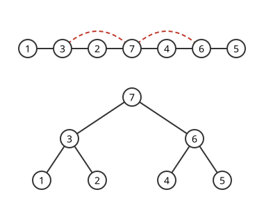

# 소거 나무

# 개요

**소거 나무(elimination tree)** 는 희소한 연립방정식을 소거할 때 어느 미지수의 소거가 어느 미지수의 소거를 기다려야 하는지를 나무로 적은 것이다. 막대 위 일곱 점의 온도를 구하는 연립방정식을 왼쪽 끝부터 소거하면 매 단계가 바로 앞 단계를 기다려서, 두 사람이 일을 나누어 할 수 없다. 소거 순서를 바꾸고 그 순서의 소거 나무를 그리면, 서로 다른 가지의 소거는 동시에 할 수 있고 나무의 높이가 차례로 해야 하는 단계 수가 된다.

# 직관

막대 위에 일곱 점이 한 줄로 있고, 각 점의 온도에 대한 식에는 그 점과 바로 이웃한 두 점의 온도만 나온다. [Gauss 소거법](gaussian-elimination.md)으로 왼쪽 끝부터 소거하면 첫 미지수를 지우는 일이 둘째 식을 바꾸고, 바뀐 둘째 식으로 둘째 미지수를 지우는 일이 셋째 식을 바꾼다. 매 단계가 바로 앞 단계의 결과를 쓰므로 일곱 단계를 차례로 해야 한다.

[중첩 분할](nested-dissection.md)처럼 가운데 점을 맨 나중에 소거하고, 양쪽 절반에서도 가운데 점을 그 절반의 마지막에 두면 아래 그림 위쪽의 번호가 된다. 번호가 소거 순서다.

중첩 분할 문서의 소거 그래프로 따라간다. $1$ 을 소거하면 이웃 $3$ 의 식만 바뀐다. $2$ 를 소거하면 이웃 $3$ 과 $7$ 이 이어져 채움 간선 $3$–$7$ 이 생긴다(빨간 점선). $3$ 을 소거하면 남은 이웃 $7$ 의 식이 바뀐다. 오른쪽 절반도 같아서 $4$ 의 소거가 채움 간선 $6$–$7$ 을 만들고, $5$ 는 $6$ 을, $6$ 은 $7$ 을 바꾼다.

정점마다 그 정점의 소거가 바꾸는 정점 가운데 번호가 가장 작은 것으로 화살표를 그으면 $1\to3$, $2\to3$, $3\to7$, $4\to6$, $5\to6$, $6\to7$ 이고, 그림 아래쪽의 나무가 된다.

$1,2,3$ 의 소거는 $4,5,6$ 의 식을 건드리지 않으므로 두 사람이 두 가지를 나누어 소거하고, $7$ 만 둘을 기다린다. 차례로 해야 하는 단계는 나무의 층 수인 셋이다. 왼쪽 끝부터의 순서에서는 화살표가 $1\to2\to\cdots\to7$ 한 줄이었다. 이렇게 그은 나무를 소거 나무라 한다.

# 정의

## 채운 그래프

대칭 행렬 $A$ 의 그래프 $G$ 와 소거 순서 $1,\dots,n$ 이 주어졌을 때, $G$ 에 그 순서의 채움 간선을 모두 더한 그래프를 **채운 그래프(filled graph)** $G^{+}$ 라 한다. 직관 절에서 $G^{+}$ 는 경로에 간선 $3$–$7$ 과 $6$–$7$ 을 더한 그래프다.

$A$ 가 양의 정부호이면 대각 성분이 양수인 아래삼각 행렬 $L$ 로 $A=LL^{\mathrm T}$ 라 적을 수 있고, 이를 **Cholesky 분해(Cholesky decomposition)** 라 한다. $L$ 의 $j$ 열은 $j$ 번째 미지수를 소거할 때 쓰는 계수다. 소거 도중 우연히 0 이 되는 상쇄가 없으면 $i\gt j$ 에서 $l_{ij}\ne0$ 인 것은 $i$–$j$ 가 $G^{+}$ 의 간선인 것과 같다.

## 소거 나무

정점 $j$ 의 부모를 $G^{+}$ 에서 $j$ 와 이웃한 정점 가운데 $j$ 보다 큰 것의 최솟값으로 정한다.

$$\mathrm{parent}(j)=\min\lbrace i\gt j : i\text{–}j\in G^{+}\rbrace$$

그런 정점이 없는 $j$ 는 뿌리다. 이 부모 관계로 만든 숲을 순서 $1,\dots,n$ 에 대한 $A$ 의 **소거 나무(elimination tree)** 라 한다. 행렬로는 $L$ 의 $j$ 열에서 대각 아래 첫 번째 0 아닌 성분의 행 번호가 $\mathrm{parent}(j)$ 다. $G$ 가 연결이면 뿌리는 $n$ 하나다.

직관 절에서 $3$ 의 $G^{+}$ 이웃은 $1,2,7$ 이므로 $\mathrm{parent}(3)=7$ 이고, $2$ 의 이웃은 $3,7$ 이므로 $\mathrm{parent}(2)=3$ 이다. 소거 나무는 그림 아래쪽의 나무다.

# 성질

## 경로 정리

정리(Rose–Tarjan–Lueker). $i\gt j$ 일 때 $i$–$j$ 가 $G^{+}$ 의 간선인 것은 $G$ 에서 $j$ 와 $i$ 를 잇고 내부 정점이 모두 $j$ 보다 작은 경로가 있는 것과 동치다[^1].

증명의 요지. 정점 $v$ 를 소거하면 $v$ 의 이웃끼리 이어지므로, $v$ 를 지나던 경로가 $v$ 를 건너뛰는 간선으로 바뀐다. 내부 정점이 모두 $j$ 보다 작으면 $j$ 를 소거하기 전에 내부 정점이 모두 소거되어 $j$ 와 $i$ 가 이어진다. 직관 절의 간선 $3$–$7$ 은 경로 $3,2,7$ 에서 나오고 내부 정점 $2$ 가 $3$ 보다 작다.

## 조상 정리

$i\gt j$ 이고 $i$–$j$ 가 $G^{+}$ 의 간선이면 $i$ 는 소거 나무에서 $j$ 의 조상이다[^2].

증명의 요지. $k=\mathrm{parent}(j)$ 라 하면 $k\le i$ 다. $j$ 를 소거할 때 $j$ 의 큰 이웃끼리 모두 이어지므로 $k\lt i$ 이면 $i$–$k$ 가 $G^{+}$ 의 간선이다. $k$ 에 같은 논증을 되풀이하면 부모를 따라 올라가다 $i$ 에 닿는다.

## 열 사이의 의존

$L$ 의 $k$ 열을 계산하려면 $l_{kj}\ne0$ 인 모든 열 $j\lt k$ 의 계산이 끝나야 한다. 조상 정리로 그런 $j$ 는 모두 $k$ 의 자손이다. 그래서 소거 나무에서 어느 쪽도 다른 쪽의 조상이 아닌 두 열은 동시에 계산할 수 있고, 차례로 해야 하는 단계 수는 나무의 높이다.

## 행 부분나무

$L$ 의 $i$ 행에서 0 아닌 성분의 열 번호들은, $a_{ij}\ne0$ 인 각 $j\lt i$ 에서 소거 나무를 따라 $i$ 까지 올라가는 경로 위의 정점들의 합집합이다[^2]. 직관 절에서 $G$ 의 $7$ 의 이웃은 $2$ 와 $4$ 이고 경로는 $2,3,7$ 과 $4,6,7$ 이므로, $L$ 의 $7$ 행은 열 $2,3,4,6,7$ 에서 0 이 아니다. 이 가운데 $3$ 과 $6$ 이 채움이다.

## 위상순 재배열

소거 나무에서 자식이 부모보다 앞에 오는 다른 순서로 번호를 다시 매겨도 채운 그래프는 같고 채움 간선의 수도 같다[^2]. 직관 절에서 소거 순서를 정점 $4,5,6,1,2,3,7$ 의 차례로 바꾸어 오른쪽 가지를 먼저 소거해도 채움은 $3$–$7$ 과 $6$–$7$ 둘이다. 부분나무 하나를 연속한 번호로 두는 후위순(postorder)이 자주 쓰인다.

## 계산

소거 나무는 $L$ 을 만들지 않고 $A$ 의 0 아닌 성분만 읽어 구할 수 있다. 행 $i=1,\dots,n$ 마다 $a_{ij}\ne0$ 인 $j\lt i$ 에서 지금까지 만든 나무의 뿌리까지 올라가 그 뿌리의 부모를 $i$ 로 정하고, 올라간 경로를 압축하면 거의 $A$ 의 0 아닌 성분 개수에 비례하는 시간이 든다[^3].

# 활용

- 희소 Cholesky 분해의 기호 분해. 수치 계산 전에 소거 나무와 행 부분나무로 $L$ 의 열마다 0 아닌 성분의 개수를 세어 기억 공간을 미리 잡는다.
- 병렬 분해. 소거 나무의 서로 다른 부분나무를 서로 다른 처리기에 맡긴다. 중첩 분할 순서는 분리자를 나무의 위쪽에 두어 나무를 낮고 넓게 만든다.
- [다전선 방법](multifrontal-method.md). 소거 나무의 정점마다 그 열과 큰 이웃들로 된 작은 밀집 행렬을 만들고, 자식들이 남긴 갱신을 더한 뒤 소거해 부모에게 넘긴다[^4]. 후위순으로 처리하면 남긴 갱신을 스택 하나에 쌓을 수 있다.
- 초절점(supernode). 소거 나무에서 한 줄로 이어지고 큰 이웃의 구조가 같은 열들을 하나로 묶어 밀집 행렬 연산으로 처리한다. 채운 그래프는 [현 그래프](chordal-graphs.md)이고, 초절점으로 묶은 나무는 그 극대 클릭들의 [접합 나무](junction-trees.md)와 같은 꼴이다.

[^1]: D. J. Rose, R. E. Tarjan, G. S. Lueker, "Algorithmic aspects of vertex elimination on graphs", *SIAM Journal on Computing* **5** (1976), 266–283.
[^2]: J. W. H. Liu, "The role of elimination trees in sparse factorization", *SIAM Journal on Matrix Analysis and Applications* **11** (1990), 134–172.
[^3]: J. W. H. Liu, "A compact row storage scheme for Cholesky factors using elimination trees", *ACM Transactions on Mathematical Software* **12** (1986), 127–148.
[^4]: I. S. Duff, J. K. Reid, "The multifrontal solution of indefinite sparse symmetric linear equations", *ACM Transactions on Mathematical Software* **9** (1983), 302–325.

# 연관 문서

## 선수지식

- [현 그래프](chordal-graphs.md)

## 더 알아보기

- [다전선 방법](multifrontal-method.md)

#graph_theory #linear_algebra #algorithms
