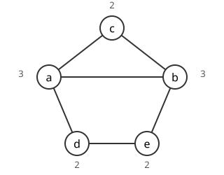
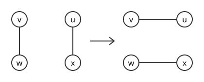

# Erdős–Gallai 정리

# 개요

**Erdős–Gallai 정리(Erdős–Gallai theorem)** 는 정점마다 이웃 수를 정해 주었을 때 그대로 이웃을 맺는 그래프가 있는지 판정하는 부등식이다. 네 사람이 모였는데 세 사람은 각각 세 명과 악수했고 한 사람은 한 명과 악수했다고 하자. 악수 횟수를 모두 더하면 $10$ 으로 짝수이지만 이런 모임은 있을 수 없다.

악수를 많이 한 사람부터 $k$ 명씩 묶어, 그 묶음의 악수 횟수가 묶음 안과 밖에서 나올 수 있는 수를 넘지 않는지 본다. 모든 $k$ 에서 넘지 않는 것이 그래프가 있을 필요충분조건이다.

# 직관

[그래프](graphs.md)에서 정점의 차수를 모두 더하면 간선 수의 두 배다. 그래서 차수의 합이 홀수이면 그래프가 없다. 개요의 $3,3,3,1$ 은 합이 $10$ 인데도 그래프가 없다.

차수가 $3$ 인 세 정점을 $a,b,c$, 차수가 $1$ 인 정점을 $d$ 라 하자. 정점이 넷이므로 $a$ 는 나머지 셋과 모두 이웃이고, $b$ 와 $c$ 도 그렇다. 그러면 $d$ 는 $a,b,c$ 셋과 이웃이라 차수가 $3$ 이어야 하는데 $1$ 로 정해져 있다.

막힌 곳은 $a,b,c$ 가 받을 이웃 수 $9$ 였다. 셋끼리 이웃을 맺으면 셋의 차수 합에 많아야 $3\cdot 2=6$ 이 들어간다. 나머지는 $d$ 가 채워야 하는데 $d$ 는 이웃이 하나뿐이라 $1$ 밖에 채우지 못한다. $9\gt 6+1$ 이므로 그래프가 없다.

차수가 큰 쪽부터 $k$ 개를 묶어 이 셈을 하면 묶음이 받을 수 있는 몫의 한계가 나온다. 묶음 안에서 $k(k-1)$, 묶음 밖의 각 정점에서 그 정점의 차수와 $k$ 가운데 작은 값이다. $3,3,2,2,2$ 는 모든 $k$ 에서 이 한계를 지키고, 아래 그림의 그래프가 그 차수를 갖는다.

그림은 정점 $a,b,c,d,e$ 와 간선 여섯 개이고, 정점 옆의 수가 차수다.



# 정의

음이 아닌 정수의 나열 $d_1\ge d_2\ge\dots\ge d_n$ 을 **차수열(degree sequence)** 이라 한다. 정점 $v_1,\dots,v_n$ 의 단순 그래프에서 $v_i$ 의 차수가 $d_i$ 이면 그 그래프를 차수열의 **실현(realization)** 이라 하고, 실현이 있는 차수열을 **그래프적(graphic)** 이라 한다. 직관 절의 $3,3,2,2,2$ 는 그래프적이고 그림의 그래프가 그 실현이다. $3,3,3,1$ 은 그래프적이 아니다.

그래프의 두 간선 $vw$, $ux$ 가 있고 $vu$, $wx$ 가 간선이 아닐 때, $vw$ 와 $ux$ 를 지우고 $vu$ 와 $wx$ 를 넣는 것을 **2-교환(2-switch)** 이라 한다. 네 정점의 차수는 그대로다.



# 성질

## Erdős–Gallai 정리

$d_1\ge\dots\ge d_n$ 이 그래프적인 것은 $d_1+\dots+d_n$ 이 짝수이고 $k=1,\dots,n$ 마다 다음이 성립하는 것과 동치다[^1].

$$
\sum_{i=1}^{k}d_i\le k(k-1)+\sum_{i=k+1}^{n}\min(d_i,k)
$$

필요성은 직관 절의 셈이다. 앞의 $k$ 개 정점끼리의 간선은 왼쪽 합에 많아야 $k(k-1)$ 을 더하고, 뒤의 정점 $v_i$ 는 앞의 $k$ 개 가운데 많아야 $\min(d_i,k)$ 개와 이웃이다. $3,3,3,1$ 은 $k=3$ 에서 $9\gt 6+1$ 로 깨진다. $3,3,2,2,2$ 는 $k=1,2,3$ 에서 $3\le 4$, $6\le 8$, $8\le 10$ 이고 $k\ge4$ 에서는 오른쪽이 $12$ 이상이다.

충분성은 아래 Havel–Hakimi 정리로 차수열의 길이에 대한 귀납법을 쓴다. 지운 뒤의 차수열이 다시 부등식을 만족함을 보이는 것이 증명의 요지다. S. A. Choudum 이 이 단계를 짧게 다시 썼다[^2].

## Havel–Hakimi 정리

**Havel–Hakimi 정리(Havel–Hakimi theorem)** 는 다음 진술이다. $d_1\ge\dots\ge d_n$ 이 그래프적인 것은 $d_1$ 을 지우고 그다음 $d_1$ 개의 항에서 $1$ 씩 뺀 다음 나열이 그래프적인 것과 동치다[^3].

$$
d_2-1,\thinspace \dots,\thinspace d_{d_1+1}-1,\thinspace d_{d_1+2},\thinspace \dots,\thinspace d_n
$$

거꾸로 가는 쪽은 새 정점 하나를 $d_1$ 개 정점에 이으면 된다. 바로 가는 쪽은 $v_1$ 이 차수가 큰 $d_1$ 개 정점과 이웃인 실현이 있음을 보이면 된다. $v_1$ 이 $u$ 와 이웃이 아니고 차수가 $u$ 이하인 $w$ 와 이웃이면, $u$ 의 이웃 가운데 $w$ 와 이웃이 아닌 $x$ 가 있다. 2-교환으로 $v_1w$, $ux$ 를 $v_1u$, $wx$ 로 바꾸면 $v_1$ 의 큰 차수 이웃이 하나 늘고, 이를 되풀이한다.

이 정리가 다음 절차를 준다.

```javascript
// 차수열이 그래프적인지 판정한다. 그래프적이면 true
function havelHakimi(d) {
  const seq = [...d];
  while (true) {
    seq.sort((a, b) => b - a);
    if (seq[0] === 0) return true; // 모두 0 이면 간선 없는 그래프
    const top = seq.shift();
    if (top > seq.length) return false;
    for (let i = 0; i < top; i++) {
      seq[i] -= 1;
      if (seq[i] < 0) return false;
    }
  }
}
```

$3,3,2,2,2$ 에서는 $2,1,1,2$ 를 정렬한 $2,2,1,1$ 이 되고, 다음은 $1,0,1$ 을 정렬한 $1,1,0$, 다음은 $0,0$ 이다. 지운 순서대로 $a$ 를 $b,c,d$ 에, $b$ 를 $e,c$ 에, $e$ 를 $d$ 에 이으면 직관 절 그림의 그래프다. $3,3,3,1$ 에서는 $2,2,0$ 다음에 $1,-1$ 이 나와 멈춘다.

## 실현 사이의 이동

같은 차수열의 두 실현은 2-교환을 거듭해 서로 옮겨 갈 수 있다. Havel–Hakimi 정리의 증명에서 두 실현을 모두 $v_1$ 이 큰 차수 정점과 이웃인 꼴로 바꾼 뒤 $v_1$ 을 지우고 귀납법을 쓰면 증명된다.

## Gale–Ryser 정리

정점을 두 쪽으로 나눈 이분 그래프에서는 한쪽의 차수 $a_1\ge\dots\ge a_m$ 과 다른 쪽의 차수 $b_1,\dots,b_n$ 을 함께 정한다. **Gale–Ryser 정리(Gale–Ryser theorem)** 는 행의 합이 $a_i$, 열의 합이 $b_j$ 인 $0\text{-}1$ 행렬이 있는 것이 두 합이 같고 $k=1,\dots,m$ 마다 다음이 성립하는 것과 동치라는 진술이다[^4].

$$
\sum_{i=1}^{k}a_i\le\sum_{j=1}^{n}\min(b_j,k)
$$

[네트워크 흐름](network-flow.md)으로 증명된다. 출발점에서 행 $i$ 로 용량 $a_i$, 행에서 열로 용량 $1$, 열 $j$ 에서 도착점으로 용량 $b_j$ 인 간선을 둔다. 흐름의 값이 $\sum a_i$ 인 정수 흐름이 행렬이고, 최대유량 최소절단 정리로 모든 절단의 용량이 $\sum a_i$ 이상인 조건이 위 부등식으로 정리된다.

# 활용

- [구성 모형](configuration-model.md). 차수열을 정해 두고 무작위 그래프를 뽑는 모형이고, 정한 차수열이 그래프적이어야 고리와 겹간선이 없는 그래프가 나올 수 있다.
- 차수를 고정한 무작위 그래프의 표본 추출. 2-교환을 한 걸음으로 하는 [Markov 연쇄 Monte Carlo](markov-chain-monte-carlo.md)가 같은 차수열의 실현들 위를 돌아다닌다. 네트워크 자료에서 어떤 구조가 차수만으로 설명되는지 비교하는 기준 모형을 만든다.
- 네트워크 설계. 노드마다 연결 수를 정해 두고 그 연결 수를 갖는 망이 있는지 Havel–Hakimi 절차로 판정하고 그대로 만든다.
- [Hoffman 순환 정리](hoffman-circulation-theorem.md). Gale–Ryser 정리의 흐름 환원은 하한과 상한이 있는 순환 문제의 특수 사례다.

[^1]: P. Erdős, T. Gallai, "Gráfok előírt fokú pontokkal", *Matematikai Lapok* 11 (1960), 264–274.
[^2]: S. A. Choudum, "A simple proof of the Erdős–Gallai theorem on graph sequences", *Bulletin of the Australian Mathematical Society* 33 (1986), 67–70.
[^3]: V. Havel, "Poznámka o existenci konečných grafů", *Časopis pro pěstování matematiky* 80 (1955), 477–480. S. L. Hakimi, "On realizability of a set of integers as degrees of the vertices of a linear graph I", *Journal of the Society for Industrial and Applied Mathematics* 10 (1962), 496–506.
[^4]: D. Gale, "A theorem on flows in networks", *Pacific Journal of Mathematics* 7 (1957), 1073–1082. H. J. Ryser, "Combinatorial properties of matrices of zeros and ones", *Canadian Journal of Mathematics* 9 (1957), 371–377.

# 연관 문서

## 선수지식

- [그래프](graphs.md)
- [네트워크 흐름](network-flow.md)

## 더 알아보기

- [Fulkerson–Chen–Anstee 정리](fulkerson-chen-anstee-theorem.md)
- [Threshold 그래프](threshold-graphs.md)
- [토너먼트](tournaments.md)

#graph_theory #combinatorics #algorithms
