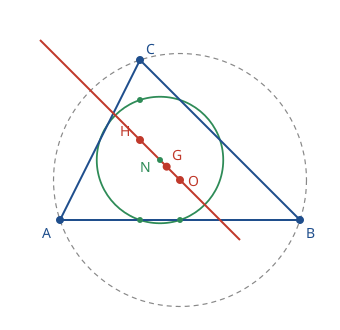

# Euler 직선

# 개요

**Euler 직선(Euler line)** 은 삼각형의 외심, 무게중심, 수심을 지나는 직선이다. 세 꼭짓점을 지나는 원의 중심, 세 꼭짓점의 평균, 세 수선이 만나는 점은 서로 다른 방법으로 정해지므로, 한 직선 위에 놓일 이유가 처음에는 보이지 않는다. 외심을 원점에 두고 꼭짓점을 벡터로 쓰면 수심이 세 벡터의 합이 되어, 세 점이 한 직선 위에 있고 그 간격이 $1:2$ 라는 것이 한 줄로 나온다.

# 직관

$A=(0,0)$, $B=(6,0)$, $C=(2,4)$ 인 삼각형에서 세 점을 계산한다.

- 무게중심 $G$ 는 꼭짓점의 평균 $(8/3,4/3)$ 이다.
- 외심 $O$ 는 $AB$ 의 수직이등분선 $x=3$ 위에 있고 $A$ 와 $C$ 에서 거리가 같으므로, $9+y^2=1+(y-4)^2$ 에서 $y=1$ 이다. $O=(3,1)$ 이다.
- 수심 $H$ 는 $C$ 에서 $AB$ 에 내린 수선 $x=2$ 와, $A$ 에서 $BC$ 에 내린 수선 $y=x$ 의 교점 $(2,2)$ 다.

세 점은 모두 직선 $y=-x+4$ 위에 있다. $O$ 에서 $G$ 로 가는 벡터는 $(-1/3,1/3)$ 이고 $G$ 에서 $H$ 로 가는 벡터는 $(-2/3,2/3)$ 이므로, $G$ 는 선분 $OH$ 를 $1:2$ 로 나눈다.

그림의 빨간 직선이 $O$, $G$, $H$ 를 지난다. 초록 원은 $OH$ 의 중점 $N=(5/2,3/2)$ 를 중심으로 하고, $AB$ 의 중점 $(3,0)$, $C$ 에서 내린 수선의 발 $(2,0)$, $CH$ 의 중점 $(2,3)$ 을 모두 지난다.

# 정의

## 삼각형의 세 중심

삼각형 $ABC$ 의 세 꼭짓점에서 거리가 같은 점 $O$ 를 **외심(circumcenter)** 이라 하고, 그 거리 $R$ 을 외접원의 반지름이라 한다. $G=(A+B+C)/3$ 을 **무게중심(centroid)** 이라 한다. 세 꼭짓점에서 마주 보는 변에 내린 수선이 만나는 점 $H$ 를 **수심(orthocenter)** 이라 한다. 세 수선이 한 점에서 만나는 것은 [Menelaus 정리](menelaus-theorem.md) 문서의 Ceva 정리로 증명된다.

직관 절의 삼각형에서 $O=(3,1)$, $G=(8/3,4/3)$, $H=(2,2)$, $R=\sqrt{10}$ 이다.

## Euler 직선

정삼각형이 아니면 $O\ne G$ 이고, $O$ 와 $G$ 를 지나는 직선을 Euler 직선이라 한다. 직관 절의 삼각형에서는 $y=-x+4$ 다. 정삼각형에서는 세 중심이 한 점이므로 Euler 직선이 정해지지 않는다.

## 구점원

$OH$ 의 중점 $N$ 을 중심으로 하고 반지름이 $R/2$ 인 원을 **구점원(nine-point circle)** 이라 한다. 직관 절의 삼각형에서 $N=(5/2,3/2)$ 이고 반지름은 $\sqrt{10}/2$ 다.

# 성질

## Euler 정리

외심을 원점에 두면 다음이 성립한다.

$$
H=A+B+C,\qquad G=\frac13H
$$

따라서 $O$, $G$, $H$ 는 한 직선 위에 있고 $OG:GH=1:2$ 다.

증명의 요지. $P=A+B+C$ 로 두면 [내적](inner-product-spaces.md)으로 다음이 나온다.

$$
(P-A)\cdot(B-C)=(B+C)\cdot(B-C)=\vert B\vert^2-\vert C\vert^2=0
$$

$\vert B\vert=\vert C\vert=R$ 이므로 $AP$ 는 $BC$ 에 수직이다. 같은 계산으로 $BP\perp CA$, $CP\perp AB$ 이므로 $P$ 는 세 수선 위에 있고 $P=H$ 다. 이 증명에서 세 수선이 한 점에서 만난다는 것도 함께 나온다. 직관 절에서 $O=(3,1)$ 을 원점으로 옮기면 세 꼭짓점은 $(-3,-1)$, $(3,-1)$, $(-1,3)$ 이고 합 $(-1,1)$ 에 $O$ 를 더하면 $H=(2,2)$ 다.

## 아홉 점

구점원은 다음 아홉 점을 지난다.

- 세 변의 중점
- 세 수선의 발
- 꼭짓점과 수심을 이은 세 선분 $AH$, $BH$, $CH$ 의 중점

증명의 요지. 외심을 원점에 두면 $N=(A+B+C)/2$ 다. $BC$ 의 중점 $(B+C)/2$ 에서 $N$ 을 빼면 $-A/2$ 이고, $AH$ 의 중점 $A+(B+C)/2$ 에서 $N$ 을 빼면 $A/2$ 이므로 두 점은 구점원의 지름의 양 끝이다. $A$ 에서 내린 수선의 발 $D$ 는 이 두 점을 각각 지나는 직선 $BC$ 와 수선 $AH$ 의 교점이고, 두 직선이 수직이므로 $D$ 는 이 지름을 직각으로 본다. 따라서 $D$ 도 구점원 위에 있다.

## Feuerbach 정리

구점원은 내접원에 안쪽에서 접하고 세 방접원에 바깥쪽에서 접한다. 이것이 **Feuerbach 정리(Feuerbach's theorem)** 다. 내심을 $I$, 내접원의 반지름을 $r$ 이라 할 때, 증명은 중심 사이의 거리 $NI$ 가 $R/2-r$ 과 같음을 변의 길이로 계산하는 것이다.

## 거리 공식

외심과 수심 사이의 거리는 변의 길이 $a,b,c$ 로 다음과 같다.

$$
OH^2=9R^2-(a^2+b^2+c^2)
$$

외심을 원점에 두면 $a^2=\vert B-C\vert^2=2R^2-2B\cdot C$ 이고, 다음 전개에 이것을 넣으면 위 식이 나온다.

$$
\vert A+B+C\vert^2=3R^2+2(A\cdot B+B\cdot C+C\cdot A)
$$ 직관 절에서 $a^2=32$, $b^2=20$, $c^2=36$ 이고 $9\cdot 10-88=2=OH^2$ 이다.

# 활용

- 삼각형의 모양 판정. $O=H$ 인 것은 정삼각형인 것과 동치이고, Euler 직선이 한 꼭짓점을 지나는 것은 그 꼭짓점에서 두 변이 같거나 그 각이 직각인 것과 동치다. 위 거리 공식에서 $OH=0$ 이면 $a^2+b^2+c^2=9R^2$ 이다.
- 무게중심 좌표의 계산. [Menelaus 정리](menelaus-theorem.md) 문서의 무게중심 좌표에서 외심, 무게중심, 수심의 좌표가 행렬식이 $0$ 인 세 벡터가 된다는 것이 Euler 정리의 좌표 판본이다.
- 원과 직선의 상들. 구점원은 수심을 중심으로 한 비 $1/2$ 의 닮음변환이 외접원을 보낸 상이고, 무게중심을 중심으로 한 비 $-1/2$ 의 닮음변환이 외접원을 보낸 상이기도 하다. 두 닮음변환의 중심 $H$ 와 $G$ 가 Euler 직선 위에 있다.

# 연관 문서

## 선수지식

- [Menelaus 정리](menelaus-theorem.md)
- [내적 공간](inner-product-spaces.md)

## 더 알아보기

아직 연결한 문서가 없다.

#algebra #linear_algebra #combinatorics
