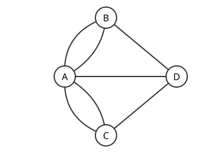

# Euler 회로

# 개요

**Euler 회로(Eulerian circuit)** 는 그래프의 모든 변을 정확히 한 번씩 지나 출발한 정점으로 돌아오는 닫힌 걸음이다. 우편배달부가 동네의 모든 골목을 한 번씩만 지나 우체국으로 돌아오려 할 때, 교차로를 정점으로, 골목을 변으로 놓으면 그런 길이 Euler 회로다. 그런 길이 있는지는 교차로마다 붙은 골목 수가 모두 짝수인지만 보면 판정되고, 있으면 골목 수에 비례하는 시간에 찾는다.

# 직관

Königsberg 시내는 강으로 땅 네 곳이 나뉘고 다리 일곱 개로 이어져 있었다. 다리마다 한 번씩만 건너 시내를 한 바퀴 돌고 출발점으로 돌아올 수 있는지가 문제였다. 땅을 정점, 다리를 변으로 두면 아래 그림이 되고, 네 정점 $A,B,C,D$ 에 붙은 다리 수가 $5,3,3,3$ 이다.



산책 중에 어느 땅에 들어가면 다른 다리로 나와야 한다. 들어올 때 다리 하나, 나갈 때 다리 하나를 쓰므로, 한 바퀴를 다 돌면 각 땅에 붙은 다리는 둘씩 짝지어 쓰였다. 출발한 땅도 처음 나간 다리와 마지막에 들어온 다리가 짝이 된다. 그러면 모든 땅의 다리 수가 짝수여야 하는데 Königsberg 의 네 땅은 모두 홀수라 그런 산책은 없다.

# 정의

## 걸음과 회로

그래프 $G=(V,E)$ 에서 **걸음(walk)** 은 정점과 변이 번갈아 나오는 열 $v_0,e_1,v_1,\dots,e_m,v_m$ 이고, $e_i$ 는 $v_{i-1}$ 과 $v_i$ 를 잇는다. $v_0=v_m$ 이면 닫힌 걸음이다. 변이 겹치지 않는 걸음을 **트레일(trail)** 이라 한다.

$G$ 의 모든 변을 정확히 한 번씩 지나는 닫힌 트레일이 Euler 회로이고, 닫히지 않은 것을 **Euler 트레일(Eulerian trail)** 이라 한다. Euler 회로를 갖는 그래프를 **Euler 그래프(Eulerian graph)** 라 한다. 다중변과 고리를 허용하며, 고리는 그 정점의 차수에 $2$ 를 더한다.

## 유향 판본

유향 그래프에서는 변을 방향대로만 지난다. 정점 $v$ 로 들어오는 변의 수를 들어오는 차수 $\deg^-(v)$, 나가는 변의 수를 나가는 차수 $\deg^+(v)$ 로 쓴다.

# 성질

## Euler 정리

정리. 고립되지 않은 정점들이 모두 한 연결성분에 있는 그래프에 대해, Euler 회로가 있는 것과 모든 정점의 차수가 짝수인 것이 동치다.

증명의 요지. 필요성은 직관 절의 짝짓기 논증이다. 충분성은 변의 수에 대한 귀납법이다. 아무 정점에서 출발해 쓰지 않은 변으로 계속 걸으면, 차수가 짝수이므로 출발점이 아닌 정점에서는 들어간 뒤 나갈 변이 남아 있어 출발점에서만 멈춘다. 그렇게 얻은 닫힌 트레일 $C$ 의 변을 지우면 남은 그래프도 모든 차수가 짝수이고, 연결성에 따라 남은 성분마다 $C$ 위의 정점을 하나씩 갖는다. 귀납 가정으로 각 성분의 Euler 회로를 얻어 그 정점에서 $C$ 에 끼워 넣는다.

L. Euler 가 1736 년에 Königsberg 의 다리 문제를 풀며 필요조건을 증명했고[^1], 충분조건과 회로를 만드는 절차는 C. Hierholzer 의 사후 1873 년에 출간된 논문에 있다[^2]. 모든 정점을 한 번씩 지나는 [Hamilton 순환](hamiltonian-cycles.md)의 판정이 NP(nondeterministic polynomial time)-완전인 것과 달리 Euler 회로의 판정은 차수만 보면 된다.

## Euler 트레일

정리. 같은 연결 조건에서 Euler 트레일이 있는 것과 차수가 홀수인 정점이 정확히 둘인 것이 동치이고, 트레일은 그 두 정점에서 시작하고 끝난다.

증명의 요지. 홀수 차수 정점 $u,v$ 사이에 변 하나를 더하면 모든 차수가 짝수가 되어 Euler 회로가 생기고, 그 변을 지우면 $u$ 에서 $v$ 로 가는 Euler 트레일이 된다. [그래프](graphs.md)에서 홀수 차수 정점의 수는 항상 짝수이므로 홀수 차수 정점이 하나뿐인 경우는 없다.

## 유향 Euler 정리

정리. 고립되지 않은 정점들이 방향을 무시했을 때 한 연결성분에 있는 유향 그래프에 대해, Euler 회로가 있는 것과 모든 정점에서 $\deg^-(v)=\deg^+(v)$ 인 것이 동치다.

증명은 무향 판본과 같고, 들어온 변과 나가는 변을 짝짓는다.

## Hierholzer 알고리즘

충분성의 증명을 그대로 절차로 옮기면 $O(\lvert V\rvert+\lvert E\rvert)$ 시간에 Euler 회로를 얻는다. 스택에 현재 걸음을 쌓고, 쓰지 않은 변이 남은 정점에서는 계속 걷고, 막힌 정점은 스택에서 꺼내 회로의 앞쪽에 붙인다. 막힌 정점을 꺼내는 순서가 증명의 "닫힌 트레일을 끼워 넣기" 에 해당한다.

```typescript
// adj[v] 는 v 에 붙은 (이웃, 변 번호) 목록. 모든 차수가 짝수이고 변이 있는 정점들이 연결되어 있다고 가정한다.
function hierholzer(adj: [number, number][][], numEdges: number, start: number): number[] {
  const used = new Array<boolean>(numEdges).fill(false);
  const next = adj.map(() => 0); // 정점마다 다음에 살펴볼 변의 위치
  const stack = [start];
  const circuit: number[] = [];
  while (stack.length > 0) {
    const v = stack[stack.length - 1];
    while (next[v] < adj[v].length && used[adj[v][next[v]][1]]) next[v]++;
    if (next[v] === adj[v].length) {
      circuit.push(stack.pop()!); // v 에 남은 변이 없으면 회로에 붙인다
    } else {
      const [u, e] = adj[v][next[v]];
      used[e] = true;
      stack.push(u);
    }
  }
  return circuit.reverse(); // 길이는 numEdges + 1, 처음과 끝이 start
}
```

## BEST 정리

정리. Euler 회로가 있는 유향 그래프 $G$ 와 정점 $w$ 에 대해, 서로 다른 Euler 회로의 수 $\mathrm{ec}(G)$ 는

$$
\mathrm{ec}(G)=t_w(G)\prod_{v\in V}\big(\deg^+(v)-1\big)!
$$

이다. $t_w(G)$ 는 모든 정점에서 $w$ 로 가는 [유향 신장트리](arborescences.md)의 수이고, 회로는 순환 이동으로 같아지는 것을 하나로 센다. N. G. de Bruijn, T. van Aardenne-Ehrenfest, C. A. B. Smith, W. T. Tutte 의 머리글자를 따 BEST 정리(BEST theorem)라 한다[^3].

$t_w(G)$ 는 [그래프 Laplacian](graph-laplacian.md)의 행렬-트리 정리(matrix-tree theorem)로 행렬식 하나로 계산되므로, Euler 회로의 수는 다항시간에 센다. 무향 그래프의 Euler 회로를 세는 문제는 #P(sharp P)-완전이다[^4].

# 활용

- [외판원 문제](traveling-salesman-problem.md)의 Christofides 알고리즘. 최소 신장트리에 홀수 차수 정점의 최소 가중치 매칭을 더하면 모든 차수가 짝수가 되고, 그 그래프의 Euler 회로에서 방문한 도시를 건너뛰어 순회를 만든다.
- 중국인 우편배달부 문제(Chinese postman problem). 모든 변을 한 번 이상 지나는 가장 짧은 닫힌 걸음을 찾는 문제다. 홀수 차수 정점들을 최단경로 길이를 가중치로 하는 최소 가중치 완전 [매칭](matchings.md)으로 짝지어 그 경로를 한 번 더 지나게 하면 Euler 회로가 생기고, 이것이 최적이다[^5].
- [de Bruijn 수열](de-bruijn-sequences.md). 길이 $n$ 인 이진 문자열을 모두 연속 부분열로 한 번씩 담는 길이 $2^n$ 의 순환 수열이다. 길이 $n-1$ 인 문자열을 정점으로, 길이 $n$ 인 문자열을 변으로 둔 유향 그래프는 모든 정점에서 들어오는 차수와 나가는 차수가 $2$ 이므로 Euler 회로가 있고, 그 회로가 de Bruijn 수열을 준다.
- [동적 연결성](dynamic-connectivity.md)의 Euler tour tree. 트리의 변을 양방향 두 변으로 바꾸면 모든 정점에서 들어오는 차수와 나가는 차수가 같아 Euler 회로가 생기고, 그 회로의 정점 열을 균형 트리에 담아 연결과 절단을 처리한다.

[^1]: L. Euler, "Solutio problematis ad geometriam situs pertinentis", Commentarii Academiae Scientiarum Petropolitanae 8 (1741), 128–140. 1736 년에 발표했다.
[^2]: C. Hierholzer, "Ueber die Möglichkeit, einen Linienzug ohne Wiederholung und ohne Unterbrechung zu umfahren", Mathematische Annalen 6 (1873), 30–32.
[^3]: T. van Aardenne-Ehrenfest, N. G. de Bruijn, "Circuits and trees in oriented linear graphs", Simon Stevin 28 (1951), 203–217. C. A. B. Smith, W. T. Tutte, "On unicursal paths in a network of degree 4", American Mathematical Monthly 48 (1941), 233–237.
[^4]: G. Brightwell, P. Winkler, "Counting Eulerian circuits is #P-complete", Proceedings of the 7th Workshop on Algorithm Engineering and Experiments and the 2nd Workshop on Analytic Algorithmics and Combinatorics (2005), 259–262.
[^5]: J. Edmonds, E. L. Johnson, "Matching, Euler tours and the Chinese postman", Mathematical Programming 5 (1973), 88–124.

# 연관 문서

## 선수지식

- [그래프](graphs.md)

## 더 알아보기

- [de Bruijn 수열](de-bruijn-sequences.md)

#graph_theory #combinatorics #algorithms
