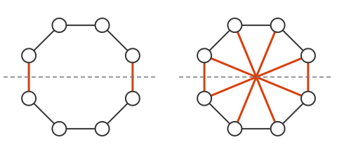

# Expander 그래프

# 개요

**Expander 그래프(expander graph)** 는 정점마다 이웃이 몇 개뿐인데도 정점을 어떻게 둘로 나눠도 두 쪽을 잇는 간선이 많은 [그래프](graphs.md)다. 컴퓨터마다 연결선을 서너 개만 둘 수 있는 통신망을 한 줄로 둥글게 이으면, 두 군데만 끊어도 망이 둘로 갈리고 신호가 반대편까지 가는 데 컴퓨터 수에 비례하는 걸음이 든다. Expander 는 연결선 수를 늘리지 않고 이 두 약점을 함께 없애며, 어떤 그래프가 expander 인지는 인접행렬의 고윳값 하나로 판정한다.

# 직관

$d$ 정규 그래프 위에서 이웃을 무작위로 골라 걷는다. 걸음마다 분포에 전이행렬 $M=A/d$ 를 곱하고, 최대 [고윳값](eigenvalues.md) $1$ 의 고유벡터가 [균등분포](uniform-distribution.md)다. 나머지 고윳값의 절댓값 최대를 $\lambda$ 라 하면 $t$ 걸음 뒤의 편차가 $\lambda^t$ 로 줄어든다.

$$
\Vert M^t x-\pi\Vert\le\lambda^{t}\Vert x-\pi\Vert
$$

원형 그래프 $C_n$ 에서 계산하면 $\lambda_2=\cos(2\pi/n)\approx1-2\pi^2/n^2$ 이므로 편차를 절반으로 줄이는 데 $n^2$ 걸음이 든다. 정점을 늘릴수록 느려지는 것은 $\lambda$ 가 $1$ 로 붙기 때문이고, 정점 수와 무관하게 $\lambda$ 를 $1$ 에서 떼어 놓으면 $O(\log n)$ 걸음에 섞인다. 차수를 상수로 묶은 채 그 조건을 만족하는 그래프가 expander 다.

그림은 정점 $8$ 개를 같은 점선으로 반씩 나눈 것이다. 차수가 $2$ 인 왼쪽 순환 $C_8$ 에서는 점선을 건너는 간선이 $2$ 개이고, 마주 보는 정점을 이어 차수를 $3$ 으로 올린 오른쪽 그래프에서는 $6$ 개다.

# 정의

## 전도도와 expander 족

$d$ 정규 그래프 $G=(V,E)$ 와 $|V|=n$ 에 대해

$$
h(G)=\min_{0\lt |S|\le n/2}\frac{|E(S,\bar S)|}{d\thinspace|S|}
$$

를 **전도도(conductance)** 또는 Cheeger 상수(Cheeger constant)라 한다. 그래프 족 $\lbrace G_i\rbrace$ 가 $|V_i|\to\infty$ 이고 차수가 상수 $d$ 로 고정되며 $h(G_i)\ge\varepsilon\gt 0$ 인 상수 $\varepsilon$ 이 있으면 **expander 족(expander family)** 이라 한다. $\varepsilon$ 은 $i$ 에 무관한 상수다.

직관 절의 $C\_8$ 에서 연속한 정점 $4$ 개를 $S$ 로 잡으면 건너는 간선이 $2$ 개이고 비는 $2/(2\cdot4)=1/4$ 이다. 연속한 $k$ 개는 건너는 간선이 $2$ 개여서 비가 $1/k$ 이고, 연속하지 않으면 건너는 간선이 늘어나므로 $h(C\_8)=1/4$ 다. $C_n$ 에서는 같은 계산으로 $h(C_n)$ 이 $2/n$ 규모여서 $\lbrace C_n\rbrace$ 은 expander 족이 아니다. 오른쪽 그래프에서 점선의 절단은 비가 $6/(3\cdot4)=1/2$ 다.

## 스펙트럼 간극

인접행렬 $A$ 의 고윳값을 $d=\mu_1\ge\mu_2\ge\cdots\ge\mu_n$ 라 하고 정규화해 $\lambda_i=\mu_i/d$ 로 둔다. $\lambda_1=1$ 이고 고유벡터는 전체 $1$ 벡터다. **스펙트럼 간극(spectral gap)** 은 $1-\lambda_2$ 다. 간극은 [그래프 Laplacian](graph-laplacian.md)을 $d$ 로 나눈 [행렬](matrices.md)의 두 번째로 작은 고윳값이기도 하다. 직관 절의 $C\_8$ 은 $\lambda_2=\cos(2\pi/8)\approx0.707$ 이어서 간극이 $0.293$ 이다.

## Ramanujan 그래프

$\max(|\lambda_2|,|\lambda_n|)\le\frac{2\sqrt{d-1}}{d}$ 인 $d$ 정규 그래프를 **Ramanujan 그래프(Ramanujan graph)** 라 한다. 완전그래프 $K_4$ 는 $d=3$ 이고 인접행렬의 고윳값이 $3,-1,-1,-1$ 이므로 $\max(|\lambda_2|,|\lambda_n|)=1/3\le2\sqrt2/3$ 이어서 Ramanujan 그래프다.

# 성질

## 이분성

연결된 $d$ 정규 그래프에서 $\lambda_n=-1$ 일 필요충분조건은 그래프가 이분인 것이다. 무작위 걷기의 수렴에는 $\max(|\lambda_2|,|\lambda_n|)$ 이, 전도도와의 관계에는 $\lambda_2$ 가 쓰인다.

## Cheeger 부등식

$
\frac{h(G)^2}{2}\le 1-\lambda_2\le 2h(G)
$

Cheeger 부등식은 미분기하의 [Cheeger 부등식](cheeger-inequality.md)([다양체](manifolds.md)의 등주 상수와 Laplace 작용소 첫 고윳값)의 이산 판본이고 증명 구조가 평행하다.

## Alon–Boppana 한계

$d$ 를 고정하고 $n\to\infty$ 일 때

$
\lambda_2\ge\frac{2\sqrt{d-1}}{d}-o_n(1)
$

이다. 이 하한을 Alon–Boppana 한계(Alon–Boppana bound)라 한다. Ramanujan 그래프는 이 한계에 닿는 그래프다. 무한족의 구성은 $d=p+1$ ($p$ 소수)에서 LPS(Lubotzky–Phillips–Sarnak)가 주었고, 모든 $d\ge3$ 에 대한 이분 Ramanujan 족의 존재는 Marcus–Spielman–Srivastava 가 교대 다항식 방법으로 증명했다.

Ramanujan 이라는 이름은 LPS 구성이 [사원수 대수](quaternion-algebras.md)와 [모듈러 형식](modular-forms.md)의 계수 평가, 곧 Deligne 이 증명한 Ramanujan 추측을 쓰는 데서 왔다. 무작위 $d$ 정규 그래프는 Friedman 의 정리로 거의 확실히 $\max(|\lambda_2|,|\lambda_n|)\le\frac{2\sqrt{d-1}}{d}+\varepsilon$ 을 만족하고, 명시적으로 하나를 적어 내는 데는 정수론이 필요하다.

## Cheeger 부등식의 증명

쉬운 쪽 $1-\lambda_2\le2h$ 는 시험벡터로 나온다. 전도도를 달성하는 절단 $S$ 에서 $S$ 위에 $+1$ , 밖에 $-1$ 을 주고 전체 합이 $0$ 이 되게 맞춘 벡터를 Rayleigh 몫에 넣으면 경계 간선의 수만 남는다.

어려운 쪽 $h^2/2\le1-\lambda_2$ 에서는 $\lambda_2$ 의 고유벡터가 [실수](real-numbers.md)여서 절단을 바로 읽을 수 없다. 고유벡터의 값 순으로 정점을 정렬하고 앞에서부터 $k$ 개를 자른 $n-1$ 개의 절단을 보면 그 가운데 하나가 $h\le\sqrt{2(1-\lambda_2)}$ 를 만족한다. 실수 벡터를 절단으로 반올림하는 이 논법이 스펙트럼 클러스터링의 원형이다.

## 혼합 보조정리

expander 에서는 임의의 두 집합 사이 간선 수가 무작위 그래프에서의 기댓값에 가깝다. $S,T\subseteq V$ 에 대해

$$
\left|\thinspace|E(S,T)|-\frac{d|S||T|}{n}\thinspace\right|\le\lambda\thinspace d\sqrt{|S||T|}
$$

이고 $\lambda=\max(|\lambda_2|,|\lambda_n|)$ 다. 간선 분포가 무작위 그래프와 구별되지 않을 만큼 고르므로 expander 를 유사무작위 그래프라 부른다. 조합론의 expander 논법 대부분이 이 부등식을 쓴다.

## 무작위성 절약

무작위 알고리즘의 오류 확률을 $2^{-k}$ 로 줄이려면 독립 반복 $k$ 번에 무작위 비트가 $k$ 배 든다. expander 위를 걷는 것으로 대신하면 첫 걸음에만 $O(\log n)$ 비트를 쓰고 이후 각 걸음에 $O(1)$ 비트만 쓰면서 오류 확률이 지수적으로 떨어진다(Ajtai–Komlós–Szemerédi). [Reingold 정리](reingold-theorem.md)의 무향 연결성 로그공간 알고리즘은 그래프를 expander 로 바꾸는 zig-zag 곱(zig-zag product)을 쓴다.

## PCP 증명에서의 역할

[PCP 정리](pcp-theorem.md)(probabilistically checkable proof)의 Dinur 증명은 제약 그래프의 간극을 한 라운드에 두 배씩 키운다. 증폭의 본체는 그래프를 $t$ 거듭제곱해 길이 $t$ 경로를 제약 하나로 묶는 것이고, 병목이 있으면 경로가 한 덩어리에 갇혀 실패한다. 그래서 매 라운드 앞에서 그래프를 expander 로 바꾼다. 스펙트럼 간극이 경로가 그래프를 고르게 훑음을 보장하고, 그 보장에서 간극 증폭의 양적 결론이 나온다.

## 부호와의 관계

expander 그래프에서 만든 [오류정정부호](error-correcting-codes.md)(expander code, Sipser–Spielman)는 선형 시간 복호가 가능하면서 상수 비율과 상수 상대 거리를 갖는다. 양자 LDPC(low-density parity-check) 부호와 상수 비율 국소 검사 가능 부호의 구성도 expander 계열의 대상(제곱 복합체, 좌우 Cayley 복합체) 위에서 이루어졌다. 두 구성 모두 그래프의 확장성으로 부호의 거리를 하한한다.

# 활용

- 무작위성 절약. expander 걷기로 증폭하면 무작위 비트를 상수 개씩만 더 쓰고도 오류가 지수적으로 준다.
- PCP 와 근사 하한. Dinur 의 간극 증폭이 expander 화를 매 라운드 수행한다.
- 오류정정부호. expander 부호는 선형 시간 복호가 가능하고, 국소 검사 가능 부호와 양자 LDPC 부호의 구성에 쓰인다.
- 분산 시스템과 네트워크. 상수 차수로 지름이 로그인 위상이 통신망과 P2P(peer-to-peer) 오버레이에 쓰인다.
- 스펙트럼 클러스터링(spectral clustering). Cheeger 부등식의 증명에 나오는 "고유벡터로 정렬하고 자른다" 가 그대로 알고리즘이 된다.

# 연관 문서

## 선수지식

- [그래프 Laplacian](graph-laplacian.md)
- [고윳값](eigenvalues.md)

## 더 알아보기

- [PCP 정리](pcp-theorem.md)
- [Ramanujan 그래프의 명시적 구성](ramanujan-graphs.md)
- [Reingold 정리](reingold-theorem.md)

#graph_theory #linear_algebra #algorithms #complexity
