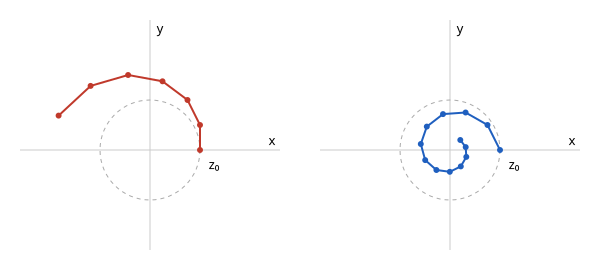

# 엑스트라그레이디언트 방법

# 개요

**엑스트라그레이디언트 방법(extragradient method)** 은 안장점이나 변분 부등식의 해를 찾을 때, 한 걸음마다 시험 걸음을 먼저 밟고 그 자리의 기울기로 원래 점에서 다시 걷는 반복이다. $x$ 는 $xy$ 를 줄이려 하고 $y$ 는 $xy$ 를 늘리려 하는 두 사람이 각자 [경사하강법](gradient-descent.md)으로 움직이면, 둘의 위치는 원점 둘레를 돌며 점점 멀어진다.

시험 걸음 자리의 기울기를 쓰면 이 회전이 원점 쪽으로 휘어 들어가고, 반복이 안장점 $(0,0)$ 으로 수렴한다.

# 직관

$L(x,y)=xy$ 에서 $x$ 는 $L$ 을 줄이고 $y$ 는 $L$ 을 늘린다. 안장점은 $(0,0)$ 이다. 보폭 $\eta$ 로 $x$ 는 기울기 $y$ 의 반대로, $y$ 는 기울기 $x$ 의 방향으로 움직이면 한 걸음은 다음과 같다.

$$
x_{k+1}=x_k-\eta y_k,\qquad y_{k+1}=y_k+\eta x_k
$$

$z\_k=(x\_k,y\_k)$ 로 적으면 $\vert z\_{k+1}\vert^2=(1+\eta^2)\vert z\_k\vert^2$ 이다. $\eta=0.5$ 이고 $z\_0=(1,0)$ 이면 $z\_1=(1,0.5)$ 이고, 원점에서의 거리가 $1$, $1.12$, $1.25$, $1.40$ 으로 걸음마다 늘어난다. 보폭을 줄여도 $1+\eta^2\gt 1$ 이라 멀어지는 것을 막지 못한다.

$T(x,y)=(y,-x)$ 로 두면 걸음은 $z\_{k+1}=z\_k-\eta T(z\_k)$ 이다. $T(z)$ 가 $z$ 에 수직이라 걸음마다 원의 접선 방향으로 나가 바깥으로 벗어난다. 그래서 먼저 시험 걸음 $\tilde z\_k=z\_k-\eta T(z\_k)$ 를 밟고, 그 자리의 방향 $T(\tilde z\_k)$ 로 $z\_k$ 에서 다시 걷는다.

$$
z_{k+1}=z_k-\eta T(\tilde z_k)
$$

$z\_0=(1,0)$ 에서 $\tilde z\_0=(1,0.5)$, $T(\tilde z\_0)=(0.5,-1)$ 이고 $z\_1=(0.75,0.5)$ 다. 시험 걸음 자리의 방향은 조금 더 돌아가 있어 원점 쪽 성분을 가지므로, 거리가 $1$, $0.90$, $0.81$, $0.73$ 으로 줄어든다.

아래 그림의 왼쪽은 경사하강을 그대로 쓴 반복 여섯 걸음, 오른쪽은 시험 걸음을 쓴 반복 열두 걸음이다. 점선은 반지름 $1$ 인 원이다. 왼쪽은 원 밖으로 나가고 오른쪽은 원점으로 감겨 들어간다.

# 정의

## 변분 부등식

$C$ 가 $\mathbb R^n$ 의 닫힌 볼록집합이고 $T:C\to\mathbb R^n$ 일 때, 다음을 만족하는 $z^\ast\in C$ 를 찾는 문제를 **변분 부등식(variational inequality)** 이라 한다.

$$
\langle T(z^\ast),\thinspace z-z^\ast\rangle\ge 0\qquad(z\in C)
$$

$C=\mathbb R^n$ 이면 해는 $T(z^\ast)=0$ 인 점이다. 직관 절에서 $C=\mathbb R^2$ 이고 $T(x,y)=(y,-x)$ 의 영점이 안장점 $(0,0)$ 이다. $T$ 가 [단조 작용소](monotone-operators.md)이면 단조 변분 부등식이라 한다.

## 반복

보폭 $\eta\gt 0$ 과 $C$ 로의 사영 $P\_C$ 로 다음 두 단계를 되풀이하는 것을 엑스트라그레이디언트 방법이라 한다[^1].

$$
\begin{aligned}
\tilde z_k&=P_C\bigl(z_k-\eta T(z_k)\bigr)\cr
z_{k+1}&=P_C\bigl(z_k-\eta T(\tilde z_k)\bigr)
\end{aligned}
$$

첫 단계를 시험 걸음이라 한다. 직관 절은 $C=\mathbb R^2$ 라 $P\_C$ 가 항등사상인 경우다.

# 성질

## 수렴

정리. $T$ 가 단조이고 상수 $\Lambda$ 로 Lipschitz 연속이며 해가 있으면, $0\lt\eta\lt 1/\Lambda$ 에서 $z\_k$ 는 해로 수렴한다[^1].

증명의 요지. 해 $z^\ast$ 에 대해 사영의 성질, 단조성, Lipschitz 조건을 차례로 쓰면 다음이 나온다.

$$
\vert z_{k+1}-z^\ast\vert^2\le\vert z_k-z^\ast\vert^2-(1-\eta^2\Lambda^2)\vert z_k-\tilde z_k\vert^2
$$

거리는 줄기만 하고, 줄어든 양의 합이 유한하므로 $\vert z\_k-\tilde z\_k\vert\to 0$ 이다. 그러면 $z\_k$ 의 극한점이 해이고, 거리가 줄기만 하므로 수열 전체가 그 해로 수렴한다. 직관 절의 $T$ 는 $\Lambda=1$ 이고, 한 걸음마다 거리에 곱해지는 수가 $\sqrt{1-\eta^2+\eta^4}$ 이라 $\eta=0.5$ 에서 $0.90$ 이다.

## 평균 반복의 수렴률

$C$ 가 지름 $D$ 인 콤팩트 볼록집합이면, 시험 걸음의 평균 $\bar z\_k=\tfrac1k\sum\_{i\lt k}\tilde z\_i$ 이 다음 간격(gap)을 $O(D^2/(\eta k))$ 로 줄인다[^2].

$$
\max_{z\in C}\thinspace\langle T(z),\thinspace\bar z_k-z\rangle
$$

$T$ 가 볼록–오목 함수 $L$ 의 안장점 연산자이면 같은 수렴률로 쌍대 간격(duality gap) $\max\_yL(\bar x\_k,y)-\min\_xL(x,\bar y\_k)$ 가 줄어든다[^2].

## 기울기 한 번의 판

시험 걸음에 직전 단계의 기울기를 다시 쓰면 걸음마다 $T$ 를 한 번만 계산한다.

$$
\tilde z_k=z_k-\eta T(\tilde z_{k-1}),\qquad z_{k+1}=z_k-\eta T(\tilde z_k)
$$

이것을 Popov 방법(Popov's method) 또는 낙관적 경사하강상승(optimistic gradient descent ascent)이라 하고, 보폭이 $1/\Lambda$ 의 상수배보다 작으면 수렴한다[^3].

# 활용

- 행렬 놀이의 균형. 두 사람 영합 놀이의 혼합 전략 균형은 확률 단체 위의 쌍선형 안장점이고, 사영을 엔트로피 거리로 바꾼 판(mirror-prox)이 $O(1/k)$ 의 간격을 준다[^2].
- 생성적 적대 신경망(generative adversarial network). 생성기와 판별기의 학습이 안장점 문제이고, 경사하강상승이 회전하며 발산하는 자리에 엑스트라그레이디언트와 Popov 방법을 쓴다.
- 장애물 문제. [Lions–Stampacchia 정리](lions-stampacchia.md)의 변분 부등식을 유한 차원으로 근사한 뒤 이 반복으로 푼다.

[^1]: G. M. Korpelevich, "The extragradient method for finding saddle points and other problems", *Ekonomika i Matematicheskie Metody* 12 (1976), 747–756.
[^2]: A. Nemirovski, "Prox-method with rate of convergence O(1/t) for variational inequalities with Lipschitz continuous monotone operators and smooth convex-concave saddle point problems", *SIAM Journal on Optimization* 15 (2004), 229–251.
[^3]: L. D. Popov, "A modification of the Arrow–Hurwicz method for search of saddle points", *Mathematical Notes of the Academy of Sciences of the USSR* 28 (1980), 845–848.

# 연관 문서

## 선수지식

- [경사하강법](gradient-descent.md)
- [단조 작용소](monotone-operators.md)

## 더 알아보기

아직 연결한 문서가 없다.

#optimization #functional_analysis #machine_learning
