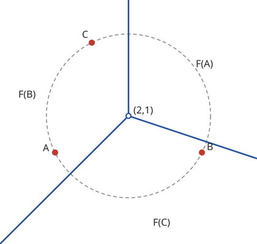

# 가장 먼 점 Voronoi 도형

# 개요

**가장 먼 점 Voronoi 도형(farthest-point Voronoi diagram)** 은 평면에 놓인 점들 각각에 대해 그 점이 가장 먼 곳을 모아 평면을 나눈 그림이다. 마을 세 곳 가운데 어디든 출동해야 하는 소방서를 세우면, 소방서 자리마다 가장 먼 마을이 정해지고 출동 거리는 그 마을까지의 거리다. 소방서 자리를 옮기면서 가장 먼 마을이 언제 바뀌는지가 물음이다.

가장 먼 점 Voronoi 도형은 가장 먼 마을이 바뀌는 경계를 선분과 반직선으로 계산해 둔다. 가장 먼 마을까지의 거리를 가장 작게 하는 자리, 곧 [최소 외접원](smallest-enclosing-circle.md)의 중심은 이 경계 위에서 찾으면 된다.

# 직관

최소 외접원 문서의 세 마을 $A=(0,0)$, $B=(4,0)$, $C=(1,3)$ 을 본다. [Voronoi 도형](voronoi-diagrams.md)은 가장 가까운 마을로 평면을 나누고, 여기서는 가장 먼 마을로 나눈다.

두 마을 $A$, $B$ 에서 같은 거리인 점은 수직이등분선 $x=2$ 위에 있고, $x\gt 2$ 인 점에서는 $A$ 가 $B$ 보다 멀다. $AC$ 의 수직이등분선은 $x+3y=5$, $BC$ 의 수직이등분선은 $y=x-1$ 이다. 세 직선은 세 마을을 지나는 원의 중심 $(2,1)$ 에서 만난다.

$x=2$ 위의 점 가운데 $A$ 와 $B$ 가 $C$ 보다 먼 것은 $4+y^2\ge 1+(y-3)^2$, 곧 $y\ge 1$ 인 점이다. 그래서 $A$ 와 $B$ 의 경계는 $(2,1)$ 에서 위로 뻗는 반직선이다. 같은 계산으로 $A$ 와 $C$ 의 경계는 $(2,1)$ 에서 오른쪽 아래로, $B$ 와 $C$ 의 경계는 왼쪽 아래로 뻗는다.

그림에서 $A$ 가 가장 먼 구역 $F(A)$ 는 $A$ 의 반대편인 오른쪽에 있고, $C$ 가 가장 먼 구역 $F(C)$ 는 아래에 있다. 어느 마을도 자기 구역 안에 있지 않다. 세 반직선이 만나는 $(2,1)$ 에서 세 마을이 모두 거리 $\sqrt5$ 로 가장 멀고, 점선 원이 최소 외접원이다.

# 정의

## 가장 먼 점 영역

평면의 서로 다른 점 $n$ 개의 집합 $S$ 를 둔다. 사이트 $p\in S$ 의 **가장 먼 점 영역(farthest-point Voronoi cell)** 은 다음이다.

$$
F(p)=\lbrace x\in\mathbb R^2:\ \lvert x-p\rvert\ge\lvert x-q\rvert\quad\forall q\in S\rbrace
$$

직관 절에서 $F(A)$ 는 $(2,1)$ 에서 위로 뻗는 반직선과 오른쪽 아래로 뻗는 반직선 사이의 영역이다.

## 가장 먼 점 Voronoi 도형

비어 있지 않은 $F(p)$ 들로 평면을 나눈 것을 **가장 먼 점 Voronoi 도형(farthest-point Voronoi diagram)** 이라 한다. 두 영역의 공통부분이 선분이나 반직선이면 변, 세 개 이상의 영역에 속하는 점이면 꼭짓점이라 한다. 직관 절의 도형은 꼭짓점이 $(2,1)$ 하나이고 변이 반직선 셋이다.

# 성질

## 볼록 껍질의 꼭짓점

$F(p)$ 는 반평면 $\lbrace x:\lvert x-p\rvert\ge\lvert x-q\rvert\rbrace$ 들의 교집합이므로 볼록이다. $F(p)$ 가 비어 있지 않은 것과 $p$ 가 $S$ 의 [볼록 껍질](convex-hull-algorithms.md)의 꼭짓점인 것은 동치다.

증명의 요지. $p$ 가 꼭짓점이면 $p$ 만 닿고 나머지 점은 한쪽에 두는 직선이 있다. 그 직선에 수직으로 $p$ 의 반대쪽 멀리 간 점에서는 $p$ 가 가장 멀다. $p$ 가 꼭짓점이 아니면 $p$ 는 다른 점들의 볼록 결합이고, 어느 $x$ 에서든 $\lvert x-\cdot\rvert$ 가 볼록함수이므로 $p$ 보다 먼 점이 있다.

## 트리 구조

비어 있지 않은 영역은 모두 유계가 아니다. 그래서 변과 꼭짓점은 유계인 면을 둘러싸지 않고, 반직선의 끝을 무한히 먼 곳으로 보면 트리를 이룬다. 볼록 껍질의 꼭짓점이 $h\ge 3$ 개이고 네 점이 한 원 위에 있지 않으면 꼭짓점은 $h-2$ 개, 변은 $2h-3$ 개이고 그 가운데 반직선이 $h$ 개다. 직관 절에서 $h=3$ 이고 꼭짓점 $1$ 개, 반직선 $3$ 개다.

## 포물면으로 올리기

[Delaunay 삼각분할](delaunay-triangulation.md) 문서처럼 점 $p=(x,y)$ 를 $(x,y,x^2+y^2)$ 로 올린다. Delaunay 삼각분할이 올린 점들의 볼록 껍질에서 아래를 향한 면을 내린 것이라면, 위를 향한 면을 내린 것은 **가장 먼 점 Delaunay 삼각분할(farthest-point Delaunay triangulation)** 이다. 그 삼각형들의 외접원은 모든 점을 안에 포함하고, 외심이 가장 먼 점 Voronoi 도형의 꼭짓점이다.

이 대응으로 볼록 껍질을 구한 뒤 가장 먼 점 Voronoi 도형을 $O(n\log n)$ 시간에 계산한다. 볼록 껍질의 꼭짓점이 순서대로 주어지면 $O(h)$ 시간에 계산된다(Aggarwal, Guibas, Saxe, Shor).[^1]

## 최소 외접원의 중심

정리. $S$ 의 최소 외접원의 중심은 가장 먼 점 Voronoi 도형의 꼭짓점이거나, 변 위에 놓인 그 변의 두 사이트의 중점이다(Shamos, Hoey).[^2]

증명의 요지. 출동 거리 $f(x)=\max\_{p\in S}\lvert x-p\rvert$ 는 $F(p)$ 안에서 $\lvert x-p\rvert$ 와 같다. $p$ 는 $F(p)$ 밖에 있으므로 $f$ 는 영역의 내부에서 최소가 되지 않는다. 변 위에서 $f$ 는 그 변의 두 사이트 $p,q$ 까지의 거리이고, 수직이등분선 위에서 이 거리는 $pq$ 의 중점에서 가장 작다. 중점이 변 위에 있으면 거기서, 아니면 변의 끝인 꼭짓점에서 최소가 된다.

직관 절의 $A,B,C$ 에서 답은 꼭짓점 $(2,1)$ 이다. $C$ 를 $C'=(2,1)$ 로 바꾸면 $A$ 와 $B$ 의 경계는 $x=2$ 위의 $y\ge -1.5$ 인 반직선이 되고, $AB$ 의 중점 $(2,0)$ 이 그 위에 있어 답이 된다. 반지름은 $2$ 다.

그러므로 도형의 꼭짓점과 변을 모두 훑으면 최소 외접원이 $O(n\log n)$ 시간에 나온다.

# 활용

- 최소 외접원. 위 정리로 1-중심 문제를 푼다. 기대 선형 시간의 Welzl 알고리즘과 결정적 선형 시간의 Megiddo 알고리즘이 나오기 전의 방법이다.[^2]
- 원형도 검사. 가공한 원형 부품의 윤곽을 측정한 점들에 대해, 모든 점을 포함하는 폭이 가장 좁은 고리를 찾아 원에서 벗어난 정도를 잰다. 고리의 중심은 Voronoi 도형의 꼭짓점이거나, 가장 먼 점 Voronoi 도형의 꼭짓점이거나, 두 도형의 변이 만나는 점이다.[^3]

[^1]: A. Aggarwal, L. J. Guibas, J. Saxe, P. W. Shor, "A linear-time algorithm for computing the Voronoi diagram of a convex polygon", *Discrete & Computational Geometry* **4** (1989), 591–604.
[^2]: M. I. Shamos, D. Hoey, "Closest-point problems", *Proceedings of the 16th IEEE Symposium on Foundations of Computer Science* (1975), 151–162.
[^3]: M. de Berg, O. Cheong, M. van Kreveld, M. Overmars, *Computational Geometry: Algorithms and Applications*, 3rd ed., Springer (2008), 7.4 절.

# 연관 문서

## 선수지식

- [Voronoi 도형](voronoi-diagrams.md)
- [최소 외접원](smallest-enclosing-circle.md)

## 더 알아보기

아직 연결한 문서가 없다.

#algorithms #computation #optimization
