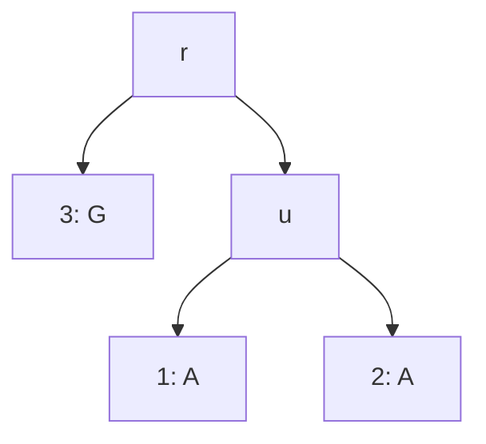

# Felsenstein 가지치기 알고리즘

# 개요

**Felsenstein 가지치기 알고리즘(Felsenstein's pruning algorithm)** 은 계통수와 치환 모형이 주어졌을 때, 잎에 놓인 서열들이 관측될 확률을 잎에서 뿌리 쪽으로 한 번 훑어 계산하는 절차다. 세 종의 어느 한 자리에 A, A, G 가 보이고, 앞의 두 종이 먼저 갈라져 나온 나무를 가정한다. 조상들의 염기는 관측되지 않으므로, 이 관측의 확률을 구하려면 조상 염기의 모든 조합에 대해 확률을 더해야 한다.

조상이 $k$ 개이면 조합은 $4^k$ 가지다. 가지치기 알고리즘은 각 조상에서 아래쪽 관측의 확률을 염기 네 개마다 한 번씩 계산해 위로 넘겨, 이 합을 조상 수에 비례하는 시간에 구한다.

# 직관

나무는 뿌리 $r$ 아래에 조상 $u$ 와 잎 3 이 있고, $u$ 아래에 잎 1 과 2 가 있다. 잎 1, 2, 3 의 염기는 A, A, G 다. 치환은 [Jukes–Cantor 모형](jukes-cantor-model.md)을 따르고, 모든 가지에서 같은 염기로 남을 확률이 $0.7$, 특정한 다른 염기로 바뀔 확률이 $0.1$ 이 되도록 가지 길이를 같게 둔다.



관측의 확률은 뿌리 염기 $x_r$ 와 조상 염기 $x_u$ 의 $16$ 가지 조합에 대해 다음을 더한 값이다. $\pi$ 는 균등분포 $1/4$ 이다.

$$
\pi(x_r)\thinspace P(x_r,x_u)\thinspace P(x_u,\mathrm A)\thinspace P(x_u,\mathrm A)\thinspace P(x_r,\mathrm G)
$$

이 합에서 $P(x_u,\mathrm A)P(x_u,\mathrm A)$ 는 $x_r$ 와 무관하다. 그래서 $x_u$ 마다 이 값을 먼저 구해 둔다. $x_u=\mathrm A$ 이면 $0.7\cdot 0.7=0.49$ 이고, 다른 세 염기이면 $0.1\cdot 0.1=0.01$ 이다. 이 네 수가 $u$ 아래쪽 관측의 확률이다.

다음으로 뿌리의 염기마다 $u$ 쪽 몫과 잎 3 쪽 몫을 곱한다. 뿌리가 A 이거나 G 일 때 $u$ 쪽 몫은 다음이다.

$$
\begin{aligned}
x_r=\mathrm A&:\quad 0.7\cdot 0.49+3\cdot 0.1\cdot 0.01=0.346\cr
x_r=\mathrm G&:\quad 0.1\cdot 0.49+0.7\cdot 0.01+2\cdot 0.1\cdot 0.01=0.058
\end{aligned}
$$

잎 3 쪽 몫은 뿌리가 G 이면 $0.7$, 아니면 $0.1$ 이다.

| 뿌리 염기 | u 쪽 몫 | 잎 3 쪽 몫 | 곱       |
| --------- | ------- | ---------- | -------- |
| A         | 0.346   | 0.1        | 0.0346   |
| G         | 0.058   | 0.7        | 0.0406   |
| C         | 0.058   | 0.1        | 0.0058   |
| T         | 0.058   | 0.1        | 0.0058   |

곱의 합 $0.0868$ 에 $1/4$ 을 곱하면 관측의 확률 $0.0217$ 이 나온다. $16$ 개 항을 따로 더하는 대신 노드마다 수 네 개를 넘겼다.

# 정의

## 부분 가능도

뿌리가 있는 이진 나무 $\mathcal T$ 의 가지 $(v,w)$ 마다 길이 $t_{vw}$ 가 있고, 치환은 전이확률 $P(t)=e^{tQ}$ 의 [연속시간 Markov 연쇄](continuous-time-markov-chains.md)를 따른다고 하자. 노드 $v$ 의 **부분 가능도(partial likelihood)** $L_v(x)$ 는 $v$ 의 염기가 $x$ 일 때 $v$ 아래 잎들의 관측이 나올 조건부 확률이다.

잎 $v$ 에서는 관측된 염기 $b_v$ 에서 $L_v(b_v)=1$ 이고 다른 염기에서 $0$ 이다. 자식이 $w_1,w_2$ 인 노드 $v$ 에서는 다음과 같다.

$$
L_v(x)=\Bigl(\sum_y P_{xy}(t_{vw_1})L_{w_1}(y)\Bigr)\Bigl(\sum_z P_{xz}(t_{vw_2})L_{w_2}(z)\Bigr)
$$

직관 절에서 $L_u=(0.49,0.01,0.01,0.01)$ 이고, 뿌리의 $L_r$ 은 표의 곱 열이다.

## 가지치기 알고리즘

잎에서 시작해 자식이 모두 계산된 노드의 $L_v$ 를 위 식으로 구하고, 뿌리에서 다음 값을 내는 절차를 **Felsenstein 가지치기 알고리즘** 이라 한다[^1].

$$
L=\sum_x\pi_xL_r(x)
$$

자리들이 독립이면 서열 전체의 가능도는 자리마다의 $L$ 의 곱이다.

```javascript
// node: { children: [{ node, P }], base?: number }  P 는 4x4 전이확률 행렬
function partial(node) {
  if (!node.children.length)
    return [0, 1, 2, 3].map((x) => (x === node.base ? 1 : 0));
  const L = [1, 1, 1, 1];
  for (const { node: child, P } of node.children) {
    const Lc = partial(child);
    for (let x = 0; x < 4; x++) {
      let s = 0;
      for (let y = 0; y < 4; y++) s += P[x][y] * Lc[y];
      L[x] *= s;
    }
  }
  return L;
}

function likelihood(root, pi) {
  const L = partial(root);
  return L.reduce((acc, v, x) => acc + pi[x] * v, 0);
}
```

# 성질

## 계산량

잎이 $n$ 개인 이진 나무에는 내부 노드가 $n-1$ 개 있다. 조상 염기를 모두 나열하면 항이 $4^{n-1}$ 개이고, 가지치기 알고리즘은 노드마다 $4\times 4$ 곱셈 두 번이므로 자리당 $O(16n)$ 이다. 염기 대신 상태가 $s$ 개인 모형에서는 $O(s^2n)$ 이다.

## 정확성

정리. 가지치기 알고리즘이 내는 $L$ 은 조상 염기 전체에 대한 합과 같다[^1].

증명의 요지. 서로 다른 자식 쪽 부분 나무의 관측은 $v$ 의 염기가 주어지면 조건부 독립이다. 그래서 $v$ 아래의 합이 자식마다의 합의 곱으로 갈린다. 잎에서 뿌리로 귀납한다.

## 뿌리의 위치

치환 연쇄가 가역적이고 뿌리 염기가 정상분포를 따르면 $L$ 은 뿌리를 어느 가지 위에 두어도 같다. 이것을 **도르래 원리(pulley principle)** 라 한다[^1]. 그래서 가역 모형으로는 뿌리 없는 나무의 가능도만 정해진다.

## 합-곱 알고리즘과의 관계

이 계산은 나무 꼴의 [확률 그래프 모형](graphical-models.md)에서 잎의 증거를 뿌리로 모으는 합-곱 메시지 전달과 같다. 부분 가능도를 노드에 저장해 다시 쓰므로 [동적 계획법](dynamic-programming.md)의 한 예다.

# 활용

- [최대가능도](maximum-likelihood.md) 계통 추정. 나무의 모양과 가지 길이를 바꿔 가며 서열 전체의 가능도를 최대로 하는 나무를 찾는다. 한 번 바꿀 때마다 이 알고리즘으로 가능도를 다시 계산한다.
- Bayes 계통 추정. 나무와 모수의 사후분포를 [Markov 연쇄 Monte Carlo](markov-chain-monte-carlo.md)로 표본할 때 수락확률에 이 가능도를 쓴다.
- 조상 서열 복원. 뿌리에서 $\pi_xL_r(x)$ 를 정규화한 값이 뿌리 염기의 사후분포다. 직관 절의 예에서 뿌리가 G 일 사후확률은 $0.0406/0.0868\approx 0.47$, A 일 사후확률은 $0.0346/0.0868\approx 0.40$ 이다.

[^1]: J. Felsenstein, "Evolutionary trees from DNA sequences: a maximum likelihood approach", *Journal of Molecular Evolution* 17 (1981), 368–376.

# 연관 문서

## 선수지식

- [Jukes–Cantor 모형](jukes-cantor-model.md)
- [동적 계획법](dynamic-programming.md)

## 더 알아보기

아직 연결한 문서가 없다.

#statistics #algorithms #probability
