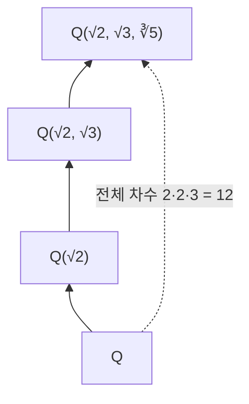

# 체의 확대

# 개요

**체의 확대(field extension)** 는 한 [체](fields.md)를 더 큰 체 안에 넣어 둘을 함께 보는 것이다. 유리수만으로는 $x^2=2$ 의 해가 없지만, 유리수에 $\sqrt2$ 를 더해 $a+b\sqrt2$ 꼴의 수 전체를 만들면 이 방정식이 풀리는 더 큰 체가 된다. 체의 확대는 큰 체를 작은 체 위의 [벡터 공간](vector-spaces.md)으로 보고 그 차원을 재어, 어떤 방정식이 어느 체에서 풀리는지를 차원 계산으로 다룬다.

# 직관

유리수만으로는 $x^2=2$ 를 풀 수 없다. 유리수에 $\sqrt2$ 를 넣고 더하기, 빼기, 곱하기, 나누기를 해서 나오는 수를 모은다. 두 수 $a+b\sqrt2$ 와 $c+d\sqrt2$ 를 곱하면 $\sqrt2\cdot\sqrt2=2$ 가 다시 유리수이므로 $(ac+2bd)+(ad+bc)\sqrt2$ 가 나온다.

나눗셈도 같은 꼴에 머문다. $a,b$ 가 동시에 $0$ 은 아니면 $a^2-2b^2\ne 0$ 이고, 분모와 분자에 $a-b\sqrt2$ 를 곱하면 다음이 나온다.

$$
\frac{1}{a+b\sqrt2}=\frac{a}{a^2-2b^2}-\frac{b}{a^2-2b^2}\sqrt2
$$

그래서 $a+b\sqrt2$ 꼴의 수 전체는 사칙연산에 닫혀 있고 $x^2=2$ 의 해를 포함한다. 이 수들은 유리수 두 개 $a,b$ 로 적히므로, 유리수를 계수로 하는 $1$ 과 $\sqrt2$ 의 일차결합이다. 큰 쪽은 작은 쪽 위의 2차원 벡터 공간이다.

$$
\mathbb{Q}(\sqrt2)=\lbrace a+b\sqrt2: a,b\in\mathbb{Q}\rbrace,\qquad [\mathbb{Q}(\sqrt2):\mathbb{Q}]=2
$$

$x^3=2$ 의 해 $\sqrt[3]{2}$ 를 넣으면 $\sqrt[3]{2}$ 를 제곱한 $\sqrt[3]{4}$ 도 들어오고, 세제곱은 $2$ 로 돌아온다. 이번에는 $1,\sqrt[3]{2},\sqrt[3]{4}$ 세 수의 일차결합이 필요하므로 차원이 3 이다. 넣는 수가 만족하는 방정식의 차수가 차원으로 나타난다. 여러 수를 차례로 넣으면 확대의 탑이 쌓이고, 층마다 기저를 곱해 전체 기저를 만든다.

# 정의

**확대체(extension field)** 는 체 $k$ 를 부분체로 포함하는 체 $K$ 다. 이 쌍을 **체의 확대(field extension)** 라 하고 $K/k$ 로 쓴다. $\mathbb{Q}(\sqrt2)$ 는 $\mathbb{Q}$ 의 확대체이고, $\mathbb{R}$ 과 $\mathbb{C}$ 도 $\mathbb{Q}$ 의 확대체다.

**확대 차수(degree)** 는 $K$ 를 $k$ 위의 벡터 공간으로 볼 때의 차원이다.

$$
[K:k]=\dim_k K
$$

차수가 유한하면 **유한 확대(finite extension)** 라 한다. 직관 절에서 $[\mathbb{Q}(\sqrt2):\mathbb{Q}]=2$ 이고, $[\mathbb{C}:\mathbb{R}]=2$ 다. $\mathbb{R}/\mathbb{Q}$ 는 유한 확대가 아니다.

$K$ 의 원소 $\alpha$ 가 $k$ 위 **대수적(algebraic)** 이라는 것은 $\alpha$ 를 근으로 갖는 $0$ 이 아닌 다항식이 [다항식환](polynomial-rings.md) $k[x]$ 에 존재한다는 뜻이다. 그런 다항식이 없으면 **초월적(transcendental)** 이라 한다. $\sqrt2$ 는 $x^2-2$ 의 근이므로 $\mathbb{Q}$ 위 대수적이고, 원주율 $\pi$ 는 $\mathbb{Q}$ 위 초월적이다.

**최소다항식(minimal polynomial)** 은 $k$ 위 대수적인 $\alpha$ 를 근으로 갖는 $k[x]$ 의 다항식 가운데 최고차 계수가 $1$ 이고 차수가 가장 작은 것이다. $\sqrt2$ 는 $x^4-4$ 의 근이기도 하지만 $\mathbb{Q}$ 위 최소다항식은 $x^2-2$ 다. $\mathbb{Q}$ 계수 일차식 가운데 $\sqrt2$ 를 근으로 갖는 것이 없기 때문이다. 같은 $\sqrt2$ 의 $\mathbb{R}$ 위 최소다항식은 $x-\sqrt2$ 다.

$S$ 가 $K$ 의 부분집합일 때 $k(S)$ 는 $k$ 와 $S$ 를 포함하는 $K$ 의 부분체 가운데 가장 작은 것이다. **단순 확대(simple extension)** 는 원소 하나로 생성된 확대 $k(\alpha)/k$ 다. 직관 절의 $\mathbb{Q}(\sqrt2)$ 와 $\mathbb{Q}(\sqrt[3]{2})$ 가 단순 확대다.

$f$ 가 $k[x]$ 의 상수가 아닌 다항식일 때, $K$ 가 $k$ 위 $f$ 의 **분해체(splitting field)** 라는 것은 $f$ 가 $K[x]$ 에서 1차식들의 곱으로 분해되고 $K$ 가 $k$ 와 $f$ 의 근들로 생성된다는 뜻이다.

$$
f(x)=c\prod_{i=1}^{n}(x-\alpha_i)\ \text{in } K[x],\qquad K=k(\alpha_1,\dots,\alpha_n)
$$

$x^2-2=(x-\sqrt2)(x+\sqrt2)$ 이므로 $\mathbb{Q}$ 위 $x^2-2$ 의 분해체는 $\mathbb{Q}(\sqrt2)$ 다. $x^3-2$ 의 근은 $\sqrt[3]{2}$ 와 $\sqrt[3]{2}\thinspace\omega$, $\sqrt[3]{2}\thinspace\omega^2$ 이고 $\omega=e^{2\pi i/3}$ 이다. $\mathbb{Q}(\sqrt[3]{2})$ 는 실수만 포함하므로 분해체가 아니고, 분해체는 $\mathbb{Q}(\sqrt[3]{2},\omega)$ 다.

# 성질

## 단순 확대의 구조

$\alpha$ 가 $k$ 위 대수적이고 최소다항식 $m$ 의 차수가 $d$ 이면 대입 준동형 $k[x]\to K$ , $x\mapsto\alpha$ 의 커널이 $(m)$ 이므로 다음 동형이 성립한다.

$$
k(\alpha)\cong k[x]/(m),\qquad [k(\alpha):k]=\deg m=d
$$

$m$ 은 기약이며 $\alpha$ 를 소멸시키는 모든 다항식을 나눈다. $m$ 이 $g\cdot h$ 로 쪼개지면 $g(\alpha)h(\alpha)=0$ 에서 체에는 영인수가 없으므로 더 낮은 차수의 소멸 다항식이 생겨 모순이다. $k(\alpha)$ 의 $k$ -기저는 $1,\alpha,\dots,\alpha^{d-1}$ 이다.

$\alpha$ 가 초월적이면 $k(\alpha)$ 는 유리함수체 $k(x)$ 와 동형이고 차수는 무한이다.

## 탑 법칙

$k\subseteq L\subseteq K$ 이고 각 층이 유한 확대일 때 차수는 곱셈적이다[^1].

$$
[K:k]=[K:L]\thinspace[L:k]
$$

증명 개요: $L$ 의 $k$ -기저 $(a_i)$ 와 $K$ 의 $L$ -기저 $(b_j)$ 를 잡으면 곱 $(a_ib_j)$ 가 $K$ 의 $k$ -기저가 된다. 생성은 두 표현을 차례로 대입해서 얻고, 일차독립성은 $b_j$ 에 대한 계수를 $L$ 안에서 모아 $a_i$ 의 일차독립성을 적용해 얻는다.

따름정리로 유한 확대의 모든 원소는 대수적이고, 중간체의 차수는 전체 차수를 나눈다. 특히 $[K:k]$ 가 소수이면 진짜 중간체가 없다.

## 유한 확대와 대수적 확대

유한 확대는 항상 대수적이다. $\alpha\in K$ 에 대해 $1,\alpha,\alpha^2,\dots$ 이 차원을 넘으면 일차종속이 되고, 그 관계가 곧 소멸 다항식이다. 역은 성립하지 않는다. $\mathbb{Q}$ 위 모든 대수적 수의 모임은 대수적 확대지만 차수가 무한이다.

유한 확대는 유한개의 대수적 원소로 생성되며, 역으로 대수적 원소 유한개로 생성된 확대는 유한하다. 탑 법칙과 단순 확대의 차수 계산을 반복하면 된다.

## 분해체의 존재와 유일성

상수가 아닌 $f\in k[x]$ 에 대해 분해체가 존재한다. $f$ 의 기약인수 하나로 몫을 취해 근을 하나 만들고, $f$ 를 그 1차식으로 나눈 뒤 귀납한다. 차수는 $(\deg f)!$ 이하로 유계다. 또한 분해체는 $k$ 를 고정하는 동형을 무시하면 유일하다[^2]. 이 유일성이 [유한체](finite-fields.md)의 분류와 Galois 군의 well-definedness 를 지탱한다.

## 예제 계산

$\sqrt2$ 와 $\sqrt3$ 을 함께 넣은 확대는 차수 4다. $\mathbb{Q}(\sqrt2)$ 위에서 $x^2-3$ 이 기약임을 보이면 탑 법칙으로 $2\cdot 2=4$ 가 된다. 기저는 $1,\sqrt2,\sqrt3,\sqrt6$ 이고, 이 확대는 단순 확대이기도 하다.

$$
\mathbb{Q}(\sqrt2,\sqrt3)=\mathbb{Q}(\sqrt2+\sqrt3),\qquad [\mathbb{Q}(\sqrt2,\sqrt3):\mathbb{Q}]=4
$$

$\sqrt2+\sqrt3$ 의 최소다항식은 $x^4-10x^2+1$ 이다.

# 활용

## 작도 불가능성

컴퍼스와 직선자로 새로 얻는 점의 좌표는 직선과 원의 교점이므로 기존 좌표체 위에서 차수 1 또는 2의 확대에만 들어간다. 따라서 작도 가능한 수 $\alpha$ 는 2차 확대의 유한 탑 안에 있고, 탑 법칙으로 다음이 필요하다[^3].

$$
[\mathbb{Q}(\alpha):\mathbb{Q}]=2^{m}\ \text{for some } m\ge 0
$$

- 세제곱 배적: 세제곱근 $2$ 의 최소다항식은 $x^3-2$ 이므로 차수 3이고 $2$ 의 거듭제곱이 아니다. 불가능하다.
- 각의 삼등분: 20도의 코사인은 $8x^3-6x-1$ 의 근으로 차수 3이다. 60도는 삼등분할 수 없다.
- 원적 문제: 원주율은 초월수이므로 유한 차수 확대에 들어가지 않는다.

## 대수적 수와 수체

$\mathbb{Q}$ 의 유한 확대를 수체(number field)라 하고 정수론의 기본 대상이 된다. 대수적 수끼리의 합과 곱은 다시 대수적이다. 탑 법칙으로 $\mathbb{Q}(\alpha,\beta)$ 가 유한 확대임을 보이면 되고, 소멸 다항식을 직접 만드는 것보다 간단하다.

## 자기동형군

확대의 자기동형(automorphism)을 모으면 군이 된다. 중간체와 그 부분군이 서로 대응하고, 이 대응을 [Galois 이론](galois-theory.md)이 다룬다. 분해체와 [군 작용](group-actions.md)이 그 진술에 들어간다. 표수 $p$ 에서 유한체는 $\mathbb{F}\_p$ 의 유한 확대뿐이고, 확대의 차수가 위수를 정한다.

[^1]: ProofWiki, "Degree of Field Extensions is Multiplicative" — 탑 법칙의 진술과 기저 곱 논증. https://proofwiki.org/wiki/Degree_of_Field_Extensions_is_Multiplicative
[^2]: A. W. Knapp, Basic Algebra, Chapter IX (Fields and Galois Theory) — 대수적 원소, 최소다항식, 분해체의 존재와 유일성. https://www.math.stonybrook.edu/~aknapp/books/basic-alg/b-alg-Ch9-sample.pdf
[^3]: X. Gao, "Field extensions and the classical compass and straight-edge constructions", University of Chicago REU 2009 — 작도 가능한 수의 차수가 $2$ 의 거듭제곱임과 세 고전 문제의 불가능성. https://www.math.uchicago.edu/~may/VIGRE/VIGRE2009/REUPapers/Gao.pdf

# 연관 문서

## 선수지식

- [체](fields.md)
- [다항식환](polynomial-rings.md)
- [벡터 공간](vector-spaces.md)

## 더 알아보기

- [유한체](finite-fields.md)
- [Galois 이론](galois-theory.md)
- [초월수](transcendental-numbers.md)
- [초월차수](transcendence-degree.md)

#field_theory #algebra #ring_theory
