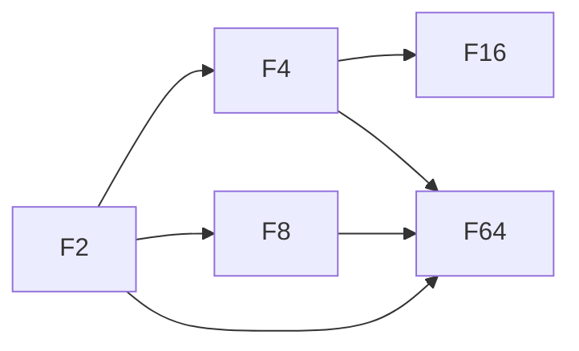

# 유한체

# 개요

**유한체(finite field)** 는 원소가 유한 개이면서 사칙연산을 할 수 있는 [체](fields.md)다. $7$ 로 나눈 나머지 $0,1,\dots,6$ 에서는 $3\cdot5=15$ 가 $1$ 과 같으므로 $3$ 으로 나누는 것이 $5$ 를 곱하는 것과 같고, $0$ 이 아닌 모든 원소로 나눌 수 있다. 유한체는 이런 체의 크기와 구조를 모두 정해 두고, 오류정정 부호와 암호에서 유한 개의 값으로 하는 계산에 쓴다.

# 직관

$p$ 가 [소수](primes.md)일 때 [나머지 연산](modular-arithmetic.md) $\mathbb{Z}/p\mathbb{Z}$ 는 체다. $0$ 이 아닌 모든 나머지가 $p$ 와 서로소라 역원을 갖는다. 반면 $\mathbb{Z}/6\mathbb{Z}$ 는 $2\cdot 3=0$ 이어서 체가 아니다. 그래서 "원소 6개인 체"를 나머지 연산으로는 만들 수 없다.

원소 4개인 체도 나머지 연산으로는 만들 수 없다. $\mathbb{Z}/4\mathbb{Z}$ 에서는 $2\cdot2=0$ 이므로 $2$ 의 역원이 없다. 대신 원소가 $0,1$ 둘인 $\mathbb{F}\_2$ 에 새 원소 $\alpha$ 를 넣고 $\alpha^2=\alpha+1$ 로 정한다. $x^2+x+1$ 은 $\mathbb{F}\_2$ 의 $0$ 과 $1$ 을 넣으면 둘 다 $1$ 이 되어 근이 없으므로, $\alpha$ 는 $\mathbb{F}\_2$ 밖의 원소다.

$$
\mathbb{F}\_4=\mathbb{F}\_2[x]/(x^2+x+1)=\lbrace 0,\thinspace 1,\thinspace\alpha,\thinspace\alpha+1\rbrace,\qquad \alpha^2=\alpha+1
$$

$\mathbb{F}\_2$ 에서 $1+1=0$ 이므로 $\alpha(\alpha+1)=\alpha^2+\alpha=2\alpha+1=1$ 이다. 그래서 $\alpha$ 와 $\alpha+1$ 은 서로의 역원이고, $0$ 이 아닌 세 원소가 모두 역원을 가진다. $\alpha$ 를 거듭제곱하면 $\alpha$, $\alpha+1$, $1$ 이 차례로 나와 $0$ 이 아닌 원소 세 개를 모두 지난다. 그래서 $\mathbb{F}\_4$ 의 곱셈은 $\alpha$ 의 지수끼리 더하는 계산으로 적힌다.

# 정의

**유한체(finite field)** 는 원소 개수가 유한한 체이고, 그 원소 개수를 **위수(order)** 라 한다. $\mathbb{Z}/7\mathbb{Z}$ 는 위수 $7$, 직관 절의 $\mathbb{F}\_4$ 는 위수 $4$ 의 유한체다. 위수가 같은 유한체는 모두 동형이므로(성질 절) 위수 $q$ 의 유한체를 $\mathbb{F}\_q$ 또는 $\mathrm{GF}(q)$ 로 쓴다. $\mathrm{GF}$ 는 Galois field 의 머리글자다.

**원시근(primitive element)** 은 $\mathbb{F}\_q$ 의 곱셈군을 생성하는 원소, 곧 거듭제곱이 $0$ 이 아닌 원소를 모두 지나는 원소다. $\mathbb{F}\_4$ 에서는 $\alpha$ 가 원시근이다. $\mathbb{F}\_7$ 에서 $3$ 의 거듭제곱은 $3,2,6,4,5,1$ 이므로 $3$ 은 원시근이고, $2$ 의 거듭제곱은 $2,4,1$ 에서 되풀이되므로 $2$ 는 원시근이 아니다.

$\mathbb{F}\_q$ 의 표수가 $p$ 일 때 **Frobenius 사상(Frobenius map)** 은 $p$ 제곱 사상이다.

$$
\varphi:\mathbb{F}\_q\to\mathbb{F}\_q,\qquad \varphi(a)=a^{p}
$$

$\mathbb{F}\_4$ 에서는 $p=2$ 이고 $\varphi(\alpha)=\alpha^2=\alpha+1$, $\varphi(\alpha+1)=\alpha^2+1=\alpha$ 이므로 $\varphi$ 는 $\alpha$ 와 $\alpha+1$ 을 맞바꾸고 $0,1$ 을 고정한다. $\mathbb{F}\_7$ 에서는 Fermat 소정리로 $a^7=a$ 이므로 $\varphi$ 가 항등사상이다.

# 성질

## 위수

유한체 $F$ 의 표수는 $0$ 일 수 없으므로 소수 $p$ 이고, 소체는 $\mathbb{F}\_p$ 와 동형이다. $F$ 는 $\mathbb{F}\_p$ 위 유한차원 [벡터 공간](vector-spaces.md)이므로 차원을 $n$ 이라 하면 원소 개수는 $p^n$ 이다[^1].

## 곱셈군의 순환성

$\mathbb{F}\_q$ 의 곱셈군은 위수 $q-1$ 의 순환군이다[^2].

$$
\mathbb{F}\_q^{\times}\cong \mathbb{Z}/(q-1)\mathbb{Z}
$$

증명 개요: $d$ 가 $q-1$ 을 나눌 때 $x^d-1$ 은 체에서 근을 최대 $d$ 개 가지므로, 위수가 $d$ 를 나누는 원소가 $d$ 개를 넘지 않는다. 유한 abelian 군에서 이 조건은 순환성과 동치다. 또는 지수(exponent) $m$ 이 $q-1$ 보다 작다고 가정하면 모든 원소가 $x^m-1$ 의 근이 되어 근의 개수 제한에 모순임을 보인다.

따름정리로 모든 원소는 다음을 만족한다. 이는 Fermat 의 소정리를 유한체로 일반화한 것이다.

$$
a^{q}=a\quad\text{for all } a\in\mathbb{F}\_q
$$

## 존재와 유일성

각 소수 $p$ 와 $n\ge 1$ 에 대해 위수 $p^n$ 의 체가 존재하고, 동형을 무시하면 유일하다[^1].

존재: $\mathbb{F}\_p$ 위 $x^{p^n}-x$ 의 분해체 $K$ 를 잡는다. 이 다항식의 도함수는 $-1$ 이므로 중근이 없고 근이 정확히 $p^n$ 개다. Frobenius 의 $n$ 제곱으로 고정되는 원소들은 덧셈·곱셈·역원에 닫혀 있어 부분체를 이루므로, 근 전체가 위수 $p^n$ 의 체가 된다.

유일성: 위수 $p^n$ 의 체 $F$ 에서는 모든 원소가 $a^{p^n}=a$ 를 만족하므로 $F$ 는 $x^{p^n}-x$ 의 분해체다. 분해체가 동형을 무시하면 유일하므로 $F$ 가 유일하다.

$$
\mathbb{F}\_{p^n}=\lbrace a : a^{p^n}=a\rbrace\subseteq \overline{\mathbb{F}\_p}
$$

이 결과가 "원소 6개인 체는 없다"와 "원소 4개인 체는 동형을 무시하면 하나"를 동시에 준다.

## 다항식 몫으로의 표현

[다항식환](polynomial-rings.md) $\mathbb{F}\_p[x]$ 의 $n$ 차 기약다항식 $f$ 를 잡으면 $\mathbb{F}\_p[x]/(f)$ 는 위수 $p^n$ 의 체이고, $\mathbb{F}\_p$ 의 $n$ 차 [확대](field-extensions.md)다.

$
\mathbb{F}\_{p^n}\cong \mathbb{F}\_p[x]/(f),\qquad [\mathbb{F}\_{p^n}:\mathbb{F}\_p]=n
$

몫환의 원소는 차수가 $n$ 미만인 $\mathbb{F}\_p$ 계수 다항식으로 하나씩 대표되므로 $p^n$ 개다. 유일성에 따라 기약다항식을 다르게 골라도 얻어지는 체는 동형이다.

## 부분체와 Frobenius

$\mathbb{F}\_{p^n}$ 의 부분체는 $n$ 의 약수 $m$ 에 대응하는 $\mathbb{F}\_{p^m}$ 들뿐이고, 이 대응은 일대일이다.

$$
\mathbb{F}\_{p^m}\subseteq \mathbb{F}\_{p^n}\iff m\mid n
$$

$3$ 이 $4$ 를 나누지 않으므로 $\mathbb{F}\_{16}$ 은 $\mathbb{F}\_8$ 을 포함하지 않는다.

Frobenius 사상 $\varphi$ 는 체 자기동형이다. 표수 $p$ 에서 $(a+b)^p=a^p+b^p$ 이므로 덧셈을 보존하고, 단사인 사상이 유한집합에서 전사이므로 자기동형이다. $\mathbb{F}\_p$ 의 원소는 $a^p=a$ 로 고정되므로 $\varphi$ 는 $\mathbb{F}\_p$ 를 고정한다. 자기동형군은 $\varphi$ 가 생성하는 위수 $n$ 의 순환군이다[^3].

$$
\mathrm{Gal}(\mathbb{F}\_{p^n}/\mathbb{F}\_p)=\langle\varphi\rangle\cong\mathbb{Z}/n\mathbb{Z}
$$

즉 유한체의 확대는 모두 Galois 확대이며 [Galois 이론](galois-theory.md)의 대응이 부분군과 약수의 대응으로 구체화된다. 부분군 $\langle\varphi^m\rangle$ 의 고정체가 $\mathbb{F}\_{p^m}$ 이다.

## 기약다항식의 개수

$\mathbb{F}\_p[x]$ 의 monic 기약다항식 중 차수 $n$ 인 것의 개수는 Möbius 반전으로 다음과 같다. 이 값은 $n\ge 1$ 에서 항상 양수이므로 존재성의 다른 증명이 된다.

$$
N_p(n)=\frac{1}{n}\sum_{d\mid n}\mu(d)\thinspace p^{n/d}
$$

# 활용

## 다항식 표현

$\mathbb{F}\_{p^n}$ 산술은 $\mathbb{F}\_p$ 계수 다항식을 기약다항식으로 나눈 나머지로 구현한다. 실무에서는 $\mathbb{F}\_{2^8}$ 이 바이트 한 개에 대응해 널리 쓰인다. **AES**(Advanced Encryption Standard)는 $x^8+x^4+x^3+x+1$ 을 법으로 하는 $\mathbb{F}\_{256}$ 을 사용한다.

## 오류정정 부호

[Reed–Solomon 부호](reed-solomon-codes.md)는 메시지를 $\mathbb{F}\_q$ 위 다항식으로 보고 여러 점에서 평가한다. 차수 $k$ 미만의 다항식은 서로 다른 점 $k$ 개로 결정되므로, 평가값을 $n$ 개 보내면 임의의 $(n-k)/2$ 개 오류를 정정할 수 있다. 체 위에서 차수 $d$ 다항식은 근을 최대 $d$ 개 가지므로 이 논증이 성립한다. 계수환이 체가 아니면 성립하지 않는다.

## 암호와 난수

$\mathbb{F}\_p$ 와 $\mathbb{F}\_{2^n}$ 의 곱셈군이 순환군이므로 [이산로그](discrete-logarithm.md) 문제가 정의되는 군이 나오고, Diffie–Hellman 키 교환이 그 위에 선다. 원시근을 이용한 [선형 되먹임 자리이동 레지스터](linear-feedback-shift-registers.md)(linear feedback shift register, LFSR)는 최대 주기 $2^n-1$ 의 비트열을 만든다.

## 조합론과 기하

$\mathbb{F}\_q$ 위의 사영평면은 위수 $q$ 의 유한사영평면이고, 조합 설계와 직교 라틴방진 구성이 이것을 쓴다. $\mathbb{F}\_q$ 위 벡터 공간의 부분공간 개수를 세는 문제는 Gauss 이항계수로 이어진다.

[^1]: A. Landesman, "Notes on finite fields" — 위수가 $p^n$ 임, $x^{p^n}-x$ 의 분해체로서의 존재, 분해체 유일성에 의한 유일성. https://people.math.harvard.edu/~landesman/assets/finite-fields.pdf
[^2]: K. Conrad, "Finite multiplicative subgroups of a field" — 체의 유한 곱셈 부분군이 순환군임의 증명. https://math.stanford.edu/~conrad/210BPage/handouts/math210b-finite-mult-groups-cyclic.pdf
[^3]: Judson, Abstract Algebra: Theory and Applications, §22.1 "Structure of a Finite Field" — Frobenius 자기동형과 부분체 격자. https://math.libretexts.org/Bookshelves/Abstract_and_Geometric_Algebra/Abstract_Algebra:_Theory_and_Applications_(Judson)/22:_Finite_Fields/22.01:_Structure_of_a_Finite_Field

# 연관 문서

## 선수지식

- [체의 확대](field-extensions.md)
- [정수의 합동](modular-arithmetic.md)

## 더 알아보기

### 체론과 수론

- [Artin–Schreier 이론](artin-schreier-theory.md)
- [이차 상호법칙](quadratic-reciprocity.md)
- [Ax–Grothendieck 정리](ax-grothendieck.md)
- [Pratt 증명서](pratt-certificate.md)

### 부호와 암호

- [오류정정부호](error-correcting-codes.md)
- [비밀 분산](secret-sharing.md)
- [선형 되먹임 자리이동 레지스터](linear-feedback-shift-registers.md)
- [타원곡선](elliptic-curves.md)

### 계산 복잡도

- [Razborov–Smolensky 정리](razborov-smolensky.md)

### 조합론

- [캡 집합](cap-sets.md)
- [조합적 영점 정리](combinatorial-nullstellensatz.md)

#field_theory #algebra #cryptography #combinatorics
