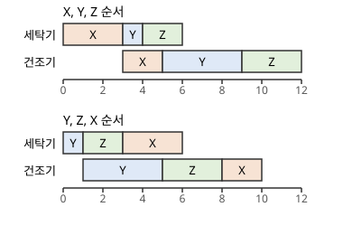

# 흐름 작업장 일정 문제

# 개요

**흐름 작업장 일정 문제(flow shop scheduling)** 는 모든 일이 같은 순서로 기계들을 거칠 때, 일을 처리하는 순서를 정해 마지막 일이 끝나는 시각을 가장 이르게 하는 문제다. 빨래 세 바구니를 세탁기 한 대와 건조기 한 대로 처리할 때 어느 바구니를 먼저 돌려야 가장 빨리 끝나는지가 이 꼴이다. 기계가 둘이면 세탁 시간이 짧은 바구니를 앞에, 건조 시간이 짧은 바구니를 뒤에 두는 Johnson 규칙이 최적 순서를 준다.

# 직관

빨래 $X,Y,Z$ 의 세탁 시간과 건조 시간이 다음과 같다. 바구니는 세탁을 마쳐야 건조기에 들어가고, 두 기계는 한 번에 한 바구니씩 처리한다.

| 바구니 | 세탁 | 건조 |
| ------ | ---- | ---- |
| X      | 3    | 2    |
| Y      | 1    | 4    |
| Z      | 2    | 3    |

$X,Y,Z$ 순서로 돌리면 아래 그림의 위쪽처럼 건조기가 처음 $3$ 시간 동안 놀고, 모든 빨래가 $12$ 에 끝난다. 세탁이 오래 걸리는 $X$ 를 처음에 두어 건조기가 기다렸다.

세탁이 짧은 $Y$ 를 먼저 돌리면 건조기가 $1$ 부터 일한다. 건조가 짧은 $X$ 를 마지막에 두면 마지막 세탁이 끝난 뒤 건조기가 혼자 일하는 시간이 짧다. $Y,Z,X$ 순서는 그림의 아래쪽처럼 $10$ 에 끝난다.

$10$ 보다 빨리 끝낼 수는 없다. 건조 시간의 합은 $2+4+3=9$ 이고, 건조기는 첫 세탁이 끝나야 일을 시작하므로 가장 짧은 세탁 시간 $1$ 만큼은 쉰다.

# 정의

## 흐름 작업장

기계 $M\_1,\dots,M\_k$ 와 일 $1,\dots,n$ 이 있고, 일 $j$ 는 $M\_1,M\_2,\dots,M\_k$ 를 차례로 거치며 $M\_i$ 에서 시간 $p\_{ij}$ 를 쓴다. 기계는 한 번에 한 일만 처리하고 일은 앞 기계를 마쳐야 다음 기계에 들어간다. 모든 일이 끝나는 시각을 **완료 시각(makespan)** 이라 하고, 이것을 최소화하는 일정을 찾는 문제를 **흐름 작업장 일정 문제** 라 한다. 기계들이 같은 일을 나눠 맡는 [동일 병렬 기계 일정 문제](identical-machine-scheduling.md)와 달리 기계마다 공정이 다르다.

모든 기계에서 같은 순서 $\pi$ 로 일을 처리하는 일정을 **순열 일정(permutation schedule)** 이라 한다. 직관 절의 두 시간표가 기계 둘($k=2$)의 순열 일정이다.

## Johnson 규칙

기계가 둘일 때 일 $j$ 의 두 처리 시간을 $a\_j=p\_{1j}$, $b\_j=p\_{2j}$ 로 쓴다. $a\_j\le b\_j$ 인 일들을 $a\_j$ 가 커지는 순서로 먼저 놓고, $a\_j\gt b\_j$ 인 일들을 $b\_j$ 가 작아지는 순서로 그 뒤에 놓는 순서를 **Johnson 규칙(Johnson's rule)** 이라 한다. 직관 절에서 $a\le b$ 인 일은 $Y(1,4)$, $Z(2,3)$ 이고 $a\gt b$ 인 일은 $X(3,2)$ 이므로 순서는 $Y,Z,X$ 다.

# 성질

## 순열 일정의 완료 시각

기계가 둘이면 순서 $\pi$ 의 완료 시각은 다음과 같다.

$$
C\_{\max}(\pi)=\max_{1\le r\le n}\left(\sum_{i\le r}a_{\pi(i)}+\sum_{i\ge r}b_{\pi(i)}\right)
$$

$r$ 번째 일이 세탁기를 마칠 때까지 $\sum\_{i\le r}a\_{\pi(i)}$ 가 걸리고, 그 뒤 건조기는 $r$ 번째부터 마지막 일까지를 쉬지 않고 처리해도 $\sum\_{i\ge r}b\_{\pi(i)}$ 가 걸린다. 건조기가 마지막으로 쉬고 난 뒤 처음 들어온 일을 $r$ 로 잡으면 등호가 된다. 순서 $Y,Z,X$ 에서 세 값은 $1+9=10$, $3+5=8$, $6+2=8$ 이다.

## Johnson 정리

S. M. Johnson 은 기계가 둘이면 Johnson 규칙의 순서가 완료 시각을 최소화함을 증명했다[^1]. 기계가 둘일 때는 최적 일정 가운데 순열 일정이 있으므로 순서만 정하면 된다.

증명의 요지. 이웃한 두 일 $i,j$ 에서 $\min(a\_i,b\_j)\le\min(a\_j,b\_i)$ 이면 $i$ 를 $j$ 앞에 두어도 완료 시각 공식의 두 항 $r=i$, $r=j$ 가운데 큰 것이 늘지 않는다. Johnson 규칙의 순서는 모든 이웃한 쌍에서 이 조건을 만족하고, 아무 순서에서 이 조건을 어기는 이웃 쌍을 바꾸기를 되풀이하면 완료 시각이 늘지 않은 채 Johnson 규칙의 순서에 이른다.

## 하한

어느 순서든 완료 시각은 다음 이상이다.

$$
\max\left(\sum_ja_j+\min_jb_j,\ \sum_jb_j+\min_ja_j\right)
$$

$M\_2$ 는 첫 일의 $a$ 가 끝나야 시작하고 마지막 일의 $b$ 는 $M\_1$ 이 다 끝난 뒤에 처리된다. 직관 절에서 이 값은 $\max(6+2,\thinspace 9+1)=10$ 이고 Johnson 규칙의 $10$ 과 같다.

## 기계가 셋 이상인 경우

기계가 셋이면 완료 시각 최소화가 [강한 NP(nondeterministic polynomial time)-어려움](strong-np-completeness.md)이다. M. R. Garey, D. S. Johnson, R. Sethi 가 [3-분할 문제](three-partition-problem.md)에서 환원해 증명했다[^2]. 기계가 셋이면 순열 일정만으로도 최적이 나오지만, 넷 이상이면 순열 일정이 아닌 일정이 더 나을 수 있다.

# 활용

- 두 공정 생산. 가공 뒤 검사, 인쇄 뒤 제본처럼 두 단계를 차례로 거치는 생산에서 주문 순서를 정한다.
- 계산 파이프라인. 자료를 읽은 뒤 처리하는 두 단계 작업에서 읽기와 처리가 겹치게 순서를 정한다.
- [근사 알고리즘](approximation-algorithms.md)의 부품. 기계가 많은 흐름 작업장에서 앞 기계들과 뒤 기계들의 시간을 각각 더해 기계 둘의 문제로 만든 뒤 Johnson 규칙을 쓰는 방법이 있다.

[^1]: S. M. Johnson, "Optimal two- and three-stage production schedules with setup times included", Naval Research Logistics Quarterly 1 (1954), 61–68.
[^2]: M. R. Garey, D. S. Johnson, R. Sethi, "The complexity of flowshop and jobshop scheduling", Mathematics of Operations Research 1 (1976), 117–129.

# 연관 문서

## 선수지식

- [동일 병렬 기계 일정 문제](identical-machine-scheduling.md)

## 더 알아보기

- [작업장 일정 문제](job-shop-scheduling.md)

#algorithms #complexity #optimization #combinatorics
