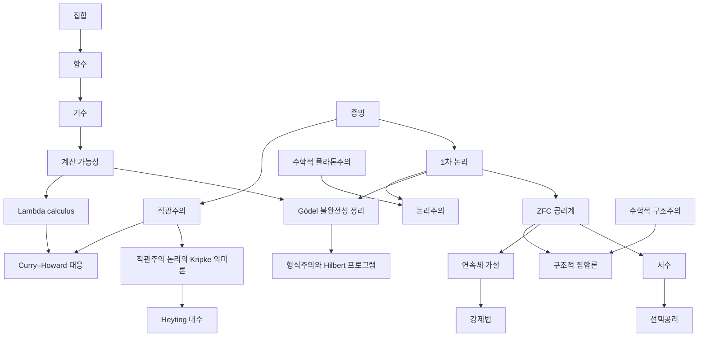

# 수학기초론 개관

# 개요

수학기초론(foundations of mathematics)은 수학 자체를 대상으로 삼아 증명이 무엇이고 무엇 위에 서는지를 묻는 분야다. "자기 자신을 원소로 갖지 않는 집합 전체의 집합" 은 자신을 원소로 가지면 갖지 않아야 하고 갖지 않으면 가져야 해서, 아무 조건으로나 집합을 만들면 모순이 생긴다. 증명에 쓸 수 있는 규칙과 공리를 목록으로 정하고, 그 목록에서 무엇이 증명되고 무엇이 증명되지 않는지를 수학적으로 따진다.

처음 읽는 사람은 [집합](sets.md)에서 시작한다.

# 지도

# 갈래

처음 읽는 사람은 집합론의 기초, 계산 가능성, 논리의 체계의 순서로 읽는다. 그 뒤는 세 방향으로 갈린다. 모형론과 무한소는 구조와 논리식의 관계를 다루고, 구성적 논리와 역수학은 증명에 필요한 것을 따지고, 집합론의 공리계부터 기술집합론까지는 무엇을 ZFC 공리계 위에서 증명할 수 있는지를 다룬다. 수리철학은 앞의 결과를 해석하므로 마지막에 읽는다.

## 집합론의 기초

시작 문서: [집합](sets.md).

- [집합](sets.md): 원소와 포함, 멱집합과 De Morgan 법칙, Russell 의 역설
  - [De Morgan 법칙](de-morgan-laws.md): 여집합이 합집합과 교집합을 바꾸는 두 등식, 명제와 한정사에서의 같은 꼴
- [증명](proofs.md): 명제와 한정사, 직접 증명과 귀류법, 수학적 귀납법
- [함수](functions.md): 단사와 전사, 합성과 역함수
- [동치관계](equivalence-relations.md): 반사, 대칭, 추이 조건과 몫집합
- [기수](cardinality.md): 대각선 논법으로 가른 무한의 크기
- [부분순서](partial-orders.md): 반사, 반대칭, 추이 조건과 상한, 하한

## 계산 가능성

먼저 읽을 갈래: 집합론의 기초. 시작 문서: [계산 가능성](computability.md).

- [계산 가능성](computability.md): Turing 기계와 정지 문제의 결정 불가능성
- [Lambda calculus](lambda-calculus.md): 함수 추상과 적용만으로 계산을 적는 체계, 축약과 정규형
- [Rice 정리](rice-theorem.md): 프로그램의 자명하지 않은 의미적 성질은 결정 불가능하다
  - [유한 오토마타](finite-automata.md): 유한 상태로 인식하는 언어와 Myhill–Nerode 정리
- [Galois 연결](galois-connections.md): 두 순서집합 사이의 수반 쌍
  - [영역 이론](domain-theory.md): 재귀의 의미론을 주는 완비 부분순서와 최소 고정점
  - [추상해석](abstract-interpretation.md): Galois 연결로 프로그램 분석의 건전성을 세운다

## 논리의 체계

먼저 읽을 갈래: 계산 가능성. 시작 문서: [1차 논리](first-order-logic.md).

- [1차 논리](first-order-logic.md): 구문과 의미, 건전성과 완전성
  - [한정사 표준형](prenex-normal-form.md): 한정사를 식 앞으로 모으는 변환, 접두부의 교대 횟수와 Skolem 함수
  - [Herbrand 정리](herbrand-theorem.md): 전칭 한정된 식의 만족가능성을 닫힌 항 대입으로 명제 수준으로 내리는 정리
  - [결의법](resolution.md): 절 집합에서 빈 절을 유도하는 단일 추론 규칙과 반박 완전성
- [Peano 공리](peano-axioms.md): 자연수의 공리계, 2차 형태의 범주성과 1차 형태의 비표준 모형
- [Löwenheim–Skolem 정리](lowenheim-skolem.md): 1차 논리가 무한 모형의 크기를 구별하지 못한다
- [Gödel 불완전성 정리](godel-incompleteness.md): 산술을 담는 무모순 체계는 자기 무모순성을 증명하지 못한다
  - [Paris–Harrington 정리](paris-harrington.md): 유한 Ramsey 정리를 강화한 조합론 명제가 Peano 산술에서 독립이라는 정리
- [2차 산술](second-order-arithmetic.md): 수 변수와 집합 변수를 함께 쓰는 언어, 내포를 제한해 얻는 다섯 부분체계

## 모형론

먼저 읽을 갈래: 논리의 체계. 시작 문서: [모형론](model-theory.md). 먼저 읽을 것: [거리 공간](metric-spaces.md)과 [필터와 그물](filters-and-nets.md)(위상 개관).

- [모형론](model-theory.md): 구조와 논리식의 관계, 양화사 소거와 범주성
- [초곱](ultraproducts.md): 초필터로 묶은 구조, Łoś 정리와 콤팩트성의 모형 구성
  - [Fraïssé 극한](fraisse-limits.md): 유한 구조의 족에서 얻는 가산 균질 구조, 확장 성질과 Rado 그래프
  - [구성가능 집합](constructible-sets.md): 대수적 집합의 Boole 조합, Chevalley 정리와 양화사 소거의 동치
  - [Ax–Grothendieck 정리](ax-grothendieck.md): 단사 다항식 사상은 전사, 유한체에서 표수 $0$ 으로의 이전
  - [o-최소성](o-minimality.md): 정의 가능 집합이 구간과 점의 유한 합집합이라는 조건, 셀 분해와 차원
  - [Pila–Wilkie 정리](pila-wilkie-theorem.md): 정의 가능 집합의 초월적 부분에 놓인 유리점의 셈
- [안정 이론](stable-theories.md): 매개변수 위의 타입 개수로 매긴 조건, 순서 성질의 부재와 갈래짓기 독립
- [Morley 범주성 정리](morley-categoricity.md): 비가산 기수 하나에서의 범주성이 모든 비가산 기수로 옮겨간다
- [Zilber 삼분법](zilber-trichotomy.md): 강최소 집합의 프리기하가 자명, 벡터공간, 대수적으로 닫힌 체 셋으로 갈린다는 진술과 Hrushovski 의 반례
  - [미분적으로 닫힌 체](differentially-closed-fields.md): 미분 방정식의 해를 모두 갖는 체, 미분 닫힘의 유일성
  - [Mordell–Lang 추측](mordell-lang.md): 삼분법을 미분체와 차분체에 적용해 아벨 다양체의 유리점을 결정한다
- [군 배치 정리](group-configuration.md): 여섯 원소의 독립성 패턴에서 정의 가능한 군을 해석한다
- [강최소 군](strongly-minimal-groups.md): 정의 가능한 진부분군이 유한하다는 관찰과 Reineke 의 아벨성 정리
- [유한 Morley 위수 군](groups-of-finite-morley-rank.md): 위수가 유한한 정의 가능 군, 부분군의 사슬 조건과 연결 성분
- [Zilber 불가분성 정리](zilber-indecomposability.md): 불가분 집합족이 생성하는 부분군이 정의 가능하고 연결이며 유한 곱과 같다
- [나쁜 군](bad-groups.md): 정의 가능한 연결 진부분군이 모두 멱영인 연결 비가해 군, Borel 부분군의 켤레성
- [Cherlin–Zilber 추측](cherlin-zilber-conjecture.md): 단순 무한 유한 Morley 위수 군이 대수군이라는 추측

## 무한소

먼저 읽을 갈래: 모형론. 시작 문서: [비표준 해석학](nonstandard-analysis.md).

- [비표준 해석학](nonstandard-analysis.md): 무한소를 가진 순서체 위에서 극한을 대수 계산으로 바꾼다
- [내부집합론](internal-set-theory.md): 초곱 대신 표준 술어와 공리꼴 셋으로 무한소를 세우는 공리계

## 구성적 논리

먼저 읽을 갈래: 계산 가능성. 시작 문서: [직관주의](intuitionism.md).

- [직관주의](intuitionism.md): 대상은 정신의 구성이고 참은 증명을 가졌다는 뜻이다
- [직관주의 논리의 Kripke 의미론](kripke-semantics.md): 부분순서로 놓은 세계에서 직관주의 논리의 타당성을 정한다
  - [Heyting 대수](heyting-algebras.md): 직관주의 논리의 대수 모형, 상대 여원과 이중부정의 비자명성
- [Boole 대수](boolean-algebras.md): 고전 논리의 대수 모형, Stone 표현 정리
- [Curry–Howard 대응](curry-howard.md): 증명이 프로그램이고 명제가 타입이다
- [호모토피 타입 이론](homotopy-type-theory.md): 등식의 증명을 경로로 읽고, 일가성 공리로 동치를 등식과 같은 것으로 삼는다
- [고차 귀납 타입](higher-inductive-types.md): 점과 함께 경로를 생성자로 지정해 원과 구면, 절단, 집합 몫을 짓는다

## 역수학

먼저 읽을 갈래: 논리의 체계. 시작 문서: [역수학](reverse-mathematics.md).

- [역수학](reverse-mathematics.md): 정리마다 그 증명에 필요한 공리를 찾는다
- [약한 König 보조정리](weak-konig-lemma.md): 무한 이진 나무의 가지, $\mathrm{WKL}\_0$ 과 동치인 정리와 원시재귀 산술 보존성

## 집합론의 공리계

먼저 읽을 갈래: 논리의 체계. 시작 문서: [ZFC 공리계](zfc-axioms.md). 먼저 읽을 것: [측도](measure.md)(측도론 개관), [재귀함수](recursive-functions.md)(계산 개관).

- [ZFC 공리계](zfc-axioms.md): Zermelo–Fraenkel 집합론에 선택공리를 더한 공리계, 분리와 치환
- [서수](ordinals.md): 정렬순서의 유형, 초한 귀납법과 초한 재귀
  - [Goodstein 정리](goodstein-theorem.md): 밑을 올리고 1 을 빼는 수열이 언제나 0 에서 끝난다는 정리, 증명에 초한 귀납법을 쓴다
  - [빠르게 자라는 계층](fast-growing-hierarchy.md): 서수마다 자연수 함수를 붙여 만든 증가 속도의 순서, 체계가 전역성을 증명하는 함수의 한계
  - [초현실수](surreal-numbers.md): 이미 만든 수의 두 집합 사이에 끼워 넣어 만드는 수, 실수와 서수를 함께 포함하는 실폐체 No 와 단순성 정리
- [선택공리](axiom-of-choice.md): 선택함수의 존재, Zorn 보조정리와 정렬 정리의 동치
  - [선택공리의 약한 형태](weak-choice-principles.md): 가산 선택, 종속 선택, 초필터 보조정리의 강도 차이
  - [Banach–Tarski 분해](banach-tarski.md): 자유 부분군의 역설적 분해를 구면으로 내린 결과, 조각은 비가측이다
- [구성가능 우주](constructible-universe.md): 정의 가능한 부분집합만 쌓은 내부 모형, 일반화 연속체 가설과 선택공리가 정리가 된다
- [큰 기수](large-cardinals.md): 도달 불가능 기수부터 측도 가능 기수까지, 무모순성 강도의 순서
  - [큰 기수의 층](large-cardinal-hierarchy.md): Mahlo 기수부터 초콤팩트 기수까지, 반사 조건과 기본 매장으로 정의하는 층
  - [결정성](determinacy.md): 무한 게임의 필승 전략, Gale–Stewart 정리와 큰 기수에서 오는 사영 결정성

## 독립성과 강제법

먼저 읽을 갈래: 집합론의 공리계. 시작 문서: [연속체 가설](continuum-hypothesis.md). 먼저 읽을 것: Boole 대수(구성적 논리 갈래).

- [연속체 가설](continuum-hypothesis.md): 가산 무한 다음 기수가 연속체인가, ZFC 공리계에서의 독립성
- [강제법](forcing.md): 일반 필터로 모형을 확장해 독립성을 증명하는 방법
  - [Δ 체계 보조정리](delta-system-lemma.md): 유한집합의 비가산 족이 비가산 Δ 체계를 포함한다는 정리, Cohen 강제와 유한지지 반복의 가산 반사슬 조건
- [반복 강제법](iterated-forcing.md): 두 단계 반복과 지지 조건, 유한지지 반복의 ccc 와 가산지지 반복의 properness
  - [Proper 강제법](proper-forcing.md): 가산 기본 부분모형에 대한 일반 조건, 가산지지 반복에서의 보존
- [Laver 강제법](laver-forcing.md): 나무 조건으로 지배 실수를 더하는 강제법, 순수 결정과 Laver 성질
  - [Martin 의 공리](martins-axiom.md): ccc 강제법에 대한 일반 필터의 존재, 연속체 가설보다 약한 공리
  - [Suslin 문제](suslin-problem.md): 조건을 만족하는 선형순서가 실직선뿐인가, Martin 의 공리 아래의 답
- [Boolean 값 모형](boolean-valued-models.md): 강제법을 완비 Boole 대수 위의 진리값으로 다시 쓴 판본
- [무작위 실수 강제법](random-real-forcing.md): 측도 대수를 조건으로 쓰는 강제법, Cohen 실수와의 대비

## 기술집합론

먼저 읽을 갈래: 독립성과 강제법. 먼저 읽을 것: [Polish 공간](polish-spaces.md)(위상 개관). 시작 문서: [Borel 계층](borel-hierarchy.md).

- [Borel 계층](borel-hierarchy.md): 열린집합에서 가산 연산을 초한으로 되풀이한 단계, Suslin 정리
- [사영 계층](projective-hierarchy.md): 사영과 여집합을 번갈아 붙인 단계, 나무 표현과 유계 정리
- [기수 불변량](cardinal-characteristics.md): 영집합과 제1범주 아이디얼의 네 기수, Cichoń 도표
  - [Borel 추측](borel-conjecture.md): 강 측도 영집합이 모두 가산인가, Laver 모형에서의 무모순성
- [Erdős–Sierpiński 쌍대성](erdos-sierpinski-duality.md): 연속체 가설 아래에서 두 아이디얼을 맞바꾸는 대합
- [Luzin 집합과 Sierpiński 집합](luzin-sierpinski-sets.md): 한쪽 뜻으로만 작은 비가산 집합, 연속체 가설 아래의 구성

## 수리철학

먼저 읽을 갈래: 집합론의 공리계. 시작 문서: [수학적 플라톤주의](mathematical-platonism.md). 다섯 입장 가운데 직관주의는 구성적 논리 갈래에서 읽는다.

- [수학적 플라톤주의](mathematical-platonism.md): 대상은 우리와 무관하게 존재하고 증명은 발견이다
- [논리주의](logicism.md): 수학은 논리로 환원된다
- [형식주의와 Hilbert 프로그램](formalism-hilbert-program.md): 수학은 규칙이 지배하는 기호이고 무모순성이 전부다
- [수학적 구조주의](mathematical-structuralism.md): 대상은 구조 안의 자리다
  - [구조적 집합론](structural-set-theory.md): 원소의 정체 대신 사상으로 집합을 적는 공리계

# 연관 문서

## 선수지식

- [집합](sets.md)
- [증명](proofs.md)

## 더 알아보기

### 수리철학의 입장

- [수학적 플라톤주의](mathematical-platonism.md)
- [논리주의](logicism.md)
- [형식주의와 Hilbert 프로그램](formalism-hilbert-program.md)
- [직관주의](intuitionism.md)
- [수학적 구조주의](mathematical-structuralism.md)

### 공리계

- [ZFC 공리계](zfc-axioms.md)

#foundations #philosophy_of_math #logic #set_theory #overview
