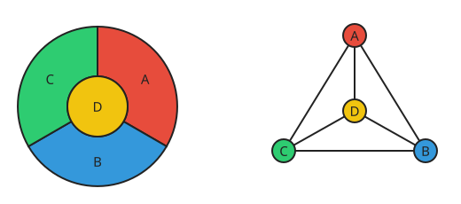

# 4색 정리

# 개요

**4색 정리(four color theorem)** 는 평면의 지도에서 경계를 맞댄 나라끼리 다른 색을 칠할 때 네 색이면 언제나 충분하다는 정리다. 나라 하나를 다른 세 나라가 둘러싸고 그 세 나라가 서로 맞닿아 있으면 네 나라가 모두 서로 맞닿으므로 세 색으로는 모자란다.

지도를 나라마다 정점, 맞닿은 경계마다 간선을 둔 평면 그래프로 바꾸면, 네 색으로 칠해지지 않는 가장 작은 그래프에 반드시 나타나는 작은 조각을 모두 찾아 그 조각마다 칠하기를 늘릴 수 있음을 컴퓨터로 확인해 증명한다.

# 직관

다음 그림의 왼쪽 지도에서 가운데 나라 $D$ 를 $A,B,C$ 가 둘러싸고, $A,B,C$ 는 서로 경계를 맞댄다. 네 나라가 모두 서로 맞닿으므로 네 색이 든다. 오른쪽은 나라를 정점으로, 맞닿은 경계를 간선으로 바꾼 그래프이고 완전그래프 $K\_4$ 다.

지도에서 나온 그래프는 간선이 서로 엇갈리지 않게 평면에 그릴 수 있는 [평면 그래프](planar-graphs.md)다. 평면 그래프에는 차수가 $5$ 이하인 정점이 있으므로, 그 정점을 지우고 나머지를 칠한 뒤 되돌리면 여섯 색으로 칠해진다. 같은 정점에서 두 색만 쓰인 부분의 색을 맞바꾸는 Kempe 사슬(Kempe chain)을 쓰면 다섯 색으로 줄어든다.

네 색에서는 차수 $5$ 인 정점 하나만 보고는 칠하기를 늘릴 수 없다. 그래서 정점 하나 대신 정점 여러 개로 된 조각을 본다. 최소 반례에 꼭 나타나는 조각들의 목록을 만들고, 그 목록의 각 조각이 최소 반례에 나타날 수 없음을 보이면 반례가 없다.

# 정의

## 정리의 진술

모든 평면 그래프 $G$ 에 대해 [그래프 색칠](graph-coloring.md)의 채색수가

$$
\chi(G)\le 4
$$

이다[^1][^2]. 지도로 쓰면, 평면을 연결된 영역들로 나눈 지도에서 한 점이 아니라 선분을 경계로 공유하는 두 영역에 다른 색을 주는 칠하기가 네 색으로 있다.

직관 절의 $K\_4$ 는 평면 그래프이고 $\chi(K\_4)=4$ 이므로 $4$ 는 더 줄어들지 않는다.

## 불가피 집합과 축약 가능 배치

평면 그래프의 일부분으로 나타나는 작은 조각을 **배치(configuration)** 라 한다. 최소 반례가 어떤 배치를 포함하면 더 작은 그래프의 네 색 칠하기를 늘려 반례를 칠할 수 있을 때, 그 배치를 **축약 가능(reducible)** 이라 한다. 모든 최소 반례가 목록 가운데 하나를 반드시 포함하는 배치들의 목록을 **불가피 집합(unavoidable set)** 이라 한다.

차수 $4$ 이하인 정점 하나로 된 배치는 축약 가능하다. 그 정점을 지운 그래프를 네 색으로 칠하면, 이웃이 네 색을 다 쓰더라도 Kempe 사슬로 한 색을 비울 수 있다.

# 성질

## 방전법

모든 면이 삼각형인 평면 그래프에서는 Euler 공식(Euler's formula)으로 간선 수가 $3V-6$ 이고, 차수의 합이 $6V-12$ 이므로

$$
\sum_{v}\bigl(6-d(v)\bigr)=12
$$

이다. 정점 $v$ 에 전하 $6-d(v)$ 를 주면 전하의 합은 양수다. 정해진 규칙으로 전하를 이웃에 옮겨도 합은 $12$ 로 같으므로, 옮긴 뒤 전하가 양수인 정점이 남는다.

그 정점 주위에서 일어날 수 있는 배치를 모두 적으면 불가피 집합이 나온다. 이 방법을 **방전법(discharging method)** 이라 한다.

최소 반례는 면이 모두 삼각형이라고 놓아도 되고, [임계 그래프](critical-graphs.md)이므로 차수가 $3$ 이하인 정점이 없고, 차수 $4$ 인 정점은 앞의 축약 가능성으로 배제된다. 그러면 위 식에서 차수 $5$ 인 정점이 적어도 $12$ 개 있다.

## 증명

Appel 과 Haken 은 방전 규칙으로 축약 가능 배치 1000 개가 넘는 불가피 집합을 만들고, 각 배치의 축약 가능성을 컴퓨터로 확인했다[^1]. Robertson, Sanders, Seymour, Thomas 는 배치 $633$ 개와 방전 규칙 $32$ 개로 증명을 다시 세우고, 평면 그래프를 네 색으로 칠하는 $O(n^2)$ 시간 알고리즘을 얻었다[^2]. $n$ 은 정점 수다. Gonthier 는 이 증명을 증명 보조기 Coq 로 형식 검증했다[^3].

## Kempe 의 오류

Kempe 는 1879 년에 Kempe 사슬로 차수 $5$ 인 정점도 처리할 수 있다는 증명을 발표했다. Heawood 는 1890 년에 두 사슬을 차례로 맞바꾸는 단계에서 첫 맞바꿈이 둘째 사슬을 바꿀 수 있음을 지적했고, 남은 논법으로 5색 정리(five color theorem)를 증명했다[^4].

## Tait 의 동치

다리(bridge)가 없는 3 정칙 평면 그래프가 모두 간선 3 색칠을 가지는 것은 4색 정리와 동치다[^5]. 면의 네 색을 $\mathbb Z\_2^2$ 의 원소 $00,01,10,11$ 로 놓고 간선에 양쪽 면의 색의 합을 주면, 합이 $00$ 이 아닌 세 값으로 간선 3 색칠이 나온다. 거꾸로 간선 3 색칠이 있으면 두 색의 간선들은 짝수 고리들로 나뉘고, 면마다 이 고리들 안에 든 횟수의 홀짝을 두 쌍의 색에 대해 적으면 면의 네 색 칠하기가 나온다.

다리가 없고 3 정칙이면서 간선 3 색칠이 없는 그래프를 [snark](snarks.md) 라 한다. [Petersen 그래프](petersen-graph.md)가 가장 작은 snark 이고, 4색 정리에 따르면 snark 는 평면 그래프가 아니다.

# 활용

- 지도 칠하기. 직관 절처럼 평면이나 구면 위의 지도는 네 색으로 칠해진다. 원환면 위의 지도는 일곱 색이 필요할 수 있고 일곱 색이면 충분하다는 것이 Heawood 의 공식에서 나온다.
- [Hadwiger 추측](hadwiger-conjecture.md). 완전그래프 $K\_5$ 를 마이너로 갖지 않는 그래프가 네 색으로 칠해진다는 진술이 4색 정리와 동치이고, $K\_6$ 의 경우의 증명도 4색 정리를 쓴다.
- [Vizing 정리](vizing-theorem.md). Tait 의 동치로 다리 없는 3 정칙 평면 그래프는 간선 채색수가 $3$ 인 1 종 그래프다.
- 형식 검증. Gonthier 의 검증은 컴퓨터 계산에 기대는 증명을 증명 보조기로 확인한 초기의 큰 예다.

[^1]: K. Appel, W. Haken, "Every planar map is four colorable", *Bulletin of the American Mathematical Society* 82 (1976), 711–712.
[^2]: N. Robertson, D. Sanders, P. Seymour, R. Thomas, "The four-colour theorem", *Journal of Combinatorial Theory, Series B* 70 (1997), 2–44.
[^3]: G. Gonthier, "Formal proof — the four-color theorem", *Notices of the American Mathematical Society* 55 (2008), 1382–1393.
[^4]: P. J. Heawood, "Map-colour theorem", *Quarterly Journal of Pure and Applied Mathematics* 24 (1890), 332–338.
[^5]: P. G. Tait, "Remarks on the colouring of maps", *Proceedings of the Royal Society of Edinburgh* 10 (1880), 729.

# 연관 문서

## 선수지식

- [평면 그래프](planar-graphs.md)
- [그래프 색칠](graph-coloring.md)

## 더 알아보기

- [Snark](snarks.md)

#graph_theory #combinatorics
