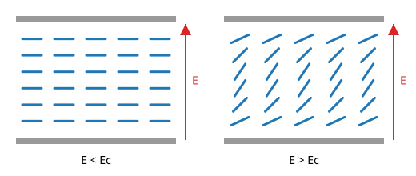

# Fréedericksz 전이

# 개요

**Fréedericksz 전이(Fréedericksz transition)** 는 두 판 사이에 나란히 놓인 액정 분자에 판과 수직인 전기장을 걸 때, 전기장이 어떤 문턱을 넘어서야 비로소 분자가 기울기 시작하는 현상이다. 전기장은 분자를 자기 방향으로 돌리려 하고 판은 분자를 판과 나란히 붙잡으므로, 약한 전기장에서는 분자가 조금이라도 기우는지가 물음이다. [Oseen–Frank 에너지](oseen-frank-energy.md)에 전기장의 에너지를 더해 기운 배치와 기울지 않은 배치의 에너지를 비교하면, 문턱의 값이 판 사이 거리와 탄성 상수로 계산된다.

# 직관

아래 그림의 두 회색 판 사이 거리는 $d$ 이고, 판에 닿은 분자는 판과 나란하게 붙잡혀 있다. 왼쪽은 전기장 $E$ 가 문턱보다 약해 모든 분자가 판과 나란한 배치이고, 오른쪽은 문턱을 넘어 가운데 분자부터 전기장 쪽으로 기운 배치다.

높이 $z$ 에서 분자가 판과 이루는 각을 $\theta(z)$ 로 두고, 판에 붙잡힌 조건 $\theta(0)=\theta(d)=0$ 을 만족하는 작은 기울기 $\theta(z)=a\sin(\pi z/d)$ 를 시험한다. 분자 방향이 높이에 따라 바뀌면 펼침의 탄성 에너지가 들고, 단위 넓이당 그 양은 다음이다.

$$
\int\_0^d\frac12 K\_1\theta'^2dz=\frac{a^2d}{4}K\_1\Bigl(\frac{\pi}{d}\Bigr)^2
$$

분자가 전기장 쪽으로 기울면 전기 에너지가 $\frac{a^2d}{4}\varepsilon\_0\Delta\varepsilon E^2$ 만큼 준다.

두 양을 비교하면 $K\_1(\pi/d)^2\gt\varepsilon\_0\Delta\varepsilon E^2$ 일 때 어떤 작은 기울기도 에너지를 늘리므로 분자는 눕힌 채로 있다. 반대 부등식이면 작은 기울기가 에너지를 줄이므로 분자가 기운다. 두 경우의 경계가 문턱이다.

# 정의

판 사이 $0\lt z\lt d$ 의 방향장을 $n=(\cos\theta(z),0,\sin\theta(z))$, 전기장을 $E=(0,0,E)$ 로 둔다. $\Delta\varepsilon\gt 0$ 은 분자 방향과 그에 수직인 방향의 유전율 차이고, $\varepsilon\_0$ 은 진공의 유전율이다. Oseen–Frank 에너지에 전기 에너지 $-\frac12\varepsilon\_0\Delta\varepsilon(n\cdot E)^2$ 을 더하면 단위 넓이당 에너지는 다음이다.

$$
F\lbrack\theta\rbrack=\frac12\int\_0^d\Bigl((K\_1\cos^2\theta+K\_3\sin^2\theta)\theta'^2-\varepsilon\_0\Delta\varepsilon E^2\sin^2\theta\Bigr)dz
$$

$\theta(0)=\theta(d)=0$ 인 $\theta$ 가운데 $F$ 를 가장 작게 하는 것이 평형이다. 다음 값을 **Fréedericksz 문턱(Fréedericksz threshold)** 이라 한다.

$$
E\_c=\frac{\pi}{d}\sqrt{\frac{K\_1}{\varepsilon\_0\Delta\varepsilon}}
$$

직관 절의 비교에서 두 양이 같아지는 $E$ 가 $E\_c$ 다.

# 성질

## 문턱 아래의 안정성

$E\lt E\_c$ 이고 $K\_3\ge K\_1$ 이면 $\theta\equiv 0$ 이 최소점이다. $\sin^2\theta\le\theta^2$ 이고 $K\_1\cos^2\theta+K\_3\sin^2\theta\ge K\_1$ 이므로, 다음 [Wirtinger 부등식](wirtinger-inequality.md)으로 $F\lbrack\theta\rbrack\ge 0$ 이 나온다.

$$
\int\_0^d\theta'^2dz\ge\Bigl(\frac{\pi}{d}\Bigr)^2\int\_0^d\theta^2dz
$$

등호는 $\theta=a\sin(\pi z/d)$ 일 때이고, 직관 절의 시험 함수가 가장 위험한 기울기다. $K\_3\lt K\_1$ 이면 $\theta\equiv 0$ 에서의 2 차 변분이 같은 부등식으로 양수이므로 $\theta\equiv 0$ 은 국소 최소점이다.

## 문턱 위의 분기

$E$ 가 $E\_c$ 를 넘으면 $\theta\equiv 0$ 은 불안정해지고 $\pm\theta\_E$ 두 평형이 갈라져 나온다. 가운데 높이의 최대 기울기 $\theta\_m$ 은 $E$ 가 $E\_c$ 에 가까울 때 다음 꼴로 자란다[^1].

$$
\theta\_m\approx C\sqrt{\frac{E}{E\_c}-1}
$$

$C$ 는 $K\_3/K\_1$ 에 따라 정해지는 상수다. Euler–Lagrange 방정식을 $\theta$ 의 3 차까지 전개하고 첫 모드 $\sin(\pi z/d)$ 의 진폭에 대한 방정식을 풀어 얻는다.

## 세 배치

판에서 분자를 붙잡는 방향과 전기장의 방향을 바꾸면 펼침, 비틀림, 굽힘 가운데 하나만 처음 변형으로 나타난다. 문턱은 같은 꼴이고 $K\_1$ 자리에 차례로 $K\_1$, $K\_2$, $K\_3$ 이 들어간다. 자기장으로 하면 $\varepsilon\_0\Delta\varepsilon$ 이 자화율의 차 $\mu\_0^{-1}\Delta\chi$ 로 바뀐다.

# 활용

- Frank 상수의 측정. 판 사이 거리 $d$ 와 문턱 $E\_c$ 를 재면 $K\_1/\Delta\varepsilon$ 이 나온다. 세 배치에서 재면 세 상수를 모두 구한다.
- 액정 화면. 전압을 걸어 분자를 세우면 빛이 지나는 방향의 굴절률이 바뀐다. 화면의 구동 전압은 문턱 전압 $E\_cd=\pi\sqrt{K\_1/(\varepsilon\_0\Delta\varepsilon)}$ 보다 크게 잡고, 이 값은 판 사이 거리와 상관없다.
- 분기 이론의 예. 대칭 $\theta\mapsto-\theta$ 를 가진 변분 문제에서 2 차 변분의 가장 작은 고윳값이 $0$ 을 지날 때 두 해가 갈라지는 갈퀴 분기의 표준 예다.

[^1]: P. G. de Gennes, J. Prost, *The Physics of Liquid Crystals*, 2nd ed., Oxford University Press, 1993.

# 연관 문서

## 선수지식

- [Oseen–Frank 에너지](oseen-frank-energy.md)

## 더 알아보기

아직 연결한 문서가 없다.

#analysis #differential_geometry
