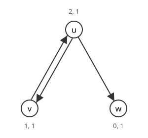

# Fulkerson–Chen–Anstee 정리

# 개요

**Fulkerson–Chen–Anstee 정리(Fulkerson–Chen–Anstee theorem)** 는 정점마다 나가는 화살표 수와 들어오는 화살표 수를 정해 주었을 때 그대로 화살표를 긋는 방향 그래프가 있는지 판정하는 부등식이다. 세 사람 $u,v,w$ 가 서로를 팔로우한다. $u$ 는 두 사람을 팔로우하고 팔로워가 두 명, $v$ 는 한 사람을 팔로우하고 팔로워가 한 명, $w$ 는 아무도 팔로우하지 않고 팔로워도 없다고 하자. 팔로우 수의 합과 팔로워 수의 합이 $3$ 으로 같지만 이런 관계는 있을 수 없다.

팔로우를 많이 하는 사람부터 $k$ 명씩 묶어, 묶음이 하는 팔로우 수가 받는 쪽이 받을 수 있는 수를 넘지 않는지 본다. 모든 $k$ 에서 넘지 않는 것이 그런 방향 그래프가 있을 필요충분조건이다.

# 직관

팔로우 관계는 표 하나로 적힌다. 행을 팔로우하는 사람, 열을 팔로우받는 사람으로 두고, $u$ 가 $v$ 를 팔로우하면 $u$ 행 $v$ 열에 $1$, 아니면 $0$ 을 적는다. 행의 합이 팔로우 수이고 열의 합이 팔로워 수다.

개요의 수에서는 행의 합과 열의 합이 둘 다 $2,1,0$ 이다. 다음 표가 이 합을 갖는다.

$$
\begin{pmatrix}1&1&0\cr 1&0&0\cr 0&0&0\end{pmatrix}
$$

왼쪽 위의 $1$ 은 $u$ 가 자기 자신을 팔로우한다는 뜻이다. 대각선에 $1$ 을 둘 수 없으면 $u$ 는 $v$ 와 $w$ 를 둘 다 팔로우해야 하는데 $w$ 는 팔로워가 없다. [Erdős–Gallai 정리](erdos-gallai-theorem.md)의 Gale–Ryser 정리는 행의 합과 열의 합만 보므로 위 표를 막지 못한다.

막힌 곳은 $u$ 가 할 팔로우 $2$ 개였다. 받을 수 있는 사람은 $u$ 를 뺀 $v$ 와 $w$ 이고, $v$ 는 팔로워 수인 $1$ 개까지, $w$ 는 $0$ 개까지 받는다. $2\gt 1+0$ 이므로 관계가 없다.

팔로우를 많이 하는 쪽부터 $k$ 명을 묶어도 같은 셈을 한다. 묶음 밖의 사람은 묶음에게서 자기 팔로워 수와 $k$ 가운데 작은 값만큼 받는다. 묶음 안의 사람은 자기를 뺀 $k-1$ 명에게서만 받으므로 $k$ 대신 $k-1$ 이 들어간다.

팔로우 수가 $2,1,0$ 이고 팔로워 수가 $1,1,1$ 이면 모든 $k$ 에서 이 셈을 통과한다. 아래 그림이 그 관계다. 화살표는 팔로우하는 사람에서 팔로우받는 사람으로 가고, 정점 옆의 두 수는 팔로우 수와 팔로워 수다.



# 정의

고리가 없고 같은 방향의 간선이 겹치지 않는 [방향 그래프](graphs.md)를 **단순 방향 그래프(simple digraph)** 라 한다. $x\to y$ 와 $y\to x$ 는 함께 있어도 된다. 정점 $x$ 에서 나가는 간선의 수를 **나가는 차수(out-degree)**, 들어오는 간선의 수를 **들어오는 차수(in-degree)** 라 한다. 직관 절의 그림에서 $u$ 의 나가는 차수는 $2$, 들어오는 차수는 $1$ 이다.

음이 아닌 정수의 쌍 $(a_1,b_1),\dots,(a_n,b_n)$ 이 있을 때, 정점 $v_1,\dots,v_n$ 의 단순 방향 그래프에서 $v_i$ 의 나가는 차수가 $a_i$, 들어오는 차수가 $b_i$ 이면 그 그래프를 쌍들의 **실현(realization)** 이라 한다. 실현이 있으면 쌍들을 **방향 그래프적(digraphic)** 이라 한다. 직관 절의 $(2,1),(1,1),(0,1)$ 은 방향 그래프적이고 그림이 그 실현이다. 개요의 $(2,2),(1,1),(0,0)$ 은 방향 그래프적이 아니다.

실현을 직관 절처럼 표로 적은 것이 인접 행렬(adjacency matrix)이다. 행 $i$ 열 $j$ 의 성분이 $v_i\to v_j$ 가 있으면 $1$, 없으면 $0$ 이다. 실현의 인접 행렬은 대각선이 모두 $0$ 이고 행의 합이 $a_i$, 열의 합이 $b_j$ 인 $0\text{-}1$ 행렬이고, 거꾸로 그런 행렬은 실현 하나를 정한다.

쌍들이 $a_1\ge\dots\ge a_n$ 이고 $a_i=a_{i+1}$ 일 때마다 $b_i\ge b_{i+1}$ 이면 **사전식 순서(lexicographic order)** 로 놓였다고 한다. $(2,1),(1,1),(0,1)$ 은 사전식 순서다.

# 성질

## Fulkerson–Chen–Anstee 정리

사전식 순서로 놓인 $(a_1,b_1),\dots,(a_n,b_n)$ 이 방향 그래프적인 것은 $a_i$ 의 합과 $b_i$ 의 합이 같고 $k=1,\dots,n$ 마다 다음이 성립하는 것과 동치다[^1][^2].

$$
\sum_{i=1}^{k}a_i\le\sum_{i=1}^{k}\min(b_i,k-1)+\sum_{i=k+1}^{n}\min(b_i,k)
$$

필요성은 직관 절의 셈이다. $(2,2),(1,1),(0,0)$ 은 $k=1$ 에서 왼쪽이 $2$, 오른쪽이 $0+1+0=1$ 이다. $(2,1),(1,1),(0,1)$ 은 $k=1,2,3$ 에서 $2\le 2$, $3\le 3$, $3\le 3$ 이다.

충분성은 [네트워크 흐름](network-flow.md)으로 증명된다. 출발점에서 행 $i$ 로 용량 $a_i$, $i\ne j$ 인 행 $i$ 에서 열 $j$ 로 용량 $1$, 열 $j$ 에서 도착점으로 용량 $b_j$ 인 간선을 둔다. 값이 $\sum a_i$ 인 정수 흐름이 대각선이 $0$ 인 행렬이다. 최대유량 최소절단 정리(max-flow min-cut theorem)로 절단의 용량을 따지면, 흐름이 있을 조건은 크기가 $k$ 인 모든 행 집합 $R$ 에 대해 다음이 성립하는 것이다.

$$
\sum_{i\in R}a_i\le\sum_{j\in R}\min(b_j,k-1)+\sum_{j\notin R}\min(b_j,k)
$$

Fulkerson 이 이 꼴을 얻었고, Chen 이 $R$ 을 사전식 순서의 앞 $k$ 개로 줄였다. $\min(b_j,k-1)$ 은 $b_j\ge k$ 일 때만 $\min(b_j,k)$ 보다 $1$ 작으므로, 가장 어려운 $R$ 은 $a_i$ 에 $b_i\ge k$ 일 때 $1$ 을 더한 값이 큰 $k$ 개다. $a_i\gt a_j$ 이면 이 값이 $j$ 보다 작아지지 않으므로 사전식 순서의 앞 $k$ 개가 그런 $R$ 이다. Anstee 는 흐름 없이 행렬의 성분을 옮기는 짧은 증명을 주었다[^3].

## Gale–Ryser 정리와의 차이

대각선을 금하지 않으면 오른쪽의 $k-1$ 이 모두 $k$ 로 바뀌어 Gale–Ryser 정리의 부등식이 된다. 두 부등식의 오른쪽 차이는 앞 $k$ 개 가운데 $b_i\ge k$ 인 것의 수다. 직관 절의 표가 Gale–Ryser 정리는 통과하고 이 정리는 통과하지 못한 것이 이 차이 때문이다. $k=1$ 에서 $b_1=2\ge 1$ 이라 오른쪽이 $2$ 에서 $1$ 로 줄었다.

## Kleitman–Wang 절차

**Kleitman–Wang 정리(Kleitman–Wang theorem)** 는 Erdős–Gallai 정리 문서의 Havel–Hakimi 정리에 해당하는 방향 그래프의 진술이다[^4]. 아무 정점 $v_i$ 를 골라, $v_i$ 를 뺀 정점 가운데 들어오는 차수가 큰 $a_i$ 개로 $v_i$ 에서 간선을 긋고, 그 정점들의 들어오는 차수에서 $1$ 씩 뺀다. 들어오는 차수가 같으면 나가는 차수가 큰 정점을 먼저 고른다. 처음 쌍들이 방향 그래프적인 것은 이렇게 남은 쌍들이 방향 그래프적인 것과 동치다.

```javascript
// pairs[i] = [나가는 차수, 들어오는 차수]. 방향 그래프적이면 간선 목록, 아니면 null
function kleitmanWang(pairs) {
  const out = pairs.map((p) => p[0]);
  const inn = pairs.map((p) => p[1]);
  const arcs = [];
  for (let v = 0; v < out.length; v++) {
    const others = [...out.keys()].filter((x) => x !== v);
    others.sort((x, y) => inn[y] - inn[x] || out[y] - out[x]);
    if (out[v] > others.length) return null;
    for (const x of others.slice(0, out[v])) {
      if (inn[x] === 0) return null;
      inn[x] -= 1;
      arcs.push([v, x]);
    }
    out[v] = 0;
  }
  return inn.every((d) => d === 0) ? arcs : null;
}
```

$(2,1),(1,1),(0,1)$ 에서는 $u$ 가 들어오는 차수 $1$ 인 $v$ 와 $w$ 로 간선을 긋고, 다음에 $v$ 가 들어오는 차수가 남은 $u$ 로 간선을 긋는다. 직관 절 그림의 간선 셋이 나온다. $(2,2),(1,1),(0,0)$ 에서는 $u$ 가 $w$ 로 간선을 그으려 할 때 $w$ 의 들어오는 차수가 $0$ 이라 멈춘다.

## 실현 사이의 이동

두 간선 $x\to y$, $z\to t$ 가 있고 $x\to t$, $z\to y$ 가 없으며 $x\ne t$, $z\ne y$ 일 때, 두 간선을 $x\to t$, $z\to y$ 로 바꾸는 것을 방향 그래프의 **2-교환(2-switch)** 이라 한다. 모든 정점의 나가는 차수와 들어오는 차수가 그대로다.

무향 그래프와 달리 2-교환만으로는 같은 쌍들의 실현 사이를 다 오가지 못한다. 순환 $u\to v\to w\to u$ 와 그 방향을 뒤집은 $u\to w\to v\to u$ 는 두 쌍들이 모두 $(1,1),(1,1),(1,1)$ 이다. 그런데 순환의 어느 두 간선을 골라도 한 간선의 끝이 다른 간선의 시작이라 2-교환을 하면 고리가 생긴다. 2-교환에 방향 3-순환을 뒤집는 이동을 더하면 모든 실현이 이어진다[^5].

# 활용

- 방향 [구성 모형](configuration-model.md). 정점마다 나가는 차수와 들어오는 차수를 정해 두고 무작위 방향 그래프를 뽑는 모형이다. 정한 쌍들이 방향 그래프적이어야 고리와 겹간선이 없는 그래프가 나올 수 있다.
- 무작위 방향 네트워크의 표본 추출. 2-교환과 3-순환 뒤집기를 한 걸음으로 하는 [Markov 연쇄 Monte Carlo](markov-chain-monte-carlo.md)가 같은 쌍들의 실현 위를 돌아다닌다. 먹이 그물이나 인용망에서 어떤 구조가 차수만으로 설명되는지 비교하는 기준 모형을 만든다.
- 자기 자신을 제외한 배정. 선물 교환에서 사람마다 줄 선물 수와 받을 선물 수를 정했을 때, 자기에게 주지 않고 한 사람에게 둘 이상 주지 않는 배정이 있는지 이 부등식으로 판정하고 Kleitman–Wang 절차로 만든다.

[^1]: D. R. Fulkerson, "Zero-one matrices with zero trace", *Pacific Journal of Mathematics* 10 (1960), 831–836.
[^2]: W.-K. Chen, "On the realization of a (p,s)-digraph with prescribed degrees", *Journal of the Franklin Institute* 281 (1966), 406–422.
[^3]: R. P. Anstee, "Properties of a class of (0,1)-matrices covering a given matrix", *Canadian Journal of Mathematics* 34 (1982), 438–453.
[^4]: D. J. Kleitman, D. L. Wang, "Algorithms for constructing graphs and digraphs with given valences and factors", *Discrete Mathematics* 6 (1973), 79–88.
[^5]: A. R. Rao, R. Jana, S. Bandyopadhyay, "A Markov chain Monte Carlo method for generating random (0,1)-matrices with given marginals", *Sankhyā Series A* 58 (1996), 225–242.

# 연관 문서

## 선수지식

- [Erdős–Gallai 정리](erdos-gallai-theorem.md)

## 더 알아보기

아직 연결한 문서가 없다.

#graph_theory #combinatorics #algorithms
