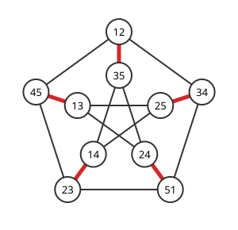

# Fulkerson 추측

# 개요

**Fulkerson 추측(Fulkerson conjecture)** 은 다리가 없고 정점마다 간선이 셋씩 붙은 그래프에서 완전 매칭 여섯 개를 골라 모든 간선이 정확히 두 매칭에 들게 할 수 있다는 추측이다. 간선을 세 색으로 칠할 수 있는 그래프에서는 색마다 간선을 모은 완전 매칭 셋을 두 번씩 쓰면 된다. [Petersen 그래프](petersen-graph.md)처럼 세 색으로 칠할 수 없는 그래프에서는 완전 매칭 셋으로 간선을 한 번씩 나눌 수 없고, 이 추측은 두 번씩 덮는 것은 언제나 되는지를 묻는다.

# 직관

정점마다 간선이 셋씩 붙은 그래프에서 간선을 세 색으로 칠하면, 한 색의 간선은 모든 정점을 한 번씩 짝짓는 완전 매칭이다. 세 색의 매칭은 간선을 겹치지 않게 나누고, 셋을 두 번씩 쓰면 여섯 개의 매칭이 모든 간선을 정확히 두 번 덮는다.

Petersen 그래프는 간선을 세 색으로 칠할 수 없다. 아래 그림의 굵은 간선 다섯 개는 바깥 오각형과 안쪽 별을 잇는 간선으로, 하나의 완전 매칭이다. Petersen 그래프의 완전 매칭은 이것을 포함해 여섯 개다.

여섯 매칭에는 간선이 $5$ 개씩, 모두 $30$ 번 나온다. Petersen 그래프의 자기동형은 어느 간선이든 다른 어느 간선으로 보내고, 완전 매칭을 완전 매칭으로 보낸다. 그래서 간선마다 그 간선을 포함하는 매칭의 수가 같고, 그 수는 $30/15=2$ 다. 여섯 매칭이 모든 간선을 정확히 두 번 덮는다.

# 정의

## 완전 매칭 이중 덮개

3 정칙 그래프 $G$ 의 완전 매칭 $M_1,\dots,M_6$ 이 $G$ 의 모든 간선을 정확히 두 번씩 포함하면, 이 여섯 매칭을 $G$ 의 **Fulkerson 덮개(Fulkerson cover)** 라 한다. 같은 매칭을 여러 번 써도 된다. 직관 절의 Petersen 그래프의 완전 매칭 여섯 개가 Fulkerson 덮개다.

## 추측

다리가 없는 모든 3 정칙 그래프에는 Fulkerson 덮개가 있다[^1]. 이것이 Fulkerson 추측이다.

간선 3 색칠이 있는 그래프에는 직관 절의 구성으로 덮개가 있으므로, 추측은 간선 3 색칠이 없는 그래프, 곧 [snark](snarks.md)와 그것을 작은 절단으로 이어 붙인 그래프에 관한 진술이다.

# 성질

## 분수판

다리가 없는 3 정칙 그래프 $G$ 에는 완전 매칭들 $M_1,\dots,M_N$ 이 있어서 모든 간선이 정확히 $N/3$ 개의 $M_i$ 에 든다. Fulkerson 추측은 $N=6$ 으로 할 수 있다는 진술이다.

증명. 모든 간선에 $1/3$ 을 준 벡터 $x$ 가 완전 매칭 다면체에 있음을 보인다. [매칭 다면체](matching-polytope.md)의 Edmonds 정리에 따르면 완전 매칭 다면체는 $x\ge 0$, 각 정점에서 $x(\delta(v))=1$, 정점 수가 홀수인 $S$ 마다 $x(\delta(S))\ge 1$ 로 정의된다. 앞의 두 조건은 차수가 $3$ 이므로 성립한다.

$\vert S\vert$ 가 홀수이면 차수의 합 $3\vert S\vert=2\vert E(S)\vert+\vert\delta(S)\vert$ 에서 $\vert\delta(S)\vert$ 가 홀수다. 다리가 없으므로 $\vert\delta(S)\vert\ne 1$ 이고 $\vert\delta(S)\vert\ge 3$ 이며, $x(\delta(S))\ge 1$ 이다. 그래서 $x$ 는 완전 매칭들의 유리수 계수 볼록 결합이고, 분모를 맞춰 같은 매칭을 여러 번 쓰면 위 덮개가 나온다.

$x$ 가 다면체에 있으므로 다면체가 비어 있지 않고, 다리 없는 3 정칙 그래프에 완전 매칭이 있다는 Petersen 정리(Petersen's theorem)도 같이 나온다.

## Berge 추측

다리가 없는 모든 3 정칙 그래프의 간선은 완전 매칭 다섯 개로 덮인다는 진술을 Berge 추측(Berge conjecture)이라 한다. Fulkerson 덮개가 있으면 여섯 매칭 가운데 아무 하나를 빼도 나머지 다섯이 모든 간선을 적어도 한 번 덮으므로, Fulkerson 추측은 Berge 추측을 함의한다. Mazzuoccolo 는 두 추측이 동치임을 보였다[^2].

## 매칭 셋과 다섯

3 정칙 그래프의 간선을 완전 매칭 셋으로 덮을 수 있는 것은 간선 3 색칠이 있는 것과 같다. 매칭 셋의 크기 합은 $3\vert V\vert/2$ 로 간선 수와 같으므로, 셋이 모든 간선을 덮으면 서로 겹치지 않고 각 매칭이 한 색이 된다. 그래서 snark 의 간선을 덮는 완전 매칭의 최소 개수는 $4$ 이상이다.

Petersen 그래프의 여섯 매칭은 둘씩 정확히 한 간선을 공유한다[^3]. 매칭 넷을 고르면 빠진 두 매칭이 공유하는 간선은 그 둘에만 들어 있어 덮이지 않으므로, Petersen 그래프의 간선을 덮는 데는 매칭이 다섯 든다.

# 활용

- 다면체 조합론. Fulkerson 은 이 추측을 다면체의 차단 쌍(blocking pair)을 다룬 논문에서 제기했다. 분수판의 증명처럼 매칭 다면체의 점을 정수 계수로 줄이는 문제의 예다.
- snark 의 연구. 새 snark 족을 구성하면 그 족에서 Fulkerson 덮개와 Berge 덮개가 있는지를 확인한다.

[^1]: D. R. Fulkerson, "Blocking and anti-blocking pairs of polyhedra", *Mathematical Programming* 1 (1971), 168–194.
[^2]: G. Mazzuoccolo, "The equivalence of two conjectures of Berge and Fulkerson", *Journal of Graph Theory* 68 (2011), 125–128.
[^3]: D. A. Holton, J. Sheehan, *The Petersen Graph*, Cambridge University Press (1993).

# 연관 문서

## 선수지식

- [Snark](snarks.md)
- [매칭 다면체](matching-polytope.md)

## 더 알아보기

아직 연결한 문서가 없다.

#graph_theory #combinatorics #optimization
