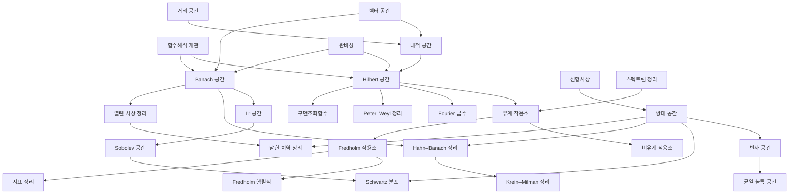

# 함수해석 개관

# 개요

함수해석(functional analysis)은 함수 전체를 하나의 공간으로 보고 그 위의 선형사상을 다루는 분야다. 구간 $\lbrack 0,1\rbrack$ 위의 함수 $x^n$ 은 $n$ 이 커질수록 그래프 아래 넓이가 $0$ 에 가까워지지만 최댓값은 늘 $1$ 이어서, 함수 사이의 거리를 어떻게 재느냐에 따라 수렴 여부가 달라진다. 거리를 하나 정하고 그 거리에서 극한이 공간 안에 남는지 확인한 뒤에 극한과 작용소를 다룬다.

처음 읽는 사람은 [Banach 공간](banach-spaces.md)에서 시작한다. 작용소의 지표가 위상 불변량이 되는 갈래는 [지표 정리](index-theorem.md)로 이어진다.

# 지도

# 갈래

처음 읽는 사람은 공간, 수렴과 직교기저, 쌍대성과 볼록성의 순서로 읽는다. 그 뒤는 작용소와 스펙트럼으로 가고, 거기서 분포와 타원형 방정식이 갈라진다. 고정점 정리와 표현론은 공간만 읽고도 들어갈 수 있다.

## 공간

먼저 읽을 것: [벡터 공간](vector-spaces.md)과 [선형사상](linear-maps.md)(선형대수 개관), [완비성](completeness.md)(해석 개관). 시작 문서: [내적 공간](inner-product-spaces.md).

- [내적 공간](inner-product-spaces.md) — 내적이 정하는 노름과 직교성. [Cauchy–Schwarz 부등식](cauchy-schwarz.md)과 Gram–Schmidt 직교화
- [Hilbert 공간](hilbert-spaces.md) — 완비 내적 공간. 닫힌 부분공간으로의 직교사영과 Riesz 표현 정리
  - [재생핵 Hilbert 공간](reproducing-kernel-hilbert-space.md) — 점 평가가 내적으로 적히는 함수 공간. 양의 준정부호 핵과의 일대일 대응, Moore–Aronszajn 정리, 표현자 정리
- [Banach 공간](banach-spaces.md) — 완비 노름 공간. 열린 사상 정리, 닫힌 그래프 정리, 균등유계성 원리
- [쌍대 공간](dual-space.md) — 선형범함수 전체가 이루는 공간. 유한차원과 달리 원공간과 표준적으로 동형이 아니다
- [Lᵖ 공간](lp-spaces.md) — 측도공간 위의 적분가능 함수들이 이루는 Banach 공간. Hölder 와 Minkowski 부등식, 쌍대성
  - [Hölder 부등식](holder-inequality.md) — 곱의 적분을 켤레 지수의 거듭제곱 적분으로 누르는 부등식. 삼각부등식과 쌍대성의 근거
  - [Rademacher type](rademacher-type.md) — 무작위 부호를 붙인 벡터 합의 증가 속도로 Banach 공간을 나누는 type 과 cotype. Kahane 부등식, Kwapień 정리, Lᵖ 공간의 값
- [Sobolev 공간](sobolev-spaces.md) — 약한 도함수가 $L^p$ 에 드는 함수들의 Banach 공간. 매장 정리, Rellich–Kondrachov 콤팩트성, 흔적 정리

## 수렴과 직교기저

먼저 읽을 갈래: 공간. 시작 문서: [균등수렴](uniform-convergence.md).

- [균등수렴](uniform-convergence.md) — 점별수렴과 달리 연속성과 적분을 보존한다. 상한 노름의 수렴과 같다
- [Fourier 급수](fourier-series.md) — 삼각함수계가 주기함수의 $L^2$ 공간에서 정규직교기저를 이룬다

## 쌍대성과 볼록성

먼저 읽을 갈래: 공간. 먼저 읽을 것: [Tychonoff 정리](tychonoff-theorem.md)(위상 개관), [볼록성](convexity.md)(최적화 개관). 시작 문서: [Hahn–Banach 정리](hahn-banach-theorem.md).

- [Hahn–Banach 정리](hahn-banach-theorem.md) — 부분공간 위의 선형범함수를 노름을 키우지 않고 전체로 확장한다. 쌍대공간의 비자명성과 볼록집합의 분리가 따라온다
- [Banach–Alaoglu 정리](banach-alaoglu.md) — 쌍대공간의 단위구가 약 $\ast$ 위상에서 콤팩트하다. 유계인 열에서 극한을 뽑는 존재논증의 바탕이다
- [반사 공간](reflexive-spaces.md) — 이중쌍대로 가는 표준 매장이 전사인 Banach 공간. 단위구의 약콤팩트성과 동치다
- [균일 볼록 공간](uniformly-convex-spaces.md) — 단위구의 두 점이 떨어지면 중점이 안쪽으로 들어가는 공간. Clarkson 부등식과 Milman–Pettis 정리
- [Krein–Milman 정리](krein-milman.md) — 콤팩트 볼록집합은 극점들의 닫힌 볼록껍질이다. 연속 선형범함수의 최대가 극점에서 난다

## 작용소와 스펙트럼

먼저 읽을 갈래: 쌍대성과 볼록성. 먼저 읽을 것: [Baire 범주 정리](baire-category.md)(위상 개관), [스펙트럼 정리](spectral-theorem.md)(선형대수 개관). 시작 문서: [열린 사상 정리](open-mapping-theorem.md).

- [열린 사상 정리](open-mapping-theorem.md) — Banach 공간 사이의 전사 유계 작용소는 열린 사상이다. 유계 역작용소 정리와 닫힌 그래프 정리가 따라온다
  - [닫힌 치역 정리](closed-range-theorem.md) — 치역이 닫혀 있는 것과 쌍대작용소의 핵으로 치역이 적히는 것이 동치다. 선형방정식의 가해성을 직교조건으로 바꾼다
  - [균등유계성 원리](uniform-boundedness.md) — 점마다 유계인 유계 작용소 모임은 노름이 균등하게 유계다. 노름이 발산하면 값이 발산하는 점이 조밀하게 존재한다
- [유계 작용소](bounded-operators.md) — 연속과 유계가 동치이고, 스펙트럼이 점과 연속과 잔여로 갈린다
  - [Fredholm 작용소](fredholm-operators.md) — 핵과 여핵이 유한차원인 작용소. 지표가 연속 변형에 불변이다
  - [콤팩트 작용소](compact-operators.md) — 유계집합의 상이 상대콤팩트인 작용소. 자기수반이면 고유벡터 기저가 있고 Fredholm 대안이 성립한다
  - [Nyström 법](nystrom-method.md) — 적분방정식의 적분을 구적 합으로 바꾸어 마디의 연립방정식으로 푸는 방법. 오차가 피적분함수의 구적 오차와 같은 차수로 준다
  - [Schatten 아이디얼](schatten-ideals.md) — 특이값의 감소 속도로 가른 콤팩트 작용소의 아이디얼. 대각합과 행렬식이 정의되는 범위를 정한다
  - [Fredholm 행렬식](fredholm-determinant.md) — 대각합 유한 작용소의 행렬식. 적분방정식의 해와 결정점과정에 쓴다
  - [C 스타 대수](c-star-algebras.md) — 노름으로 닫힌 작용소 대수. 가환인 경우가 콤팩트 공간 위의 연속함수 대수와 동형이고 일반 경우가 작용소로 실현된다
  - [von Neumann 대수](von-neumann-algebras.md) — 약작용소 위상에서 닫힌 수반 닫힌 부분대수. 이중교환자 정리와 사영의 동치로 인자를 세 형으로 가른다
  - [작용소 K 이론](operator-k-theory.md) — 사영의 동치류로 K₀, 유니터리의 호모토피류로 K₁ 을 정의한다. 6항 완전열의 지표 사상이 Fredholm 지표이고 Bott 주기성으로 군이 둘뿐이다
  - [교차곱](crossed-products.md) — 군 작용을 유니터리의 켤레로 구현하는 C 스타 대수. 순종군에서 완전 교차곱과 축소 교차곱이 같고, 극소 자유 작용의 교차곱은 단순하다
  - [Baum–Connes 추측](baum-connes-conjecture.md) — 축소 군 C 스타 대수의 K 군이 고유 작용의 보편 공간의 동변 K 호몰로지와 같다는 추측. Haagerup 성질을 갖는 군과 쌍곡군에서 증명되었다
- [비유계 작용소](unbounded-operators.md) — 조밀한 정의역에서만 정의되는 자기수반 작용소와 한 매개변수 유니터리 군의 대응
  - [Friedrichs 확장](friedrichs-extension.md) — 아래로 유계인 대칭 작용소의 이차형식을 닫아 얻는 자기수반 확장. 원래 형식의 하한을 그대로 갖는다
  - [극한점·극한원 분류](limit-point-limit-circle.md) — 특이 Sturm–Liouville 작용소의 끝점을 제곱적분가능한 해의 차원으로 가른다. 결손지수가 극한원인 끝점의 개수와 같다
  - [Weyl–Titchmarsh m 함수](weyl-titchmarsh-m-function.md) — 극한점 끝점의 제곱적분가능한 해가 주는 Herglotz 함수. 실축 위 경계값이 스펙트럼 측도를 준다

## 분포와 타원형 방정식

먼저 읽을 갈래: 작용소와 스펙트럼. 먼저 읽을 것: [Fourier 변환](fourier-transform.md)(해석 개관). 시작 문서: [Schwartz 분포](schwartz-distributions.md).

- [Schwartz 분포](schwartz-distributions.md) — 시험함수 위의 연속 선형범함수. Dirac 델타, 무제한 미분, 완만 분포의 Fourier 변환
  - [Weyl 보조정리](weyl-lemma.md) — 약조화함수는 매끄러운 조화함수다. 완화자와 평균값 성질로 증명하고, Laplace 작용소의 저타원성이다
- [Lax–Milgram 정리](lax-milgram.md) — 유계 강제 쌍선형형식이 주는 약한 꼴 방정식의 유일해. 비대칭 타원형 문제와 Galerkin 근사의 오차 추정
- [타원형 정칙성](elliptic-regularity.md) — 자료가 $H^k$ 에 들면 약해가 $H^{k+2}$ 에 든다. 차분몫 방법과 측정가능 계수의 Hölder 추정
  - [유일 연속 정리](unique-continuation.md) — 열린집합에서 0 인 타원형 방정식의 해는 연결 영역 전체에서 0 이다. 진동수 함수와 두배 부등식, Carleman 부등식, Hölder 계수의 반례
- [Schauder 추정](schauder-estimates.md) — 자료와 계수가 $C^{0,\alpha}$ 에 들면 해가 $C^{2,\alpha}$ 에 든다. 계수 동결과 연속법

## 고정점과 존재정리

먼저 읽을 갈래: 공간. 먼저 읽을 것: [Brouwer 고정점 정리](brouwer-fixed-point.md)(위상 개관). 시작 문서: [Schauder 고정점 정리](schauder-fixed-point.md).

- [Schauder 고정점 정리](schauder-fixed-point.md) — 콤팩트 볼록집합 위의 연속사상이 갖는 고정점. 유한차원 근사로 Brouwer 정리에서 얻는다
- [Leray–Schauder 차수](leray-schauder-degree.md) — 콤팩트 섭동에 붙이는 정수 불변량. 선험적 추정에서 해의 존재를 얻는 대체 원리
- [분기 이론](bifurcation-theory.md) — 매개변수를 지나며 해가 갈라지는 자리. 홀수 중복도 특성값에서의 Krasnosel'skii 정리, Rabinowitz 전역 분기, Crandall–Rabinowitz 정리

## 표현론

먼저 읽을 갈래: 공간, 작용소와 스펙트럼. 먼저 읽을 것: [위상군](topological-groups.md)(위상 개관), [군 표현](group-representations.md)(대수 개관). 시작 문서: [Pontryagin 쌍대성](pontryagin-duality.md).

- [Pontryagin 쌍대성](pontryagin-duality.md) — 국소콤팩트 아벨군과 지표군의 대응, Fourier 변환의 군론적 틀
- [Peter–Weyl 정리](peter-weyl.md) — 콤팩트 군의 정칙 표현이 기약 표현의 직합으로 분해되고 행렬계수가 $L^2$ 의 기저가 된다
  - [구면조화함수](spherical-harmonics.md) — 구면 위 $L^2$ 공간의 회전군 표현에 따른 분해
- [부분인자](subfactors.md) — II₁ 형 인자의 부분인자와 Jones 지표. 지표가 4 미만에서 4cos²(π/n) 꼴만 가지고, Jones 사영이 Temperley–Lieb 관계를 만족한다

# 연관 문서

## 선수지식

- [집합](sets.md)

## 더 알아보기

- [Banach 공간](banach-spaces.md)
- [Hilbert 공간](hilbert-spaces.md)

#functional_analysis #analysis #linear_algebra #overview
