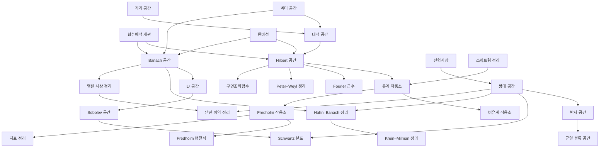

# 함수해석 개관

# 개요

함수해석(functional analysis)은 함수 전체를 하나의 공간으로 보고 그 위의 선형사상을 다루는 분야다. 구간 $\lbrack 0,1\rbrack$ 위의 함수 $x^n$ 은 $n$ 이 커질수록 그래프 아래 넓이가 $0$ 에 가까워지지만 최댓값은 늘 $1$ 이어서, 함수 사이의 거리를 어떻게 재느냐에 따라 수렴 여부가 달라진다. 거리를 하나 정하고 그 거리에서 극한이 공간 안에 남는지 확인한 뒤에 극한과 작용소를 다룬다.

처음 읽는 사람은 [Banach 공간](banach-spaces.md)에서 시작한다. 작용소의 지표가 위상 불변량이 되는 갈래는 [지표 정리](index-theorem.md)로 이어진다.

# 지도

# 갈래

처음 읽는 사람은 공간, 수렴과 직교기저, 쌍대성과 볼록성의 순서로 읽는다. 그 뒤는 작용소와 스펙트럼으로 가고, 거기서 분포와 타원형 방정식이 갈라진다. 고정점 정리와 표현론은 공간만 읽고도 들어갈 수 있다.

## 공간

먼저 읽을 것: [벡터 공간](vector-spaces.md)과 [선형사상](linear-maps.md)(선형대수 개관), [완비성](completeness.md)(해석 개관). 시작 문서: [내적 공간](inner-product-spaces.md).

- [내적 공간](inner-product-spaces.md) — 내적이 정하는 노름과 직교성. [Cauchy–Schwarz 부등식](cauchy-schwarz.md)과 Gram–Schmidt 직교화
- [Hilbert 공간](hilbert-spaces.md) — 완비 내적 공간. 닫힌 부분공간으로의 직교사영과 Riesz 표현 정리
  - [재생핵 Hilbert 공간](reproducing-kernel-hilbert-space.md) — 점 평가가 내적으로 적히는 함수 공간. 양의 준정부호 핵과의 일대일 대응, Moore–Aronszajn 정리, 표현자 정리
- [Banach 공간](banach-spaces.md) — 완비 노름 공간. 열린 사상 정리, 닫힌 그래프 정리, 균등유계성 원리
- [쌍대 공간](dual-space.md) — 선형범함수 전체가 이루는 공간. 유한차원과 달리 원공간과 표준적으로 동형이 아니다
- [Lᵖ 공간](lp-spaces.md) — 측도공간 위의 적분가능 함수들이 이루는 Banach 공간. Hölder 와 Minkowski 부등식, 쌍대성
  - [Hölder 부등식](holder-inequality.md) — 곱의 적분을 켤레 지수의 거듭제곱 적분으로 누르는 부등식. 삼각부등식과 쌍대성의 근거
  - [Rademacher type](rademacher-type.md) — 무작위 부호를 붙인 벡터 합의 증가 속도로 Banach 공간을 나누는 type 과 cotype. Kahane 부등식, Kwapień 정리, Lᵖ 공간의 값
- [Sobolev 공간](sobolev-spaces.md) — 약한 도함수가 $L^p$ 에 드는 함수들의 Banach 공간. 매장 정리, Rellich–Kondrachov 콤팩트성, 흔적 정리
  - [분수 Sobolev 공간](fractional-sobolev-spaces.md) — 두 점의 값 차이를 거리의 거듭제곱으로 나눈 Gagliardo 반노름으로 정한 Wˢᵖ 와 Fourier 쪽의 Hˢ, 두 정의의 일치, 분수 매장, 경계값 공간 H¹ᐟ²

## 수렴과 직교기저

먼저 읽을 갈래: 공간. 시작 문서: [균등수렴](uniform-convergence.md).

- [균등수렴](uniform-convergence.md) — 점별수렴과 달리 연속성과 적분을 보존한다. 상한 노름의 수렴과 같다
- [Fourier 급수](fourier-series.md) — 삼각함수계가 주기함수의 $L^2$ 공간에서 정규직교기저를 이룬다

## 쌍대성과 볼록성

먼저 읽을 갈래: 공간. 먼저 읽을 것: [Tychonoff 정리](tychonoff-theorem.md)(위상 개관), [볼록성](convexity.md)(최적화 개관), [부분미분](subdifferential.md)(최적화 개관). 시작 문서: [Hahn–Banach 정리](hahn-banach-theorem.md).

- [Hahn–Banach 정리](hahn-banach-theorem.md) — 부분공간 위의 선형범함수를 노름을 키우지 않고 전체로 확장한다. 쌍대공간의 비자명성과 볼록집합의 분리가 따라온다
- [Banach–Alaoglu 정리](banach-alaoglu.md) — 쌍대공간의 단위구가 약 $\ast$ 위상에서 콤팩트하다. 유계인 열에서 극한을 뽑는 존재논증의 바탕이다
- [반사 공간](reflexive-spaces.md) — 이중쌍대로 가는 표준 매장이 전사인 Banach 공간. 단위구의 약콤팩트성과 동치다
- [균일 볼록 공간](uniformly-convex-spaces.md) — 단위구의 두 점이 떨어지면 중점이 안쪽으로 들어가는 공간. Clarkson 부등식과 Milman–Pettis 정리
- [Banach–Mazur 거리](banach-mazur-distance.md) — 같은 차원의 두 노름 공간 사이 선형 동형사상의 노름과 역의 노름의 곱의 하한, 정사각형과 원판의 √2, John 타원체로 하는 Euclid 공간까지의 √n, 정육면체의 √n 과 Hadamard 부등식, Gluskin 의 지름 하한. 최적화 개관의 John 타원체를 먼저 읽는다
  - [Dvoretzky 정리](dvoretzky-theorem.md) — 차원이 큰 모든 노름 공간이 차원 log n 의 거의 Euclid 인 부분공간을 갖는다. 구면의 측도 집중과 무작위 부분공간, ℓ∞ⁿ 과 ℓ₁ⁿ 의 두 끝
  - [Kadec–Snobar 정리](kadec-snobar-theorem.md) — n 차원 부분공간 위로 노름이 √n 이하인 사영이 있다는 정리. 상대 사영 상수와 사영 상수, 최대 노름 공간에서 재는 사영 상수, John 정리의 접점으로 만드는 사영, ℓ₂ⁿ 의 √(2n/π) 와 König–Lewis 의 엄격한 부등식
  - [Gurarii–Kadec–Macaev 정리](gurarii-kadec-macaev-theorem.md) — ℓᵖ 와 Euclid 공간의 거리가 n^|1/p − 1/2| 라는 정리, 항등사상과 Hölder 부등식의 위쪽 한계, 부호 평균의 등식으로 하는 아래쪽 한계, Hadamard 행렬로 하는 ℓ₁ 과 ℓ∞ 사이의 √n. Rademacher type 을 먼저 읽는다
- [Krein–Milman 정리](krein-milman.md) — 콤팩트 볼록집합은 극점들의 닫힌 볼록껍질이다. 연속 선형범함수의 최대가 극점에서 난다
- [교대 사영](alternating-projections.md) — 두 닫힌 볼록집합으로의 사영을 번갈아 써서 교점을 찾는 반복. 부분공간에서 von Neumann 정리와 Friedrichs 각의 수렴률
  - [Halperin 정리](halperin-theorem.md) — 부분공간 여러 개로의 정사영을 순환으로 곱한 거듭제곱이 교집합으로의 정사영으로 수렴한다. Smith–Solmon–Wagner 한계와 순서를 바꾼 곱
  - [Dykstra 알고리즘](dykstra-algorithm.md) — 사영마다 잘라 낸 양을 되더해 교집합으로의 최근접점에 수렴하는 교대 사영의 보정
- [단조 작용소](monotone-operators.md) — 부분미분과 회전을 함께 다루는 집합값 작용소, Minty 정리와 레졸벤트의 단단한 비확장성, 근접점 방법과 Douglas–Rachford 분할의 수렴
  - [Browder–Minty 정리](browder-minty.md) — 반사 공간에서 단조, 반연속, 강압적인 작용소의 전사성, Galerkin 근사와 Minty 기법, p-Laplace 방정식의 약해의 존재와 유일성

## 작용소와 스펙트럼

먼저 읽을 갈래: 쌍대성과 볼록성. 먼저 읽을 것: [Baire 범주 정리](baire-category.md)(위상 개관), [스펙트럼 정리](spectral-theorem.md)(선형대수 개관), [Fourier 변환](fourier-transform.md)과 [열방정식](heat-equation.md)(해석 개관). 시작 문서: [열린 사상 정리](open-mapping-theorem.md).

- [열린 사상 정리](open-mapping-theorem.md) — Banach 공간 사이의 전사 유계 작용소는 열린 사상이다. 유계 역작용소 정리와 닫힌 그래프 정리가 따라온다
  - [닫힌 치역 정리](closed-range-theorem.md) — 치역이 닫혀 있는 것과 쌍대작용소의 핵으로 치역이 적히는 것이 동치다. 선형방정식의 가해성을 직교조건으로 바꾼다
  - [균등유계성 원리](uniform-boundedness.md) — 점마다 유계인 유계 작용소 모임은 노름이 균등하게 유계다. 노름이 발산하면 값이 발산하는 점이 조밀하게 존재한다
- [Banach 대수](banach-algebras.md) — 곱의 노름이 노름의 곱 이하인 완비 노름 대수. 스펙트럼의 비공집합과 스펙트럼 반지름 공식, 극대 아이디얼과 지표의 대응, Wiener 정리
  - [정칙 함수 계산](holomorphic-functional-calculus.md) — 정칙함수에 원소를 넣는 Cauchy 적분, 스펙트럼 사상 정리, Riesz 사영
- [유계 작용소](bounded-operators.md) — 연속과 유계가 동치이고, 스펙트럼이 점과 연속과 잔여로 갈린다
  - [부분 등거리](partial-isometries.md) — 닫힌 부분공간에서 길이를 보존하고 직교여공간을 0 으로 보내는 작용소. 작용소의 극분해 T = V|T| 의 회전 부분이다
  - [Wold 분해](wold-decomposition.md) — 등거리 작용소가 작용하는 공간을 유니터리 부분과 이동 작용소 부분으로 나누는 정리. 치역의 직교여공간을 거듭 밀어 이동 부분을 얻는다
  - [Fredholm 작용소](fredholm-operators.md) — 핵과 여핵이 유한차원인 작용소. 지표가 연속 변형에 불변이다
  - [콤팩트 작용소](compact-operators.md) — 유계집합의 상이 상대콤팩트인 작용소. 자기수반이면 고유벡터 기저가 있고 Fredholm 대안이 성립한다
  - [Nyström 법](nystrom-method.md) — 적분방정식의 적분을 구적 합으로 바꾸어 마디의 연립방정식으로 푸는 방법. 오차가 피적분함수의 구적 오차와 같은 차수로 준다
  - [Schatten 아이디얼](schatten-ideals.md) — 특이값의 감소 속도로 가른 콤팩트 작용소의 아이디얼. 대각합과 행렬식이 정의되는 범위를 정한다
  - [Fredholm 행렬식](fredholm-determinant.md) — 대각합 유한 작용소의 행렬식. 적분방정식의 해와 결정점과정에 쓴다
  - [von Neumann 부등식](von-neumann-inequality.md) — 노름 1 이하인 작용소에 넣은 다항식의 노름이 단위원판 위의 최댓값 이하라는 부등식. Sz.-Nagy 유니터리 팽창으로 증명하고, 교환하는 축약 둘에서는 Andô 정리로 성립하고 셋에서는 깨진다
  - [C 스타 대수](c-star-algebras.md) — 노름으로 닫힌 작용소 대수. 가환인 경우가 콤팩트 공간 위의 연속함수 대수와 동형이고 일반 경우가 작용소로 실현된다
  - [von Neumann 대수](von-neumann-algebras.md) — 약작용소 위상에서 닫힌 수반 닫힌 부분대수. 이중교환자 정리와 사영의 동치로 인자를 세 형으로 가른다
  - [작용소 K 이론](operator-k-theory.md) — 사영의 동치류로 K₀, 유니터리의 호모토피류로 K₁ 을 정의한다. 6항 완전열의 지표 사상이 Fredholm 지표이고 Bott 주기성으로 군이 둘뿐이다
  - [교차곱](crossed-products.md) — 군 작용을 유니터리의 켤레로 구현하는 C 스타 대수. 순종군에서 완전 교차곱과 축소 교차곱이 같고, 극소 자유 작용의 교차곱은 단순하다
  - [Kadison–Singer 문제](kadison-singer-problem.md) — 대각 작용소 위의 순수 상태가 하나뿐인 확장을 갖는지 묻는 문제. 짧은 벡터로 된 Parseval 틀을 고르게 나누는 Marcus–Spielman–Srivastava 정리로 풀렸고, Anderson 포장 추측과 Weaver 추측이 동치다
  - [Baum–Connes 추측](baum-connes-conjecture.md) — 축소 군 C 스타 대수의 K 군이 고유 작용의 보편 공간의 동변 K 호몰로지와 같다는 추측. Haagerup 성질을 갖는 군과 쌍곡군에서 증명되었다
- [비유계 작용소](unbounded-operators.md) — 조밀한 정의역에서만 정의되는 자기수반 작용소와 한 매개변수 유니터리 군의 대응
  - [강연속 반군](c0-semigroups.md) — 시간마다 작용소를 주는 반군과 그 생성원. 분해작용소가 반군의 Laplace 변환이고, Hille–Yosida 정리와 Lumer–Phillips 정리가 축약 반군의 생성원을 가른다
    - [Lie–Trotter 곱 공식](lie-trotter-formula.md) — 두 생성원의 합이 만드는 반군을 각 반군을 짧게 번갈아 적용한 곱의 극한으로 얻는 공식. 교환자가 주는 1/n 오차와 Strang 분할의 1/n² 오차
      - [Golden–Thompson 부등식](golden-thompson-inequality.md) — 에르미트 행렬에서 합의 지수의 대각합이 지수의 곱의 대각합 이하라는 부등식. 특이값과 고윳값의 비교와 곱 공식으로 하는 증명, 등호 조건, 세 행렬에서의 실패, [행렬 Chernoff 부등식](matrix-chernoff-inequality.md)과 분배함수
    - [해석 반군](analytic-semigroups.md) — 시간을 복소 부채꼴로 넓힌 반군. 생성원의 분해작용소 상한으로 판정하고, 열방정식처럼 해를 즉시 매끄럽게 하며 스펙트럼 사상 정리가 성립한다
    - [Trotter–Kato 근사 정리](trotter-kato-theorem.md) — 안정한 반군 열에서 핵 위의 생성원 수렴이 반군의 수렴을 준다는 정리. 차분 근사의 수렴과 Chernoff 곱 공식
      - [Lax 동치 정리](lax-equivalence-theorem.md) — 일관된 차분 방법의 수렴과 안정성이 동치라는 정리. 열방정식 앞 Euler 차분의 r ≤ 1/2, von Neumann 조건과 [CFL 조건](cfl-condition.md)
        - [Crank–Nicolson 방법](crank-nicolson-method.md) — 열방정식의 공간 변화율을 지금 시각과 다음 시각에서 반씩 섞는 차분. 모든 r 에서 안정하고 시간 오차가 간격의 제곱이며, 큰 r 에서 격자 진동이 −1 배에 가깝게 남는다
        - [CFL 조건](cfl-condition.md) — 수송 방정식의 명시적 차분에서 한 걸음에 파동이 격자 한 칸보다 멀리 가지 않아야 한다는 조건, 의존 영역, 바람 위쪽 차분의 안정성과 수치 확산
          - [Lax–Wendroff 방법](lax-wendroff-method.md) — 시간 방향 Taylor 전개의 2 차 항까지 맞춘 세 점 차분, |ν| ≤ 1 의 안정성, 3 차 미분 항의 분산과 계단 뒤의 진동
            - [Godunov 정리](godunov-theorem.md) — 단조인 선형 차분 방법은 1 차 정확도를 넘지 못한다는 정리, 계수를 확률분포로 본 분산 0 증명, TVD 방법과 플럭스 제한자
              - [전체 변동 감소 방법](tvd-schemes.md) — 이웃 차이의 절댓값 합이 늘지 않는 차분, 플럭스 제한자와 Sweby 영역, Harten 의 판정
                - [강한 안정성 보존 Runge–Kutta 방법](ssp-runge-kutta-methods.md) — 한 걸음을 Euler 걸음의 양의 무게 평균으로 짜서 Euler 걸음의 전체 변동 감소와 양성을 높은 차수의 시간 적분에서도 지키는 방법, Shu–Osher 꼴과 SSP 계수, 양함수 방법의 차수 4 한계
          - [Godunov 방법](godunov-method.md) — 칸 평균과 이웃 칸 사이 Riemann 문제의 해로 경계 플럭스를 계산하는 보존형 방법, 선형일 때 바람 위쪽 차분, 근사 Riemann 풀이
            - [Roe 풀이](roe-solver.md) — 두 상태에 맞춘 상수 행렬의 선형 Riemann 문제로 경계 플럭스를 근사하는 방법, Roe 행렬의 세 조건, 음속 희박파의 엔트로피 수정
            - [HLL 풀이](hll-solver.md) — 가장 느린 파와 가장 빠른 파 사이를 상수 상태 하나로 놓는 근사 Riemann 풀이, 적분으로 얻는 가운데 상태, 엔트로피와 양성, HLLC
            - [Lax–Wendroff 정리](lax-wendroff-theorem.md) — 보존형이고 일관적인 방법이 전체 변동이 유계인 채로 수렴하면 극한이 약한 해라는 정리, 보존형이 아닌 차분에서 멈춘 계단, Rankine–Hugoniot 속도
            - [MUSCL 방법](muscl-method.md) — 칸 안의 값을 제한된 기울기의 직선으로 놓아 Godunov 방법을 2 차로 올린 유한 부피 방법, minmod 기울기, MUSCL–Hancock 예측 단계, 선형일 때 플럭스 제한자 방법과의 대응
              - [ENO 방법](eno-schemes.md) — 이웃 칸을 차이가 작은 쪽에서 하나씩 골라 맞춘 다항식으로 경계값을 만드는 고차 방법, 스텐실 고르기, 극값에서의 정확도, 부호 성질, 가중 ENO
                - [WENO 방법](weno-schemes.md) — 후보 스텐실의 경계값을 매끄러움 지표로 정한 무게로 볼록결합하는 방법, 선형 무게와 2k−1 차 정확도, 불연속 근처의 무게, WENO-M
              - [구간별 포물선 방법](piecewise-parabolic-method.md) — 이웃 네 칸에서 4 차로 맞춘 경계값 사이를 포물선으로 잇고 단조 제한으로 고치는 방법, 극값 평탄화, 접촉 불연속 가파르게 하기
        - [교대 방향 음함수 방법](alternating-direction-implicit-method.md) — 2 차원 열방정식의 한 걸음을 x 방향과 y 방향의 삼중대각계로 나누어 푸는 Peaceman–Rachford 방법, 무조건 안정성과 시간 차수 2
  - [Friedrichs 확장](friedrichs-extension.md) — 아래로 유계인 대칭 작용소의 이차형식을 닫아 얻는 자기수반 확장. 원래 형식의 하한을 그대로 갖는다
  - [극한점·극한원 분류](limit-point-limit-circle.md) — 특이 Sturm–Liouville 작용소의 끝점을 제곱적분가능한 해의 차원으로 가른다. 결손지수가 극한원인 끝점의 개수와 같다
  - [Weyl–Titchmarsh m 함수](weyl-titchmarsh-m-function.md) — 극한점 끝점의 제곱적분가능한 해가 주는 Herglotz 함수. 실축 위 경계값이 스펙트럼 측도를 준다

## 분포와 타원형 방정식

먼저 읽을 갈래: 작용소와 스펙트럼. 먼저 읽을 것: [Fourier 변환](fourier-transform.md)(해석 개관). 시작 문서: [Schwartz 분포](schwartz-distributions.md).

- [Schwartz 분포](schwartz-distributions.md) — 시험함수 위의 연속 선형범함수. Dirac 델타, 무제한 미분, 완만 분포의 Fourier 변환
  - [Weyl 보조정리](weyl-lemma.md) — 약조화함수는 매끄러운 조화함수다. 완화자와 평균값 성질로 증명하고, Laplace 작용소의 저타원성이다
- [div–curl 보조정리](div-curl-lemma.md) — 발산과 회전이 콤팩트한 두 약수렴 벡터장의 내적이 극한의 내적으로 수렴한다. Jacobi 행렬식의 약연속성, 실 Hardy 공간에 드는 내적, 탄성학과 보존 법칙
- [Besov 공간](besov-spaces.md) — 주파수 띠 조각의 크기를 수열 노름으로 모은 공간. Sobolev 와 Hölder 공간과의 관계, Bernstein 부등식과 끝점 매장, Wᵏᵖ 의 경계값 공간
  - [Paraproduct](paraproducts.md) — 곱을 높은 주파수를 맡은 인수에 따라 가른 Bony 분해. paraproduct 와 나머지 항의 유계성, 곱의 추정, 음의 차수에서 곱이 정의되지 않는 예
  - [Triebel–Lizorkin 공간](triebel-lizorkin-spaces.md) — 띠 조각을 점마다 먼저 모은 노름의 공간. Fefferman–Stein 극대 부등식과 분해 무관성, Wᵏᵖ 와 Bessel 퍼텐셜 공간과의 일치, Jawerth 매장, q 에 무관한 흔적 공간
- [실보간](real-interpolation.md) — 두 공간의 조각으로 가르는 비용인 K 범함수로 정한 중간 공간. 보간 정리, Peetre 공식, 재반복 정리, Sobolev 공간의 실보간이 Besov 공간
  - [Lorentz 공간](lorentz-spaces.md) — 감소 재배열에 둘째 지수를 더해 Lᵖ 를 잘게 나눈 공간. 약한 Lᵖ, 둘째 지수에 대한 포함, 노름화와 L¹,∞ 의 예외, O'Neil 부등식과 쌍대성
- [복소 보간](complex-interpolation.md) — 띠 위의 정칙함수의 가운데 값으로 정한 중간 공간. 보간 정리, Lᵖ 와 Hˢ 의 복소 보간, 실보간과의 비교, Stein 의 해석적 족 보간
- [Lax–Milgram 정리](lax-milgram.md) — 유계 강제 쌍선형형식이 주는 약한 꼴 방정식의 유일해. 비대칭 타원형 문제와 Galerkin 근사의 오차 추정
  - [Lions–Stampacchia 정리](lions-stampacchia.md) — 닫힌 볼록집합 위 변분 부등식의 유일해. 사영과 축약사상, 장애물 위의 최소화와 상보성 계
- [균질화](homogenization.md) — 짧은 주기로 진동하는 계수를 셀 문제로 정한 상수 계수로 바꾼다. 층의 조화평균 8/5, 진동 시험 함수와 div–curl 증명, Voigt–Reuss 경계, 교정자
  - [Hashin–Shtrikman 경계](hashin-shtrikman-bounds.md) — 등방 2상 재료의 유효 전도율의 가장 좁은 범위. 반씩 섞은 1 과 4 의 13/7 과 28/13, 피복 구 집합체의 달성, Keller–Dykhne 쌍대성과 바둑판의 기하평균
  - [H 수렴](h-convergence.md) — 주기가 없는 진동 계수의 극한을 해와 흐름의 극한으로 정한다. Murat–Tartar 콤팩트성, 국소성, 1차원의 조화평균 공식, 대칭 계수의 G 수렴, 최적 설계의 완화
  - [확률적 균질화](stochastic-homogenization.md) — 정상 에르고딕 무작위 계수의 상수 H 극한. 동전 칸 막대의 8/5, 확률공간 위의 교정자, Kozlov–Papanicolaou–Varadhan 정리, 무작위 바둑판의 2, 무작위 환경의 걷기
- [Stokes 방정식](stokes-equations.md) — 비압축 점성 유체의 속도와 압력. 압력을 Lagrange 승수로 둔 안장점 문제, 발산 연산자의 전사성에서 나오는 inf-sup 조건
  - [Navier–Stokes 방정식](navier-stokes-equations.md) — 대류항을 더한 시간 의존 유체 방정식. 에너지 등식, 정상 해의 존재와 작은 자료의 유일성, Leray–Hopf 약해
- [타원형 정칙성](elliptic-regularity.md) — 자료가 $H^k$ 에 들면 약해가 $H^{k+2}$ 에 든다. 차분몫 방법과 측정가능 계수의 Hölder 추정
  - [유일 연속 정리](unique-continuation.md) — 열린집합에서 0 인 타원형 방정식의 해는 연결 영역 전체에서 0 이다. 진동수 함수와 두배 부등식, Carleman 추정, Hölder 계수의 반례
- [Schauder 추정](schauder-estimates.md) — 자료와 계수가 $C^{0,\alpha}$ 에 들면 해가 $C^{2,\alpha}$ 에 든다. 계수 동결과 연속법

## 고정점과 존재정리

먼저 읽을 갈래: 공간. 먼저 읽을 것: [Brouwer 고정점 정리](brouwer-fixed-point.md)(위상 개관). 시작 문서: [Schauder 고정점 정리](schauder-fixed-point.md).

- [Schauder 고정점 정리](schauder-fixed-point.md) — 콤팩트 볼록집합 위의 연속사상이 갖는 고정점. 유한차원 근사로 Brouwer 정리에서 얻는다
- [Leray–Schauder 차수](leray-schauder-degree.md) — 콤팩트 섭동에 붙이는 정수 불변량. 선험적 추정에서 해의 존재를 얻는 대체 원리
- [분기 이론](bifurcation-theory.md) — 매개변수를 지나며 해가 갈라지는 자리. 홀수 중복도 특성값에서의 Krasnosel'skii 정리, Rabinowitz 전역 분기, Crandall–Rabinowitz 정리

## 표현론

먼저 읽을 갈래: 공간, 작용소와 스펙트럼. 먼저 읽을 것: [위상군](topological-groups.md)(위상 개관), [군 표현](group-representations.md)(대수 개관). 시작 문서: [Pontryagin 쌍대성](pontryagin-duality.md).

- [Pontryagin 쌍대성](pontryagin-duality.md) — 국소콤팩트 아벨군과 지표군의 대응, Fourier 변환의 군론적 틀
- [Peter–Weyl 정리](peter-weyl.md) — 콤팩트 군의 정칙 표현이 기약 표현의 직합으로 분해되고 행렬계수가 $L^2$ 의 기저가 된다
  - [구면조화함수](spherical-harmonics.md) — 구면 위 $L^2$ 공간의 회전군 표현에 따른 분해
- [부분인자](subfactors.md) — II₁ 형 인자의 부분인자와 Jones 지표. 지표가 4 미만에서 4cos²(π/n) 꼴만 가지고, Jones 사영이 Temperley–Lieb 관계를 만족한다

# 연관 문서

## 선수지식

- [집합](sets.md)

## 더 알아보기

- [Banach 공간](banach-spaces.md)
- [Hilbert 공간](hilbert-spaces.md)

#functional_analysis #analysis #linear_algebra #overview
