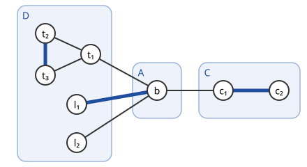

# Gallai–Edmonds 분해

# 개요

**Gallai–Edmonds 분해(Gallai–Edmonds decomposition)** 는 그래프의 정점을 최대 매칭과의 관계에 따라 세 묶음으로 나누는 방법이다. 사람들을 두 명씩 짝지을 때 짝을 가장 많이 만드는 방법은 여러 가지이고, 어떤 사람은 방법에 따라 남기도 하고 남지 않기도 한다. 남을 수 있는 사람, 그 이웃, 나머지로 정점을 나누면 짝을 가장 많이 만드는 모든 방법이 같은 모양으로 놓이므로, 짝의 최대 개수와 짝짓는 방법의 구조가 이 세 묶음으로 정해진다.

# 직관

정점 $b$ 에 잎 $a_1,a_2,a_3$ 이 붙은 별 모양 그래프에서 최대 [매칭](matchings.md)은 간선 하나다. $ba_1$ 을 고르면 $a_2,a_3$ 이 남고, $ba_2$ 를 고르면 $a_1,a_3$ 이 남는다. 잎은 셋 다 어떤 최대 매칭에서 남는 정점이고, $b$ 는 모든 최대 매칭에서 덮인다.

$b$ 를 지우면 잎 셋이 홀수 크기 성분 세 개로 남는다. Tutte–Berge 공식(Tutte–Berge formula)에서 $S=\lbrace b\rbrace$ 로 두면 $o(G-S)-\lvert S\rvert=2$ 이고, 매칭이 덮지 못하는 정점이 $2$ 개 이상이라는 하한이 실제 값과 같다. 덮이지 않을 수 있는 정점을 모으고 그 이웃을 $S$ 로 잡으면 공식의 최댓값이 나온다는 것이 이 분해다.

# 정의

그래프 $G=(V,E)$ 에서

- $D(G)$ 는 $G$ 의 최대 매칭 가운데 $v$ 를 덮지 않는 것이 있는 정점 $v$ 의 집합,
- $A(G)$ 는 $D(G)$ 밖에 있고 $D(G)$ 의 정점과 이웃한 정점의 집합,
- $C(G)=V\setminus(D(G)\cup A(G))$

이다. 어느 정점 $v$ 를 지워도 $G-v$ 에 완전 매칭이 있는 그래프를 **인수 임계 그래프(factor-critical graph)** 라 한다. 인수 임계 그래프는 정점 수가 홀수다.

그림의 그래프에서 $D$ 는 삼각형 $t_1t_2t_3$ 과 두 잎 $l_1,l_2$ 이고, $A=\lbrace b\rbrace$, $C=\lbrace c_1,c_2\rbrace$ 다. 굵은 간선은 최대 매칭 하나다. $b$ 는 성분 $\lbrace l_1\rbrace$ 과 짝지어지고, $t_1$ 과 $l_2$ 가 덮이지 않는다.

# 성질

## 구조 정리

정리(Gallai–Edmonds). 다음이 성립한다[^1][^2].

1. $G\lbrack D(G)\rbrack$ 의 각 연결 성분은 인수 임계 그래프다.
2. $G\lbrack C(G)\rbrack$ 에는 완전 매칭이 있다.
3. $A(G)$ 의 정점을 $G\lbrack D(G)\rbrack$ 의 성분으로 줄인 이분 그래프에서, 공집합이 아닌 $A(G)$ 의 부분집합 $X$ 는 모두 $\lvert X\rvert$ 개보다 많은 성분과 이웃한다.
4. 모든 최대 매칭은 $C(G)$ 를 $C(G)$ 안에서 완전히 덮고, $A(G)$ 의 정점을 $D(G)$ 의 서로 다른 성분과 짝짓고, $D(G)$ 의 각 성분에서 정점 하나만 남기고 덮는다.
5. $G\lbrack D(G)\rbrack$ 의 성분 수를 $c(D)$ 라 하면 $2\nu(G)=\lvert V\rvert-c(D)+\lvert A(G)\rvert$ 이다.

5 에서 $S=A(G)$ 일 때 $G-S$ 의 홀수 성분은 $D(G)$ 의 성분들이고, Tutte–Berge 공식의 최댓값 $o(G-S)-\lvert S\rvert$ 가 이 $S$ 에서 이루어진다. 3 은 Hall 조건이 하나의 여유를 두고 성립한다는 것이다.

## Gallai 보조정리

보조정리(Gallai). 연결 그래프 $G$ 에서 모든 정점 $v$ 에 대해 $\nu(G-v)=\nu(G)$ 이면 $G$ 는 인수 임계 그래프다[^1].

조건은 $D(G)=V$ 와 같다. 구조 정리의 1 은 $D(G)$ 의 각 성분에 이 보조정리를 써서 증명한다.

## 인수 임계 그래프의 귀 분해

정리(Lovász). 그래프가 인수 임계인 것은 첫 순환과 모든 귀의 길이가 홀수인 [귀 분해](ear-decomposition.md)가 있는 것과 동치다[^3]. 홀수 순환은 인수 임계이고, 홀수 길이의 귀를 붙이면 인수 임계가 유지된다.

## 계산

Edmonds 의 blossom 알고리즘이 끝날 때, 매칭되지 않은 정점에서 짝수 거리로 닿는 정점들과 축약한 blossom 의 정점들이 $D(G)$ 이고 홀수 거리로 닿는 정점들이 $A(G)$ 다. 그래서 분해는 최대 매칭과 함께 다항시간에 구해진다. 축약한 blossom 은 홀수 순환에 홀수 귀를 붙인 것이므로 인수 임계다.

# 활용

- 매칭의 Tutte 정리. 완전 매칭이 있는 것은 $D(G)=\varnothing$ 인 것과 같고, 없으면 $S=A(G)$ 가 Tutte 조건을 어기는 증명서다.
- [매칭 다면체](matching-polytope.md). 면을 정의하는 홀수 집합 부등식은 인수 임계 부분그래프의 정점 집합에서 나온다.

[^1]: T. Gallai, "Maximale Systeme unabhängiger Kanten", A Magyar Tudományos Akadémia Matematikai Kutató Intézetének Közleményei 9 (1964), 401–413.
[^2]: J. Edmonds, "Paths, trees, and flowers", Canadian Journal of Mathematics 17 (1965), 449–467.
[^3]: L. Lovász, "A note on factor-critical graphs", Studia Scientiarum Mathematicarum Hungarica 7 (1972), 279–280.

# 연관 문서

## 선수지식

- [매칭](matchings.md)
- [귀 분해](ear-decomposition.md)

## 더 알아보기

아직 연결한 문서가 없다.

#graph_theory #combinatorics #algorithms
