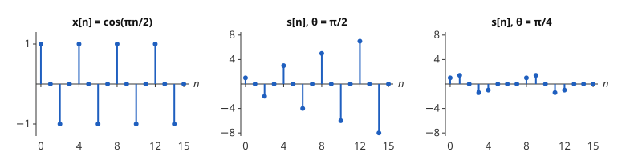

# Goertzel 알고리즘

# 개요

**Goertzel 알고리즘(Goertzel algorithm)** 은 [이산 Fourier 변환](fourier.md)의 계수 하나를 실수 계수의 2차 점화식으로 계산하는 알고리즘이다. 전화기의 버튼을 누르면 정해진 여덟 주파수 가운데 두 개를 더한 소리가 나고, 받는 쪽은 그 여덟 주파수의 크기만 알면 어느 버튼인지 가린다. 수백 개의 계수를 모두 계산하는 대신, 필요한 계수 하나마다 점화식 하나를 신호 끝까지 돌린다.

# 직관

수열 $x\lbrack n\rbrack=\cos(\pi n/2)$ $(0\le n\le 15)$ 의 길이 16 이산 Fourier 변환에서 $X\lbrack 4\rbrack$ 하나만 필요하다. 정의대로 계산하면 $X\lbrack 4\rbrack=\sum_{n=0}^{15}x\lbrack n\rbrack e^{-2\pi i\cdot 4n/16}$ 이고, 항마다 복소수 $e^{-i\pi n/2}$ 를 곱한다.

$r=e^{i\pi/2}=i$ 로 두면 $r^{16}=1$ 이므로 $e^{-i\pi n/2}=r^{16-n}$ 이다. 그러면 $X\lbrack 4\rbrack=\sum_n x\lbrack n\rbrack r^{16-n}$ 은 $r$ 에서 계산한 다항식의 값이다. Horner 법(Horner's method)대로 $y\lbrack n\rbrack=r\thinspace y\lbrack n-1\rbrack+x\lbrack n\rbrack$, $y\lbrack -1\rbrack=0$ 을 $n=15$ 까지 돌리면 $X\lbrack 4\rbrack=r\thinspace y\lbrack 15\rbrack$ 이다. 이 점화식은 극이 $r$ 인 1차 [IIR 필터](iir-filters.md)(infinite impulse response)다.

$r$ 이 복소수라 이 점화식은 칸마다 복소수 곱셈을 한다. 전달함수 $1/(1-rz^{-1})$ 의 분모와 분자에 $1-\bar rz^{-1}$ 을 곱하면 분모가 실수 계수 $1-2\cos\theta\thinspace z^{-1}+z^{-2}$ 가 된다($\theta=\pi/2$). 그래서 실수 점화식 $s\lbrack n\rbrack=x\lbrack n\rbrack+2\cos\theta\thinspace s\lbrack n-1\rbrack-s\lbrack n-2\rbrack$ 을 돌리고, 마지막에 한 번만 복소수를 곱한다.

$\theta=\pi/2$ 이면 $2\cos\theta=0$ 이므로 $s\lbrack n\rbrack=x\lbrack n\rbrack-s\lbrack n-2\rbrack$ 이고, $s=1,0,-2,0,3,0,-4,0,\dots,-8,0$ 이다. 마지막 두 값에서 $X\lbrack 4\rbrack=r\thinspace s\lbrack 15\rbrack-s\lbrack 14\rbrack=0-(-8)=8$ 이 나온다.

아래 그림의 가운데는 이 $s\lbrack n\rbrack$ 이다. 입력의 주파수 $\pi/2$ 가 점화식의 $\theta$ 와 같아서 $s$ 의 진폭이 칸마다 늘어난다. 오른쪽은 같은 입력에 $\theta=\pi/4$ 로 돌린 것이고, 진폭이 $\sqrt2$ 를 넘지 않으며 마지막 두 값이 $0$ 이어서 $X\lbrack 2\rbrack=0$ 이 나온다.



# 정의

길이 $N$ 인 수열 $x\lbrack 0\rbrack,\dots,x\lbrack N-1\rbrack$ 과 주파수 $\theta$ 를 받는다. $s\lbrack -1\rbrack=s\lbrack -2\rbrack=0$ 에서 시작해 다음 점화식을 $n=0,\dots,N-1$ 에 대해 돌린다.

$$
s\lbrack n\rbrack=x\lbrack n\rbrack+2\cos\theta\thinspace s\lbrack n-1\rbrack-s\lbrack n-2\rbrack
$$

그리고 $e^{i\theta}s\lbrack N-1\rbrack-s\lbrack N-2\rbrack$ 를 내놓는다. 이 절차를 **Goertzel 알고리즘** 이라 한다[^1]. $\theta=2\pi k/N$ 이면 출력은 $X\lbrack k\rbrack$ 다. 직관 절은 $N=16$, $k=4$, $\theta=\pi/2$ 인 경우다.

```javascript
// x: 길이 N 인 실수 배열, theta: 주파수. 출력은 [실수부, 허수부]
function goertzel(x, theta) {
  const c = 2 * Math.cos(theta);
  let s1 = 0, s2 = 0;            // s[n-1], s[n-2]
  for (const v of x) {
    const s0 = v + c * s1 - s2;
    s2 = s1;
    s1 = s0;
  }
  // e^{iθ} s[N-1] - s[N-2]
  return [Math.cos(theta) * s1 - s2, Math.sin(theta) * s1];
}
```

# 성질

## 출력과 계수의 일치

$r=e^{i\theta}$ 이고 $r\bar r=1$ 이면 다음 항등식이 성립한다.

$$
\frac{1}{1-rz^{-1}}=\frac{1-\bar rz^{-1}}{(1-rz^{-1})(1-\bar rz^{-1})}=\frac{1-\bar rz^{-1}}{1-2\cos\theta\thinspace z^{-1}+z^{-2}}
$$

[z 변환](z-transform.md)의 합성곱 정리로 읽으면, 직관 절의 $y$ 는 $s$ 에 $1-\bar rz^{-1}$ 을 거친 것, 곧 $y\lbrack n\rbrack=s\lbrack n\rbrack-\bar r\thinspace s\lbrack n-1\rbrack$ 이다. 따라서 $r\thinspace y\lbrack N-1\rbrack=r\thinspace s\lbrack N-1\rbrack-s\lbrack N-2\rbrack$ 이다. $r\thinspace y\lbrack N-1\rbrack=\sum_n x\lbrack n\rbrack r^{N-n}$ 이고 $\theta=2\pi k/N$ 이면 $r^N=1$ 이므로 이것은 $\sum_n x\lbrack n\rbrack e^{-2\pi ikn/N}=X\lbrack k\rbrack$ 다.

## 크기의 계산

$x$ 가 실수이면 $s$ 도 실수이고, 다음 식으로 복소수 없이 크기를 얻는다.

$$
\lvert X\lbrack k\rbrack\rvert^2=s\lbrack N-1\rbrack^2+s\lbrack N-2\rbrack^2-2\cos\theta\thinspace s\lbrack N-1\rbrack\thinspace s\lbrack N-2\rbrack
$$

$\lvert r a-b\rvert^2=a^2+b^2-2\thinspace\mathrm{Re}(r)\thinspace ab$ 를 $a=s\lbrack N-1\rbrack$, $b=s\lbrack N-2\rbrack$ 에 쓴 것이다. 직관 절에서는 $0+64-0=64=8^2$ 이다.

## 계산량

$x$ 가 실수이면 점화식은 한 칸에 실수 곱셈 한 번과 덧셈 두 번이다. 계수 $M$ 개를 구하면 곱셈이 약 $MN$ 번이다. [고속 Fourier 변환](fft.md)은 계수 $N$ 개를 모두 $O(N\log N)$ 번의 연산으로 계산하므로, $M$ 이 $\log\_2N$ 정도보다 작으면 Goertzel 알고리즘의 연산이 적다[^1]. 점화식은 들어오는 값마다 바로 갱신하므로 신호 전체를 저장하지 않는다.

## 정수가 아닌 주파수

$\theta$ 가 $2\pi/N$ 의 정수배가 아니면 $r^N\ne 1$ 이고, 출력은 $\sum_n x\lbrack n\rbrack r^{N-n}=e^{i\theta N}\sum_n x\lbrack n\rbrack e^{-i\theta n}$ 이다. 크기는 [z 변환](z-transform.md) 문서의 이산시간 Fourier 변환(discrete-time Fourier transform, DTFT) $X(e^{i\theta})$ 의 크기와 같다. 그래서 $N$ 이 2 의 거듭제곱일 필요가 없고, 원하는 주파수를 격자에 맞추려고 $N$ 을 바꿀 필요도 없다.

## 단위원 위의 극

점화식의 극은 $e^{\pm i\theta}$ 로 단위원 위에 있다. 따라서 [IIR 필터](iir-filters.md) 문서의 기준으로는 안정이 아니며, 직관 절의 가운데 그림처럼 같은 주파수의 입력에서 $s$ 가 $n$ 에 비례해 커진다. 점화식을 $N$ 칸만 돌리므로 값은 유한하지만, 반올림 오차는 $N$ 이 클수록 커진다.

# 활용

- 전화 버튼음 판별(dual-tone multi-frequency, DTMF). 버튼마다 낮은 주파수 697, 770, 852, 941 Hz 가운데 하나와 높은 주파수 1209, 1336, 1477, 1633 Hz 가운데 하나를 더한 소리가 난다. 받는 쪽은 여덟 주파수에서 크기만 구하면 되므로 크기의 계산 절의 식을 여덟 번 쓴다[^1].
- 주파수 하나의 감시. 정해진 주파수의 신호가 있는지만 보는 검출기는 점화식 하나를 들어오는 값마다 갱신하고, $N$ 칸마다 크기를 읽는다.
- [단시간 Fourier 변환](short-time-fourier-transform.md)의 일부 계산. 조각마다 몇 개의 $k$ 만 필요하면 그 $k$ 들에만 점화식을 돌린다.

[^1]: A. V. Oppenheim, R. W. Schafer, *Discrete-Time Signal Processing*, 3rd ed., Pearson (2010), 9.2절.

# 연관 문서

## 선수지식

- [이산 Fourier 변환](fourier.md)
- [IIR 필터](iir-filters.md)

## 더 알아보기

아직 연결한 문서가 없다.

#signal_processing #algorithms #analysis
