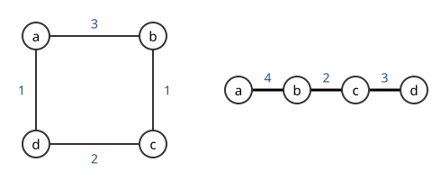

# Gomory–Hu 나무

# 개요

**Gomory–Hu 나무(Gomory–Hu tree)** 는 무게 있는 무향 그래프의 모든 정점 쌍의 최소 절단을 나무 하나에 담은 것이다. 통신망의 모든 지점 쌍에 대해 둘을 끊으려면 연결을 최소 얼마나 잘라야 하는지 알고 싶으면, 쌍마다 최대 흐름을 구해 $\binom n2$ 번 계산해야 할 것 같다. 쌍마다의 값이 많아야 $n-1$ 가지라는 점을 써서 최대 흐름 $n-1$ 번으로 이 나무를 만들고, 두 정점 사이 나무 경로에서 가장 가벼운 간선의 무게로 답을 읽는다.

# 직관

정점 $a,b,c,d$ 가 순환으로 이어지고 간선 무게가 $ab=3$, $bc=1$, $cd=2$, $da=1$ 인 그래프에서 모든 정점 쌍의 최소 절단을 구한다. $a$ 와 $b$ 를 가르려면 $\lbrace a\rbrace$ 를 떼어 $3+1=4$ 를 내거나 $\lbrace a,d\rbrace$ 를 떼어 $3+2=5$ 를 낸다. 가장 작은 것은 $4$ 다. 같은 계산으로 $c$ 와 $d$ 는 $\lbrace d\rbrace$ 를 떼는 $2+1=3$ 이고, 나머지 네 쌍은 모두 $\lbrace a,b\rbrace$ 와 $\lbrace c,d\rbrace$ 로 가르는 $1+1=2$ 다.

여섯 쌍의 값이 $4$, $3$, $2$ 세 가지뿐이다. 나무 $a$–$b$–$c$–$d$ 에 무게 $4,2,3$ 을 주면, 두 정점 사이 경로의 가장 작은 무게가 여섯 쌍의 값을 모두 맞힌다. 나무의 간선 $bc$ 를 지우면 $\lbrace a,b\rbrace$ 와 $\lbrace c,d\rbrace$ 로 갈리고, 원래 그래프에서 그 둘을 가르는 간선 무게의 합이 $2$ 다.



값이 적은 이유는 다음 부등식이다. $a$ 와 $c$ 를 가르는 절단은 $b$ 를 $a$ 쪽이나 $c$ 쪽에 두므로 $a$ 와 $b$ 를 가르거나 $b$ 와 $c$ 를 가른다. 그래서 $a$–$c$ 의 최소 절단은 $a$–$b$ 와 $b$–$c$ 의 최소 절단 가운데 작은 것 이상이다.

# 정의

무향 그래프 $G=(V,E)$ 의 간선 무게를 $w\ge 0$ 이라 하고, $S\subseteq V$ 에 대해 $S$ 와 $V\setminus S$ 를 잇는 간선 무게의 합을 $w(\delta(S))$ 로 쓴다. 서로 다른 $s,t$ 에 대해

$$
\lambda(s,t)=\min\lbrace w(\delta(S)) : s\in S,\ t\notin S\rbrace
$$

를 최소 $s$–$t$ 절단의 크기라 한다. [Menger 정리](menger-theorem.md)의 흐름 판본에서 $\lambda(s,t)$ 는 최대 $s$–$t$ 흐름의 값이다.

$V$ 위의 나무 $T$ 와 간선 무게 $f$ 가 다음을 만족하면 Gomory–Hu 나무라 한다. $T$ 의 간선 $e=uv$ 를 지워 생기는 두 성분 가운데 $u$ 쪽을 $S_e$ 라 할 때, 모든 간선 $e$ 에서 $f(e)=w(\delta(S_e))=\lambda(u,v)$ 이다.

# 성질

## 경로의 최솟값

정리. Gomory–Hu 나무에서 $s$ 와 $t$ 를 잇는 경로의 간선들 가운데 무게가 가장 작은 $e$ 에 대해 $\lambda(s,t)=f(e)$ 이고, $S_e$ 가 최소 $s$–$t$ 절단이다.

증명의 요지. 세 정점 $s,u,t$ 에서 $\lambda(s,t)\ge\min(\lambda(s,u),\lambda(u,t))$ 이다. 직관 절의 논법과 같다. 경로 $s=v_0,v_1,\dots,v_k=t$ 에 이것을 되풀이 쓰면 $\lambda(s,t)$ 는 $\lambda(v_{i-1},v_i)=f(v_{i-1}v_i)$ 의 최솟값 이상이다. 거꾸로 경로의 간선 $e$ 를 지우면 $s$ 와 $t$ 가 다른 쪽에 놓이므로 $S_e$ 는 $s$ 와 $t$ 를 가르는 절단이고 크기가 $f(e)$ 다.

## 존재와 구성

정리(Gomory–Hu). 모든 무향 그래프에 Gomory–Hu 나무가 존재하고, 최대 흐름 계산 $n-1$ 번으로 구성된다. R. E. Gomory 와 T. C. Hu 가 1961 년에 증명했다[^1].

Gomory–Hu 의 구성은 정점 집합을 나눈 덩어리들의 나무를 유지한다. 두 정점 이상이 든 덩어리에서 정점 $s,t$ 를 고르고, 나무에서 그 덩어리를 떼었을 때 생기는 다른 쪽 부분마다 정점 하나로 합친 그래프에서 최소 $s$–$t$ 절단을 구한다. 그 절단으로 덩어리를 둘로 나누고 무게 $\lambda(s,t)$ 의 간선으로 잇는다. 합친 그래프에서 구한 절단이 원래 그래프의 최소 절단이라는 것이 증명의 요지이고, 최소 절단 $S$ 와 $S'$ 에 대해 $w(\delta(S\cap S'))+w(\delta(S\cup S'))\le w(\delta(S))+w(\delta(S'))$ 인 부분모듈성을 쓴다.

D. Gusfield 는 정점을 합치지 않고 원래 그래프에서 최대 흐름 $n-1$ 번만 계산하는 구성을 주었다[^2]. 정점마다 부모 $p(v)$ 를 두고 $v$ 와 $p(v)$ 의 최소 절단을 구한 뒤, 그 절단의 $v$ 쪽에 있는 정점들의 부모를 $v$ 로 고친다. 아래 판본이 만드는 나무는 경로의 최솟값이 모든 쌍에서 $\lambda(s,t)$ 와 같은 등가 흐름 나무(equivalent flow tree)이고, 부모를 한 번 더 맞바꾸는 단계를 더하면 절단까지 맞는 Gomory–Hu 나무가 된다.

```javascript
// Gusfield 의 구성. minCut(s, t) 는 최소 s–t 절단의 값과 s 쪽 정점 집합을 준다.
function gomoryHu(n, minCut) {
  const parent = new Array(n).fill(0);
  const weight = new Array(n).fill(0);
  for (let s = 1; s < n; s++) {
    const t = parent[s];
    const { value, side } = minCut(s, t);
    weight[s] = value;
    for (let v = s + 1; v < n; v++) {
      if (side.has(v) && parent[v] === t) parent[v] = s;
    }
  }
  return { parent, weight }; // 간선 s–parent[s] 의 무게가 weight[s]
}
```

## 서로 다른 값의 개수

나무의 간선이 $n-1$ 개이므로 $\lambda(s,t)$ 가 갖는 서로 다른 값은 $n-1$ 개 이하다. 가장 작은 나무 간선의 무게가 그래프 전체의 최소 절단, 곧 Menger 정리의 간선 연결도 $\lambda(G)$ 다.

유향 그래프에는 이런 나무가 일반적으로 없다. 증명에 쓴 $\lambda(s,t)=\lambda(t,s)$ 와 세 정점의 부등식이 유향 절단에서 성립하지 않는다.

# 활용

- 매칭 다면체의 분리 문제. M. W. Padberg 와 M. R. Rao 는 홀수 집합 부등식을 어기는 집합이 있는지를 홀수 개의 지정 정점을 가르는 최소 절단 문제로 바꾸고, 그 답이 Gomory–Hu 나무의 간선 가운데 하나가 정하는 절단임을 보였다[^3]. [매칭 다면체](matching-polytope.md)의 분리 문제가 다항시간에 풀린다.
- 최소 k-절단의 근사. 그래프를 $k$ 조각으로 나누는 최소 무게 간선 집합을, Gomory–Hu 나무에서 가장 가벼운 간선 $k-1$ 개가 정하는 절단들의 합집합으로 근사하면 $2-2/k$ 배 이내다(Saran–Vazirani)[^4].
- 망 설계. 통신망에서 모든 지점 쌍의 연결 용량을 한 번에 구하고, 용량이 가장 작은 쌍을 나무의 가장 가벼운 간선으로 찾는다.

[^1]: R. E. Gomory, T. C. Hu, "Multi-terminal network flows", Journal of the Society for Industrial and Applied Mathematics 9 (1961), 551–570.
[^2]: D. Gusfield, "Very simple methods for all pairs network flow analysis", SIAM Journal on Computing 19 (1990), 143–155.
[^3]: M. W. Padberg, M. R. Rao, "Odd minimum cut-sets and b-matchings", Mathematics of Operations Research 7 (1982), 67–80.
[^4]: H. Saran, V. V. Vazirani, "Finding k cuts within twice the optimal", SIAM Journal on Computing 24 (1995), 101–108.

# 연관 문서

## 선수지식

- [Menger 정리](menger-theorem.md)

## 더 알아보기

아직 연결한 문서가 없다.

#graph_theory #algorithms #optimization
