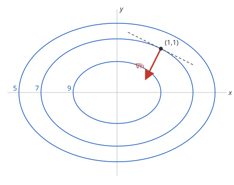

# 기울기 벡터

# 개요

**기울기 벡터(gradient)** 는 여러 변수 함수에서 각 변수 방향의 변화율을 모아 놓은 벡터다. 땅의 높이가 $h(x,y)=10-x^2-2y^2$ 인 언덕의 점 $(1,1)$ 에 선 사람은 동쪽으로 가면 내려가고, 서쪽으로 가면 올라간다. 어느 방향이 가장 가파른 오르막이고 그 경사가 얼마인지는 기울기 벡터 $(-2,-4)$ 하나로 정해진다.

# 직관

점 $(1,1)$ 에서 동쪽으로 거리 $t$ 만큼 가면 높이는 $h(1+t,1)=7-2t-t^2$ 이고, [미분](derivative.md)하면 $t=0$ 에서 경사가 $-2$ 다. 북쪽으로 가면 $h(1,1+t)=7-4t-2t^2$ 이고 경사는 $-4$ 다. 두 방향은 한 변수 함수로 계산된다.

북서쪽처럼 비스듬한 방향 $u=(u_1,u_2)$, $u_1^2+u_2^2=1$ 로 가면 높이는 다음과 같다.

$$
h(1+tu_1,\ 1+tu_2)=7-(2u_1+4u_2)t-(u_1^2+2u_2^2)t^2
$$

$t=0$ 에서의 경사는 $-2u_1-4u_2=(-2,-4)\cdot u$ 다. 방향마다 따로 계산할 필요 없이, 동쪽과 북쪽의 경사를 모은 벡터 $(-2,-4)$ 와 방향 $u$ 의 내적이 그 방향의 경사다.

내적 $(-2,-4)\cdot u$ 는 $u$ 가 $(-2,-4)$ 와 같은 방향일 때 가장 크다. 그 방향은 $u=(-1,-2)/\sqrt5$ 이고 경사는 $\sqrt{20}=2\sqrt5$ 다. $u$ 가 $(-2,-4)$ 에 수직인 $(2,-1)/\sqrt5$ 이면 경사가 $0$ 이고, 이 방향으로 가면 높이가 변하지 않는다.

아래 그림의 파란 타원은 높이가 $9$, $7$, $5$ 인 등고선이다. 빨간 화살표가 $(1,1)$ 에서의 벡터 $(-2,-4)$ 의 방향이고, 점선은 높이 $7$ 의 등고선에 접하는 방향이다. 화살표는 등고선에 수직이고 꼭대기 쪽을 가리킨다.

# 정의

## 기울기 벡터

$f$ 가 $\mathbb R^n$ 의 열린집합에서 정의되고 점 $a$ 에서 모든 편미분(partial derivative)이 존재할 때, $f$ 의 $a$ 에서의 기울기 벡터는 다음이다[^1].

$$
\nabla f(a)=\Bigl(\frac{\partial f}{\partial x_1}(a),\ \dots,\ \frac{\partial f}{\partial x_n}(a)\Bigr)
$$

기호 $\nabla$ 는 나블라(nabla)라 읽는다. 직관 절의 언덕에서 $\partial h/\partial x=-2x$, $\partial h/\partial y=-4y$ 이므로 $\nabla h(1,1)=(-2,-4)$ 다.

## 방향도함수

$u$ 가 길이 $1$ 인 벡터일 때 $f$ 의 $a$ 에서 $u$ 방향의 **방향도함수(directional derivative)** 는 다음 극한이다.

$$
D_uf(a)=\lim_{t\to0}\frac{f(a+tu)-f(a)}{t}
$$

$u$ 가 $i$ 번째 좌표축의 단위벡터이면 $D_uf(a)$ 는 $i$ 번째 편미분이다. 직관 절에서 동쪽 $u=(1,0)$ 의 방향도함수가 $-2$, 북쪽 $u=(0,1)$ 의 방향도함수가 $-4$ 였다.

# 성질

## 방향도함수의 공식

$f$ 가 $a$ 에서 미분 가능하면 모든 단위벡터 $u$ 에 대해 다음이 성립한다.

$$
D_uf(a)=\nabla f(a)\cdot u
$$

증명의 요지. 미분 가능성은 다음을 만족하는 선형사상 $Df(a)$ 가 있다는 것이다.

$$
f(a+v)=f(a)+Df(a)v+o(\vert v\vert)
$$

$v$ 에 좌표축 방향 벡터를 넣으면 $Df(a)v=\nabla f(a)\cdot v$ 다. $v=tu$ 를 넣고 $t$ 로 나누어 $t\to0$ 으로 보내면 공식이 나온다.

## 가장 가파른 방향

$\nabla f(a)\ne0$ 이면 $D_uf(a)$ 는 $u=\nabla f(a)/\vert\nabla f(a)\vert$ 에서 최댓값 $\vert\nabla f(a)\vert$ 를, 그 반대 방향에서 최솟값 $-\vert\nabla f(a)\vert$ 를 갖는다. [Cauchy–Schwarz 부등식](cauchy-schwarz.md)으로 $\vert\nabla f(a)\cdot u\vert\le\vert\nabla f(a)\vert$ 이고, 등호는 $u$ 가 $\nabla f(a)$ 와 평행할 때만 성립한다.

$\nabla f(a)=0$ 인 점을 **임계점(critical point)** 이라 한다. 열린집합 안에서 미분 가능한 함수의 극댓점과 극솟점은 임계점이다. 직관 절의 언덕에서 $\nabla h=(-2x,-4y)$ 는 꼭대기 $(0,0)$ 에서만 $0$ 이다.

## 등위집합과의 수직성

$f(\gamma(t))=c$ 인 미분 가능한 곡선 $\gamma$ 가 $\gamma(0)=a$ 를 지나면 다음이 성립한다.

$$
\nabla f(a)\cdot\gamma'(0)=0
$$

[연쇄법칙](chain-rule.md)으로 $f\circ\gamma$ 를 미분하면 좌변이고, $f\circ\gamma$ 가 상수이므로 $0$ 이다. 곧 기울기 벡터는 등위집합 $\lbrace f=c\rbrace$ 에 수직이다. 직관 절의 그림에서 화살표가 등고선에 수직인 것이 이것이다.

공간의 곡면 $F(x,y,z)=c$ 위의 점 $a$ 에서 $\nabla F(a)\ne0$ 이면, 접평면은 $\nabla F(a)\cdot(x-a)=0$ 이다. 구면 $x^2+y^2+z^2=3$ 의 점 $(1,1,1)$ 에서 $\nabla F=(2,2,2)$ 이므로 접평면은 $x+y+z=3$ 이다.

## 미분 가능하지 않은 경우

모든 방향도함수가 존재해도 공식 $D_uf=\nabla f\cdot u$ 가 성립하지 않을 수 있다. 원점에서 $0$ 이고 그 밖에서 다음 식으로 주어진 함수가 그 예다.

$$
f(x,y)=\frac{x^2y}{x^4+y^2}
$$

$u_2\ne0$ 이면 $f(tu)/t=u_1^2u_2/(t^2u_1^4+u_2^2)$ 가 $u_1^2/u_2$ 로 가고, $u_2=0$ 이면 $0$ 이다. $\nabla f(0)=(0,0)$ 인데 $D_uf(0)=u_1^2/u_2$ 는 $u$ 의 일차식이 아니다. 포물선 $y=x^2$ 위에서 $f=1/2$ 이므로 $f$ 는 원점에서 연속도 아니다.

# 활용

- [경사하강법](gradient-descent.md): 손실 함수를 줄이려고 현재 점에서 $-\nabla f$ 방향으로 한 걸음씩 간다. 가장 가파른 방향 절에 따라 이 방향에서 함숫값이 가장 빨리 준다.
- [Lagrange 승수법](lagrange-multipliers.md): 제약 $g=0$ 위의 극값점에서 $\nabla f$ 는 제약 곡면에 수직이어야 하므로, 등위집합과의 수직성에 따라 $\nabla f=\lambda\nabla g$ 꼴이 된다.
- [선적분](line-integral.md): 보존장은 어떤 함수의 기울기 벡터로 된 벡터장이고, 그 선적분은 끝점의 함숫값의 차다.
- [Hessian 행렬](hessian.md): 기울기 벡터를 한 번 더 미분한 행렬이다. 임계점에서 이 행렬의 고윳값의 부호로 극대, 극소, 안장점을 판정한다.
- [자동미분](automatic-differentiation.md): 출력이 하나인 함수의 기울기 벡터 전체를 역전 모드로 함숫값 계산 비용의 상수배에 얻는다.

[^1]: J. Stewart, *Calculus: Early Transcendentals*, 8th ed., Cengage, 2015, 14 장 6 절. 미분 가능성과 방향도함수의 관계는 W. Rudin, *Principles of Mathematical Analysis*, 3rd ed., McGraw-Hill, 1976, 9 장.

# 연관 문서

## 선수지식

- [미분](derivative.md)
- [연쇄법칙](chain-rule.md)

## 더 알아보기

- [선적분](line-integral.md)
- [경사하강법](gradient-descent.md)
- [Lagrange 승수법](lagrange-multipliers.md)
- [수송 방정식](transport-equation.md)

#analysis #optimization #differential_geometry
